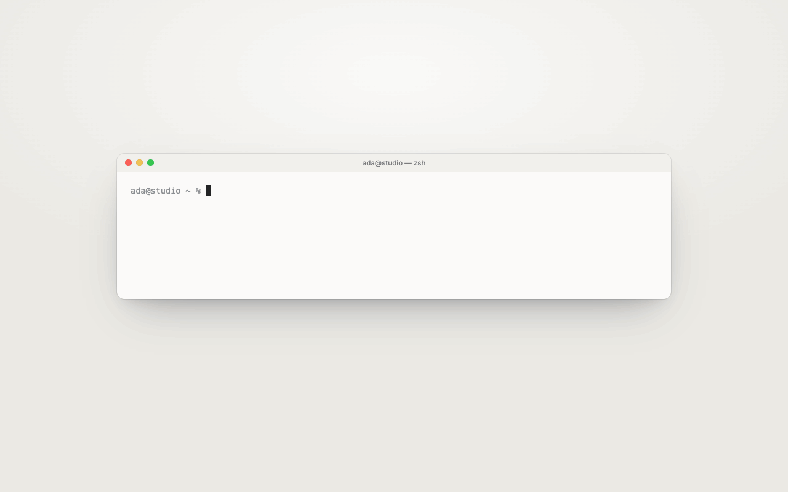
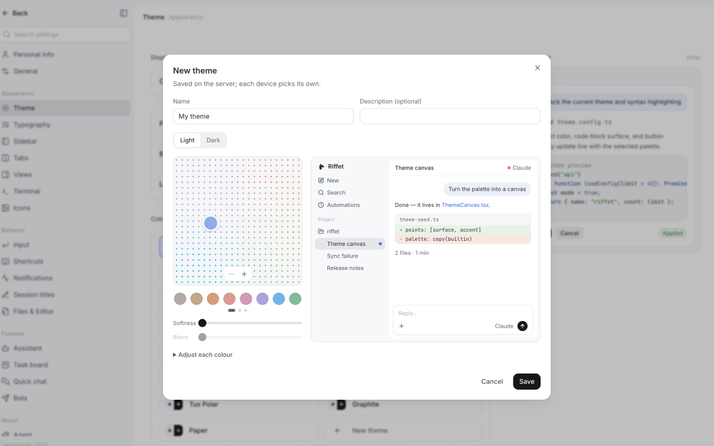

<div align="center">

<picture>
  <source media="(prefers-color-scheme: dark)" srcset="docs/brand/lockup-dark.svg">
  <source media="(prefers-color-scheme: light)" srcset="docs/brand/lockup.svg">
  
</picture>

### Keep the riff going.

A self-hosted workbench for agent CLIs. Run it on any host and continue sessions from any device.

[](https://github.com/riffable/riffet/actions/workflows/ci.yml)
[](https://github.com/riffable/riffet/releases)
[](LICENSE)

English · [简体中文](README.zh-CN.md) · [Homepage](https://riffable.github.io/riffet/) · [Plugins](https://riffable.github.io/riffet/plugins/) · [Releases](https://github.com/riffable/riffet/releases) · [Changelog](CHANGELOG.md)

</div>

<p align="center">
  <picture>
    <source media="(prefers-color-scheme: dark)" srcset="docs/assets/hero-dark.png">
    <source media="(prefers-color-scheme: light)" srcset="docs/assets/hero-light.png">
    
  </picture>
</p>

Riffet is a self-hosted workbench for agent CLIs, driving Claude Code, Codex, Cursor, Antigravity, TRAE CLI, and more. Sessions live on your own host and can be followed, steered, and continued from a browser, macOS, iPhone, or Android; linked hosts are managed together from one web workbench.

Claude Code, Codex, and other agents run independently of the server process, so restarts do not interrupt running turns, and clients resume automatically after a disconnect. Code, credentials, and history stay on your host. Riffet is open source under the Apache-2.0 license.

---

## Install

Requires macOS or Linux, Node.js 24.19+, tmux 3.2+, and at least one [supported agent CLI](#agent-matrix) installed and signed in on the host.

```bash
npm install -g riffet
riffet doctor                  # checklist for Node, tmux, the agent CLIs, port, and permissions
riffet start --workspace .     # start the background daemon and register the current repository
riffet                         # open http://127.0.0.1:4337/ in a browser
```

Upgrade with `riffet update`. Hooks and MCP depend on a fixed install path, so install globally rather than running through `npx`.

### Clients

| Component | Channel | Notes |
| :--- | :--- | :--- |
| Server and web workbench | `npm install -g riffet` | Default listener `127.0.0.1:4337`; also serves as a PWA |
| macOS app | [`Riffet.dmg` on Releases](https://github.com/riffable/riffet/releases) *(upcoming)* | macOS 15+, Apple Silicon; bundles the server runtime |
| Android app | [`APK` on Releases](https://github.com/riffable/riffet/releases) | Pairs by QR code, or by address and one-time code |
| iPhone app | Source build (`apps/mobile/iosApp`) | iOS 18+; signed with your own Apple team ID ([guide](apps/mobile/iosApp/README.md)) |

### Connect other devices

The server listens only on loopback by default. To reach it over a LAN, Tailscale, or an HTTPS proxy, restart it with authentication and generate a pairing code:

```bash
riffet restart --host 0.0.0.0 --auth
riffet pair                    # prints reachable URLs, a five-minute single-use code, and a QR code
```

The mobile apps pair by scanning the QR code; browsers and the Mac app enter the code. Tunnels and reverse proxies are covered in [Remote Access](docs/guide/remote-access.md).

### Link servers

```bash
riffet link invite             # on one server: print a link string
riffet link join <string>      # on the other: join (or paste it in Settings › Server links)
riffet link ssh devbox         # link over SSH when the ports are not reachable
```

Each server sets whether the other may operate it (off by default); removing the link on either side removes it for both. See [Server Links](docs/SERVER-LINKS.md).

<details>
<summary><strong>Build from source</strong></summary>

Requires `pnpm` in addition to Node.js `>= 24.19.0`:

```bash
git clone https://github.com/riffable/riffet.git ~/.local/src/riffet
cd ~/.local/src/riffet
pnpm install && pnpm build

mkdir -p "$HOME/.local/bin"
ln -s "$HOME/.local/src/riffet/scripts/riffet.mjs" "$HOME/.local/bin/riffet"
```

</details>

<details>
<summary><strong>CLI commands, completions, and defaults</strong></summary>

```bash
riffet                 # start the background server (if stopped) and open a browser
riffet status          # show daemon status, listen address, state directory, and available updates
riffet pair            # generate a five-minute single-use pairing code and QR code (--url for tunnels)
riffet link            # link with another server: invite, join, ssh, list, rename, remove
riffet ssh <server>    # open a shell or run a command on a linked server
riffet stop            # stop the web server; live tmux agent terminals keep running
riffet restart         # restart with the saved listener and auth settings
riffet logs -f         # tail server logs; tokens are redacted (--since, --scope)
riffet token           # print the access token to stdout (e.g. riffet token | pbcopy)
riffet url --login     # print a one-step browser login URL
riffet ls              # list conversations, this directory's project first (-a for all)
riffet resume          # continue a conversation in this terminal (searchable picker)
riffet doctor          # inspect the environment (--json for report, --compact to shrink workbench.db)
riffet service install # start at login (launchd / systemd); also status, uninstall
riffet completion zsh  # tab completion for zsh, bash, or fish
riffet update --check  # check for a newer stable release
riffet update          # update an npm install or a clean source release checkout and restore the daemon
riffet restore         # restore a verified backup into an empty state directory (--backup)
riffet plugin --help   # develop, pack, install, manage sources, and diagnose plugins
```

Defaults: `http://127.0.0.1:4337/`, Cursor executable `cursor-agent`, private state directory `~/.local/share/riffet` (`0700` directory, `0600` secrets), no token on loopback. Overrides: `--port`, `--host`, `--cli`, `--state-dir`, `--workspace`, `--allow-host`; `--port`, `--host`, `--cli`, and `--state-dir` also read `RIFFET_PORT`, `RIFFET_HOST`, `RIFFET_CLI`, and `RIFFET_STATE_DIR`.

</details>

---

## Features

### 01 · Pairing and linked servers

- **QR pairing**: connect a phone by scanning a QR code; one client can manage several servers, and every client stays in sync on the same session.
- **Linked servers**: link several servers and browse, open, and start sessions on any of them from one web workbench.
- **Remote execution**: authorize an agent to run commands on a linked machine.

<p align="center">
  <picture>
    <source media="(prefers-color-scheme: dark)" srcset="docs/assets/reel-link-dark.gif">
    <source media="(prefers-color-scheme: light)" srcset="docs/assets/reel-link-light.gif">
    
  </picture>
</p>

### 02 · Sessions and models

Riffet drives the official CLIs and keeps their own login, rules, skills, MCP servers, and subscriptions intact.

- **Agents and models**: choose the agent and model per session; common CLIs are prewarmed, so new sessions skip the cold start.
- **Mid-turn steering**: add instructions while a turn runs, or queue them for the next one.
- **Terminal interop**: import Claude Code and Codex sessions from a terminal, and hand them back at any time.
- **Custom model sources**: bring your own LLM providers over the OpenAI, Anthropic, or Google protocols or through plugins, with remaining quota shown live.
- **Switching and handoff**: switch models within a family mid-session, and hand any session off to another agent.
- **Session references**: `@` past sessions to use them as context.
- **Export and sharing**: export to PDF or create expiring read-only share links.
- **Voice input**: dictate with cloud or local speech recognition.
- **Side chats and quick chat**: select part of an answer to branch a side chat, and start quick chats outside any project.

### 03 · Agents together

- **Agent calls**: `@` another agent in a session to call it; the callee runs in its own session, open to watch and join at any time.
- **Model collaboration**: have several models debate, hold a roundtable, cross-examine, or review a document on the same question.
- **Parallel attempts**: give one task to several agents at once, each in an isolated worktree, and adopt the best result.
- **Task board**: task dependencies with automatic hand-off: a task starts once its prerequisites are accepted, and another agent can verify each delivery. The inbox gathers what needs a person.
- **Personal assistant**: a cross-project assistant with its own memory and background delegation.
- **Automations**: scheduled and recurring tasks; agents can also schedule their own wake-ups.

<p align="center">
  <picture>
    <source media="(prefers-color-scheme: dark)" srcset="docs/assets/reel-agents-dark.gif">
    <source media="(prefers-color-scheme: light)" srcset="docs/assets/reel-agents-light.gif">
    
  </picture>
</p>

### 04 · Views, files, and Git

- **Timeline**: tool calls fold automatically, edits show as diffs, subagents get their own transcripts, and diagrams and math (Mermaid, KaTeX, and more) render locally.
- **Views**: every session offers conversation, live terminal, canvas, and trace views; the trace shows each model request’s token usage and tool calls.
- **Files**: local preview for many formats, including PDF, Office, notebooks, SQLite, and 3D models, and text editing on every client.
- **Git**: line-level staging, commits, branches, pull/push, and PRs; automatic per-turn checkpoints to restore or fork from; diff comments sent back to the agent.
- **Code Studio**: Android Studio–style code reading with go to definition, find usages, and blame, no Gradle sync required.
- **Browser**: a built-in browser panel where you and the agent work on the same web page together.

<p align="center">
  <picture>
    <source media="(prefers-color-scheme: dark)" srcset="docs/assets/reel-views-dark.gif">
    <source media="(prefers-color-scheme: light)" srcset="docs/assets/reel-views-light.gif">
    
  </picture>
</p>

### 05 · Plugins

Riffet has a full plugin system covering agent backends, model sources, session views, side panels, pages, commands, themes, and IM channels. Built-in plugins run in the server process; third-party plugins run isolated by default. Public plugins are listed in the [plugin market](https://riffable.github.io/riffet/plugins/), and the [Plugin Guide](docs/PLUGINS.md) covers development.

```bash
riffet plugin dev ./my-plugin
riffet plugin pack ./my-plugin --out my-plugin.tgz
riffet plugin install my-plugin.tgz
```

| Extension point | Built-in | Official and examples |
| :--- | :--- | :--- |
| Agent backends *(experimental)* | `cursor`, `antigravity` | `example.echo` |
| Model sources | — | `riffet.litellm`, `example.gateway-models` |
| Session views | `canvas`, `trace` | — |
| Side panels | `browser` | `riffet.android`, `example.session-stats` |
| Pages | `code-studio` | `example.workbench-sample` |
| Commands | `translate` | — |
| Appearance | `avatars` | `riffet.appearance-paper`, `example.tux-theme`, `example.graphite-theme`, `example.mono-icons` |
| Sharing, IM channels, speech | `feishu`, `speech-local` | `riffet.share-s3` |

<p align="center">
  <picture>
    <source media="(prefers-color-scheme: dark)" srcset="docs/assets/reel-plugins-dark.gif">
    <source media="(prefers-color-scheme: light)" srcset="docs/assets/reel-plugins-light.gif">
    
  </picture>
</p>

### 06 · Appearance

- **Themes**: built-in palettes plus custom themes, wallpapers, and logos, with more themes available as plugins.
- **Interface styles**: switchable interface styles on macOS and Android.
- **Session layout**: manage sessions in horizontal tabs, with a side panel for each session’s plan, outline, subagents, and output files.

<p align="center">
  
</p>

---

## Agent matrix

| Agent | CLI | Structured Chat | Live TUI | Mid-Turn Steer | Subagent View | Riffet MCP & Wakeups | Per-Chat MCP / Skill Toggle | @ Session | Callable as @ Agent | Terminal Import / Resume |
| :--- | :--- | :---: | :---: | :---: | :---: | :---: | :---: | :---: | :---: | :---: |
| Claude Code | `claude` | ✓ | ✓ (`tmux`) | ✓ | ✓ | ✓ | MCP + Skills | ✓ | consult, work | ✓ |
| Codex | `codex` | ✓ | ✓ (`--remote`) | ✓ | ✓ | ✓ | MCP | ✓ | consult, work | ✓ |
| Cursor | `cursor-agent` | ✓ | ✓ (`tmux`) | ✓ | ✓ | ✓ | — | ✓ | work | — |
| Antigravity | `agy` (`1.5.6+`) | ✓ | ✓ (`tmux`) | — | ✓ | ✓ | — | ✓ | work | — |
| TRAE CLI | `traex` | ✓ | ✓ (native) | ✓ | ✓ | ✓ | MCP | ✓ | consult, work | — |
| DeepSeek Harness | `dsh` (`0.2.0-rc.2+`) | ✓ | — | — | ✓ | — | — | ✓ | work | — |
| Factory Droid | `droid` | ✓ | — | — | ✓ | ✓ | — | ✓ | work | — |
| pi | `pi` (`1.4.0+`) | ✓ | — | — | — | ✓ | — | ✓ | work | — |

**Callable as @ Agent**: `consult` is read-only; `work` runs in a new Git worktree and can edit files. Any agent with Riffet MCP can make the call.

CLI paths can be set through `RIFFET_CLI`, `CLAUDE_CLI`, `CODEX_CLI`, `DSH_CLI`, `DROID_CLI`, `TRAEX_CLI`, or `PI_CLI`, or under **Settings → Models** (including `agy`); other backends plug in through [`@riffet/plugin-api`](docs/PLUGINS.md).

---

## Reliability

| Capability | Implementation | Reference |
| :--- | :--- | :--- |
| Process isolation | Claude Code and Cursor run in Riffet-managed `tmux`, and Codex and TRAE CLI in a separate app-server, so a server restart does not interrupt their turns; Droid, pi, and DeepSeek Harness exit with the server. | [Delivery](docs/DELIVERY.md) |
| At-most-once delivery | Each session’s inputs are queued serially and confirmed by a transcript or hook receipt from the agent; unconfirmed messages are not resent after a crash. | `apps/server/src/native/dispatch.property.test.ts` |
| Resumable sync | Rows and the sync cursor commit in one transaction; clients resume from their cursor with no gaps or duplicates. | [Sync](docs/SYNC-V3.md) |
| CLI regression detection | Real CLI sessions are recorded and replayed in tests; `pnpm record <cli> all --check` re-records with the installed version and compares. | `scripts/record.ts` |
| Integrity checks and restore | The journal is append-only; database integrity is checked at startup, `riffet doctor` reports missing and orphaned data, and checksummed backups restore with `riffet restore`. | [Operations](docs/guide/operations.md) |
| Resource limits | Limits for caches, storage, and CLI processes are defined in one place and shared with the mobile apps; idle CLIs are reclaimed by last use and a memory budget. | [Performance](docs/guide/performance.md) |

---

## How the clients differ

The web client has the full feature set and installs as a PWA; linked servers, agent calls, model collaboration, the task board, trace, and Code Studio are currently web-only.

- **macOS**: native SwiftUI + AppKit app with a bundled server, menu bar approvals, Shortcuts, widgets, and Spotlight; once authorized, agents can capture windows, use the clipboard, and post notifications.
- **iPhone**: native SwiftUI app with approvals and replies from push notifications (bring your own APNs key), widgets, and a terminal.
- **Android**: Kotlin Multiplatform + Compose app with a touch terminal; with per-session authorization and biometric confirmation, agents can operate the phone (preview).

---

## Architecture

Riffet is a single-node server between its clients and the agent CLIs installed on the same host. A command takes one path to the agent; what the agent does returns on another, folded into rows that every client renders alike.

<p align="center">
  <picture>
    <source media="(prefers-color-scheme: dark)" srcset="docs/assets/architecture/system-dark.svg">
    <source media="(prefers-color-scheme: light)" srcset="docs/assets/architecture/system-light.svg">
    
  </picture>
</p>

Design principles:

1. **The vendor CLI is the agent.** Riffet drives the installed program through its own interface and does not reimplement it.
2. **One session model.** Differences between agents end at the driver contract; nothing above it names a vendor.
3. **Commands and observations are separate paths.** A message is delivered when its receipt is observed, not when it was written.
4. **The journal is the source of truth.** Timeline, status, usage, and search are projections of it.
5. **The server folds, clients render.** Every client resumes from a cursor and receives the same rows.
6. **Single node.** One process with embedded SQLite (three databases and a blob store) and one user; no external service is required. Linked servers are peers and share no data.
7. **Dependencies point inward.** Client-facing layers and drivers depend on the core, never the reverse; optional capability arrives as a plugin.

Each subsystem, the import layering, and the runtime topology (processes, files, interfaces) have a figure of their own in [docs/guide/architecture.md](docs/guide/architecture.md).

---

## Development

```bash
pnpm dev               # API server on :4317
pnpm dev:web           # Vite web workbench on :5173
pnpm typecheck
pnpm test
pnpm check:plugins
pnpm build
```

Native clients live in `apps/macos` and `apps/mobile`:

```bash
# Shared Kotlin Multiplatform & Android JVM tests (JDK 21+ and Android SDK)
cd apps/mobile
./gradlew :contracts:jvmTest :core:jvmTest :terminal:jvmTest :client:jvmTest :shared:jvmTest

# Native macOS app (macOS 15+, Xcode 26, JDK 17+, XcodeGen)
cd apps/macos
./scripts/build.sh dev        # build, install to build/Release, and relaunch
./scripts/release.sh          # build signed & notarized DMG
```

The checks to run before opening a pull request, and the npm packaging steps, are in [CONTRIBUTING.md](CONTRIBUTING.md).

## Documentation

Design and operations documents under `docs/` are written mainly in Chinese:

- **Guides**: [Conversations, Models & Sessions](docs/guide/conversation.md) · [Cursor CLI & Custom Gateways](docs/guide/cursor.md) · [Workspace, Previews & Git](docs/guide/workspace.md) · [Remote Access](docs/guide/remote-access.md) · [Operations & Deployment](docs/guide/operations.md) · [Architecture](docs/guide/architecture.md) · [Release & Distribution](docs/RELEASE.md)
- **Workflows**: [Personal Assistant](docs/ASSISTANT.md) · [Task Board](docs/TASK-BOARD.md) · [Review & Orchestration](docs/ORCHESTRATION.md) · [Agent Calls](docs/AGENT-CALLS.md) · [Mid-Turn Steering](docs/STEER.md) · [Side Chats](docs/DISCUSSIONS.md) · [Quick Chat](docs/QUICK-CHAT.md) · [Bookmarks & Highlights](docs/MARKS.md) · [Session Sharing & PDF](docs/SHARES.md) · [Usage & Throughput Stats](docs/STATS.md)
- **Surfaces & Channels**: [Design System](docs/design/system/README.md) · [Web](docs/WEB.md) · [macOS](docs/MACOS.md) · [Android & Mobile](docs/MOBILE.md) · [iPhone](docs/IOS.md) · [Mobile Terminal](docs/MOBILE-TERMINAL.md) · [IM Channels](docs/design/channels.md) · [Riffet Browser](docs/BROWSER.md) · [Code Studio](docs/CODE-STUDIO.md) · [Trace](docs/TRACE.md) · [Voice Input](docs/VOICE.md) · [Devices & Riffet MCP](docs/DEVICES.md) · [Server Links](docs/SERVER-LINKS.md) · [Themes](docs/THEMES.md)
- **Extensibility & Ops**: [Extensions](docs/EXTENSIONS.md) · [Plugin Guide](docs/PLUGINS.md) · [Plugin Architecture](docs/PLUGIN_ARCHITECTURE.md) · [Antigravity CLI](docs/ANTIGRAVITY.md) · [TRAE CLI](docs/TRAEX.md) · [pi RPC](docs/PI.md) · [Updates](docs/UPDATE.md) · [Delivery](docs/DELIVERY.md) · [Sync](docs/SYNC-V3.md) · [Security Model](docs/SECURITY.md)

## Acknowledgements and license

Visual design draws inspiration from [ZCode](https://github.com/zai-org/ZCode) and [DeepSeek Harness](https://github.com/deepseek-ai/deepseek-harness); the DSH backend bridge adapts portions of DeepSeek Harness's MIT-licensed native interfaces with upstream notices preserved alongside the code.

Licensed under [Apache-2.0](LICENSE). Third-party notices are listed in [NOTICE](NOTICE); security vulnerabilities are reported privately as described in [SECURITY.md](SECURITY.md).
