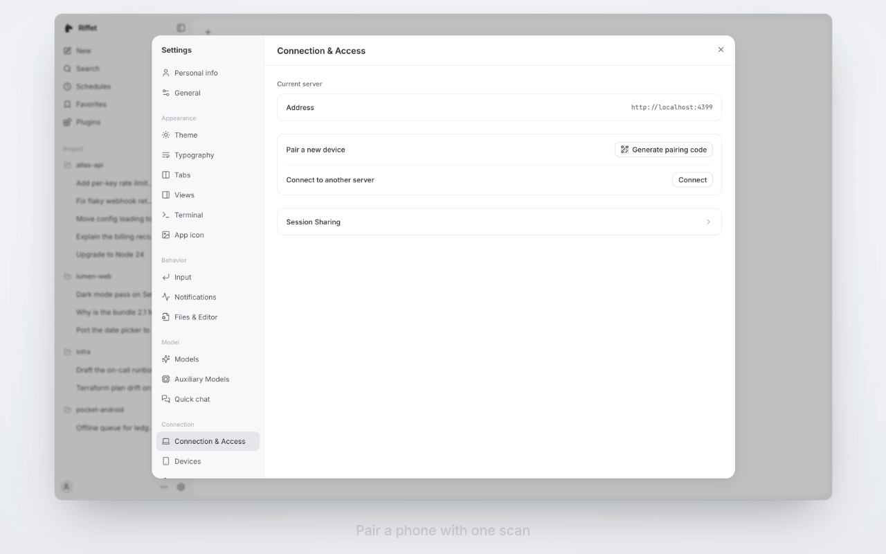
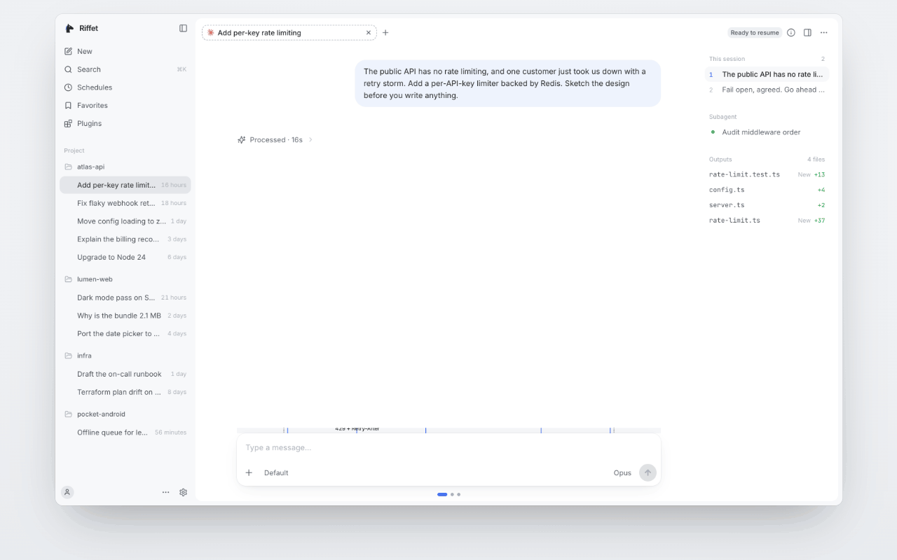
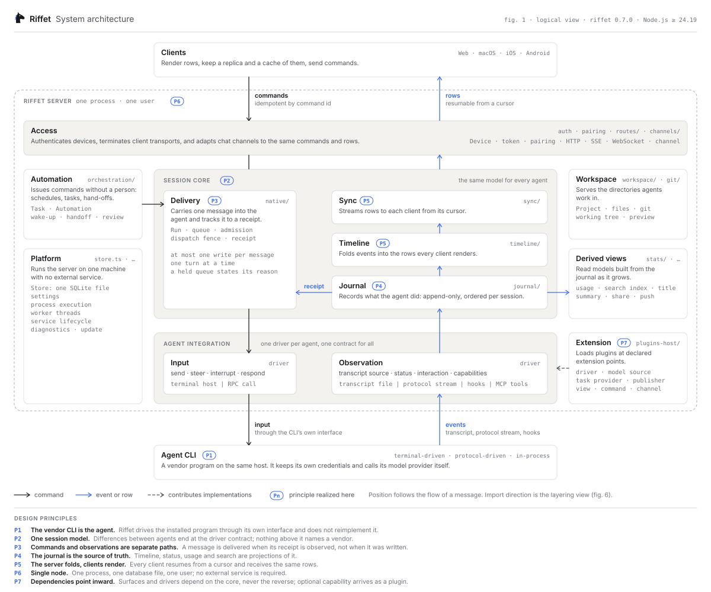

<div align="center">

<picture>
  <source media="(prefers-color-scheme: dark)" srcset="docs/brand/lockup-dark.svg">
  <source media="(prefers-color-scheme: light)" srcset="docs/brand/lockup.svg">
  
</picture>

### Keep the riff going.

A self-hosted workbench for agent CLIs.

[](https://github.com/riffable/riffet/actions/workflows/ci.yml)
[](https://github.com/riffable/riffet/releases)
[](LICENSE)

English · [简体中文](README.zh-CN.md) · [Homepage](https://riffable.github.io/riffet/) · [Plugins](https://riffable.github.io/riffet/plugins/) · [Releases](https://github.com/riffable/riffet/releases) · [Changelog](CHANGELOG.md)

**8** agent CLIs · **5** clients (`Web`, `macOS`, `iPhone`, `Android`, `Feishu`) · **Local** journal · **Plugin** SDK

</div>

<p align="center">
  <picture>
    <source media="(prefers-color-scheme: dark)" srcset="docs/assets/hero-dark.png">
    <source media="(prefers-color-scheme: light)" srcset="docs/assets/hero-light.png">
    
  </picture>
</p>

Riffet is a self-hosted workbench that drives the agent CLIs installed on a macOS or Linux host. Sessions stay on the host and can be started, read, steered, and resumed from any connected client: the web workbench, the native macOS, iPhone, and Android apps, or a Feishu / Lark bot.

- **Agents.** Riffet drives the official CLIs (Claude Code, Codex, Cursor, Antigravity, TRAE CLI, Factory Droid, DeepSeek Harness, pi) and reads each CLI’s native session store in place. Capabilities per agent are listed in the [agent matrix](#agent-matrix).
- **Data.** Code, terminals, credentials, and history stay on the server. Clients connect to it directly.
- **License.** Apache-2.0. Every feature is in the open-source build.

---

## Install

Requires **macOS or Linux**, **Node.js `>= 24.19.0`**, **`tmux >= 3.2`** (for Cursor, Claude Code, Antigravity, and live terminal views), and at least one [supported agent CLI](#agent-matrix) installed and signed in on the host.

```bash
npm install -g riffet
riffet doctor                  # checklist for Node, tmux, the agent CLIs, port, and permissions
riffet start --workspace .     # start the background daemon and register the current repository
riffet                         # open http://127.0.0.1:4337/ in a browser
```

Upgrade an npm install with `riffet update` (or `npm i -g riffet@latest && riffet restart`). Do not run it through `npx`: hook and MCP paths must stay fixed.

### Clients

| Component | Channel | Notes |
| :--- | :--- | :--- |
| Server and web workbench | `npm install -g riffet` | Default listener `127.0.0.1:4337`; also serves as a PWA |
| macOS app | [`Riffet.dmg` on Releases](https://github.com/riffable/riffet/releases) *(upcoming)* | macOS 15+, Apple Silicon; bundles the server runtime |
| Android app | [`APK` on Releases](https://github.com/riffable/riffet/releases) | Pairs by QR code, or by address and one-time code |
| iPhone app | Source build (`apps/mobile/iosApp`) | iOS 18+; signed with your own Apple team ID ([guide](apps/mobile/iosApp/README.md)) |
| Feishu / Lark bot | Built into the server | Configured under **Settings → Features → Bots** (outbound WebSocket, no public IP needed) |

### Connect other devices

The server listens on `127.0.0.1` by default. To reach it from other devices over a LAN, Tailscale / VPN, or an HTTPS proxy:

```bash
riffet restart --host 0.0.0.0 --auth
riffet pair                    # prints reachable URLs, a five-minute single-use code, and a QR code
```

The iPhone and Android apps scan the QR code; a remote browser or the Mac app takes the code. `--allow-host` and `riffet pair --url` for tunnels are covered in [Remote Access](docs/guide/remote-access.md).

<details>
<summary><strong>Build from source</strong></summary>

Requires `pnpm` in addition to Node.js `>= 24.19.0`:

```bash
git clone https://github.com/riffable/riffet.git ~/.local/src/riffet
cd ~/.local/src/riffet
pnpm install && pnpm build

mkdir -p "$HOME/.local/bin"
ln -s "$HOME/.local/src/riffet/scripts/riffet.mjs" "$HOME/.local/bin/riffet"
```

</details>

<details>
<summary><strong>CLI commands, completions, and defaults</strong></summary>

```bash
riffet                 # start the background server (if stopped) and open a browser
riffet status          # show daemon status, listen address, state directory, and available updates
riffet pair            # generate a five-minute single-use pairing code and QR code (--url for tunnels)
riffet stop            # stop the web server; live tmux agent terminals keep running
riffet restart         # restart with the saved listener and auth settings
riffet logs -f         # tail server logs; tokens are redacted (--since, --scope)
riffet token           # print the access token to stdout (e.g. riffet token | pbcopy)
riffet url --login     # print a one-step browser login URL
riffet ls              # list conversations, this directory's project first (-a for all)
riffet resume          # continue a conversation in this terminal (searchable picker)
riffet doctor          # inspect the environment (--json for report, --compact to shrink workbench.db)
riffet service install # start at login (launchd / systemd); also status, uninstall
riffet completion zsh  # tab completion for zsh, bash, or fish
riffet update --check  # check for a newer stable release
riffet update          # update an npm install or a clean source release checkout and restore the daemon
riffet restore         # restore a verified backup into an empty state directory (--backup)
riffet plugin --help   # develop, pack, install, manage sources, and diagnose plugins
```

Defaults: `http://127.0.0.1:4337/`, default backend `cursor-agent`, private state directory `~/.local/share/riffet` (`0700` directory, `0600` secrets), no token on loopback. Overrides: `--port`, `--host`, `--cli`, `--state-dir`, `--workspace`, `--allow-host`; `--port`, `--host`, `--cli`, and `--state-dir` also read `RIFFET_PORT`, `RIFFET_HOST`, `RIFFET_CLI`, and `RIFFET_STATE_DIR`.

</details>

---

## Agent matrix

| Agent | CLI | Structured Chat | Live TUI | Mid-Turn Steer | Subagent View | Riffet MCP & Wakeups | Per-Chat MCP / Skill Toggle | @ Session | Terminal Import / Resume |
| :--- | :--- | :---: | :---: | :---: | :---: | :---: | :---: | :---: | :---: |
| **Cursor** | `cursor-agent` | ✓ | ✓ (`tmux`) | ✓ | ✓ | — | — | — | — |
| **Claude Code** | `claude` | ✓ | ✓ (`tmux`) | ✓ | ✓ | ✓ | MCP + Skills | ✓ | ✓ |
| **Codex** | `codex` | ✓ | ✓ (`--remote`) | ✓ | ✓ | ✓ | MCP | ✓ | ✓ |
| **Antigravity** | `agy` (`1.5.6+`) | ✓ | ✓ (`tmux`) | — | ✓ | ✓ | — | ✓ | — |
| **TRAE CLI** | `traex` | ✓ | ✓ (native) | ✓ | ✓ | ✓ | MCP | — | — |
| **DeepSeek Harness** | `dsh` (`0.2.0-rc.2+`) | ✓ | — | — | ✓ | — | — | — | — |
| **Factory Droid** | `droid` | ✓ | — | — | ✓ | ✓ | — | — | — |
| **pi** | `pi` (`1.4.0+`) | ✓ | — | — | — | ✓ | — | — | — |

CLI paths are configured with `RIFFET_CLI`, `CLAUDE_CLI`, `CODEX_CLI`, `DSH_CLI`, `DROID_CLI`, `TRAEX_CLI`, or `PI_CLI`, or per profile under **Settings → Models** (including `agy`). Other backends, model sources, views, and themes are added as plugin packages built with [`@riffet/plugin-api`](docs/PLUGINS.md).

---

## Workbench and workflows

### 01 · Pairing and multi-client sync

A host runs on a Mac, a Linux machine, or a cloud VM—started manually, via `launchd` / `systemd`, or bundled inside the macOS app. A phone pairs by scanning one QR code (`riffet pair`), browsers and Mac take the single-use code, and apps store multiple servers to switch between. Every connected client shares the same transcript, unread state, and running turns across server restarts.

<p align="center">
  <picture>
    <source media="(prefers-color-scheme: dark)" srcset="docs/assets/reel-connect-dark.gif">
    <source media="(prefers-color-scheme: light)" srcset="docs/assets/reel-connect-light.gif">
    
  </picture>
</p>

### 02 · Sessions, steering, and parallel attempts

- **Official CLI environment.** Each session picks its agent and model; the CLI’s login, rules, skills, MCP servers, and subscription apply unchanged. Idle CLI processes are reclaimed by last use and a configurable memory budget.
- **Terminal import and hand-back.** A Claude Code or Codex session started in a terminal can be imported into Riffet and returned with **Resume in terminal** or `riffet resume`. One side writes at a time, so the transcript does not interleave.
- **Parallel attempts.** One prompt can be sent to 2–4 agents or models at once. Each attempt runs in its own Git worktree (or a shadow repository outside Git); changes are compared side by side and one is adopted. *(Web, macOS)*
- **Mid-turn steering.** Additional instructions can be sent while a turn is running without `Ctrl+C`, or queued for the next turn.
- **Side threads and quick chat.** Selected passages can branch into side threads out of the main timeline *(Web)*. Standalone questions go straight to a model with web search and attachments (`⌃⌥Space` on macOS; tile, share sheet, or text selection on Android). *(Web, macOS, iPhone, Android)*

<p align="center">
  <picture>
    <source media="(prefers-color-scheme: dark)" srcset="docs/assets/reel-start-dark.gif">
    <source media="(prefers-color-scheme: light)" srcset="docs/assets/reel-start-light.gif">
    
  </picture>
</p>

### 03 · Personal assistant, task board, and automations

- **Personal assistant.** A persistent cross-project assistant with its own page, memory (`USER.md` and topic notes), instructions, capability packs, and background delegations (`/new` starts a fresh thread). Isolated on Claude Code or Codex so your project rules and MCP servers stay untouched. *(Web, macOS, iPhone, Android, Feishu DM)*
- **Task board.** Conversations can belong to tasks started from one sentence with optional completion criteria and status tracking; an inbox collects only items waiting for approval, questions, or acceptance. *(Web, macOS, iPhone, Android)*
- **Automations.** Prompts run on demand or on a cron schedule, keeping the last 50 runs; agents can also schedule their own wake-ups.

### 04 · Timeline, browser, files, and Git

- **Timeline and selection toolbar.** Tool calls fold into one line, edits open as diffs, subagents have their own transcript, and goals appear across clients. Mermaid, D2, Graphviz, PlantUML, and Vega-Lite diagrams render locally with KaTeX math and selectable code themes. Selecting text opens a floating toolbar to quote into the composer, start a side chat, highlight with a color, export an image, or run plugin actions such as **Translate**.
- **Views and search.** Sessions switch between the timeline, live terminal, or a canvas laying out each turn with its commands and files *(Canvas: Web, macOS)*. `⌘K` searches across sessions; in-conversation find searches within the active transcript.
- **Managed browser.** The built-in browser plugin (`riffet.browser`) drives Chromium via `playwright-core`, streaming live frames to a side panel where the user and agent operate the page together with explicit handoff for sign-in or payment. *(Web, macOS)*
- **File preview and Git.** More than 20 file types preview locally (sandboxed HTML, PDF, Office, Jupyter notebooks, SQLite, 3D models). The Git panel supports history, line-level staging, commit, branch switching, pull/push, PR creation via `gh`, per-turn checkpoints to restore or fork from, and diff-line review comments *(Web, macOS, iPhone, Android)*.

<p align="center">
  <picture>
    <source media="(prefers-color-scheme: dark)" srcset="docs/assets/reel-session-dark.gif">
    <source media="(prefers-color-scheme: light)" srcset="docs/assets/reel-session-light.gif">
    
  </picture>
</p>

### 05 · Models, references, handoff, and export

- **Providers and quota.** Add providers by endpoint, key, and protocol (OpenAI Chat Completions / Responses, Anthropic Messages, Google Generative AI) or via model-source plugins. The model picker shows Codex and model-source quota; each session tracks context window usage. Auxiliary models can be assigned separately for titles, quick chat, handoff summaries, canvas summaries, and plugins.
- **Switching and handoff.** Sessions switch in place across compatible providers of the same model family, or hand off to another agent with a structured summary.
- **References, favorites, and export.** `@` cites an earlier session via a read-only transcript snapshot *(Claude Code, Codex, Antigravity)*. Favorites save highlighted passages, replies, images, and files as self-contained snapshots *(Web, macOS)*. Any session can be exported as a PDF or published as an expiring read-only link through a share plugin *(Web, macOS)*.

### 06 · Plugins and appearance

- **Plugins.** Built-in plugins (`cursor`, `antigravity`, `canvas`, `browser`, `avatars`, `translate`) run in-process; installed packages run isolated by default ([Plugin Architecture](docs/PLUGIN_ARCHITECTURE.md)). Plugins contribute agent backends *(experimental)*, model sources, workbench views, project tasks, message/selection menu commands, share publishers, palettes, icon packs, and fonts. Multiple plugin sources are supported with installs pinned to their source; public packages are indexed in the [plugin market](https://riffable.github.io/riffet/plugins/).

```bash
riffet plugin dev ./my-plugin
riffet plugin pack ./my-plugin --out my-plugin.tgz
riffet plugin install my-plugin.tgz
```

- **Tabs, aside, and themes.** Sessions open as tabs alongside an aside showing the plan, outline, subagents, background tasks, and output files *(Tabs: Web, and macOS in the Riffet style)*. Twelve built-in palettes and a live theme editor pair with replaceable icon packs and platform interface styles (`Native`, `Riffet`, `Line` on macOS; `Material 3`, `iOS`, `Expressive`, `Miuix`, `Fluent` on Android).

<p align="center">
  <picture>
    <source media="(prefers-color-scheme: dark)" srcset="docs/assets/reel-shape-dark.gif">
    <source media="(prefers-color-scheme: light)" srcset="docs/assets/reel-shape-light.gif">
    
  </picture>
</p>

---

## Clients

- **Web.** Complete workbench served by the Riffet server, with desktop tabs, mobile layout, and PWA support.
- **macOS.** Native SwiftUI + AppKit app with a bundled server, native canvas, menu bar status and approvals, Shortcuts, widgets, and Spotlight integration.
- **iPhone.** Native SwiftUI app built on the shared client core with push notifications, diffs, remote file browsing, Git panel, and a terminal.
- **Android.** Kotlin Multiplatform + Compose app with five interface styles, a touch terminal, Git panel, and quick chat from system entry points. In preview: an agent on the server can read and operate the phone, gated by a per-session switch and biometric confirmation on the device.
- **Feishu / Lark.** Outbound WebSocket connection with no public IP, domain, or tunnel required. Starts or continues project sessions in DMs or group topics, answers approvals in chat, and exposes the personal assistant in DMs.

---

## Architecture

Riffet is a single-node server between its clients and the agent CLIs installed on the same host. A command takes one path to the agent; what the agent does returns on another, folded into rows that every client renders alike.

<p align="center">
  <picture>
    <source media="(prefers-color-scheme: dark)" srcset="docs/assets/architecture/system-dark.svg">
    <source media="(prefers-color-scheme: light)" srcset="docs/assets/architecture/system-light.svg">
    
  </picture>
</p>

Design principles:

1. **The vendor CLI is the agent.** Riffet drives the installed program through its own interface and does not reimplement it.
2. **One session model.** Differences between agents end at the driver contract; nothing above it names a vendor.
3. **Commands and observations are separate paths.** A message is delivered when its receipt is observed, not when it was written.
4. **The journal is the source of truth.** Timeline, status, usage, and search are projections of it.
5. **The server folds, clients render.** Every client resumes from a cursor and receives the same rows.
6. **Single node.** One process, one database file, one user; no external service is required.
7. **Dependencies point inward.** Surfaces and drivers depend on the core, never the reverse; optional capability arrives as a plugin.

| Subsystem | Responsibility | Code |
| :--- | :--- | :--- |
| Clients | Render rows, keep a replica and a cache of them, send commands | `apps/web`, `apps/mobile`, `apps/macos` |
| Access | Authenticates devices, terminates HTTP, SSE, and WebSocket, adapts chat channels | `apps/server/src/auth.ts`, `apps/server/src/routes`, `apps/server/src/channels` |
| Session core: Delivery | Queues a message, admits one turn at a time, writes it at most once, tracks it to a receipt | `apps/server/src/native` |
| Session core: Journal | Append-only event log, ordered per session | `apps/server/src/journal` |
| Session core: Timeline | Folds events into the rows clients render | `apps/server/src/timeline`, `packages/timeline` |
| Session core: Sync | Streams rows to each client from its cursor | `apps/server/src/sync` |
| Agent integration | One driver per agent behind one contract; terminal host, hook bridge, tool bridge | `apps/server/src/backends`, `apps/server/src/terminal`, `apps/server/src/riffet-mcp` |
| Automation & Assistant | Personal assistant, task board, schedules, and hand-offs | `apps/server/src/assistant`, `apps/server/src/work-items`, `apps/server/src/orchestration`, `apps/server/src/tasks` |
| Workspace | Files, git, and working trees of the directories agents work in | `apps/server/src/workspace`, `apps/server/src/git` |
| Derived views | Read models built from the journal: usage, search index, titles, shares | `apps/server/src/stats`, `apps/server/src/search`, `apps/server/src/shares` |
| Extension | Loads plugins at declared extension points; installed packages run isolated | `apps/server/src/plugins-host`, `packages/plugin-api` |
| Platform | SQLite store, settings, process execution, service lifecycle | `apps/server/src/store.ts`, `apps/server/src/exec.ts` |

Each subsystem, the import layering, and the runtime topology (processes, files, interfaces) have a figure of their own in [docs/guide/architecture.md](docs/guide/architecture.md).

---

## Development

```bash
pnpm dev               # API server on :4317
pnpm dev:web           # Vite web workbench on :5173
pnpm typecheck
pnpm test
pnpm check:plugins
pnpm build
```

Native clients live in `apps/macos` and `apps/mobile`:

```bash
# Shared Kotlin Multiplatform & Android JVM tests (JDK 21+ and Android SDK)
cd apps/mobile
./gradlew :contracts:jvmTest :core:jvmTest :terminal:jvmTest :client:jvmTest :shared:jvmTest

# Native macOS app (macOS 15+, Xcode 26, JDK 17+, XcodeGen)
cd apps/macos
./scripts/build.sh dev        # build, install to build/Release, and relaunch
./scripts/release.sh          # build signed & notarized DMG
```

Automated tests follow [AGENTS.md](AGENTS.md): a test is added only when necessary, and tests cover authentication, data isolation, protocol contracts, idempotency, persistence, concurrency, and failure recovery, not UI snapshots or styling. The checks to run before opening a pull request are in [CONTRIBUTING.md](CONTRIBUTING.md).

## Documentation

Design and operations documents under `docs/` are written mainly in Chinese:

- **Guides**: [Conversations, Models & Sessions](docs/guide/conversation.md) · [Cursor CLI & Custom Gateways](docs/guide/cursor.md) · [Workspace, Previews & Git](docs/guide/workspace.md) · [Remote Access](docs/guide/remote-access.md) · [Operations & Deployment](docs/guide/operations.md) · [Architecture](docs/guide/architecture.md) · [Release & Distribution](docs/RELEASE.md)
- **Workflows**: [Personal Assistant](docs/ASSISTANT.md) · [Task Board](docs/TASK-BOARD.md) · [Review & Orchestration](docs/ORCHESTRATION.md) · [Mid-Turn Steering](docs/STEER.md) · [Side Chats](docs/DISCUSSIONS.md) · [Quick Chat](docs/QUICK-CHAT.md) · [Bookmarks & Highlights](docs/MARKS.md) · [Session Sharing & PDF](docs/SHARES.md) · [Usage & Throughput Stats](docs/STATS.md)
- **Surfaces & Channels**: [Design System](docs/design/system/README.md) · [Web](docs/WEB.md) · [macOS](docs/MACOS.md) · [Android & Mobile](docs/MOBILE.md) · [iPhone](docs/IOS.md) · [Mobile Terminal](docs/MOBILE-TERMINAL.md) · [Feishu / IM Channels](docs/design/channels.md) · [Riffet Browser](docs/BROWSER.md) · [Devices & Riffet MCP](docs/DEVICES.md) · [Server Links](docs/SERVER-LINKS.md) · [Themes](docs/THEMES.md)
- **Extensibility & Ops**: [Extensions](docs/EXTENSIONS.md) · [Plugin Guide](docs/PLUGINS.md) · [Plugin Architecture](docs/PLUGIN_ARCHITECTURE.md) · [Antigravity CLI](docs/ANTIGRAVITY.md) · [TRAE CLI](docs/TRAEX.md) · [pi RPC](docs/PI.md) · [Updates](docs/UPDATE.md) · [Security Model](docs/SECURITY.md)

## Acknowledgements and license

Visual design draws inspiration from [ZCode](https://github.com/zai-org/ZCode) and [DeepSeek Harness](https://github.com/deepseek-ai/deepseek-harness); the DSH backend bridge adapts portions of DeepSeek Harness's MIT-licensed native interfaces with upstream notices preserved alongside the code.

Licensed under [Apache-2.0](LICENSE). Third-party notices are listed in [NOTICE](NOTICE); security vulnerabilities are reported privately as described in [SECURITY.md](SECURITY.md).
