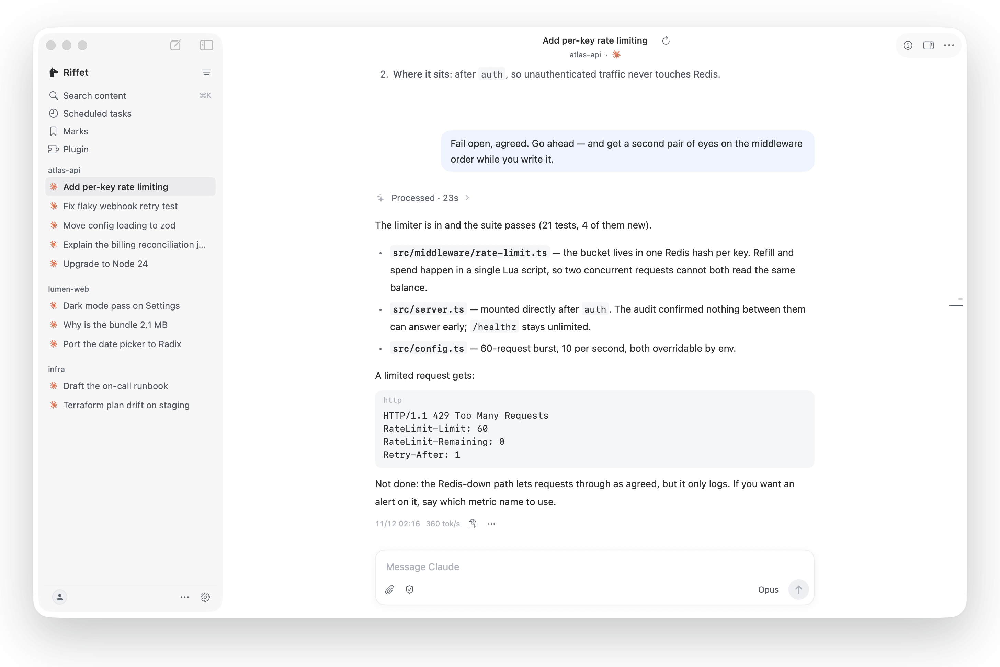
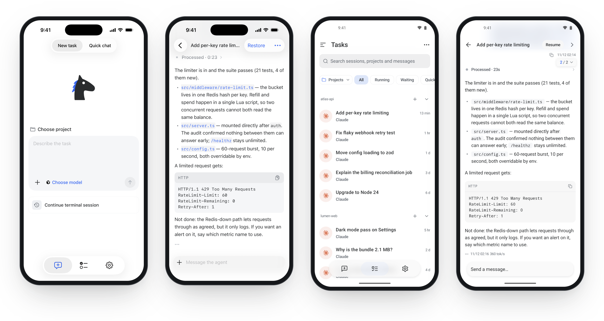
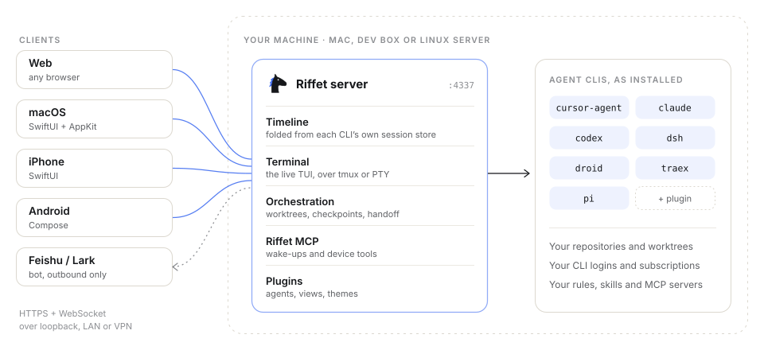

<div align="center">

<picture>
  <source media="(prefers-color-scheme: dark)" srcset="docs/brand/lockup-dark.svg">
  <source media="(prefers-color-scheme: light)" srcset="docs/brand/lockup.svg">
  
</picture>

### Keep the riff going.

A self-hosted workbench for Claude Code, Codex, Cursor, pi, and more.

[](https://github.com/riffetai/riffet/actions/workflows/ci.yml)
[](https://github.com/riffetai/riffet/releases)
[](LICENSE)

English · [简体中文](README.zh-CN.md) · [Releases](https://github.com/riffetai/riffet/releases) · [Issues](https://github.com/riffetai/riffet/issues) · [Discussions](https://github.com/riffetai/riffet/discussions) · [Changelog](CHANGELOG.md)

</div>

<p align="center">
  <picture>
    <source media="(prefers-color-scheme: dark)" srcset="docs/assets/hero-dark.png">
    <source media="(prefers-color-scheme: light)" srcset="docs/assets/hero-light.png">
    
  </picture>
</p>

Riffet is a self-hosted workbench for the agent CLIs you already use and pay for. Run `riffet` on your Mac, a dev box, or a headless Linux server: your code, terminals, credentials, and history stay on that machine, and every session becomes a durable workspace you can open from a browser, the native macOS, iPhone, and Android apps, or a Feishu / Lark bot.

A terminal tab runs one CLI in one checkout and goes out of reach when you close the laptop. Cloud agent platforms ask you to move your repositories, pay a second subscription, or give up your local tools. Riffet does neither: Apache-2.0, no cloud relay, no feature paywall.

## A 40-second tour

<p align="center">
  <picture>
    <source media="(prefers-color-scheme: dark)" srcset="docs/assets/demo-dark.gif">
    <source media="(prefers-color-scheme: light)" srcset="docs/assets/demo-light.gif">
    
  </picture>
</p>

<!-- A sharper .mp4 of this walkthrough can replace the GIF: upload it into any GitHub issue or PR body and paste the https://github.com/user-attachments/assets/<uuid> URL on a line of its own. -->

## What you get

### The real CLIs, made readable

Riffet drives the official CLIs (`claude`, `codex`, `cursor-agent`, `pi`, and [others](#agent-matrix)) and reads their native session stores in place. Your CLI logins, rules, skills, and MCP servers keep working, and you keep editing in your own IDE.

- **A timeline you can read.** Consecutive tool calls fold into one line, and each edit opens as a diff. Subagents get their own transcript. Mermaid, D2, Graphviz, PlantUML, and Vega-Lite diagrams render locally, alongside KaTeX math and syntax highlighting for 45 languages.
- **The live terminal, one click away.** For TUI-backed agents, switch between the structured conversation and the real terminal (`tmux` or `codex --remote`). Close the browser or sleep the laptop and sessions keep running on the host.

<p align="center">
  <picture>
    <source media="(prefers-color-scheme: dark)" srcset="docs/assets/timeline-dark.png">
    <source media="(prefers-color-scheme: light)" srcset="docs/assets/timeline-light.png">
    
  </picture>
</p>

### Review and ship where the agent worked

- **Comment on the diff.** Click a line number in any change, write what should be different, and the comments go back to the agent together.
- **Race 2–4 agents.** Send one prompt to several backends or models. Each attempt runs in its own Git worktree (or a shadow repo for non-Git folders), so you can compare the file matrix side by side and adopt the winner.
- **Hand off and roll back.** Hit a rate limit or want a second opinion? Hand an idle conversation to another backend with a structured summary, fork from any turn, or restore one of the automatic per-turn checkpoints.
- **Preview, then open the PR.** More than 20 file types preview locally, including PDF, Office documents, Jupyter notebooks, SQLite, 3D models, and archives. Push the branch, open the GitHub PR, and check CI through `gh`.

<p align="center">
  <picture>
    <source media="(prefers-color-scheme: dark)" srcset="docs/assets/review-dark.png">
    <source media="(prefers-color-scheme: light)" srcset="docs/assets/review-light.png">
    
  </picture>
</p>

### Native on every screen, and a bot with no webhook

- **macOS**. A native app that bundles the server runtime, so it opens ready to work with no pairing, stays in the menu bar, and takes a quick prompt from anywhere with `⌃⌥Space`.
- **iPhone** and **Android**. Scan a QR code to pair, switch between servers, answer permission prompts, read diffs, browse remote directories, or open a touch terminal.
- **Feishu / Lark bot.** It connects outbound from your server over WebSocket, so it needs no public IP, domain, or tunnel. Start or continue a project conversation in a DM or a group topic, watch progress cards update, and approve actions in the chat.

<p align="center">
  <picture>
    <source media="(prefers-color-scheme: dark)" srcset="docs/assets/mac-dark.png">
    <source media="(prefers-color-scheme: light)" srcset="docs/assets/mac-light.png">
    
  </picture>
</p>

<p align="center">
  <picture>
    <source media="(prefers-color-scheme: dark)" srcset="docs/assets/devices-dark.png">
    <source media="(prefers-color-scheme: light)" srcset="docs/assets/devices-light.png">
    
  </picture>
</p>

### Stay in the turn

- **Steer a running turn.** Add an instruction to Claude Code, Codex, Cursor, or TRAE CLI while it works, without `Ctrl+C` and without losing the tool calls already done. Or queue it for the next turn.
- **Side chats.** Select a paragraph of an answer to ask about it in a side thread that inherits the conversation’s context and stays out of the main timeline. Bring the conclusion back into your draft when you have it.
- **Quick chat and bookmarks.** Ask a question that belongs to no project, with web search and attachments. Highlight passages and bookmark images or files; each keeps its own snapshot and outlives the session it came from.

### Your phone as a tool *(Android preview)*

An agent on your server can read the screen of a paired Android phone, tap and type on it, send you a notification, or schedule a one-shot wake-up of its own conversation (“check the deployment again in 20 minutes”). Two switches gate this: a per-session toggle, and a biometric opt-in on the phone.

## How it fits together

<p align="center">
  <picture>
    <source media="(prefers-color-scheme: dark)" srcset="docs/assets/architecture-dark.svg">
    <source media="(prefers-color-scheme: light)" srcset="docs/assets/architecture.svg">
    
  </picture>
</p>

Clients hold no agent and no code. Loopback is the default; reach the server from other devices over your LAN, a VPN, or an HTTPS proxy.

---

## Agent Matrix

| Agent | CLI | Structured Chat | Live TUI | Mid-Turn Steer | Subagent View | Riffet MCP & Wakeups | Per-Chat MCP / Skill Toggle |
| :--- | :--- | :---: | :---: | :---: | :---: | :---: | :---: |
| **Cursor** | `cursor-agent` | ✓ | ✓ (`tmux`) | ✓ | ✓ | — | — |
| **Claude Code** | `claude` | ✓ | ✓ (`tmux`) | ✓ | ✓ | ✓ | MCP + Skills |
| **Codex** | `codex` | ✓ | ✓ (`--remote`) | ✓ | ✓ | ✓ | MCP |
| **DeepSeek Harness** | `dsh` (`0.2.0-rc.2+`) | ✓ | — | — | ✓ | — | — |
| **Factory Droid** | `droid` | ✓ | — | — | ✓ | ✓ | — |
| **TRAE CLI** | `traex` | ✓ | ✓ (native) | ✓ | ✓ | ✓ | MCP |
| **pi** | `pi` (`1.4.0+`) | ✓ | — | — | — | ✓ | — |

> Override any CLI path via `RIFFET_CLI`, `CLAUDE_CLI`, `CODEX_CLI`, `DROID_CLI`, `TRAEX_CLI`, `PI_CLI`, or per-profile settings under **Settings → Models**. Need another provider, custom view, or theme? Build an isolated package with [`@riffet/plugin-api`](docs/PLUGINS.md).

---

## Quick start

### Prerequisites

- **macOS or Linux** with **Node.js `>= 24.19.0`** (`pnpm` is also required when building from source).
- **`tmux >= 3.2`** (needed for Cursor / Claude Code sessions and live terminal views).
- At least one supported agent CLI installed and signed in on the host machine.

### 1. Install Riffet

<!-- TODO(release): Uncomment/update download links once npm package and GitHub Release assets are published. -->

**Option A — Build from source (available today)**

```bash
git clone https://github.com/riffetai/riffet.git ~/.local/src/riffet
cd ~/.local/src/riffet
pnpm install && pnpm build

mkdir -p "$HOME/.local/bin"
ln -s "$HOME/.local/src/riffet/scripts/riffet.mjs" "$HOME/.local/bin/riffet"
```

**Option B — npm & prebuilt native apps *(release channels reserved)***

| Surface | Channel | Notes |
| :--- | :--- | :--- |
| **Server + Web CLI** | `npm install -g riffet` *(upcoming)* | Upgrades via `npm i -g riffet@latest && riffet restart` (avoid `npx` so hook/MCP paths stay permanent) |
| **macOS App** | [`Riffet.dmg` on Releases](https://github.com/riffetai/riffet/releases) *(upcoming)* | macOS 15+, Apple Silicon; bundles the server runtime out of the box |
| **Android App** | [`APK` on Releases](https://github.com/riffetai/riffet/releases) *(upcoming)* | Pairs via QR code or address + one-time code |
| **iPhone App** | Source build (`apps/mobile/iosApp`) | iOS 18+; sign with your Apple team ID ([guide](apps/mobile/iosApp/README.md)) |

### 2. Verify your environment & launch

```bash
riffet doctor                  # ✅ / ⚠️ / ❌ checklist for Node, tmux, the agent CLIs, port & permissions
riffet start --workspace .     # start background daemon and register the current repo
riffet                         # open http://127.0.0.1:4337/ in your browser
```

### 3. Connect your phone, another Mac, or Feishu

Loopback-only (`127.0.0.1`) is the safe default. When you want to reach your server from other devices on your LAN, Tailscale / VPN, or an HTTPS proxy:

```bash
riffet restart --host 0.0.0.0 --auth
riffet pair                    # prints reachable URLs, a 5-min single-use code, and a QR code
```

Scan the QR code in the iPhone / Android app, enter the 5-minute code in a remote browser or Mac app, or connect a Feishu / Lark bot under **Settings → Bots** (outbound WebSocket, no public endpoint needed). See [Remote Access](docs/guide/remote-access.md) for `--allow-host` and `riffet pair --url` tunnel setups.

<details>
<summary><strong>Common CLI commands &amp; defaults</strong></summary>

```bash
riffet                 # start background server (if stopped) and open browser
riffet status          # show daemon status, listen address, and state directory
riffet pair            # generate a 5-minute single-use pairing code and QR (--url for tunnels)
riffet stop            # stop the web server; live tmux agent terminals keep running
riffet restart         # restart using saved listener & auth settings
riffet logs -f         # tail server logs with tokens automatically redacted
riffet token           # print raw admin token to stdout (e.g. riffet token | pbcopy)
riffet login-url       # print a one-step browser login URL
riffet doctor          # inspect environment (--json for machine-readable report)
riffet update --check  # check origin for newer stable vX.Y.Z release tags
riffet update          # update a clean source release checkout and restore the daemon
riffet plugin --help   # develop, pack, install, and diagnose plugins
```

Defaults: `http://127.0.0.1:4337/`, default backend `cursor-agent`, private state directory `~/.local/share/riffet` (`0700` dir / `0600` secrets), token-free on loopback. Override with `--port`, `--host`, `--cli`, `--state-dir`, `--workspace`, or `--allow-host` (`--port`, `--host`, `--cli`, and `--state-dir` also read `RIFFET_PORT`, `RIFFET_HOST`, `RIFFET_CLI`, and `RIFFET_STATE_DIR`).

</details>

---

## Development & Building Clients

```bash
pnpm dev               # API server on :4317
pnpm dev:web           # Vite web workbench on :5173
pnpm typecheck
pnpm test
pnpm check:plugins
pnpm build
```

Native clients live in `apps/macos` and `apps/mobile`:

```bash
# Shared Kotlin Multiplatform & Android JVM tests (JDK 21+ and Android SDK)
cd apps/mobile
./gradlew :contracts:jvmTest :core:jvmTest :terminal:jvmTest :client:jvmTest :shared:jvmTest

# Native macOS app (macOS 15+, Xcode 26, JDK 17+, XcodeGen)
cd apps/macos
./scripts/build.sh dev        # build, install to build/Release, and relaunch
./scripts/release.sh          # build signed & notarized DMG
```

Automated testing follows [AGENTS.md](AGENTS.md): **do not add tests unless necessary** — tests focus strictly on authentication, data isolation, protocol contracts, idempotency, persistence, concurrency, and failure recovery rather than UI snapshots or styling. See [CONTRIBUTING.md](CONTRIBUTING.md) before opening a pull request.

## Documentation

Detailed design and operational docs under `docs/` are primarily written in Chinese:

- **Guides**: [Conversations, Models & Sessions](docs/guide/conversation.md) · [Cursor CLI & Custom Gateways](docs/guide/cursor.md) · [Workspace, Previews & Git](docs/guide/workspace.md) · [Remote Access](docs/guide/remote-access.md) · [Operations & Deployment](docs/guide/operations.md) · [Architecture](docs/guide/architecture.md)
- **Workflows**: [Review & Orchestration](docs/ORCHESTRATION.md) · [Mid-Turn Steering](docs/STEER.md) · [Side Chats](docs/DISCUSSIONS.md) · [Quick Chat](docs/QUICK-CHAT.md) · [Bookmarks & Highlights](docs/MARKS.md) · [Session Sharing & PDF](docs/SHARES.md) · [Usage & Throughput Stats](docs/STATS.md)
- **Surfaces & Channels**: [Web](docs/WEB.md) · [macOS](docs/MACOS.md) · [Android & Mobile](docs/MOBILE.md) · [iPhone](docs/IOS.md) · [Mobile Terminal](docs/MOBILE-TERMINAL.md) · [Feishu / IM Channels](docs/design/channels.md) · [Devices & Riffet MCP](docs/DEVICES.md) · [Themes](docs/THEMES.md)
- **Extensibility & Ops**: [Agent Extensions](docs/EXTENSIONS.md) · [Plugin Guide](docs/PLUGINS.md) · [Plugin Architecture](docs/PLUGIN_ARCHITECTURE.md) · [TRAE CLI](docs/TRAEX.md) · [pi RPC](docs/PI.md) · [Updates](docs/UPDATE.md) · [Security Model](docs/SECURITY.md)

## Acknowledgements & License

Visual design draws inspiration from [ZCode](https://github.com/zai-org/ZCode) and [DeepSeek Harness](https://github.com/deepseek-ai/deepseek-harness); the DSH backend bridge adapts portions of DeepSeek Harness's MIT-licensed native interfaces with upstream notices preserved alongside the code.

Licensed under [Apache-2.0](LICENSE). Third-party notices are listed in [NOTICE](NOTICE); please report security vulnerabilities privately via [SECURITY.md](SECURITY.md).
