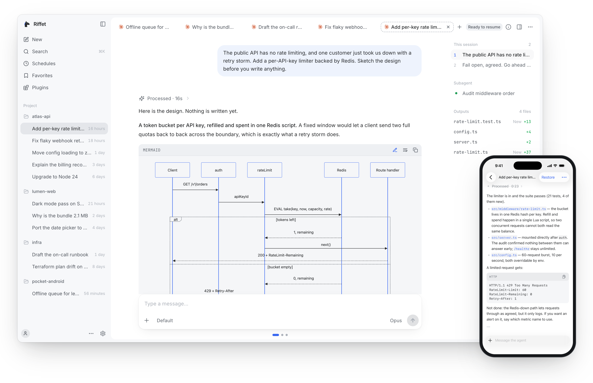
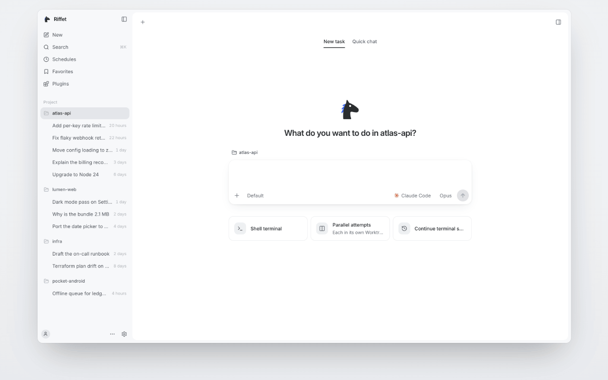
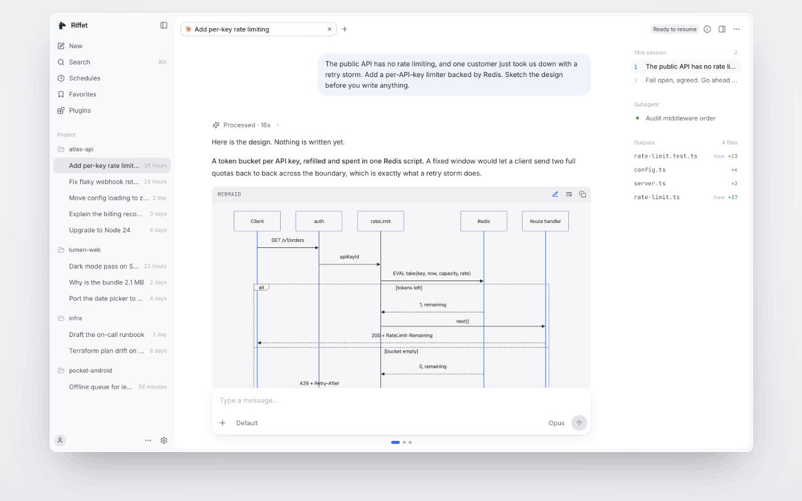

<div align="center">

<picture>
  <source media="(prefers-color-scheme: dark)" srcset="docs/brand/lockup-dark.svg">
  <source media="(prefers-color-scheme: light)" srcset="docs/brand/lockup.svg">
  
</picture>

### Keep the riff going.

A self-hosted workbench for coding agents. Run it on any machine, open it on every screen, and shape it to fit.

[](https://github.com/riffable/riffet/actions/workflows/ci.yml)
[](https://github.com/riffable/riffet/releases)
[](LICENSE)

English · [简体中文](README.zh-CN.md) · [Releases](https://github.com/riffable/riffet/releases) · [Issues](https://github.com/riffable/riffet/issues) · [Discussions](https://github.com/riffable/riffet/discussions) · [Changelog](CHANGELOG.md)

</div>

<p align="center">
  <picture>
    <source media="(prefers-color-scheme: dark)" srcset="docs/assets/hero-dark.png">
    <source media="(prefers-color-scheme: light)" srcset="docs/assets/hero-light.png">
    
  </picture>
</p>

A riff is a short phrase one player starts and the next picks up. Riffet keeps work with a coding agent in that shape: every session is a durable workspace on a server you own, and you can start it, read it, step in, and pick it up later from the web, the native macOS, iPhone, and Android apps, or a Feishu / Lark bot.

Riffet drives the agent CLIs you already use and pay for, and leaves your code, terminals, credentials, and history on that server. Apache-2.0, no account, no cloud relay, no feature paywall.

## A quick look

**Connect.** Scan once from a phone, and the same session runs live on every screen.

<p align="center">
  <picture>
    <source media="(prefers-color-scheme: dark)" srcset="docs/assets/reel-connect-dark.gif">
    <source media="(prefers-color-scheme: light)" srcset="docs/assets/reel-connect-light.gif">
    
  </picture>
</p>

**Start.** Choose the agent, try several at once, pick up a terminal session, switch models.

<p align="center">
  <picture>
    <source media="(prefers-color-scheme: dark)" srcset="docs/assets/reel-start-dark.gif">
    <source media="(prefers-color-scheme: light)" srcset="docs/assets/reel-start-light.gif">
    
  </picture>
</p>

**Read, share, keep.** A streaming timeline, the canvas, search, highlights in Favorites, and sharing.

<p align="center">
  <picture>
    <source media="(prefers-color-scheme: dark)" srcset="docs/assets/reel-session-dark.gif">
    <source media="(prefers-color-scheme: light)" srcset="docs/assets/reel-session-light.gif">
    
  </picture>
</p>

**Make it yours.** Palettes, light and dark, and plugins.

<p align="center">
  <picture>
    <source media="(prefers-color-scheme: dark)" srcset="docs/assets/reel-shape-dark.gif">
    <source media="(prefers-color-scheme: light)" srcset="docs/assets/reel-shape-light.gif">
    
  </picture>
</p>

## What you get

### Runs anywhere, pairs in seconds

- **Any machine.** Run the server on your Mac, a Linux dev box, or a cloud VM, by hand or as a launchd / systemd service. It listens on loopback by default; open it to your LAN, a VPN, or an HTTPS proxy when other devices need it.
- **A code or a QR.** `riffet pair` prints a single-use code that lasts five minutes, with a QR code. Type the code into a browser or the Mac app, or scan it with the iPhone or Android app.
- **More than one server.** The Mac, iPhone, and Android apps keep several servers, say your laptop and a build box, and switch between them.
- **Nothing to pair on a Mac.** The macOS app bundles the server and opens ready to work.

### Start the way you work

- **An agent per conversation.** Choose the agent and model for each conversation. Riffet drives the official CLI, so its login, rules, skills, MCP servers, and subscription keep working.
- **Continue a terminal session.** Pick up a Claude Code or Codex session you started in the terminal, and hand it back with **Resume in terminal** or `riffet resume`. Only one side writes at a time, so the transcript never interleaves.
- **Parallel attempts.** Send one prompt to 2–4 agents or models. Each attempt runs in its own Git worktree (a shadow repo for folders outside Git); compare the changes side by side and adopt one. *(Web, macOS)*
- **Quick chat.** Ask something that belongs to no project, straight to a model, with web search and attachments. On the Mac it is `⌃⌥Space` away; on Android, a tile, the share sheet, or selected text. *(Web, macOS, Android)*

### Your models

- **Your providers.** Add a provider by endpoint, key, and protocol (OpenAI Chat Completions or Responses, Anthropic Messages, Google Generative AI), or install a model-source plugin. Cursor can run through your own gateway.
- **Quota in view.** The model picker shows how much of the Codex account’s quota is left, and every conversation shows how much of its context window it has used.
- **A model for each chore.** Set separate models for session titles, quick chat, handoff summaries, and canvas summaries.
- **Switch within a family.** Move a conversation to another model or provider of the same family and it continues in place. Across families, hand it off.

### Take it with you, pass it on

- **Terminal, PDF, or a link.** Resume any conversation in the terminal, export it as a PDF, or publish a read-only snapshot with an expiry through a share plugin. *(PDF and links: Web, macOS)*
- **@ another session.** Type `@` to cite an earlier conversation. The agent gets a short brief and a snapshot of the transcript it can read further, and the cited session is left untouched. *(Claude Code, Codex)*
- **Hand off.** Out of quota, or want a second opinion? Hand an idle conversation to another agent with a structured summary.
- **Favorites.** Highlight passages in four colors with a note, or save a whole reply, an image, or a file. Each keeps its own snapshot and outlives the session it came from. *(Web, macOS)*

### Everything is a plugin

The canvas and the Cursor settings are plugins themselves, built on the same [plugin API](docs/PLUGINS.md) you get. A plugin can contribute:

- agent backends *(experimental)* and model sources;
- views in the conversation, sidebar, side panel, main area, or settings *(Web, macOS)*;
- project tasks, such as building an Android app, installing and launching it, and following its Logcat;
- share publishers, commands, and actions such as a device-flow sign-in;
- palettes, icon packs, fonts, and backgrounds.

Plugins run in their own process. Browse the [plugin market](https://riffable.github.io/riffet/plugins/), or build one:

```bash
riffet plugin dev ./my-plugin
riffet plugin pack ./my-plugin --out my-plugin.tgz
riffet plugin install my-plugin.tgz
```

### Quiet by default, yours to shape

- **Tabs and an aside.** Keep sessions open as tabs. The aside next to the conversation holds the plan, outline, subagents, background tasks, and output files. *(Tabs: Web, and macOS in the Riffet style)*
- **Themes.** Twelve built-in palettes, near-neutral ink on low-chroma paper, and a theme editor for your own.
- **Icons and interface styles.** Swap the icon pack, and choose how the app is drawn: Native, Riffet, or Line on macOS; Material 3, iOS, Expressive, Miuix, or Fluent on Android.

### The basics, done properly

- **A readable timeline.** Tool calls fold into one line, edits open as diffs, and subagents get their own transcript. Mermaid, D2, Graphviz, PlantUML, and Vega-Lite render locally, alongside KaTeX math and highlighting for 45 languages.
- **Files in place.** More than 20 file types preview locally, including HTML in a sandbox, PDF, Office documents, Jupyter notebooks, SQLite, and 3D models.
- **Git.** Review changes, stage by line, commit, switch branches, pull, push, and open the PR through `gh`. Every turn leaves a checkpoint to restore or fork from, and comments on diff lines go back to the agent.
- **Steer and side chats.** Add an instruction while the agent works, without `Ctrl+C`, or queue it for the next turn. Select part of an answer to ask about it in a side thread that stays out of the main timeline.
- **Search and schedules.** Search session titles and content from `⌘K`. Run a prompt once or on a cron schedule, and let agents schedule their own wake-ups.
- **Three views.** Switch a conversation between the timeline, the live terminal, and a canvas that lays out every turn with its commands and files. *(Web, macOS)*

### Native on every screen

- **Web.** The complete workbench in any browser, with nothing to install on the client.
- **macOS.** A native app with its own server. The menu bar shows running sessions and pending approvals; Shortcuts, widgets, and Spotlight reach into it.
- **iPhone.** Answer permission prompts, read diffs, browse remote folders, and open a terminal.
- **Android.** Five interface styles, a touch terminal, and quick chat from anywhere. In preview, an agent on your server can read and operate the phone, behind a per-session switch and a biometric opt-in.
- **Feishu / Lark.** The bot connects outbound over WebSocket, so it needs no public IP, domain, or tunnel. Start or continue a project conversation in a DM or a group topic, and approve actions in the chat.

## What it leaves alone

- **Your agents.** Riffet has no agent or model of its own. It reads each CLI’s native session store in place.
- **Your editor.** Keep editing in your own IDE. Riffet is where you start, read, review, and steer.
- **Your data.** No account and no relay. Clients connect to your server directly and hold no agent and no code.

It works today with Claude Code, Codex, Cursor, TRAE CLI, Factory Droid, DeepSeek Harness, and pi, and more are being added. See [what each supports](#agent-matrix).

---

## Quick start

### Prerequisites

- **macOS or Linux** with **Node.js `>= 24.19.0`** (`pnpm` is also required when building from source).
- **`tmux >= 3.2`** (needed for Cursor / Claude Code sessions and live terminal views).
- At least one [supported agent CLI](#agent-matrix) installed and signed in on the host machine.

### 1. Install Riffet

<!-- TODO(release): Uncomment/update download links once npm package and GitHub Release assets are published. -->

**Option A — Build from source (available today)**

```bash
git clone https://github.com/riffable/riffet.git ~/.local/src/riffet
cd ~/.local/src/riffet
pnpm install && pnpm build

mkdir -p "$HOME/.local/bin"
ln -s "$HOME/.local/src/riffet/scripts/riffet.mjs" "$HOME/.local/bin/riffet"
```

**Option B — npm & prebuilt native apps *(release channels reserved)***

| Surface | Channel | Notes |
| :--- | :--- | :--- |
| **Server + Web CLI** | `npm install -g riffet` *(upcoming)* | Upgrades via `npm i -g riffet@latest && riffet restart` (avoid `npx` so hook/MCP paths stay permanent) |
| **macOS App** | [`Riffet.dmg` on Releases](https://github.com/riffable/riffet/releases) *(upcoming)* | macOS 15+, Apple Silicon; bundles the server runtime out of the box |
| **Android App** | [`APK` on Releases](https://github.com/riffable/riffet/releases) *(upcoming)* | Pairs via QR code or address + one-time code |
| **iPhone App** | Source build (`apps/mobile/iosApp`) | iOS 18+; sign with your Apple team ID ([guide](apps/mobile/iosApp/README.md)) |

### 2. Verify your environment & launch

```bash
riffet doctor                  # ✅ / ⚠️ / ❌ checklist for Node, tmux, the agent CLIs, port & permissions
riffet start --workspace .     # start background daemon and register the current repo
riffet                         # open http://127.0.0.1:4337/ in your browser
```

### 3. Connect your phone, another Mac, or Feishu

Loopback-only (`127.0.0.1`) is the safe default. When you want to reach your server from other devices on your LAN, Tailscale / VPN, or an HTTPS proxy:

```bash
riffet restart --host 0.0.0.0 --auth
riffet pair                    # prints reachable URLs, a 5-min single-use code, and a QR code
```

Scan the QR code in the iPhone / Android app, enter the 5-minute code in a remote browser or Mac app, or connect a Feishu / Lark bot under **Settings → Bots** (outbound WebSocket, no public endpoint needed). See [Remote Access](docs/guide/remote-access.md) for `--allow-host` and `riffet pair --url` tunnel setups.

<details>
<summary><strong>Common CLI commands &amp; defaults</strong></summary>

```bash
riffet                 # start background server (if stopped) and open browser
riffet status          # show daemon status, listen address, and state directory
riffet pair            # generate a 5-minute single-use pairing code and QR (--url for tunnels)
riffet stop            # stop the web server; live tmux agent terminals keep running
riffet restart         # restart using saved listener & auth settings
riffet logs -f         # tail server logs with tokens automatically redacted
riffet token           # print raw admin token to stdout (e.g. riffet token | pbcopy)
riffet login-url       # print a one-step browser login URL
riffet doctor          # inspect environment (--json for machine-readable report)
riffet update --check  # check origin for newer stable vX.Y.Z release tags
riffet update          # update a clean source release checkout and restore the daemon
riffet plugin --help   # develop, pack, install, and diagnose plugins
```

Defaults: `http://127.0.0.1:4337/`, default backend `cursor-agent`, private state directory `~/.local/share/riffet` (`0700` dir / `0600` secrets), token-free on loopback. Override with `--port`, `--host`, `--cli`, `--state-dir`, `--workspace`, or `--allow-host` (`--port`, `--host`, `--cli`, and `--state-dir` also read `RIFFET_PORT`, `RIFFET_HOST`, `RIFFET_CLI`, and `RIFFET_STATE_DIR`).

</details>

---

## Agent Matrix

| Agent | CLI | Structured Chat | Live TUI | Mid-Turn Steer | Subagent View | Riffet MCP & Wakeups | Per-Chat MCP / Skill Toggle | @ Session | Terminal Import / Resume |
| :--- | :--- | :---: | :---: | :---: | :---: | :---: | :---: | :---: | :---: |
| **Cursor** | `cursor-agent` | ✓ | ✓ (`tmux`) | ✓ | ✓ | — | — | — | — |
| **Claude Code** | `claude` | ✓ | ✓ (`tmux`) | ✓ | ✓ | ✓ | MCP + Skills | ✓ | ✓ |
| **Codex** | `codex` | ✓ | ✓ (`--remote`) | ✓ | ✓ | ✓ | MCP | ✓ | ✓ |
| **DeepSeek Harness** | `dsh` (`0.2.0-rc.2+`) | ✓ | — | — | ✓ | — | — | — | — |
| **Factory Droid** | `droid` | ✓ | — | — | ✓ | ✓ | — | — | — |
| **TRAE CLI** | `traex` | ✓ | ✓ (native) | ✓ | ✓ | ✓ | MCP | — | — |
| **pi** | `pi` (`1.4.0+`) | ✓ | — | — | — | ✓ | — | — | — |

> Override any CLI path via `RIFFET_CLI`, `CLAUDE_CLI`, `CODEX_CLI`, `DROID_CLI`, `TRAEX_CLI`, `PI_CLI`, or per-profile settings under **Settings → Models**. Need another provider, custom view, or theme? Build an isolated package with [`@riffet/plugin-api`](docs/PLUGINS.md).

---

## Development & Building Clients

```bash
pnpm dev               # API server on :4317
pnpm dev:web           # Vite web workbench on :5173
pnpm typecheck
pnpm test
pnpm check:plugins
pnpm build
```

Native clients live in `apps/macos` and `apps/mobile`:

```bash
# Shared Kotlin Multiplatform & Android JVM tests (JDK 21+ and Android SDK)
cd apps/mobile
./gradlew :contracts:jvmTest :core:jvmTest :terminal:jvmTest :client:jvmTest :shared:jvmTest

# Native macOS app (macOS 15+, Xcode 26, JDK 17+, XcodeGen)
cd apps/macos
./scripts/build.sh dev        # build, install to build/Release, and relaunch
./scripts/release.sh          # build signed & notarized DMG
```

Automated testing follows [AGENTS.md](AGENTS.md): **do not add tests unless necessary** — tests focus strictly on authentication, data isolation, protocol contracts, idempotency, persistence, concurrency, and failure recovery rather than UI snapshots or styling. See [CONTRIBUTING.md](CONTRIBUTING.md) before opening a pull request.

## Documentation

Detailed design and operational docs under `docs/` are primarily written in Chinese:

- **Guides**: [Conversations, Models & Sessions](docs/guide/conversation.md) · [Cursor CLI & Custom Gateways](docs/guide/cursor.md) · [Workspace, Previews & Git](docs/guide/workspace.md) · [Remote Access](docs/guide/remote-access.md) · [Operations & Deployment](docs/guide/operations.md) · [Architecture](docs/guide/architecture.md)
- **Workflows**: [Review & Orchestration](docs/ORCHESTRATION.md) · [Mid-Turn Steering](docs/STEER.md) · [Side Chats](docs/DISCUSSIONS.md) · [Quick Chat](docs/QUICK-CHAT.md) · [Bookmarks & Highlights](docs/MARKS.md) · [Session Sharing & PDF](docs/SHARES.md) · [Usage & Throughput Stats](docs/STATS.md)
- **Surfaces & Channels**: [Web](docs/WEB.md) · [macOS](docs/MACOS.md) · [Android & Mobile](docs/MOBILE.md) · [iPhone](docs/IOS.md) · [Mobile Terminal](docs/MOBILE-TERMINAL.md) · [Feishu / IM Channels](docs/design/channels.md) · [Devices & Riffet MCP](docs/DEVICES.md) · [Themes](docs/THEMES.md)
- **Extensibility & Ops**: [Agent Extensions](docs/EXTENSIONS.md) · [Plugin Guide](docs/PLUGINS.md) · [Plugin Architecture](docs/PLUGIN_ARCHITECTURE.md) · [TRAE CLI](docs/TRAEX.md) · [pi RPC](docs/PI.md) · [Updates](docs/UPDATE.md) · [Security Model](docs/SECURITY.md)

## Acknowledgements & License

Visual design draws inspiration from [ZCode](https://github.com/zai-org/ZCode) and [DeepSeek Harness](https://github.com/deepseek-ai/deepseek-harness); the DSH backend bridge adapts portions of DeepSeek Harness's MIT-licensed native interfaces with upstream notices preserved alongside the code.

Licensed under [Apache-2.0](LICENSE). Third-party notices are listed in [NOTICE](NOTICE); please report security vulnerabilities privately via [SECURITY.md](SECURITY.md).
