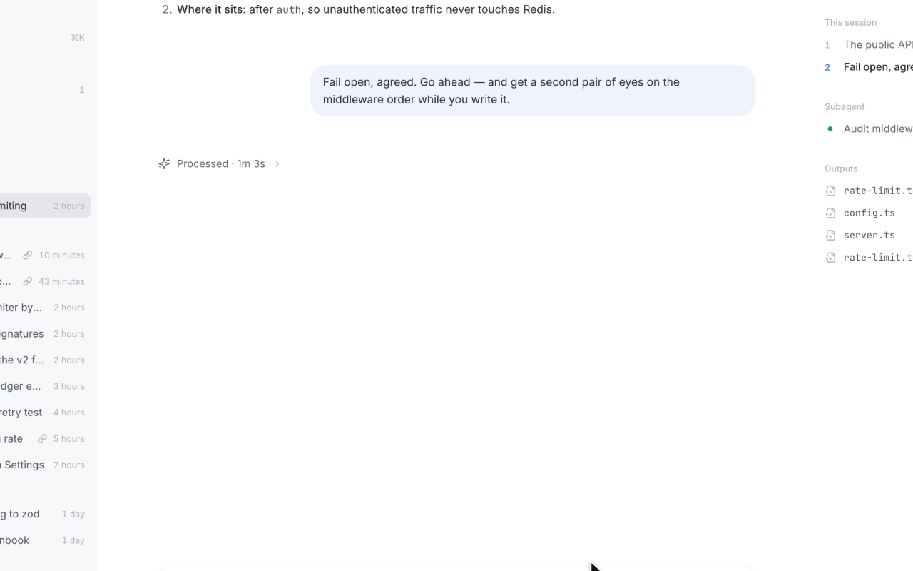
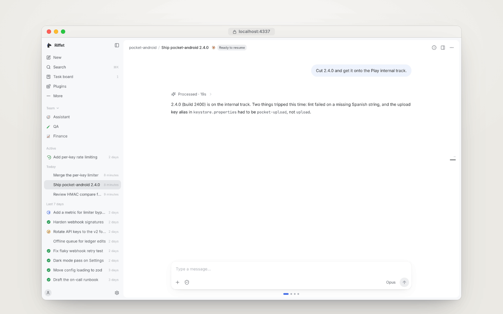
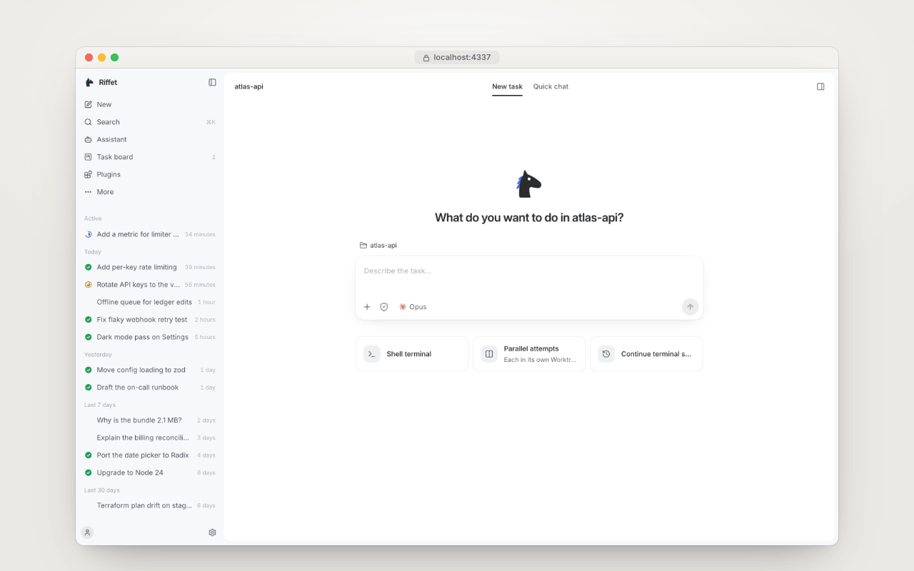
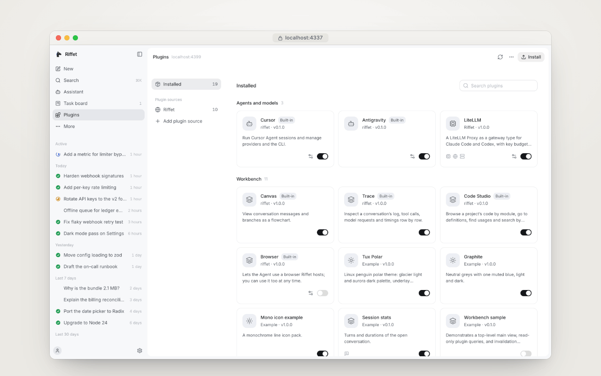

<div align="center">

<picture>
  <source media="(prefers-color-scheme: dark)" srcset="docs/brand/lockup-dark.svg">
  <source media="(prefers-color-scheme: light)" srcset="docs/brand/lockup.svg">
  
</picture>

### Keep the riff going.

自托管的 Agent CLI 工作台，部署在任意主机上，从任意设备继续会话。

[](https://github.com/riffable/riffet/actions/workflows/ci.yml)
[](https://github.com/riffable/riffet/releases)
[](LICENSE)

[English](README.md) · 简体中文 · [主页](https://riffable.github.io/riffet/) · [插件市场](https://riffable.github.io/riffet/plugins/) · [Releases](https://github.com/riffable/riffet/releases) · [变更记录](CHANGELOG.zh-CN.md)

</div>

<p align="center">
  <picture>
    <source media="(prefers-color-scheme: dark)" srcset="docs/assets/hero-dark.png">
    <source media="(prefers-color-scheme: light)" srcset="docs/assets/hero-light.png">
    
  </picture>
</p>

Riffet 是自托管的 Agent CLI 工作台，深度适配 Claude Code、Codex、Cursor、Antigravity、TRAE CLI 等主流 Agent CLI：直接驱动官方 CLI，保留各自的登录、Rules、Skills、MCP 与订阅，提供结构化对话与实时终端，支持运行中追加指令，以及终端会话的导入与交还。会话保存在你自己的主机上，可从浏览器、macOS、iPhone、Android 和 IM 机器人随时查看和继续；多台主机互联后，可在一个 Web 工作台中统一管理。

在此之上，Riffet 支持把 Agent 配置成团队成员：每位成员有固定的职责，记得过往工作中积累的经验，只获得所需的权限，并能按计划或在事件发生时自动开始工作。在任意会话中，都可以让 Agent 把当前对话整理成一位新成员。

Claude Code、Codex 等 Agent 独立于服务进程运行，重启服务不会中断进行中的回合，客户端断线后自动续传。代码、凭证和历史记录始终留在你的主机上。Riffet 基于 Apache-2.0 许可证开源。

---

## 安装

需要 macOS 或 Linux、Node.js 24.19+ 和 tmux 3.2+，并在主机上安装和登录至少一款[受支持的 Agent CLI](#后端能力矩阵)。

```bash
npm install -g riffet
riffet doctor                  # 检查 Node、tmux、各 Agent CLI、端口与权限
riffet start --workspace .     # 启动后台服务并添加当前代码库
riffet                         # 在浏览器打开 http://127.0.0.1:4337/
```

升级使用 `riffet update`。Hook 和 MCP 依赖固定的安装路径，因此请全局安装，不要通过 `npx` 运行。

### 客户端

| 组件 | 获取方式 | 说明 |
| :--- | :--- | :--- |
| 服务端与 Web 工作台 | `npm install -g riffet` | 默认监听 `127.0.0.1:4337`，支持安装为 PWA |
| macOS 应用 | [GitHub Releases 下载 `Riffet.dmg`](https://github.com/riffable/riffet/releases) *（即将发布）* | macOS 15+，Apple Silicon；内置服务端运行时 |
| Android 应用 | [GitHub Releases 下载 `APK`](https://github.com/riffable/riffet/releases) | 扫描二维码，或输入地址与一次性配对码 |
| iPhone 应用 | 源码构建（`apps/mobile/iosApp`） | iOS 18+，使用自己的 Apple 团队 ID 签名（见[构建说明](apps/mobile/iosApp/README.md)） |

### 连接其他设备

服务端默认只监听本机。如需从局域网、Tailscale 或 HTTPS 代理访问，请以认证模式重启并生成配对码：

```bash
riffet restart --host 0.0.0.0 --auth
riffet pair                    # 打印可达地址、5 分钟有效的一次性配对码与二维码
```

手机应用扫描二维码完成配对，浏览器和 Mac 应用输入配对码。其他设备经明文 HTTP 打开的网页仅可查看，Tailscale 和 HTTPS 地址不受此限制。隧道与反向代理的配置见[远程访问](docs/guide/remote-access.md)。

### 服务器互联

```bash
riffet link invite             # 在一台服务器上生成链接串
riffet link join <链接串>       # 在另一台上加入，也可以粘贴到「设置 › 互联」
riffet link ssh devbox         # 端口不可达时经 SSH 互联
```

每台服务器可分别设置是否允许对方操作本机，默认不允许；任一方解除链接即双向解除。详见[服务器链接](docs/SERVER-LINKS.md)。

<details>
<summary><strong>从源码构建</strong></summary>

除 Node.js `>= 24.19.0` 外还需 `pnpm`：

```bash
git clone https://github.com/riffable/riffet.git ~/.local/src/riffet
cd ~/.local/src/riffet
pnpm install && pnpm build

mkdir -p "$HOME/.local/bin"
ln -s "$HOME/.local/src/riffet/scripts/riffet.mjs" "$HOME/.local/bin/riffet"
```

</details>

<details>
<summary><strong>CLI 命令、补全与默认值</strong></summary>

```bash
riffet                 # 启动后台服务（若未运行）并打开浏览器
riffet status          # 查看运行状态、监听地址、数据目录与可用更新
riffet pair            # 生成 5 分钟有效的一次性配对码与二维码（隧道可加 --url）
riffet link            # 与另一台服务器互联：invite、join、ssh、list、rename、remove
riffet ssh <服务器>     # 在互联的服务器上打开 shell 或执行命令
riffet stop            # 关闭 Web 服务；tmux 中的 Agent 终端继续运行
riffet restart         # 按已保存的监听与认证参数重启
riffet logs -f         # 持续查看服务日志，令牌已脱敏（支持 --since、--scope）
riffet token           # 向标准输出打印访问令牌（如 riffet token | pbcopy）
riffet url --login     # 输出一步登录链接
riffet ls              # 列出会话，当前目录所属项目在前（-a 列出全部）
riffet resume          # 在当前终端继续一个会话（可搜索的选择器）
riffet doctor          # 检查运行环境（--json 输出报告，--compact 压缩 workbench.db）
riffet service install # 登录时自动启动（launchd / systemd），另有 status、uninstall
riffet completion zsh  # zsh、bash、fish 的命令补全
riffet update --check  # 检查是否有更新的稳定版本
riffet update          # 升级 npm 安装或更新干净的发布 tag 源码目录并恢复服务
riffet restore         # 将已校验的备份恢复到空数据目录（--backup）
riffet plugin --help   # 开发、打包、安装、管理插件源与诊断插件
```

默认值：地址 `http://127.0.0.1:4337/`，Cursor 可执行文件 `cursor-agent`，私有数据目录 `~/.local/share/riffet`（目录权限 `0700`，密钥文件 `0600`），回环地址无需令牌。覆盖项：`--port`、`--host`、`--cli`、`--state-dir`、`--workspace`、`--allow-host`；前四项同时读取 `RIFFET_PORT`、`RIFFET_HOST`、`RIFFET_CLI`、`RIFFET_STATE_DIR`。

</details>

---

## 功能

### 01 · Agent 会话

Riffet 直接驱动官方 CLI，完整保留 CLI 自身的登录、Rules、Skills、MCP 与订阅，并逐款适配各 CLI 的输出解析、实时终端和消息投递，支持程度见[后端能力矩阵](#后端能力矩阵)。

- **Agent 与模型**：每条会话可单独选择 Agent、模型和模型服务商，也可把会话交给另一个 Agent 继续。
- **运行中引导**：Agent 运行时可追加指令，或把指令排入下一轮。
- **终端互通**：终端里的 Claude Code、Codex 会话可导入 Riffet，也可交还终端继续。
- **多种视图**：同一会话可切换为对话、实时终端、画布和追踪；画布把回答按输出类型排成卡片，追踪列出每次模型请求的 token 用量与工具调用。
- **文件与 Git**：支持 PDF、Office、Notebook 等多种格式的预览和文本编辑，以及按行暂存与提交；每轮对话自动保存检查点，可回退或从任一轮分叉；可在 Diff 上批注并发给 Agent。
- **Code Studio**：提供 IDE 式的代码浏览，支持跳转定义、查找引用和逐行 blame。
- **内置浏览器**：人与 Agent 可在同一个网页上协同操作。

<p align="center">
  <picture>
    <source media="(prefers-color-scheme: dark)" srcset="docs/assets/reel-views-dark.gif">
    <source media="(prefers-color-scheme: light)" srcset="docs/assets/reel-views-light.gif">
    
  </picture>
</p>

### 02 · 团队

团队成员是有固定职责和长期记忆的 Agent。可以为反复出现的工作配置一位成员，例如负责项目验收的 QA、负责打包发版的构建员或个人理财助手。成员会记住每次工作积累的经验，不需要每次重新交代背景。

- **在对话中创建成员**：在任意会话中，可直接让 Agent 把当前对话整理成一位团队成员，职责说明、从对话中提炼的经验、负责的项目、使用的 Agent 和权限一次生成；之后也可以通过对话继续调整，或在团队页面手动新建。
- **职责与记忆**：每位成员的职责写在自己的 `AGENTS.md` 中，工作经验写入独立的记忆文件，每晚自动整理去重。
- **工作范围**：成员可以只处理个人事务、只负责指定的代码项目，或跨项目工作，能看到的代码、任务和会话限于这个范围。
- **权限**：修改代码、管理任务、后台运行、调用其他成员、使用浏览器和 MCP 工具等权限均可按成员单独开启，每位成员的模型、MCP 和 Skills 互不影响。
- **后台运行**：成员可按计划定时工作，或在网页内容变化、GitHub 发布新版本、任务状态变化时自动开始，并可限制每天的运行次数。
- **对话方式**：成员可以一直延续同一条对话，也可以每次工作都从新会话开始，历次记录集中在成员页面。
- **@ 成员**：在任意会话中可用 `@成员名` 请它回答问题或接手工作，成员在自己的会话中处理，结果回到当前对话。
- **收件箱**：成员需要你确认的操作和主动汇报的重要消息集中在收件箱中，并通过通知提醒你。

成员可基于 Claude Code、Codex、Cursor 或 Antigravity 运行。成员的每次工作都是一条真实的 CLI 会话，可随时打开查看、插话或接管。详见[团队与成员](docs/TEAM.md)。

<p align="center">
  <picture>
    <source media="(prefers-color-scheme: dark)" srcset="docs/assets/reel-team-dark.gif">
    <source media="(prefers-color-scheme: light)" srcset="docs/assets/reel-team-light.gif">
    
  </picture>
</p>

### 03 · 协作

- **Agent 互相调用**：在会话中 `@` 其他 Agent，可请它回答问题或动手修改，对方在独立会话中运行，可随时查看和介入。
- **多模型协作**：可让多个模型围绕同一问题辩论、圆桌讨论、交叉质询或审阅文档，并给出结论。
- **并行尝试**：可将同一任务同时交给多个 Agent，各自在独立的 Git worktree 中实现，比较后采用最好的结果。
- **任务看板**：可为任务设置先后依赖，前一个任务验收通过后下一个任务自动开始，交付可指定另一个 Agent 核验。
- **自动化**：支持定时和周期任务，Agent 也可以约定稍后回到当前会话继续工作。

<p align="center">
  <picture>
    <source media="(prefers-color-scheme: dark)" srcset="docs/assets/reel-agents-dark.gif">
    <source media="(prefers-color-scheme: light)" srcset="docs/assets/reel-agents-light.gif">
    
  </picture>
</p>

### 04 · 多端与互联

- **多端同步**：浏览器、macOS、iPhone 和 Android 实时同步同一会话；手机扫码完成配对，一个客户端可同时连接多台服务器。
- **IM 机器人**：可通过飞书和 Telegram 机器人与 Agent 对话、处理权限确认，每个聊天可绑定到一个项目。
- **服务器互联**：多台服务器互联后，可在一个 Web 工作台中查看和新建所有服务器上的会话，也可授权 Agent 在其他服务器上执行命令。
- **连接安全**：App 与服务器之间全程 TLS 加密，设备凭证保存在手机的安全芯片中，复制到别处无法使用；服务器互联时两端显示同一串校验码，用于核对连接没有被他人截获；有新设备接入时，已有设备会收到通知。

<p align="center">
  <picture>
    <source media="(prefers-color-scheme: dark)" srcset="docs/assets/reel-link-dark.gif">
    <source media="(prefers-color-scheme: light)" srcset="docs/assets/reel-link-light.gif">
    
  </picture>
</p>

### 05 · 插件与外观

Riffet 提供完整的插件体系，可扩展 Agent 后端、模型源、会话视图、侧边面板、页面、命令、主题和 IM 通道，并支持自定义主题、壁纸和标志。内置插件在服务进程内运行，第三方插件默认隔离运行。公开插件见[插件市场](https://riffable.github.io/riffet/plugins/)，开发方法见[插件开发指南](docs/PLUGINS.md)。

```bash
riffet plugin dev ./my-plugin
riffet plugin pack ./my-plugin --out my-plugin.tgz
riffet plugin install my-plugin.tgz
```

| 扩展点 | 内置 | 官方与示例 |
| :--- | :--- | :--- |
| Agent 后端 *（实验性）* | `cursor`、`antigravity` | `example.echo` |
| 模型源 | — | `riffet.litellm`、`example.gateway-models` |
| 会话视图 | `canvas`、`trace` | — |
| 侧边面板 | `browser` | `riffet.android`、`example.session-stats` |
| 页面 | `code-studio` | `example.workbench-sample` |
| 命令 | `translate` | — |
| 外观 | `avatars` | `riffet.appearance-paper`、`example.tux-theme`、`example.graphite-theme`、`example.mono-icons` |
| IM 通道、分享、语音 | `channel-feishu`、`channel-telegram`、`speech-local` | `riffet.share-s3` |

<p align="center">
  <picture>
    <source media="(prefers-color-scheme: dark)" srcset="docs/assets/reel-plugins-dark.gif">
    <source media="(prefers-color-scheme: light)" srcset="docs/assets/reel-plugins-light.gif">
    
  </picture>
</p>

---

## 后端能力矩阵

| 后端 | CLI | 结构化对话 | 实时 TUI 终端 | 运行中引导 (Steer) | 子 Agent 详情页 | Riffet MCP / 自唤醒 | 按对话开关 MCP / Skill | @ 会话引用 | 可被 @ 调用 | 终端导入 / 交还 | 可作团队成员 |
| :--- | :--- | :---: | :---: | :---: | :---: | :---: | :---: | :---: | :---: | :---: | :---: |
| Claude Code | `claude` | ✓ | ✓（`tmux`） | ✓ | ✓ | ✓ | MCP + Skills | ✓ | 咨询、动手 | ✓ | ✓ |
| Codex | `codex` | ✓ | ✓（`--remote`） | ✓ | ✓ | ✓ | MCP | ✓ | 咨询、动手 | ✓ | ✓ |
| Cursor | `cursor-agent` | ✓ | ✓（`tmux`） | ✓ | ✓ | ✓ | — | ✓ | 动手 | — | ✓ |
| Antigravity | `agy`（`1.5.6+`） | ✓ | ✓（`tmux`） | — | ✓ | ✓ | — | ✓ | 动手 | — | ✓ |
| TRAE CLI | `traex` | ✓ | ✓（原生） | ✓ | ✓ | ✓ | MCP | ✓ | 咨询、动手 | — | — |
| DeepSeek Harness | `dsh`（`0.2.0-rc.2+`） | ✓ | — | — | ✓ | — | — | ✓ | 动手 | — | — |
| Factory Droid | `droid` | ✓ | — | — | ✓ | ✓ | — | ✓ | 动手 | — | — |
| pi | `pi`（`1.4.0+`） | ✓ | — | — | — | ✓ | — | ✓ | 动手 | — | — |

**可被 @ 调用**：「咨询」只读；「动手」在新的 Git worktree 中运行，可修改文件。支持 Riffet MCP 的 Agent 均可发起调用。

支持通过环境变量 `RIFFET_CLI`、`CLAUDE_CLI`、`CODEX_CLI`、`DSH_CLI`、`DROID_CLI`、`TRAEX_CLI`、`PI_CLI` 或「设置 → 模型」指定各 CLI 的路径（包括 `agy`）；其他后端可通过 [`@riffet/plugin-api`](docs/PLUGINS.md) 以插件形式接入。

---

## 稳定性

| 能力 | 实现 | 参考 |
| :--- | :--- | :--- |
| 进程隔离 | Claude Code、Cursor 运行在 Riffet 管理的 `tmux` 中，Codex、TRAE CLI 运行在独立的 app-server 中，服务重启不会中断它们的回合；Droid、pi、DeepSeek Harness 随服务退出 | [消息投递](docs/DELIVERY.md) |
| 至多一次投递 | 每条会话的输入串行排队，以 Agent 的转录或 hook 回执确认送达；崩溃后不重发未确认的消息 | `apps/server/src/native/dispatch.property.test.ts` |
| 断点续传 | 会话内容与同步进度在同一事务中写入，客户端断线后从上次的位置继续，不漏不重 | [同步](docs/SYNC-V3.md) |
| CLI 行为回归检测 | 录制真实的 CLI 会话并在测试中回放；`pnpm record <cli> all --check` 用已安装的版本重录并对比 | `scripts/record.ts` |
| 数据校验与恢复 | 会话记录只追加写入；启动时检查数据库完整性，`riffet doctor` 报告缺失和无主的数据；备份带校验，可用 `riffet restore` 恢复 | [运行与维护](docs/guide/operations.md) |
| 资源上限与回收 | 缓存、存储和 CLI 进程的上限集中定义，与移动端共用；空闲 CLI 按最近使用时间和内存预算回收 | [性能规范](docs/guide/performance.md) |

---

## 各端的差异

Web 端功能最完整，支持安装为 PWA；团队目前在 Web、iPhone 和 Android 上提供；服务器互联、Agent 调用、模型协作、任务看板、追踪和 Code Studio 目前仅在 Web 端提供。

- **macOS**：SwiftUI + AppKit 原生应用，内置服务端，支持在菜单栏处理权限确认、快捷指令、小组件和聚焦搜索；经授权后，Agent 可截取窗口、读写剪贴板和发送通知。
- **iPhone**：SwiftUI 原生应用，支持在推送通知中直接确认权限请求或回复（需自行配置 APNs），提供小组件和终端。
- **Android**：Kotlin Multiplatform + Compose 应用，提供触控终端；经会话授权和生物识别确认后，Agent 可操作这台手机（预览）。

---

## 架构

Riffet 是单节点服务，位于客户端与同一主机上已安装的 Agent CLI 之间。命令沿一条路径送达 Agent；Agent 的输出沿另一条路径返回，整理成各客户端一致的时间线。

<p align="center">
  <picture>
    <source media="(prefers-color-scheme: dark)" srcset="docs/assets/architecture/system-dark.svg">
    <source media="(prefers-color-scheme: light)" srcset="docs/assets/architecture/system-light.svg">
    
  </picture>
</p>

设计原则：

1. **厂商 CLI 即 Agent。** Riffet 通过 CLI 自身的接口驱动已安装的程序，不重新实现。
2. **单一会话模型。** Agent 之间的差异止于驱动契约，契约之上不出现厂商名。
3. **命令与观测分离。** 观测到回执才算送达，写入不算。
4. **Journal 是唯一事实来源。** 时间线、状态、用量与搜索都是它的投影。
5. **服务端折叠，客户端渲染。** 客户端从游标续传，得到同一份行。
6. **单节点。** 一个进程、内嵌 SQLite（三个数据库加一个 blob 存储）、一个用户，不依赖外部服务。互联的服务器彼此对等，不共享数据。
7. **依赖向内。** 客户端接入层与驱动依赖核心，反向不成立；可选能力以插件提供。

各子系统、导入分层与运行时拓扑（进程、文件、接口）各有一张图，见 [docs/guide/architecture.md](docs/guide/architecture.md)。

---

## 开发

```bash
pnpm dev               # API 服务（:4317）
pnpm dev:web           # Vite Web 工作台（:5173）
pnpm typecheck
pnpm test
pnpm check:plugins
pnpm build
```

原生客户端位于 `apps/macos` 与 `apps/mobile`：

```bash
# 共享 Kotlin Multiplatform 与 Android JVM 测试（需 JDK 21+ 与 Android SDK）
cd apps/mobile
./gradlew :contracts:jvmTest :core:jvmTest :terminal:jvmTest :client:jvmTest :shared:jvmTest

# macOS 原生客户端（需 macOS 15+、Xcode 26、JDK 17+ 与 XcodeGen）
cd apps/macos
./scripts/build.sh dev        # 构建、安装到 build/Release 并重启应用
./scripts/release.sh          # 构建签名与公证后的 DMG
```

提交 PR 前的检查和 npm 打包步骤见 [CONTRIBUTING.md](CONTRIBUTING.md)。

## 文档索引

- **使用指南**：[对话、模型与会话](docs/guide/conversation.md) · [Cursor 原生会话与自定义网关](docs/guide/cursor.md) · [工作区、多格式预览与 Git](docs/guide/workspace.md) · [远程访问](docs/guide/remote-access.md) · [运行、部署与维护](docs/guide/operations.md) · [代码结构与前端约定](docs/guide/architecture.md) · [版本、发布与分发](docs/RELEASE.md)
- **核心工作流**：[团队与成员](docs/TEAM.md) · [任务看板](docs/TASK-BOARD.md) · [审阅发布与会话编排](docs/ORCHESTRATION.md) · [调用其他 Agent](docs/AGENT-CALLS.md) · [运行中会话引导](docs/STEER.md) · [侧边聊天](docs/DISCUSSIONS.md) · [快速对话](docs/QUICK-CHAT.md) · [高亮与收藏](docs/MARKS.md) · [会话分享与 PDF 导出](docs/SHARES.md) · [用量与吞吐统计](docs/STATS.md)
- **多端与通道**：[设计体系](docs/design/system/README.md) · [Web 设计契约](docs/WEB.md) · [macOS 客户端](docs/MACOS.md) · [Android 与移动端](docs/MOBILE.md) · [iPhone 客户端](docs/IOS.md) · [移动端终端](docs/MOBILE-TERMINAL.md) · [IM 通道](docs/design/channels.md) · [Riffet 浏览器](docs/BROWSER.md) · [Code Studio](docs/CODE-STUDIO.md) · [会话追踪](docs/TRACE.md) · [语音输入](docs/VOICE.md) · [设备操控与 Riffet MCP](docs/DEVICES.md) · [服务器链接](docs/SERVER-LINKS.md) · [主题系统](docs/THEMES.md)
- **扩展与运维**：[扩展管理](docs/EXTENSIONS.md) · [插件开发指南](docs/PLUGINS.md) · [插件架构](docs/PLUGIN_ARCHITECTURE.md) · [Antigravity CLI](docs/ANTIGRAVITY.md) · [TRAE CLI](docs/TRAEX.md) · [pi RPC](docs/PI.md) · [更新机制](docs/UPDATE.md) · [消息投递](docs/DELIVERY.md) · [同步](docs/SYNC-V3.md) · [安全模型](docs/SECURITY.md) · [传输与身份安全](docs/TRANSPORT-SECURITY.md)

## 致谢与许可证

前端视觉参考了 [ZCode](https://github.com/zai-org/ZCode) 与 [DeepSeek Harness](https://github.com/deepseek-ai/deepseek-harness)；DSH 后端桥接复用了 DeepSeek Harness 以 MIT 许可发布的原生接口，上游声明随桥接代码保留。

本项目基于 [Apache-2.0](LICENSE) 许可证开源，第三方归属声明见 [NOTICE](NOTICE)，安全漏洞请按 [SECURITY.md](SECURITY.md) 私密上报。
