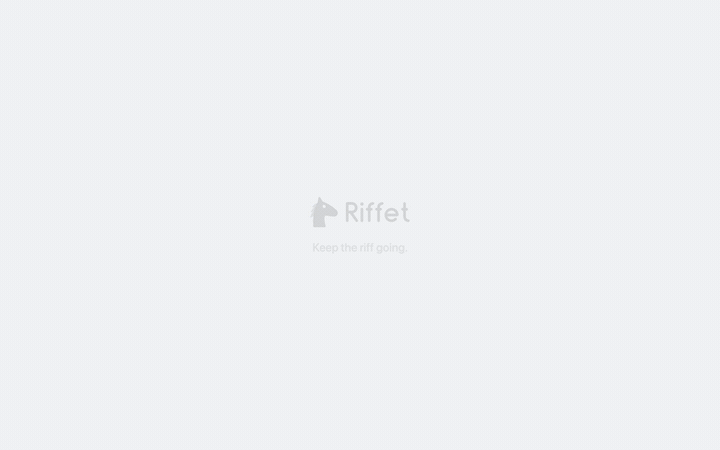
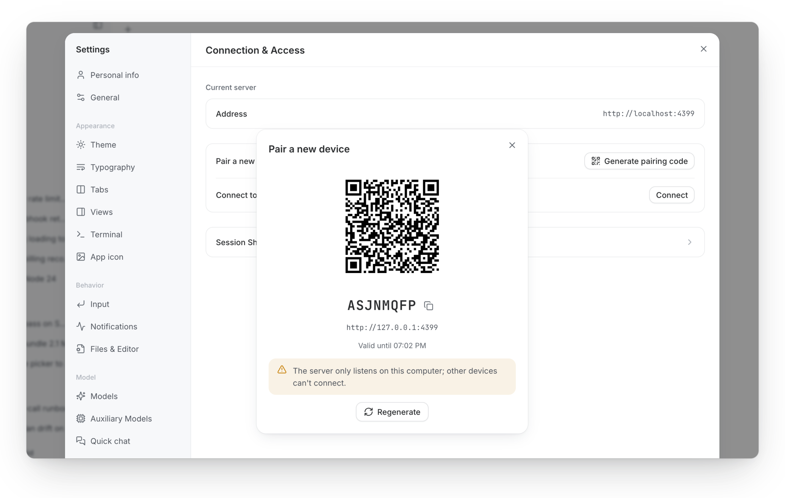
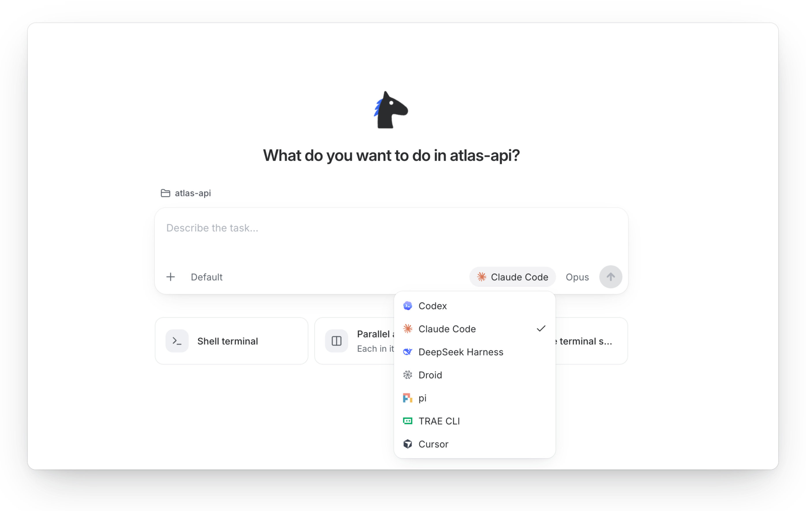
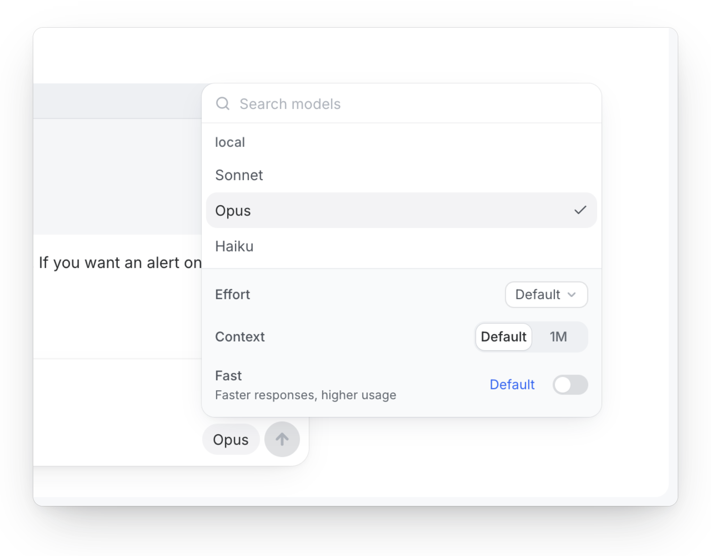
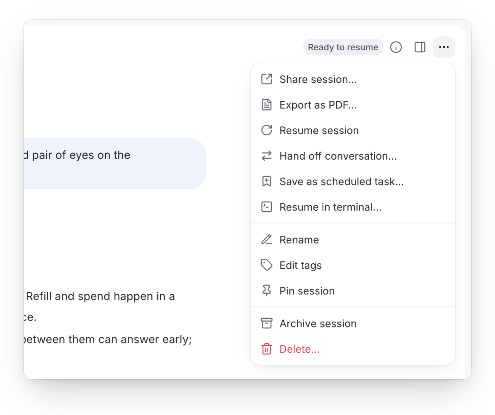
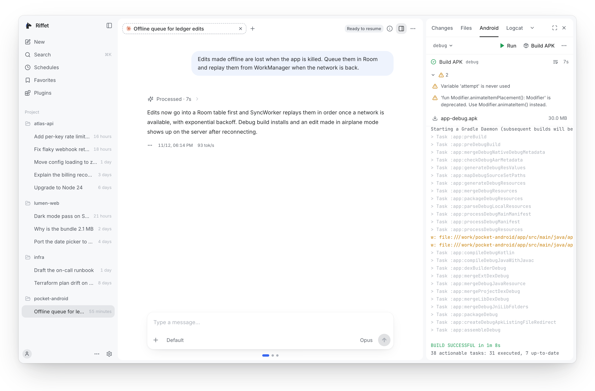
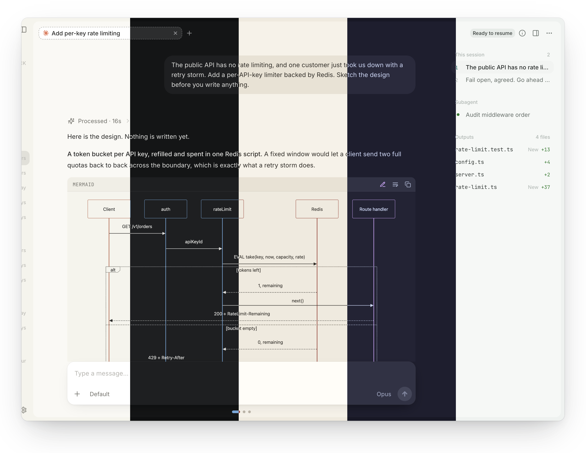
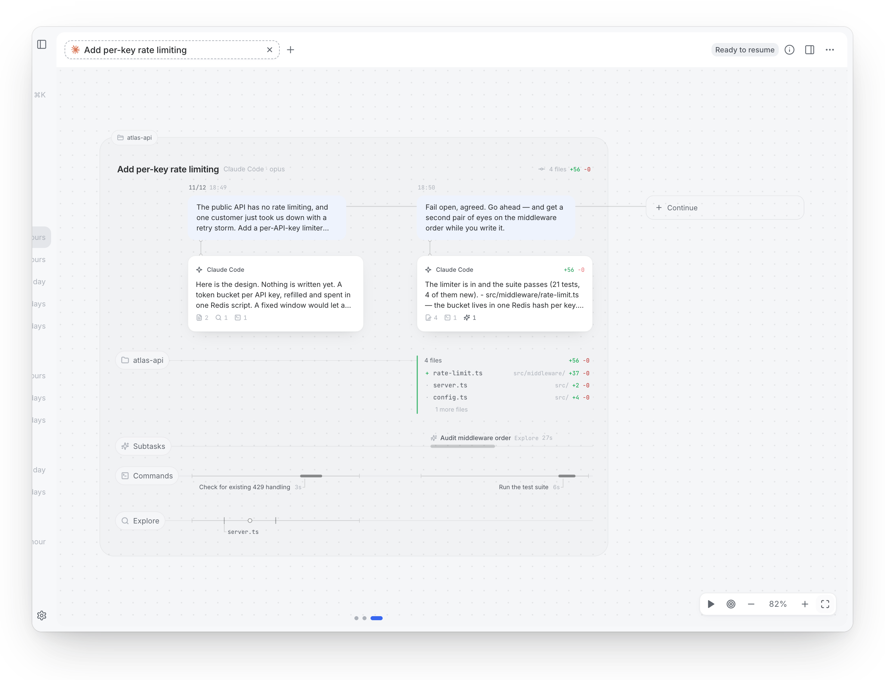
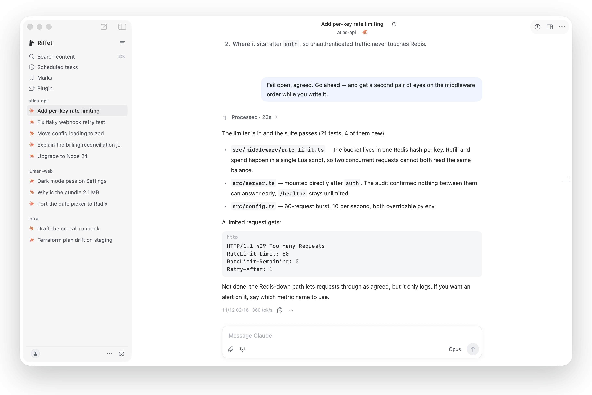
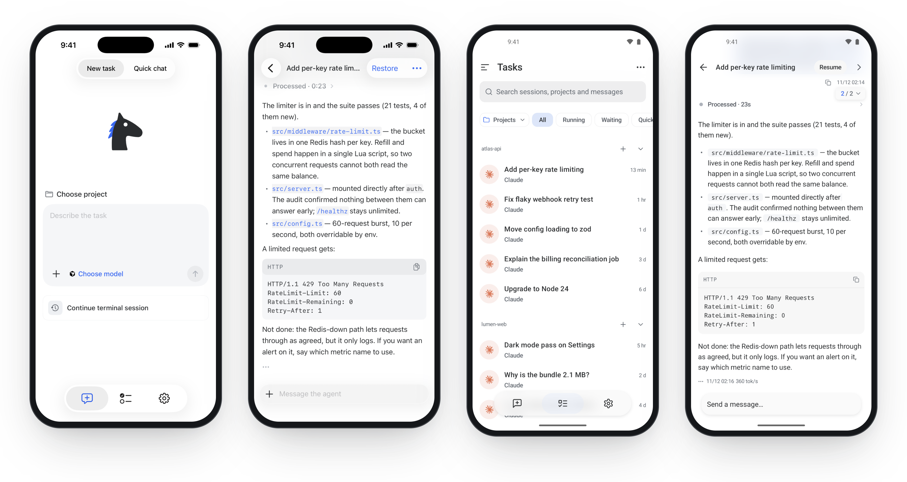

<div align="center">

<picture>
  <source media="(prefers-color-scheme: dark)" srcset="docs/brand/lockup-dark.svg">
  <source media="(prefers-color-scheme: light)" srcset="docs/brand/lockup.svg">
  
</picture>

### Keep the riff going.

自托管的编码 Agent 工作台：部署在哪台机器都行，每块屏幕都能接着做，界面按你的习惯来。

[](https://github.com/riffable/riffet/actions/workflows/ci.yml)
[](https://github.com/riffable/riffet/releases)
[](LICENSE)

[English](README.md) · 简体中文 · [Releases](https://github.com/riffable/riffet/releases) · [Issues](https://github.com/riffable/riffet/issues) · [Discussions](https://github.com/riffable/riffet/discussions) · [变更记录](CHANGELOG.md)

</div>

<p align="center">
  <picture>
    <source media="(prefers-color-scheme: dark)" srcset="docs/assets/hero-dark.png">
    <source media="(prefers-color-scheme: light)" srcset="docs/assets/hero-light.png">
    
  </picture>
</p>

Riff 是乐手之间来回接的一小段乐句：一个人起头，下一个人接下去。Riffet 让和编码 Agent 的协作保持这个样子：每条会话都是留在你自己服务器上的工作区，可以从网页、macOS / iPhone / Android 原生应用或飞书（Lark）机器人发起、阅读、插话，之后换块屏幕接着做。

Riffet 驱动的是你已经在用、已经付费的 Agent CLI；代码、终端、登录凭证和历史都留在那台服务器上。Apache-2.0 开源，没有账号，不经云端中继，没有付费功能。

## 45 秒看一遍

<p align="center">
  <picture>
    <source media="(prefers-color-scheme: dark)" srcset="docs/assets/tour-dark.gif">
    <source media="(prefers-color-scheme: light)" srcset="docs/assets/tour-light.gif">
    
  </picture>
</p>

<!-- 可以用更清晰的 .mp4 替换这张 GIF：把视频拖进任意 GitHub Issue / PR 的编辑框，再把得到的 https://github.com/user-attachments/assets/<uuid> 链接单独放一行。 -->

## 能做什么

### 部署在哪都行，扫码就连

- **任意机器。** 服务端跑在你的 Mac、Linux 开发机或云服务器上，手动启动或注册成 launchd / systemd 服务都可以。默认只监听本机回环地址，需要时再开放给局域网、VPN 或 HTTPS 代理。
- **配对码或二维码。** `riffet pair` 打印一个 5 分钟内有效的一次性配对码和二维码。浏览器和 Mac 应用输入配对码，iPhone 和 Android 应用扫码。
- **不止一台服务器。** Mac、iPhone、Android 应用可以同时保存多台服务器（比如笔记本和编译机），随时切换。
- **Mac 上不用配对。** macOS 应用内置服务端，打开就能用。

<p align="center">
  <picture>
    <source media="(prefers-color-scheme: dark)" srcset="docs/assets/pair-dark.png">
    <source media="(prefers-color-scheme: light)" srcset="docs/assets/pair-light.png">
    
  </picture>
</p>

### 怎么开始都行

- **每条会话选一个 Agent。** 每条会话各自选择 Agent 和模型。Riffet 驱动官方 CLI，CLI 的登录、Rules、Skills、MCP 和订阅照常生效。
- **接着终端里的会话做。** 在终端里开始的 Claude Code 或 Codex 会话可以导入 Riffet 继续，再用「在终端恢复」或 `riffet resume` 交还终端。同一时刻只有一方写入，记录不会交错。
- **并行尝试。** 同一条需求同时发给 2–4 个 Agent 或模型，每一路跑在自己的 Git worktree 里（非 Git 目录用影子仓库），并排比较改动后采用其中一路。*（Web、macOS）*
- **快速对话。** 不属于任何项目的问题直接问模型，支持联网搜索和附件。Mac 上按 `⌃⌥Space`，Android 上从快捷开关、分享菜单或选中的文字发起。*（Web、macOS、Android）*

<p align="center">
  <picture>
    <source media="(prefers-color-scheme: dark)" srcset="docs/assets/start-dark.png">
    <source media="(prefers-color-scheme: light)" srcset="docs/assets/start-light.png">
    
  </picture>
</p>

### 模型自己定

- **自定义模型源。** 填入接口地址、密钥和协议（OpenAI Chat Completions 或 Responses、Anthropic Messages、Google Generative AI）即可添加，也可以安装模型源插件。Cursor 可以走你自己的网关。
- **额度一眼可见。** 模型选择器显示 Codex 账号剩余的额度，每条会话显示上下文窗口已用多少。
- **辅助模型分开配。** 会话标题、快速对话、交接摘要、画布摘要各自可以指定模型。
- **同系列换模型。** 会话可以切到同一系列的另一个模型或模型源，原地接着聊；跨系列则用交接。

<p align="center">
  <picture>
    <source media="(prefers-color-scheme: dark)" srcset="docs/assets/models-dark.png">
    <source media="(prefers-color-scheme: light)" srcset="docs/assets/models-light.png">
    
  </picture>
</p>

### 带走与交接

- **终端、PDF 或链接。** 任意会话都能在终端恢复、导出为 PDF，或通过分享插件发布成带有效期的只读快照。*（PDF 与链接：Web、macOS）*
- **@ 另一条会话。** 输入 `@` 引用之前的对话：Agent 拿到一份简短导读和可继续读取的原文快照，被引用的会话不受影响。*（Claude Code、Codex）*
- **交接。** 额度用完或想换个模型看看时，把空闲的会话连同结构化摘要交给另一个 Agent。
- **收藏。** 用四种颜色高亮片段并写批注，也可以收藏整条回答、图片或文件。每条收藏各自保存快照，原会话删除后仍然可读。*（Web、macOS）*

<p align="center">
  <picture>
    <source media="(prefers-color-scheme: dark)" srcset="docs/assets/share-dark.png">
    <source media="(prefers-color-scheme: light)" srcset="docs/assets/share-light.png">
    
  </picture>
</p>

### 一切皆插件

画布和 Cursor 设置本身就是插件，用的是同一套[插件 API](docs/PLUGINS.md)。插件可以提供：

- Agent 后端 *（实验性）* 和模型源；
- 会话、侧栏、侧边面板、主区或设置里的视图 *（Web、macOS）*；
- 项目任务，比如构建 Android 应用、安装启动并跟随 Logcat；
- 分享发布、命令，以及设备码登录这类操作；
- 配色、图标包、字体和背景。

插件运行在独立进程里。可以浏览[插件市场](https://riffable.github.io/riffet/plugins/)，或者自己写一个：

```bash
riffet plugin dev ./my-plugin
riffet plugin pack ./my-plugin --out my-plugin.tgz
riffet plugin install my-plugin.tgz
```

<p align="center">
  <picture>
    <source media="(prefers-color-scheme: dark)" srcset="docs/assets/plugins-dark.png">
    <source media="(prefers-color-scheme: light)" srcset="docs/assets/plugins-light.png">
    
  </picture>
</p>

### 克制，也由你来定

- **标签页与侧栏。** 会话可以作为标签页常开。对话旁的概览栏放着计划、大纲、子 Agent、后台任务和产出文件。*（标签页：Web，以及 macOS 的 Riffet 风格）*
- **主题。** 内置 12 套配色，接近无彩的墨色配低色度的纸；也可以用主题编辑器做自己的。
- **图标与界面风格。** 可以换图标包，也可以换整套界面画法：macOS 有原生、Riffet、线条三种，Android 有 Material 3、iOS、Expressive、Miuix、Fluent 五种。

<p align="center">
  <picture>
    <source media="(prefers-color-scheme: dark)" srcset="docs/assets/looks-dark.png">
    <source media="(prefers-color-scheme: light)" srcset="docs/assets/looks-light.png">
    
  </picture>
</p>

### 基本功扎实

- **能读的时间线。** 连续的工具调用折叠成一行，每次修改都能展开成 Diff，子 Agent 有独立的转录页。Mermaid、D2、Graphviz、PlantUML、Vega-Lite 图表在本地渲染，另有 KaTeX 公式和 45 种语言的语法高亮。
- **文件就地打开。** 20 多种文件格式在本地预览，包括沙箱里的 HTML、PDF、Office 文档、Jupyter Notebook、SQLite 和 3D 模型。
- **Git。** 查看变更、按行暂存、提交、切换分支、拉取推送，通过 `gh` 提 PR。每一轮自动建立检查点，可以恢复或从任意回合分叉；在 Diff 行上写的批注会一并发回给 Agent。
- **插话与侧边聊天。** Agent 正在执行时直接补充要求，不用 `Ctrl+C`，也可以排到下一轮。选中回答里的一段，在侧边线程里追问，不进主时间线。
- **搜索与定时任务。** 用 `⌘K` 搜索会话标题和内容。提示词可以只跑一次或按 cron 定时运行，Agent 也能给自己定唤醒。
- **三种视角。** 同一条会话可以在时间线、实时终端和画布之间切换；画布把每一轮连同执行的命令和写入的文件排在一张图上。*（Web、macOS）*

<p align="center">
  <picture>
    <source media="(prefers-color-scheme: dark)" srcset="docs/assets/canvas-dark.png">
    <source media="(prefers-color-scheme: light)" srcset="docs/assets/canvas-light.png">
    
  </picture>
</p>

### 每块屏幕都是原生

- **Web**：完整的工作台，客户端不用安装任何东西。
- **macOS**：原生应用，自带服务端。菜单栏列出运行中的会话和待批的权限请求，快捷指令、小组件和聚焦搜索都能直达。
- **iPhone**：批权限、看 Diff、浏览远端目录、打开终端。
- **Android**：五种界面风格、触控终端，随处发起快速对话。预览功能里，服务器上的 Agent 可以读取并操作这台手机，需要会话开关和手机上的生物识别确认同时打开。
- **飞书 / Lark 机器人**：由服务端主动建立出站 WebSocket 连接，不需要公网 IP、域名或内网穿透。在私聊或群话题里新建、续聊项目会话，审批直接在聊天里点。

<p align="center">
  <picture>
    <source media="(prefers-color-scheme: dark)" srcset="docs/assets/mac-dark.png">
    <source media="(prefers-color-scheme: light)" srcset="docs/assets/mac-light.png">
    
  </picture>
</p>

<p align="center">
  <picture>
    <source media="(prefers-color-scheme: dark)" srcset="docs/assets/devices-dark.png">
    <source media="(prefers-color-scheme: light)" srcset="docs/assets/devices-light.png">
    
  </picture>
</p>

## 它不做什么

- **不自带 Agent。** Riffet 没有自己的 Agent 和模型，就地读取各个 CLI 自己的会话存储。
- **不是编辑器。** 代码仍在你自己的 IDE 里改；Riffet 负责发起、阅读、审阅和引导。
- **不碰你的数据。** 没有账号，不经中继。客户端直连你的服务器，不运行 Agent，也不保存代码。

目前接入了 Claude Code、Codex、Cursor、TRAE CLI、Factory Droid、DeepSeek Harness 和 pi，还在继续增加。各自支持的能力见[后端能力矩阵](#后端能力矩阵)。

---

## 快速上手

### 环境要求

- **macOS 或 Linux**，已安装 **Node.js `>= 24.19.0`**（从源码构建还需 `pnpm`）。
- **`tmux >= 3.2`**（Cursor / Claude Code 会话与实时终端视图需要）。
- 本机至少安装并登录一款[受支持的 Agent CLI](#后端能力矩阵)。

### 1. 安装 Riffet

<!-- TODO(release): npm 包与 GitHub Releases 客户端产物正式发布后，更新下方预留说明与直链。 -->

**方式 A — 从源码构建（当前立即可用）**

```bash
git clone https://github.com/riffable/riffet.git ~/.local/src/riffet
cd ~/.local/src/riffet
pnpm install && pnpm build

mkdir -p "$HOME/.local/bin"
ln -s "$HOME/.local/src/riffet/scripts/riffet.mjs" "$HOME/.local/bin/riffet"
```

**方式 B — npm 与预构建原生客户端 *（发布渠道预留）***

| 平台 | 获取方式 | 说明 |
| :--- | :--- | :--- |
| Server + Web CLI | `npm install -g riffet` *（即将发布）* | 升级运行 `npm i -g riffet@latest && riffet restart`（请勿用 `npx`，以免缓存清理导致 Hook/MCP 路径失效） |
| macOS 客户端 | [GitHub Releases 下载 `Riffet.dmg`](https://github.com/riffable/riffet/releases) *（即将发布）* | 支持 macOS 15+（Apple Silicon），内置服务端运行时，开箱即用 |
| Android 客户端 | [GitHub Releases 下载 `APK`](https://github.com/riffable/riffet/releases) *（即将发布）* | 扫码或输入地址 + 一次性配对码连接任意服务器 |
| iPhone 客户端 | 源码签名构建（`apps/mobile/iosApp`） | 支持 iOS 18+，使用个人或团队证书编译安装（见 [构建说明](apps/mobile/iosApp/README.md)） |

### 2. 检查环境并启动

```bash
riffet doctor                  # 输出 Node、tmux、各 Agent CLI、端口与权限的 ✅ / ⚠️ / ❌ 检查清单
riffet start --workspace .     # 启动后台服务并添加当前代码库
riffet                         # 在浏览器打开 http://127.0.0.1:4337/
```

### 3. 连接手机、其他电脑或飞书

服务默认仅监听本机 `127.0.0.1`。需要从局域网、Tailscale / VPN 或反向代理接入其他设备时，在服务器上执行：

```bash
riffet restart --host 0.0.0.0 --auth
riffet pair                    # 打印可达地址、5 分钟有效的一次性配对码与二维码
```

打开 iPhone / Android 客户端扫码，或在远端浏览器与 Mac App 输入配对码即可接入；飞书机器人在 Web「设置 → 机器人」中扫码创建即可连通（无需公网回调地址）。跨网域名与隧道配对见 [远程访问指南](docs/guide/remote-access.md)。

<details>
<summary><strong>展开查看常用 CLI 命令与默认配置</strong></summary>

```bash
riffet                 # 启动后台服务（若未运行）并打开浏览器
riffet status          # 查看运行状态、监听地址与数据目录
riffet pair            # 生成 5 分钟有效的一次性配对码与二维码（隧道可加 --url）
riffet stop            # 关闭 Web 服务；tmux 中的原生 Agent 终端继续保留
riffet restart         # 按上次保存的监听与认证参数重启
riffet logs -f         # 持续查看服务日志（URL 中的令牌自动脱敏）
riffet token           # 仅向标准输出打印管理员令牌（如 riffet token | pbcopy）
riffet login-url       # 输出带令牌的一步登录链接
riffet doctor          # 逐项检查运行环境（--json 输出完整机器可读报告）
riffet update --check  # 检查 origin 是否有更新的 vX.Y.Z 发布 tag
riffet update          # 更新干净的发布 tag 源码目录并按原配置恢复服务
riffet plugin --help   # 开发、打包、安装与诊断插件
```

默认值：地址 `http://127.0.0.1:4337/`，默认后端 `cursor-agent`，私有数据目录 `~/.local/share/riffet`（目录权限 `0700`、密钥文件 `0600`），回环地址免令牌访问。可通过 `--port`、`--host`、`--cli`、`--state-dir`、`--workspace`、`--allow-host` 覆盖，前四项同时支持 `RIFFET_PORT`、`RIFFET_HOST`、`RIFFET_CLI`、`RIFFET_STATE_DIR` 环境变量。

</details>

---

## 后端能力矩阵

| 后端 | CLI | 结构化对话 | 实时 TUI 终端 | 运行中引导 (Steer) | 子 Agent 详情页 | Riffet MCP / 自唤醒 | 按对话开关 MCP / Skill | @ 会话引用 | 终端导入 / 交还 |
| :--- | :--- | :---: | :---: | :---: | :---: | :---: | :---: | :---: | :---: |
| Cursor | `cursor-agent` | ✓ | ✓（`tmux`） | ✓ | ✓ | — | — | — | — |
| Claude Code | `claude` | ✓ | ✓（`tmux`） | ✓ | ✓ | ✓ | MCP + Skills | ✓ | ✓ |
| Codex | `codex` | ✓ | ✓（`--remote`） | ✓ | ✓ | ✓ | MCP | ✓ | ✓ |
| DeepSeek Harness | `dsh`（`0.2.0-rc.2+`） | ✓ | — | — | ✓ | — | — | — | — |
| Factory Droid | `droid` | ✓ | — | — | ✓ | ✓ | — | — | — |
| TRAE CLI | `traex` | ✓ | ✓（原生） | ✓ | ✓ | ✓ | MCP | — | — |
| pi | `pi`（`1.4.0+`） | ✓ | — | — | — | ✓ | — | — | — |

> 可通过环境变量（`RIFFET_CLI`、`CLAUDE_CLI`、`CODEX_CLI`、`DROID_CLI`、`TRAEX_CLI`、`PI_CLI`）或「设置 → 模型设置」按配置指定 CLI 路径。需要接入自建模型源、自定义工作台视图或配色主题时，可使用 [`@riffet/plugin-api`](docs/PLUGINS.md) 开发独立插件包。

---

## 本地开发与客户端构建

```bash
pnpm dev               # API 服务（:4317）
pnpm dev:web           # Vite Web 工作台（:5173）
pnpm typecheck
pnpm test
pnpm check:plugins
pnpm build
```

原生客户端位于 `apps/macos` 与 `apps/mobile`：

```bash
# 共享 Kotlin Multiplatform 与 Android JVM 测试（需 JDK 21+ 与 Android SDK）
cd apps/mobile
./gradlew :contracts:jvmTest :core:jvmTest :terminal:jvmTest :client:jvmTest :shared:jvmTest

# macOS 原生客户端（需 macOS 15+、Xcode 26、JDK 17+ 与 XcodeGen）
cd apps/macos
./scripts/build.sh dev        # 构建、安装到 build/Release 并重启应用
./scripts/release.sh          # 构建签名与公证后的 DMG
```

自动化测试遵循 [仓库协作规范](AGENTS.md#测试与验证)：非必要不增加测试，只覆盖鉴权与数据隔离、外部协议契约、幂等、持久化、并发一致性与故障恢复，不维护 UI 展示、样式或简单格式化测试。提交 PR 前的完整检查与 npm 打包步骤见 [CONTRIBUTING.md](CONTRIBUTING.md)。

## 文档索引

- **使用指南**：[对话、模型与会话](docs/guide/conversation.md) · [Cursor 原生会话与自定义网关](docs/guide/cursor.md) · [工作区、多格式预览与 Git](docs/guide/workspace.md) · [远程访问](docs/guide/remote-access.md) · [运行、部署与维护](docs/guide/operations.md) · [代码结构与前端约定](docs/guide/architecture.md)
- **核心工作流**：[审阅发布与会话编排](docs/ORCHESTRATION.md) · [运行中会话引导](docs/STEER.md) · [侧边聊天](docs/DISCUSSIONS.md) · [快速对话](docs/QUICK-CHAT.md) · [高亮与收藏](docs/MARKS.md) · [会话分享与 PDF 导出](docs/SHARES.md) · [用量与吞吐统计](docs/STATS.md)
- **多端与通道**：[Web 设计契约](docs/WEB.md) · [macOS 客户端](docs/MACOS.md) · [Android 与移动端](docs/MOBILE.md) · [iPhone 客户端](docs/IOS.md) · [移动端终端](docs/MOBILE-TERMINAL.md) · [飞书 / IM 通道](docs/design/channels.md) · [设备操控与 Riffet MCP](docs/DEVICES.md) · [主题系统](docs/THEMES.md)
- **扩展与运维**：[Agent 扩展管理](docs/EXTENSIONS.md) · [插件开发指南](docs/PLUGINS.md) · [插件架构](docs/PLUGIN_ARCHITECTURE.md) · [TRAE CLI](docs/TRAEX.md) · [pi RPC](docs/PI.md) · [更新机制](docs/UPDATE.md) · [安全模型](docs/SECURITY.md)

## 致谢与许可证

前端视觉参考了 [ZCode](https://github.com/zai-org/ZCode) 与 [DeepSeek Harness](https://github.com/deepseek-ai/deepseek-harness)；DSH 后端桥接复用了 DeepSeek Harness 以 MIT 许可发布的原生接口，上游声明随桥接代码保留。

本项目基于 [Apache-2.0](LICENSE) 许可证开源，第三方归属声明见 [NOTICE](NOTICE)，安全漏洞请按 [SECURITY.md](SECURITY.md) 私密上报。
