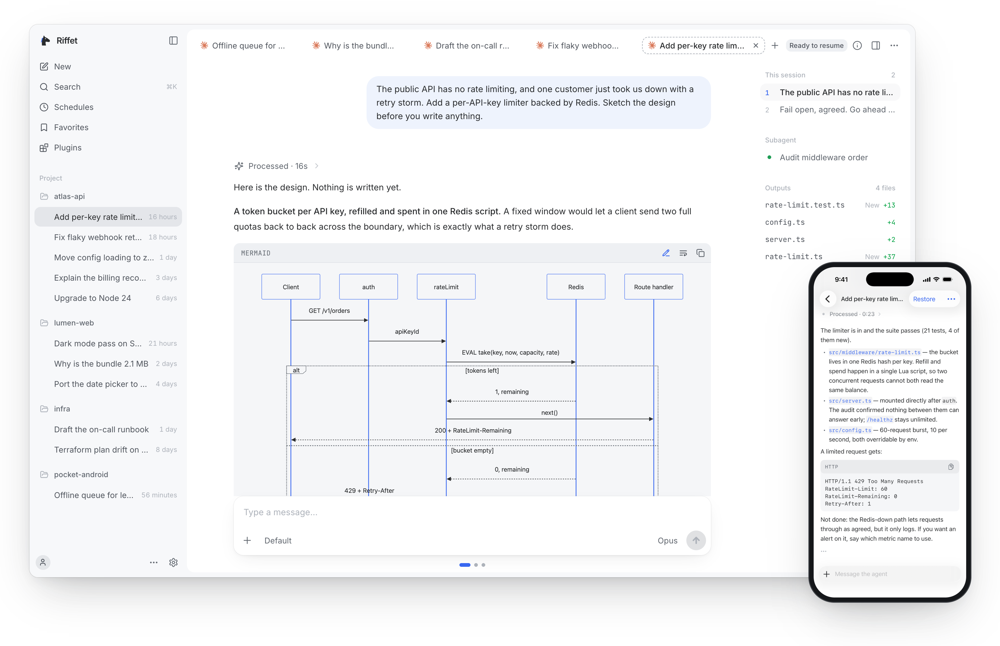
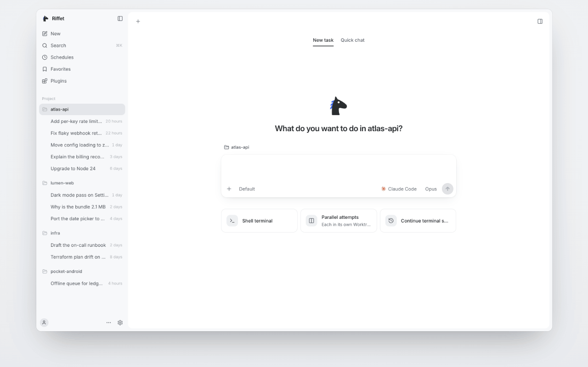

<div align="center">

<picture>
  <source media="(prefers-color-scheme: dark)" srcset="docs/brand/lockup-dark.svg">
  <source media="(prefers-color-scheme: light)" srcset="docs/brand/lockup.svg">
  
</picture>

### Keep the riff going.

自托管的编码 Agent CLI 服务端与客户端。

[](https://github.com/riffable/riffet/actions/workflows/ci.yml)
[](https://github.com/riffable/riffet/releases)
[](LICENSE)

[English](README.md) · 简体中文 · [Releases](https://github.com/riffable/riffet/releases) · [Issues](https://github.com/riffable/riffet/issues) · [Discussions](https://github.com/riffable/riffet/discussions) · [变更记录](CHANGELOG.zh-CN.md)

</div>

<p align="center">
  <picture>
    <source media="(prefers-color-scheme: dark)" srcset="docs/assets/hero-dark.png">
    <source media="(prefers-color-scheme: light)" srcset="docs/assets/hero-light.png">
    
  </picture>
</p>

Riffet 是运行在 macOS 或 Linux 上的服务端，驱动该主机上已安装的编码 Agent CLI。会话保存在服务端，可以从任一已连接的客户端发起、阅读、引导和继续：Web 工作台，macOS、iPhone、Android 原生应用，或飞书（Lark）机器人。

- **Agent。** Riffet 驱动官方 CLI（Claude Code、Codex、Cursor、TRAE CLI、Factory Droid、DeepSeek Harness、pi），并就地读取各 CLI 自己的会话存储。各 Agent 支持的能力见[后端能力矩阵](#后端能力矩阵)。
- **数据。** 代码、终端、登录凭证和历史保存在服务端。客户端直连服务端。
- **许可证。** Apache-2.0，全部功能都在开源版本中。

## 截图

**配对与多端同步。** 手机扫码一次完成配对，此后会话在所有已连接的客户端上同步更新。

<p align="center">
  <picture>
    <source media="(prefers-color-scheme: dark)" srcset="docs/assets/reel-connect-dark.gif">
    <source media="(prefers-color-scheme: light)" srcset="docs/assets/reel-connect-light.gif">
    
  </picture>
</p>

**发起会话。** 选择 Agent、并行尝试、导入终端会话、选择模型。

<p align="center">
  <picture>
    <source media="(prefers-color-scheme: dark)" srcset="docs/assets/reel-start-dark.gif">
    <source media="(prefers-color-scheme: light)" srcset="docs/assets/reel-start-light.gif">
    
  </picture>
</p>

**阅读与留存。** 流式时间线、画布、搜索、高亮收藏、分享。

<p align="center">
  <picture>
    <source media="(prefers-color-scheme: dark)" srcset="docs/assets/reel-session-dark.gif">
    <source media="(prefers-color-scheme: light)" srcset="docs/assets/reel-session-light.gif">
    
  </picture>
</p>

**外观与插件。** 配色、浅色与深色模式、插件。

<p align="center">
  <picture>
    <source media="(prefers-color-scheme: dark)" srcset="docs/assets/reel-shape-dark.gif">
    <source media="(prefers-color-scheme: light)" srcset="docs/assets/reel-shape-light.gif">
    
  </picture>
</p>

## 功能

### 部署与配对

- **主机。** 服务端运行在 Mac、Linux 机器或云服务器上，可手动启动，也可注册为 launchd / systemd 服务。默认只监听回环地址，可开放给局域网、VPN 或 HTTPS 反向代理。
- **配对。** `riffet pair` 打印一个 5 分钟内有效的一次性配对码和二维码。浏览器与 Mac 应用输入配对码，iPhone 与 Android 应用扫描二维码。
- **多台服务器。** Mac、iPhone、Android 应用可保存多台服务器并在其间切换。
- **macOS 内置服务端。** macOS 应用内置服务端，连接本机服务无需配对。

### 会话

- **按会话选择 Agent 与模型。** 每条会话各自选择 Agent 和模型。Riffet 驱动官方 CLI，CLI 的登录、Rules、Skills、MCP 和订阅保持原样生效。
- **终端会话的导入与交还。** 在终端中开始的 Claude Code 或 Codex 会话可导入 Riffet 继续，并通过「在终端恢复」或 `riffet resume` 交还终端。同一时刻只有一方写入，转录不会交错。
- **并行尝试。** 同一条提示词可发给 2–4 个 Agent 或模型。每一路运行在独立的 Git worktree 中（非 Git 目录使用影子仓库），改动并排比较后采用其中一路。*（Web、macOS）*
- **运行中引导。** Agent 执行期间可追加指令，无需 `Ctrl+C`，也可排入下一轮。
- **侧边线程。** 选中回答中的一段，可在侧边线程中讨论，不进入主时间线。
- **快速对话。** 不属于任何项目的问题直接发给模型，支持联网搜索和附件。入口：macOS 为 `⌃⌥Space`，Android 为快捷开关、分享菜单或选中的文字。*（Web、macOS、Android）*
- **定时。** 提示词可运行一次或按 cron 定时运行，Agent 可为自己安排唤醒。
- **搜索。** `⌘K` 搜索会话标题与内容。

### 模型

- **模型源。** 通过接口地址、密钥和协议（OpenAI Chat Completions 或 Responses、Anthropic Messages、Google Generative AI）添加，或安装模型源插件。Cursor 可经自定义网关接入。
- **额度与上下文。** 模型选择器显示 Codex 账号的剩余额度，每条会话显示上下文窗口的已用比例。
- **辅助模型。** 会话标题、快速对话、交接摘要、画布摘要各有独立的模型设置。
- **切换。** 会话可切换到同一系列的其他模型或模型源并原地继续，跨系列通过交接完成。

### 导出、引用与交接

- **导出。** 任一会话可在终端恢复、导出为 PDF，或经分享插件发布为带有效期的只读快照。*（PDF 与链接：Web、macOS）*
- **会话引用。** 输入 `@` 引用之前的会话。Agent 得到一份简短导读和可继续读取的转录快照，被引用的会话不被修改。*（Claude Code、Codex）*
- **交接。** 空闲的会话可连同结构化摘要交给另一个 Agent，例如在额度用尽时。
- **收藏。** 片段可用四种颜色高亮并附批注，整条回答、图片和文件也可收藏。每条收藏保存独立快照，原会话删除后仍可读取。*（Web、macOS）*

### 时间线、文件与 Git

- **时间线。** 工具调用折叠为一行，修改可展开为 Diff，每个子 Agent 有独立的转录。Mermaid、D2、Graphviz、PlantUML、Vega-Lite 图表在本地渲染，支持 KaTeX 公式和 45 种语言的语法高亮。
- **视图。** 同一条会话可显示为时间线、实时终端或画布，画布按回合排列其命令和文件。*（Web、macOS）*
- **文件预览。** 20 多种文件类型在本地预览，包括沙箱中的 HTML、PDF、Office 文档、Jupyter Notebook、SQLite 和 3D 模型。
- **Git。** 查看变更、按行暂存、提交、切换分支、拉取、推送，并通过 `gh` 创建 PR。每一轮记录一个检查点，可恢复或从该回合分叉；Diff 行上的批注会发回给 Agent。

### 插件

画布和 Cursor 设置都是插件，基于公开的[插件 API](docs/PLUGINS.md)。插件可提供：

- Agent 后端 *（实验性）* 和模型源；
- 会话、侧栏、侧边面板、主区或设置中的视图 *（Web、macOS）*；
- 项目任务，例如构建 Android 应用、安装启动并跟随 Logcat；
- 分享发布、命令，以及设备码登录等操作；
- 配色、图标包、字体和背景。

安装的插件包默认在隔离进程中运行，内置插件在服务进程中运行（见[插件架构](docs/PLUGIN_ARCHITECTURE.md)）。已发布的插件包列在[插件市场](https://riffable.github.io/riffet/plugins/)。开发、打包和安装通过 CLI 完成：

```bash
riffet plugin dev ./my-plugin
riffet plugin pack ./my-plugin --out my-plugin.tgz
riffet plugin install my-plugin.tgz
```

### 界面

- **标签页与概览栏。** 会话以标签页保持打开。对话旁的概览栏显示计划、大纲、子 Agent、后台任务和产出文件。*（标签页：Web，以及 macOS 的 Riffet 风格）*
- **主题。** 内置 12 套配色（接近无彩的墨色配低色度的纸），并提供主题编辑器用于自定义。
- **图标与界面风格。** 图标包可替换。界面风格：macOS 有原生、Riffet、线条三种，Android 有 Material 3、iOS、Expressive、Miuix、Fluent 五种。

### 客户端

- **Web。** 浏览器中的完整工作台，由 Riffet 服务端提供。
- **macOS。** 原生应用，内置服务端。菜单栏列出运行中的会话和待批的权限请求，支持快捷指令、小组件和聚焦搜索。
- **iPhone。** 权限请求、Diff、远端目录浏览和终端。
- **Android。** 五种界面风格、触控终端，以及从系统入口发起的快速对话。预览功能：服务端的 Agent 可读取并操作手机，需同时打开会话开关和设备上的生物识别确认。
- **飞书 / Lark。** 机器人由服务端建立出站 WebSocket 连接，不需要公网 IP、域名或内网穿透。项目会话在私聊或群话题中新建或继续，审批在聊天中完成。

---

## 快速上手

### 环境要求

- **macOS 或 Linux**，已安装 **Node.js `>= 24.19.0`**（从源码构建还需 `pnpm`）。
- **`tmux >= 3.2`**，Cursor 与 Claude Code 会话及实时终端视图需要。
- 主机上至少安装并登录一款[受支持的 Agent CLI](#后端能力矩阵)。

### 1. 安装

**方式 A：npm 与预构建客户端**

| 组件 | 获取方式 | 说明 |
| :--- | :--- | :--- |
| 服务端与 Web 工作台 | `npm install -g riffet` | 升级运行 `npm i -g riffet@latest && riffet restart`。不要通过 `npx` 运行：Hook 与 MCP 路径需保持固定 |
| macOS 应用 | [GitHub Releases 下载 `Riffet.dmg`](https://github.com/riffable/riffet/releases) *（即将发布）* | macOS 15+，Apple Silicon；内置服务端运行时 |
| Android 应用 | [GitHub Releases 下载 `APK`](https://github.com/riffable/riffet/releases) | 扫描二维码，或输入地址与一次性配对码 |
| iPhone 应用 | 源码构建（`apps/mobile/iosApp`） | iOS 18+，使用自己的 Apple 团队 ID 签名（见[构建说明](apps/mobile/iosApp/README.md)） |

**方式 B：从源码构建**

```bash
git clone https://github.com/riffable/riffet.git ~/.local/src/riffet
cd ~/.local/src/riffet
pnpm install && pnpm build

mkdir -p "$HOME/.local/bin"
ln -s "$HOME/.local/src/riffet/scripts/riffet.mjs" "$HOME/.local/bin/riffet"
```

### 2. 检查环境并启动

```bash
riffet doctor                  # 检查 Node、tmux、各 Agent CLI、端口与权限
riffet start --workspace .     # 启动后台服务并添加当前代码库
riffet                         # 在浏览器打开 http://127.0.0.1:4337/
```

### 3. 连接其他设备

服务端默认只监听 `127.0.0.1`。需要经局域网、Tailscale / VPN 或 HTTPS 代理从其他设备访问时：

```bash
riffet restart --host 0.0.0.0 --auth
riffet pair                    # 打印可达地址、5 分钟有效的一次性配对码与二维码
```

iPhone 与 Android 应用扫描二维码，远端浏览器或 Mac 应用输入配对码。飞书机器人在「设置 → 机器人」中连接（出站 WebSocket，无需公网回调地址）。`--allow-host` 与用于隧道的 `riffet pair --url` 见[远程访问](docs/guide/remote-access.md)。

<details>
<summary><strong>CLI 命令与默认值</strong></summary>

```bash
riffet                 # 启动后台服务（若未运行）并打开浏览器
riffet status          # 查看运行状态、监听地址与数据目录
riffet pair            # 生成 5 分钟有效的一次性配对码与二维码（隧道可加 --url）
riffet stop            # 关闭 Web 服务；tmux 中的 Agent 终端继续运行
riffet restart         # 按已保存的监听与认证参数重启
riffet logs -f         # 持续查看服务日志，令牌已脱敏
riffet token           # 向标准输出打印管理员令牌（如 riffet token | pbcopy）
riffet url --login     # 输出一步登录链接
riffet ls              # 列出会话，当前目录所属项目在前（-a 列出全部）
riffet resume          # 在当前终端继续一个会话（可搜索的选择器）
riffet doctor          # 检查运行环境（--json 输出机器可读报告）
riffet service install # 登录时自动启动（launchd / systemd），另有 status、uninstall
riffet completion zsh  # zsh、bash、fish 的命令补全
riffet update --check  # 检查 origin 是否有更新的 vX.Y.Z 发布 tag
riffet update          # 更新干净的发布 tag 源码目录并按原配置恢复服务
riffet plugin --help   # 开发、打包、安装与诊断插件
```

默认值：地址 `http://127.0.0.1:4337/`，默认后端 `cursor-agent`，私有数据目录 `~/.local/share/riffet`（目录权限 `0700`，密钥文件 `0600`），回环地址无需令牌。覆盖项：`--port`、`--host`、`--cli`、`--state-dir`、`--workspace`、`--allow-host`；前四项同时读取 `RIFFET_PORT`、`RIFFET_HOST`、`RIFFET_CLI`、`RIFFET_STATE_DIR`。

</details>

---

## 后端能力矩阵

| 后端 | CLI | 结构化对话 | 实时 TUI 终端 | 运行中引导 (Steer) | 子 Agent 详情页 | Riffet MCP / 自唤醒 | 按对话开关 MCP / Skill | @ 会话引用 | 终端导入 / 交还 |
| :--- | :--- | :---: | :---: | :---: | :---: | :---: | :---: | :---: | :---: |
| Cursor | `cursor-agent` | ✓ | ✓（`tmux`） | ✓ | ✓ | — | — | — | — |
| Claude Code | `claude` | ✓ | ✓（`tmux`） | ✓ | ✓ | ✓ | MCP + Skills | ✓ | ✓ |
| Codex | `codex` | ✓ | ✓（`--remote`） | ✓ | ✓ | ✓ | MCP | ✓ | ✓ |
| DeepSeek Harness | `dsh`（`0.2.0-rc.2+`） | ✓ | — | — | ✓ | — | — | — | — |
| Factory Droid | `droid` | ✓ | — | — | ✓ | ✓ | — | — | — |
| TRAE CLI | `traex` | ✓ | ✓（原生） | ✓ | ✓ | ✓ | MCP | — | — |
| pi | `pi`（`1.4.0+`） | ✓ | — | — | — | ✓ | — | — | — |

CLI 路径通过环境变量 `RIFFET_CLI`、`CLAUDE_CLI`、`CODEX_CLI`、`DROID_CLI`、`TRAEX_CLI`、`PI_CLI` 指定，或在「设置 → 模型设置」中按配置指定。其他模型源、视图和主题以插件包的形式添加，使用 [`@riffet/plugin-api`](docs/PLUGINS.md) 开发。

---

## 架构

Riffet 是单节点服务，位于客户端与同一主机上已安装的 agent CLI 之间。命令沿一条路径送达 agent；agent 的输出沿另一条路径返回，折叠成各客户端一致的行。

<p align="center">
  <picture>
    <source media="(prefers-color-scheme: dark)" srcset="docs/assets/architecture/system-dark.svg">
    <source media="(prefers-color-scheme: light)" srcset="docs/assets/architecture/system-light.svg">
    
  </picture>
</p>

设计原则：

1. **厂商 CLI 即 agent。** Riffet 通过 CLI 自身的接口驱动已安装的程序，不重新实现。
2. **单一会话模型。** agent 之间的差异止于驱动契约，契约之上不出现厂商名。
3. **命令与观测分离。** 消息以观测到回执为送达，不以写入为准。
4. **Journal 是唯一事实来源。** 时间线、状态、用量与搜索都是它的投影。
5. **服务端折叠，客户端渲染。** 客户端从游标续传，得到同一份行。
6. **单节点。** 一个进程、一个数据库文件、一个用户，不依赖外部服务。
7. **依赖向内。** 表面与驱动依赖核心，反向不成立；可选能力以插件提供。

| 子系统 | 职责 | 代码 |
| :--- | :--- | :--- |
| Clients | 渲染行，保存行的副本与缓存，发送命令 | `apps/web`、`apps/mobile`、`apps/macos` |
| Access | 设备鉴权，终结 HTTP、SSE、WebSocket，适配聊天通道 | `apps/server/src/auth.ts`、`apps/server/src/routes`、`apps/server/src/channels` |
| Session core：Delivery | 消息排队，一次放行一个回合，至多写入一次，跟踪到回执 | `apps/server/src/native` |
| Session core：Journal | 只追加的事件日志，按会话有序 | `apps/server/src/journal` |
| Session core：Timeline | 把事件折叠成客户端渲染的行 | `apps/server/src/timeline`、`packages/timeline` |
| Session core：Sync | 按各客户端的游标推送行 | `apps/server/src/sync` |
| Agent integration | 每个 agent 一个驱动，共用一份契约；终端宿主、hook 桥、工具桥 | `apps/server/src/backends`、`apps/server/src/terminal`、`apps/server/src/riffet-mcp` |
| Automation | 不经人发出命令：定时、任务、交接 | `apps/server/src/orchestration`、`apps/server/src/tasks` |
| Workspace | agent 工作目录的文件、git 与工作树 | `apps/server/src/workspace`、`apps/server/src/git` |
| Derived views | 由 journal 派生的读模型：用量、搜索索引、标题、分享 | `apps/server/src/stats`、`apps/server/src/search`、`apps/server/src/shares` |
| Extension | 在声明的扩展点加载插件；安装包默认隔离运行 | `apps/server/src/plugins-host`、`packages/plugin-api` |
| Platform | SQLite 存储、设置、进程执行、服务生命周期 | `apps/server/src/store.ts`、`apps/server/src/exec.ts` |

各子系统、导入分层与运行时拓扑（进程、文件、接口）各有一张图，见 [docs/guide/architecture.md](docs/guide/architecture.md)。

---

## 开发

```bash
pnpm dev               # API 服务（:4317）
pnpm dev:web           # Vite Web 工作台（:5173）
pnpm typecheck
pnpm test
pnpm check:plugins
pnpm build
```

原生客户端位于 `apps/macos` 与 `apps/mobile`：

```bash
# 共享 Kotlin Multiplatform 与 Android JVM 测试（需 JDK 21+ 与 Android SDK）
cd apps/mobile
./gradlew :contracts:jvmTest :core:jvmTest :terminal:jvmTest :client:jvmTest :shared:jvmTest

# macOS 原生客户端（需 macOS 15+、Xcode 26、JDK 17+ 与 XcodeGen）
cd apps/macos
./scripts/build.sh dev        # 构建、安装到 build/Release 并重启应用
./scripts/release.sh          # 构建签名与公证后的 DMG
```

自动化测试遵循[仓库协作规范](AGENTS.md#测试与验证)：非必要不增加测试，只覆盖鉴权与数据隔离、外部协议契约、幂等、持久化、并发一致性与故障恢复，不维护 UI 展示、样式或简单格式化测试。提交 PR 前的完整检查与 npm 打包步骤见 [CONTRIBUTING.md](CONTRIBUTING.md)。

## 文档索引

- **使用指南**：[对话、模型与会话](docs/guide/conversation.md) · [Cursor 原生会话与自定义网关](docs/guide/cursor.md) · [工作区、多格式预览与 Git](docs/guide/workspace.md) · [远程访问](docs/guide/remote-access.md) · [运行、部署与维护](docs/guide/operations.md) · [代码结构与前端约定](docs/guide/architecture.md)
- **核心工作流**：[审阅发布与会话编排](docs/ORCHESTRATION.md) · [运行中会话引导](docs/STEER.md) · [侧边聊天](docs/DISCUSSIONS.md) · [快速对话](docs/QUICK-CHAT.md) · [高亮与收藏](docs/MARKS.md) · [会话分享与 PDF 导出](docs/SHARES.md) · [用量与吞吐统计](docs/STATS.md)
- **多端与通道**：[Web 设计契约](docs/WEB.md) · [macOS 客户端](docs/MACOS.md) · [Android 与移动端](docs/MOBILE.md) · [iPhone 客户端](docs/IOS.md) · [移动端终端](docs/MOBILE-TERMINAL.md) · [飞书 / IM 通道](docs/design/channels.md) · [设备操控与 Riffet MCP](docs/DEVICES.md) · [主题系统](docs/THEMES.md)
- **扩展与运维**：[扩展管理](docs/EXTENSIONS.md) · [插件开发指南](docs/PLUGINS.md) · [插件架构](docs/PLUGIN_ARCHITECTURE.md) · [TRAE CLI](docs/TRAEX.md) · [pi RPC](docs/PI.md) · [更新机制](docs/UPDATE.md) · [安全模型](docs/SECURITY.md)

## 致谢与许可证

前端视觉参考了 [ZCode](https://github.com/zai-org/ZCode) 与 [DeepSeek Harness](https://github.com/deepseek-ai/deepseek-harness)；DSH 后端桥接复用了 DeepSeek Harness 以 MIT 许可发布的原生接口，上游声明随桥接代码保留。

本项目基于 [Apache-2.0](LICENSE) 许可证开源，第三方归属声明见 [NOTICE](NOTICE)，安全漏洞请按 [SECURITY.md](SECURITY.md) 私密上报。
