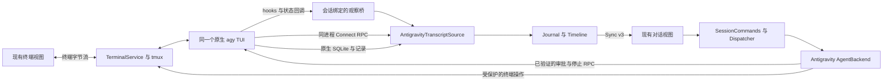

# Antigravity 原生会话接入方案

日期：2026-11-13。状态：原生 TUI 接入已实现，受管会话的主要链路已通过本机端到端验证；实际交付范围见第 26 节。第 1–25 节保留设计与三轮原生探针记录，其中“尚未实现”等表述描述当时状态。当前使用内置插件 `riffet.antigravity`，Web、macOS、Android、iOS 共享同一个原生终端与对话源。依赖 `agy 1.5.6` 的私有 RPC/SQLite 格式，未验证版本需重新验收。

## 1 目标和架构决定

一个 Riffet 会话托管一个持续运行的原生 `agy` TUI。终端视图连接它的 tmux pane；对话视图读取同一原生会话的记录，把发送、审批、配置和停止交给同一进程。切换视图不启动、停止、恢复或替换 Agent，也不改变 `nativeSessionId`、Run 或 Journal 身份。

本方案采用官方插件 `riffet.antigravity`，提供内置后端 ID `antigravity`，与 Cursor 的组织方式一致。驱动位于插件模块，宿主通过 `AgentBackend` 调用；TS 与 KMP 增加明确的后端身份，以现有四端路径交付。这里新增的内置 ID 表达产品支持范围，不把 Antigravity 实现放入 kernel。纯 namespaced ID 需要先改造 Android/iOS 的动态身份消费者和提供商编辑器，超出本次接入必要范围。

正式交付必须包括以下行为：

1. 对话里发送，切到终端可见同一任务；终端里输入，切回对话可见相应消息和执行结果。
2. 模型执行、工具调用、审批等待期间可以切换视图，原任务继续运行。
3. 任一视图完成审批或停止后，另一视图撤掉旧请求；重试不会再执行一次。
4. Web、macOS、Android、iOS 使用同一 Session、Run、能力目录和同步协议；旧客户端不接收不能解码的身份。
5. Riffet 重启后接回原 pane；历史、输入回执、未决交互和后台任务按证据恢复。



### 1.1 接入方式的取舍

| 路线 | 决定与依据 |
| --- | --- |
| 原生 TUI、本地 RPC、SQLite、hooks | 当前主路线；同一 TUI 保留，RPC 观察实时状态，SQLite 提供离线事实，hooks 辅助唤醒 |
| `agy acp` | 不作为该会话的执行或观察连接；尚无与运行中 TUI 共享 runtime 的保证，另起 ACP 可能形成第二个 writer |
| headless `stream-json` | 仅用于隔离协议探测；正式会话不能因进入对话视图切换成 headless |
| Python SDK 或云端 Interactions API | 属于其他运行形态，不纳入本次本地原生会话接入 |
| 模型 HTTP 代理 | 用户配置的模型来源；不承担 Riffet 对话同步，也不替代 Antigravity harness |
| 本地内部 RPC | 第二轮已验证同 TUI 正文流与控制，纳入版本受限的 adapter；未知版本/字段回退只读或终端，不能承诺官方稳定性 |
| 官方 Remote Control 网页 | 不嵌入第三方网页替代 Riffet 对话视图，也不新增云端控制依赖 |

沿用 [TRAEX 方案](TRAEX.md) 中对原生终端完整性的要求，以及 [终端会话](TERMINAL-SESSIONS.md) 的单 writer 约束。内部视图切换与 `riffet resume` 交还外部终端是不同操作，后者有单独的空闲和持有者检查。

## 2 已有证据与验证边界

以下“已验证”指本次独立探针，不等于 Riffet 产品已经实现。临时测试未修改 Riffet 代码，没有把测试 Key 写入仓库或全局 provider 配置。

| 项目 | 已取得的证据 | 实现时的约束 |
| --- | --- | --- |
| CLI | 本机 `agy --version` 为 `1.5.6`，支持 `--settings`、`--model`、`--conversation`、`--add-dir` | 版本范围与能力报告分开，后续版本不能仅凭版本号自动打开高级能力 |
| 自定义模型 | `modelProvider=gemini`、`GEMINI_API_KEY`、`GOOGLE_GEMINI_BASE_URL` 可用 | Google 登录和 API Key 两条认证链不混用 |
| 网关请求 | `gemini-3.8-flash-medium` 实际发往 `/v1beta/models/gemini-3.8-flash:streamGenerateContent?alt=sse`，`thinkingLevel=MEDIUM`，HTTP 200 | 展示选择与实际 wire model/effort 要有明确映射 |
| 原生执行 | 同一 pane、进程和 conversation ID 完成两轮；第一轮 `read_file` 读临时文件，第二轮从上下文复述 | 核心 harness、工具和多轮上下文保留 |
| 状态回调 | 收到 conversation ID、model、`agent_state`；Shift+Tab 后收到 `cycle_mode=accept-edits` | 可用于运行状态和配置观察，不能单凭 idle 判定回合成功 |
| hooks | 收到 SessionStart、PreInvocation、PostInvocation、PostToolUse、Stop；后台完成分阶段上报，Ctrl-C/拒绝/崩溃可没有 Stop | hooks 不构成完整生命周期流；缺失终态和重复调用按第 10、23 节处理 |
| 执行编号 | 两轮 Stop 的 `executionNum` 均为 0 | 不能用 executionNum 单独标识或区分用户回合 |
| 附加目录 | `--add-dir` 加载 hooks 与 MCP；同项目两 TUI 的 marker 工具路由正确 | 私有入口可用；真实 Riffet shim 的鉴权、ACK 和设备副作用仍需实现后验收 |
| 原生文件 | hook 给出 `antigravity-cli/brain/<id>/.system_generated/logs/transcript_full.jsonl`；样本含六个 step | 不能写死 status line 所给路径；必须核验 hook 路径、cwd 和会话归属 |
| 路径差异 | status line 指向 `antigravity/brain/.../transcript.jsonl`，与本次实际文件不同 | status line 路径仅为提示，不作为唯一读源 |
| 行结构 | 含 `step_index/source/type/status/created_at`；压缩追加 CHECKPOINT；rewind 后同 ID 内复用 step index | 记录 occurrence 与当前可见分支分别维护；step index 不是唯一消息键 |
| 工具关联 | 第一轮 JSONL 缺 ID；第二轮完整 RPC/SQLite 的 planner 与 result metadata 含对应 call ID、execution ID | 按原生 ID 关联；并发和 child 的边界继续补测 |
| 启动身份 | 新 TUI 未发送前 conversation ID 为空，首次输入后才分配 UUID | 首条发送先绑定 launch/pane，不能假造原生 UUID |
| 账号路径 | 本机 Google 登录模式曾被地区资格检查拒绝；API Key 模式真实调用成功 | 登录成功、目录可读与模型调用资格分别报告 |

一次直接向网关发送非流式 `generateContent` 的探测发生断连；上表成功范围是 `agy` 使用的流式请求。不由此承诺网关全部 Gemini 接口或全部模型可用。

### 2.1 当前验证边界

第一轮 transcript/hooks 缺口见第 23 节；第二轮通过开源实现定位并验证了更完整的 RPC、SQLite 和 `--gemini_dir` 路径，详见第 24 节。正文实时增长、撤回后活动分支、审批回执、execution 终态与私有 settings 写入均已有实测路径。第三轮又验证了 reader 重连、原生重启、并发审批、单选回执、self 子 Agent MCP、常规定制快照和现有 Journal 的撤回/重放。仍未完成：未知版本的协议拒绝、SQLite 完整生产 decoder、所有事件/车道的 Journal 映射、MCP 真正重叠副作用、显式 custom child MCP、复杂定制重定位、跨认证续接，以及 Riffet 双视图、ACK、四端和服务重启端到端验收。原生锁已确认只有 advisory 作用，不能等待它提供原子交接。SIGKILL 后无匹配 executor 终态的执行继续保持 unknown。

## 3 与现有 Agent 的能力对齐

“对齐”包含相同的产品语义、数据保护和错误处理；具体协议无法提供的能力按 capabilities 收敛，不能以错误的成功状态伪装支持。核心能力缺口阻止正式发布，高级能力缺口只关闭相应入口。

| 能力 | 对齐来源 | Antigravity 的交付要求 |
| --- | --- | --- |
| 终端与对话切换 | Cursor、Claude | 四端共用原生 pane；运行中切换不改变进程或会话 |
| 新建与恢复 | 所有原生后端 | 延迟取得首个 ID；确定 ID 恢复；禁止模糊 `--continue` |
| 发送、排队、Outbox | Dispatcher、Claude | 持久 fence、原生回执、未知不重发；保护终端草稿 |
| 停止与打断发送 | Claude、Codex | 每次写前验证目标；确认停止和遗留输入后才发送替代任务 |
| 严格引导 | STEER 契约 | 默认关闭；只有绑定同一执行目标且有持久回执时开放 |
| 审批与提问 | 现有 NativeInteraction | 标准请求可在任一视图回答；复杂或秘密输入转原生终端 |
| 模型、思考、模式、权限 | 现有 profiles 和 pickers | 保存选择、运行有效值和下一轮 pending 分开；TUI 改动回流 |
| provider 变更 | 现有 continuation 语义 | 仅空闲切换兼容配置；同一会话保留历史；未知兼容性拒绝续接 |
| 实时与历史 | Journal、Sync v3 | 一个投影；稳定身份；重读不重复；尾窗导入和大文件按需读取 |
| 附件、文件与会话引用 | materializeNativeInput | 真实模态和原生可读路径；不把图片悄悄降成文字 |
| 子 Agent、计划、后台任务 | 现有子车道与 Activity | 有真实关联才建立子车道；主回合和后台状态分开 |
| MCP、设备工具 | RiffetMcpService | 每会话注入；变更按启动快照生效；无全局项目配置改写 |
| Skills、MCP、Plugins、Hooks、Rules | EXTENSIONS 契约 | 只读发现、hash 冲突保护、来源与运行状态分别表达 |
| 分享、搜索、收藏、统计 | 现有 stored readers | 只读既有记录，不为查看内容启动 CLI 或 MCP |
| 外部会话导入与交还 | TERMINAL-SESSIONS 契约 | 扩展公共插件接缝，保留单 writer 与 cwd 绑定 |
| 任务、定时、唤醒、讨论、交接 | 现有 orchestration | 仍通过 SessionCommands；不能绕开队列与归档检查 |
| 四端、旧版本 | pi-agent 协商方式 | 新增 `antigravity-agent`；在所有返回入口保护旧端 |
| CLI 检测、升级、停用 | 原生版本报告与插件生命周期 | 可解释的版本状态；升级不打断运行任务；停用不误杀 TUI |

## 4 模块与宿主边界

下列树是计划新增的位置，不表示这些文件已经存在。按实际职责合并小文件，不为每个概念创建类。

```text
plugins/riffet/antigravity/
  index.ts                 manifest、激活、doctor
  backend.ts               AgentBackend 适配及能力
  runtime.ts               launch、状态归属、终端操作
  config.ts                profile、模型映射、版本与启动配置
  bridge.ts                NativeHookServer、绑定、descriptor 与观察事件
  transcript.ts            原生读取、行身份、Journal 投影
  interactions.ts          RPC/屏幕交互与审批回执
  extensions.ts            原生扩展目录和管理
  assets/                  CLI 子进程可直接执行的最小桥接脚本
```

复用 `@riffet/plugin-api/kit` 的 CLI resolver、exec、NativeHookServer、附件、模型选择、配置文件、TurnTracker 和 Activity 辅助能力。继续使用宿主 TerminalService、SessionCommands、Journal、Stats 和 RiffetMcpService；不复制另一套 tmux 服务、转录数据库或请求调度器。不引入 ACP SDK、Python runtime 或生产模型流量代理。

具体 Agent 的逻辑不进入 kernel；插件不得导入另一个 driver 或服务端内部模块。确有复用价值的机制从 kit 暴露，依赖由 host 或 `app.ts` 注入。遵守 [服务端分层](guide/architecture.md) 和 `check:plugins`。

### 4.1 需要补齐的通用接缝

| 现有缺口 | 计划调整 | 约束 |
| --- | --- | --- |
| `AgentRunRef` 读不到已持久化的输入基线 | 加入只读 `nativeInputBoundary`、终端身份、发送时间/基线等现有字段，并更新适配层 `runRef` | 只给本插件会话，不能暴露 Store 或秘密配置 |
| 插件只能读 pane PID，不能核验进程树 | 增加有限的 `terminals.inspect`，由宿主核验 launch marker、PID 起始时间、可执行文件和 cwd | 返回核验结果及所需身份；argv 必须脱敏，不提供任意进程查询 |
| 外部历史、holder、交还接口未进入 AgentBackend | 将内部 driver 的 external operations 作为结构化可选成员公开并转接；新增三态 `ownership` 探测 | `held/free/unknown` 明确区分，unknown 和探测失败阻止启动；旧 holder 接口兼容保留 |
| continuation 未进入插件协议 | 增加 `continuationKey/canContinueProfile` 对应意图接口 | 未实现即不提供跨 profile 续接 |
| 自定义模型探测硬编码少数后端 | 增加通用 `probeModels` 与 profile 协议描述，provider editor 从元数据取可编辑字段和协议 | kernel 不增加 `if antigravity`；Gemini 解析在驱动或公共 gateway kit |
| 终端命令需要切视图，但各端有后端分支 | 为 slash catalog 增加可选执行类型/需要终端元数据，四端统一消费 | 普通文字和 Skill 不自动打开终端 |
| runtime 能力 DTO 不完整 | 对齐 TS、KMP 的 `requiresLiveTerminal`、版本信息等实际使用字段 | 新字段可选；不更改已有枚举值含义 |
| 会话工具快照和扩展关闭字段未在 AgentSessionView 暴露 | 向插件开放所需的只读快照及变更指纹 | 避免插件从全局设置猜测当前会话权限 |
| `ingest()` 返回 void，不能作为持久化 ACK | 增加返回提交证明的可选摄取方法，给出绑定、已提交 deliveryId 和 Journal 水位 | source 未就绪、异常或没有提交时不能返回 committed |
| 配置回流没有 expected revision | `updateSession` 增加可选 `expectedConfigRevision`，用 CAS 拒绝过期观察 | 保留已有调用方式；runtime 内按 launch 和观测顺序处理回调 |
| MCP 只有会话凭据，没有原生调用绑定 | 受管 runtime 的 tools/call 传递原生 `_meta` 与 launch binding，服务端在副作用前核验当前/root 会话与调用身份 | 复用已有鉴权和幂等边界；不再预设 PreToolUse 授权配对表，缓存 status 不足以授权 |

这些扩展保持可加性，Cursor/Echo 等旧实现仍能运行；只为本次明确的行为缺口增加接口。自动生成契约之外的 KMP DTO 继续按仓库约定手工维护并用 fixtures 校验。

## 5 运行配置和认证

### 5.1 Profile

默认 profile 沿用本机 `agy` 登录与配置。自定义 profile 复用现有 `executable/apiEndpoint/apiKey/apiProtocol/defaultModel/enabledModels/modelInputModalities/modelContextWindows/disableAutoUpdate` 字段，`apiProtocol` 只接受 `google-generative-ai`。只有 CLI 公开并验证支持的配置才出现在编辑器中。

保存 profile 先做字段校验，连通验证是独立动作。删除仍被会话、默认设置或任务引用的 profile 沿用现有引用保护；不能删除后把旧会话默默转到另一账号。错误中的 endpoint、响应头和原生异常经过同一 redactor；TLS/代理继续沿用已有网络配置，不自动关闭证书校验。

| 场景 | 启动配置 |
| --- | --- |
| 原生 Google 登录 | 不注入 Riffet 的 Gemini Key 和 base URL，不强制切到 API Key provider；沿用 CLI 的原生选择 |
| 自定义 Gemini endpoint | `--settings` 中 `modelProvider: "gemini"`；`GOOGLE_GEMINI_BASE_URL` 指向 profile endpoint；Key 用 `GEMINI_API_KEY` |
| 本机已有 Gemini API 配置 | 沿用原生非秘密配置；Key 必须由受支持的 resolver 显式取得并放入 secretEnv，不能依赖 pane 自动继承 |
| 其他 provider 协议 | 写入前明确拒绝；不给 OpenAI/Anthropic 协议一个会被 CLI 忽略的选项 |

Key 经 `AgentLaunchSpec.secretEnv` 进入该 pane。`GEMINI_API_KEY` 声明为 secret managed env，base URL 和桥地址为普通 managed env；切换 profile 时清理 tmux 服务器可能保留的旧值。禁止 Key 出现在 argv、`--settings` JSON、launch marker、客户端响应、日志、分享和证据文件中。响应只给 `hasApiKey`。

凭据解析顺序为：该 profile 的显式 Key、用户为该 profile 选择的受支持 credential source、用户明确允许导入的服务启动环境变量。每一步都把结果显式放入 secretEnv；默认不读其他 profile 或任意 shell rc。API Key 模式缺凭据时返回需要配置凭据，不自动退回 OAuth。Google 登录使用原生 keyring；服务由 LaunchAgent 启动时没有交互 shell 的 export 是预期情况。

原生 TUI 的隐藏参数 `--gemini_dir=<root>` 已在 `1.5.6` 验证；此前失败的是不同拼写的 `--gemini-dir`。该根能隔离 settings、会话数据库和发现目录，HOME 保持真实值。第二轮以合成配置启动，再通过 TUI `/model` 从 Low 改为 Medium，写入只发生在私有 settings，两份真实全局配置 hash 不变。

该参数未列入官方帮助，先供受管 session root 使用，不立即开放任意 `configDir` 编辑。新增 profile 指纹必须包含规范化的原生数据根；精确恢复沿用同一根。默认 Google 登录/keyring、用户定制迁移与已有全局历史的导入规则单独验收，不能复制凭据或把所有 global 目录链接后声称隔离完成。`disableAutoUpdate` 映射官方 `AGY_CLI_DISABLE_AUTO_UPDATE=true`，属于该 launch 的 managed env；显式更新先核验版本/安装来源，活跃进程不被替换。

地址规范化保留用户配置的路径前缀；拒绝 userinfo、fragment 和承载 Key 的 query。loopback HTTP 是已验证的合法使用方式。模型探测限制跳转，不能把 Key 转发给另一 origin；401/403 与 429/5xx 分别报告。不得修改或读取 Google OAuth token 来冒充 Gemini API Key。

### 5.2 模型目录与思考强度

自定义 Gemini 目录优先查询带 `x-goog-api-key` 的 `GET /v1beta/models`，读取 `name/supportedGenerationMethods`；不默认将 OpenAI `/v1/models` 当作 Gemini 模型目录。支持手填 ID，目录失败时保留缓存和已存选择。缓存按 endpoint、credential revision 和 profile 绑定，Key 不进入缓存键或公开内容。

本次网关提供 `gemini-3.8-flash-high/medium/low/tiered`，而 CLI 对 medium 的实际请求是基础模型加思考强度。模型适配保存三层信息：用户选中的目录项、CLI selector、实际 wire model 与 effort。只对已验证的模型家族做别名归一；不能对所有带 `-high` 的任意 ID 截后缀。`tiered` 未实测，不猜测其含义。

流量探针还观察到一次 CLI 发往 `gemini-3.1-flash-lite-preview` 的附加请求，用途未确认；profile 连通性与计费不能假设所有原生请求都使用 picker 选中的模型。

Riffet 选择沿用现有模型参数表达，例如 `gemini-3.8-flash[effort=medium]`；内部映射为已验证 CLI selector。实际模型从回调/原生配置确认后写 `resolvedConfig`。无思考参数的模型不继承上一个模型的 effort。网关未声明的 context window 和模态保持未知，不从型号名字推断。

自定义别名可按官方 `customModelsConfig` 注入本次 `--settings`，使用 `gemini-api://.../models/...` 形式；该路径的 URL 编码、工具 formatter 和模态配置必须单独实测，不能因 schema 存在就开放任意 custom model。官方自定义模型的缺省工具 formatter 与标准 Gemini 模型可能不同。

模型源插件的 `catalog()` 当前仅接受部分内置后端身份。直接 endpoint + Key 属于本次必需能力；命名 model source 在通用协议目录接缝完成前不提供，不能硬把 Antigravity 伪装成 Codex 来取目录。

### 5.3 模式与权限

`Session.mode` 使用 Antigravity 自己的 native option ID：`default/accept-edits/auto/plan`。其中 `default` 写 CLI 时是缺省/空设置；`auto` 按机器、账号和 sandbox 实际能力开放，CLI 回退 default 必须回流有效值。

`Session.approval` 对应原生 `toolPermission`：`request-review/proceed-in-sandbox/always-proceed/strict`。模式和权限的作用同时保留，不把 `accept-edits` 拆成虚假的只读模式，也不把 `plan` 等同文件系统沙箱。原生 deny/ask/allow 规则和 `artifactReviewPolicy` 继续生效。高权限选项复用既有权限提示，不默认传 `--dangerously-skip-permissions`。

优先在空闲 TUI 中通过已验证的原生命令/控件设置，然后回读；必须重启的 endpoint、Key 或启动配置变更保存为 `configPending`，等主回合、原生队列、审批、子 Agent、后台命令均结束后应用。执行中绝不为了更新 picker 重启。手动 TUI 改动通过 `updateSession(..., {bump:true})` 更新实际值，不覆盖用户后来提交的更高配置 revision。实测 `/effort low`、`/model` 选 High 与 Shift+Tab 均能改变有效值，启动 `--model` 不锁定运行选择；恢复时该 flag 又会覆盖为 Medium。原生 `/model` 会越过临时 settings overlay 写所在根的持久配置；第二轮私有 `--gemini_dir` 已验证能将该写入留在会话根。其余模式、权限和扩展仍须分别核验作用域。

同会话跨 profile 切换仅对经验证的同 CLI、同原生记录根、历史兼容的配置开放。Google OAuth 与 Gemini API Key 之间的相互恢复尚未验证，默认不列入 continuations。切换失败保留原 runtime 或按原 profile 恢复，已保存的新选择留 pending；不生成 fork，不清 Journal。

配置观察在 session lock 内按 launch 和持久 `observationSeq` 串行处理。发送配置命令前记下 expected revision、最后观察序号与期望值；只在命令后的新观察与期望值一致时清 pending。callback 不具备因果标记时先视为观测值，不直接覆盖用户选择，再通过新一次原生回读确认。手动 TUI 修改仅在没有更新的 pending 意图时以 CAS 写回；CAS 失败后重读并重新判断，不能无条件 bump。

已验证的 `--model` 只设启动值，不锁运行中的 TUI 选择。下一次启动从已确认的最新会话配置生成 selector，不反复带回最初的固定值。mode 的所有启动组合与权限配置尚未完全验证；未知组合按能力关闭，不能在 UI 先显示已生效。

## 6 原生进程与会话身份

### 6.1 启动

1. 解析绝对 executable，校验支持的宿主平台、版本和必要 flag。Riffet 服务依赖现有 tmux 宿主；Windows CLI 支持不代表本方案新增 Windows 服务端支持。
2. 在会话锁内重新检查项目 cwd、归档状态、外部 holder 和现有 terminal。先复用可信的 live pane；两个视图并发打开也只能有一个 writer。
3. 准备会话私有 bridge bundle、不可变启动配置和 launch descriptor。为每次进程启动分配 `launchId`，记录 executable identity、PID 起始时间、cwd 和 profile 指纹。
4. `host.terminals.launch` 使用 `reuseLive: true`，监听注册先于任何输入。新会话不携带初始 prompt 参数，`supportsInitialPromptArgs=false`。
5. 确认原生 composer 完成恢复且可完整粘贴，或有可信的有效 busy 状态。启用 MCP 的会话还须确认本次工具 inventory 就绪；服务 initialize 完成不等于首轮模型已取得工具。登录、信任、失败界面是独立状态，不误判为 ready。新项目信任与 Claude Code 驱动一致：在 Riffet 中为会话选定项目即作为信任决定，写入本次启动 `--settings` 的 `trustedWorkspaces`（并入用户已信任的目录），不改用户自己的 agy 配置，并以 info 提示说明（2026-11-13 修订：原做法让首次发送停在信任对话框，对话视图无法处理；2026-11-26 实测 1.5.10 只靠 `--settings` 就不再弹出信任对话框）。

新会话没有 native ID 时允许 terminal 先绑定 Riffet Session。首条 fence 保存 launch 与 pane 身份；可信 hook 确认 conversation ID、cwd 和 launch 后，才调用 `setNativeSessionId`。第一次绑定失败或候选冲突时停止结构化发送并保留诊断。首次 outcome 不明前不发送第二条受管消息。

恢复使用精确 `--conversation <verified-id>`。`--continue`、名称匹配和前缀 UUID 不用于恢复。原生 ID 和文件定位分别校验；请求中的 ID 不能当文件路径。新建失败保留草稿，只有重试同 commandId 才读取原投递记录，不能把“再次打开视图”当作再次发送。

### 6.2 运行身份与终端 epoch

运行实例由 Riffet Session、native conversation、launchId、进程启动时间和 pane 共同确定。终端 epoch 表示当前控制代次，服务重连可以改变 epoch；不能因此认为原生进程已经重启，也不能拿旧 epoch 的操作控制新连接。恢复时先核验进程，再按当前 epoch 签发操作目标。

配置指纹不包含 Key 原文或可公开暴露的 Key 哈希，使用宿主持久 credential revision 或私有指纹。view 切换、订阅增加、窗口 resize 不影响启动指纹。

### 6.3 原生切换到另一会话

`/clear`、`/new`、`/resume`、fork 或原生选择器可能改变 conversation ID。正式行为是：首次无 ID→有 ID 属于正常绑定；观察到已有 ID A→B 时冻结对话发送、审批和停止，A 的历史不被替换成 B。MCP 不等待异步 status 回调判定安全，每个副作用请求都必须取得当前原生调用的身份授权，见第 7.2 节。原终端仍可查看和操作。

对话命令目录把此类命令引导到现有新建/导入流程，不直接作为普通消息发送。终端手动切换后显示一次连接归属冲突，提供返回已绑定会话的路径。若要接管 B，须经现有外部会话导入及宿主原子转交能力：核验 B 唯一绑定、cwd、A 无活动/未知输入后再转移 pane，不能让插件自己改数据库或在后台悄悄创建 Session。该原子转交未完成前，只允许返回 A 或结束该 pane 后通过导入打开 B。

## 7 桥接目录和配置隔离

2026-11-26 修订：新会话的原生数据根就是提供商的 `sourceDir`（默认 `~/.gemini`），对话写进 agy 自己的 `antigravity-cli/conversations/`，用户自己的 agy 和用量工具都能看到。原先为每个会话复制一份私有根，是因为 `/model`、`/mcp` 等原生命令会写持久配置、Riffet 的 MCP 也只能写进配置文件；现在 Riffet 的选择（模型、模式、审批、信任、自定义模型）都只经本次启动的 `--settings` 和参数传入，`--settings` 只带这些键，其余设置仍由 agy 读用户自己的文件；原生命令产生的持久设置沿 CLI 原生作用域，与用户直接运行 agy 一致（启动参数 `--model` 优先于 `/model` 保存的模型，已实测）。Riffet MCP 放进本会话的桥接插件，只有本进程加载。会话第一次准备时在 `initialized.json` 记下布局：`version: 2` 记录数据根；`version: 1` 是此前的私有根，这些会话继续在 `native/` 上恢复，不迁移。对话位于共享目录后，用户可能在自己的终端里同时 `agy --conversation` 打开同一对话；目前不检查这种外部持有者（Claude Code、Codex 的检查见 [TERMINAL-SESSIONS.md](TERMINAL-SESSIONS.md)）。

受管会话以 `--gemini_dir` 指明原生数据根，以 `--add-dir` 加载桥接工作区。不把数据根变成 Agent 工作区。额外工作区仅包含非秘密桥接插件和执行脚本，按会话隔离。会话自己的 endpoint Key、控制 token、投递基线和其他会话数据都不能放进这个可由 Agent 访问的目录。

```text
<plugin-state>/sessions/<sessionId>/
  initialized.json            布局与数据根（version 2：sourceDir；version 1：native/）
  native/                     仅旧会话（version 1）：私有 settings、原生 SQLite、扩展快照
  descriptor.json             0600，当前服务地址及已核验进程绑定
  workspace/                  稳定路径，精确恢复时继续使用
    .agents/plugins/riffet-antigravity/
      plugin.json
      hooks.json
      mcp_config.json
      scripts/
  launches/<launchId>/
    settings.json             0600，无密钥的本次 CLI 配置
    latest-status.json        0600，白名单字段的最新状态
```

精确恢复探针中，另一个目录内的同名新 bridge 没有收到 hooks，原会话仍调用旧路径。因此 bridge 入口和插件身份按 Riffet Session 保持稳定，launch 的可变状态另存；不能每次启动换目录再假设原生会自动迁移。恢复时核验实际 hook 路径，稳定脚本按调用进程祖先和 native ID 找到经宿主验证的 launch，不能只读取“最近一次启动”就认领回调。会话可继续恢复期间保留入口；升级在安全停机后更新，不能按短期缓存策略删除仍被原生历史引用的脚本。

附加目录会出现在原生工作区列表中，并允许原生工具按权限访问其中内容。这是已选择的官方加载方式的副作用；不把整个 Riffet stateDir 加入工作区。插件目录只读，私有状态由 host 管理；脚本引用精确 descriptor 路径，不扫描其他会话。

`--settings` 合并用户原配置，只覆盖 Riffet 本次必须控制的设置。status line collector 转发用户已有命令的原始输出；没有用户命令时保留默认状态行，不添加常驻 Riffet 说明文字。脚本输出只给原生 status line，诊断不污染模型文本。collector 必须在原生五秒期限前结束；快路径先更新白名单状态再有界地唤醒 source，不等待人的审批。用户原命令同样计入五秒预算，保持其 stdout 原文；超时结束本次 callback，不能无限积累子进程。

### 7.1 Hook 观察桥

复用 kit 的 `NativeHookServer`，监听 loopback，校验 bearer token、body 上限与 delivery ID。再校验 launch、Session、workspacePaths、native ID、路径 realpath 和活动进程归属。实测插件 hook 的 cwd 为附加 bridge 目录，不是主项目目录；主项目归属须由已核验的进程 cwd 与 workspacePaths 集合共同确认，不能直接要求 hook cwd 等于项目。只有 token 不足以允许任意 hook 自报另一会话；子 Agent 使用第 13 节的 parent 关联规则。

descriptor 原子替换，包含 server instance 与过期检测；每次调用重读，不把服务端随机端口永久烙进 TUI。共享 descriptor 实现应参数化文件名并由 kit 导出，不能借用 Claude 的固定文件或后端身份。

完整 RPC 提供用户输入、工具关联、审批回执与 executor 终态，SQLite 已验证活动分支与 executor 持久化；对应事实通过 schema 核对后恢复，不再预设逐条复制到独立 hook outbox。hooks/status 只唤醒 source，服务离线时原生继续执行，重连从 SQLite 一致快照补齐。恢复 cursor 与 Journal 事件仍须原子提交，不能将 HTTP 200 当作 Journal 已提交。

仅对于经验证无法从原生重建、却影响输入或交互安全的少量观察，才考虑沿用现有持久机制；先证明缺口再增加文件。关键控制请求在现有 Run/interaction receipt 中先记 pending，结果未知不重试写入。`NativeHookServer` 的 handler 异常响应不能伪装成功，也不能直接当 PreToolUse 原生响应，后者遵守下述明确格式。

status 高频快照使用覆盖式 latest 文件，按白名单和内容变化处理，不持续追加完整 JSON。常规 source 通知不需要持久 ACK；需要提交证明的是 Dispatcher/Journal 的控制与摄取边界。第一轮预设的每 launch 32 MiB 观察队列和终态预留区不纳入首版，原生快照不能恢复的真实场景出现后再决定最小补充。

控制预算以可取消操作实现：本机版本探测最多 8 秒，启动 ready 等待最多 30 秒；超时报告当前原生界面，保留 pane，不自动二次启动。pane 内粘贴确认最多占锁 2 秒，到期释放并标记未确认；观察 hook 到 HTTP 的等待预算为 1 秒，HTTP 超时按下述已验证的 hook 响应格式返回，source 以后续快照补齐。模型和人的审批等待没有这些操作超时；MCP 沿用现有长调用预算。所有数字是本方案的初始实现参数，由慢机、SSH、长输入和故障探针校正，不用于推断原生任务已经结束。

PreToolUse 仅做短时观察，并明确返回 `{"decision":"allow"}` 结束本观察 hook 的否决检查，再由原生权限策略决定是否弹窗。实测 `{}` 会导致 `tool call denied by pre-tool hook`，不能作为正常空响应或网络失败回退；`allow` 不等于 `auto_approve`，严格模式仍弹出权限请求。传输失败时脚本返回这一已验证响应，由 source 重新读取原生事实，不新增工具权限；脚本崩溃/原生 hook timeout 的具体策略另测，不能把未执行的回退描述成可靠放行。人机交互在原生屏幕保持等待，见第 11 节。

### 7.2 Riffet MCP

`host.riffetMcp(sessionId)` 的 stdio spec 放入当前会话 bridge plugin 的 `mcp_config.json`。agy 把插件里的服务命名为 `<插件名>_<服务名>`（`riffet-antigravity_riffet_<hash>`）。1.5.10 起插件 MCP 不在启动时加载，要等 `/mcp` 视图打开或第一条消息到达，而第一条消息本身拿不到工具；`RefreshMcpServers` 不触发加载，`--settings` 不接受 `mcpServers`，附加目录下的 `.agents/mcp_config.json` 也不读。因此投递前 inventory 里没有这个服务时，Riffet 先输入 `/mcp`、按 Esc 关掉，等服务就绪再粘贴（`mcp-scope.ts#mcpReady`）。旧会话（version 1）的 MCP 仍写在私有根自己的 MCP 配置里。保留现有凭据 shim、按会话 toolGroups、基础工具和设备授权；不把 `/api/riffet-mcp` 当通用 HTTP MCP 端点，不改全局或项目 MCP 文件。

桥接需在原生 /mcp 名称空间下核对真实加载结果。受管工具请求附带 launch/native binding；RiffetMcpService 在实际副作用前原子核验绑定、撤销状态和调用身份，不能只由包装器先读缓存再转发。身份未确认、观察缺口或切到其他会话时拒绝调用。服务重启后使用原 shim 的凭据重读机制，不重复发送结果未知的 tools/call。

实测每个 `tools/call` 的 `_meta` 已携带 `antigravity.google/conversation_id`、`antigravity.google/root_conversation_id`、`antigravity.google/artifacts_dir` 和 `progressToken`。以受管 shim 的启动凭据绑定 launch，在服务端副作用边界校验当前/root ID；缺字段或 A→B 时立即拒绝，不能等待 statusline。`/clear` 后 MCP 进程保持不变，但下一次请求已携带 B 的 ID，说明不能缓存启动时的 conversation ID 作为长期授权。

调用关联保存完整 opaque progressToken、传输代次和原生 occurrence。样本中 token 后缀与 hook stepIdx 对应，同参两次调用也有不同 token；这是 `1.5.6` 的实测关系，尚不是跨版本保证，且 JSON-RPC request ID 在 MCP 重启后会从头分配。无需为取得当前会话身份另造 PreToolUse/FIFO 配对机制；hook call ID 可作为辅助核对，稳定调用去重仍需经过重叠调用、rewind、重连与旧请求重放测试，不能只用 token 后缀或参数哈希。该措施防止串会话和控制竞态，不把同 UID、可执行 shell 的本机 Agent 当成隔离沙箱。

toolGroups 变更保存后在下一次安全启动生效；运行中的工具清单不因设备上下线反复增删。归档、删除和授权撤销按现有服务即时拒绝调用。两会话同项目也使用不同 bundle、token 和稳定的 session namespace。实测相同原生 server 名共用 schema cache，B 会覆盖 A 的工具描述；正式 server/plugin 名按会话区分，同一会话恢复时保持不变，工具快照变化后重新确认 inventory。Riffet 桥自身故障不得影响用户安装的 MCP，也不能扩大设备集合。

`--add-dir` 的真实 MCP 加载、两会话路由、五秒长调用和原生 Restart 已验证；真实 Riffet shim 的服务端绑定、撤销、持久幂等与设备副作用尚未实现，仍是正式发布门槛，不将 `supportsRiffetTools` 预置为 true。

## 8 发送、回执和队列

### 8.1 受管发送

本节先保留 TUI 投递作为基线。第三轮已验证 `SendUserCascadeMessage` 能向 TUI 当前会话发送、保留草稿并持久记录 clientMessageId，但原生不按该 ID 去重；完整配置映射通过前不替换基线。RPC 路径的具体门槛见第 25.3 节，不能照搬仅传 model 的请求。

1. SessionCommands 接受 commandId 并持久保存输入；Dispatcher 处理排队、去重、取消、配置 revision 和未知状态。
2. 准备附件与会话引用，核验当前 launch、主回合和原生队列。普通发送只在主 composer 可写时投递。
3. 进入 `terminals.interact`，读取 fresh screen，确认没有菜单、审批、子 Agent 输入框或未知手工草稿。非空用户草稿保留，操作返回已有阻塞语义；不自动全选删除。
4. 捕获原生输入基线：native ID 或首条 launch 绑定、已读 occurrence、step/文件尾、必要前缀指纹和最近确认输入。用版本化 JSON 写入现有 `nativeInputBoundary`，不添加独立关联表。
5. 在第一次可能改变终端输入的写入之前调用 `commitDispatchFence`；其后发生超时或断线均不得自动重发。
6. bracketed paste，确认完整文本已进入正确 composer 后只发送一次 Enter。每次写前复核 cancel、launch、epoch、目标和输入框状态；不依赖固定 80ms 延时作为已粘贴证据。
7. 短时等待确认可以持有 pane，等待模型或用户不能长期占用 pane/session 锁。`requestInterrupt` 能解除发送等待，让停止取得锁。
8. 写成功只报告 submitted。出现与该 fence 唯一匹配的原生 USER_INPUT 后再发 `native_input_receipt`，关联原生 message/turn 和 Run；终态由第 10 节处理。

### 8.2 原生回执匹配

主源直接读取 RPC/SQLite 的 userResponse，保留原生干净输入。仅在 JSONL 兜底时，样本 USER_INPUT 含 `<USER_REQUEST>`、时间 metadata 和设置变更包装，解析器只解包已验证的顶层格式；用户正文中同名标签、XML、换行、粘贴的 `/` 命令都必须保持原文，不能做任意正则剥离。受管输入用 Run 保存的原文和实际 materialized 内容分别核对。解析不确定时保留原生文字并停止认领。

回执必须同时满足同 native/launch/cwd、基线之后的唯一原生输入、原生 source 合法、实际展开内容可验证、没有冲突的终端写入。相同文本、相同秒时间戳、多个候选、Skill 改写或未知原生排队不能仅按 FIFO 归属。首条输入的 native ID 后补到既有 Run，不再次提交 fence。

原生 message ID 的候选形式是 conversation + step occurrence，必须先通过第 9 节的稳定性检查。RPC request ID、当前数组下标和本地随机 UUID 都不是原生回执证据。若两个相同输入在终端与对话竞争而无法区分，Run 保持 uncertain，原生消息仍可正常展示。

### 8.3 两套队列

Riffet 排队消息只保存在现有 Run 队列，轮到它时再进入 TUI。用户在 TUI 输入的原生队列继续由 `agy` 管理；通过真实 pending 数量和记录观察，不能把它复制成另一批可执行 Run。

受管启动选择 `queuedMessages=queue`，避免运行中意外输入触发原生打断；这不是严格 steer。原生队列非空时暂停 Riffet 后续投递，等前台与队列来源确认后继续。原生 queued item 没有完整身份/正文时只显示活动，不制造虚假待发送条目。

原生 UI 命令成功打开面板，只结算该命令操作，不产生模型回合完成。`/compact` 等实际执行任务走真实回合/活动；不能用所有 slash 都 `settlesSlashOnSubmit=true` 的做法结束长命令。

## 9 原生记录、实时输出和 Journal

### 9.1 事实来源

实时主源为已绑定本进程的 `StreamAgentStateUpdates`，首帧与重连通过有大小/分页边界的 `GetCascadeTrajectory`/`GetCascadeTrajectorySteps` 对照；离线主源为同根 conversation SQLite 的一致只读快照。transcript_full 保留可读兜底，不能用于恢复完整分支和终态。hook/status 负责及时唤醒与辅助校验。路径需 realpath 留在允许的原生记录根，native ID 与 workspace 匹配；权限失败、损坏或字段不兼容属于明确读取错误。

一个 `AntigravityTranscriptSource` 服务实时、历史、搜索、分享、收藏定位、会话引用和统计。文件 watcher、hooks 和订阅只唤醒同一个 source；多个客户端不创建多个 reader。只读路径不启动 CLI、MCP、hook 或模型。

### 9.2 行身份和投影

| 原生对象 | Journal 处理 |
| --- | --- |
| USER_INPUT | user 行；保留原始用户语义、附件与来源；终端直接输入也有 turnStarted |
| PLANNER_RESPONSE 的正文 | assistant/thought 根据真实字段分流；未知正文不猜成最终答案 |
| PLANNER_RESPONSE 的 tool_calls | 工具调用，按调用 occurrence 与 hook ID 关联 |
| GENERIC | 仅在有明确关联时作为工具结果；未知类型保留受限的通用可读记录和诊断，不静默丢弃 |
| 状态/配置 metadata | 更新控制或配置；不混入用户消息 |
| 子 Agent | 真实 parent call 对应子车道；父正文只显示子任务入口 |
| 计划、压缩、后台通知 | 复用 plan/Activity/通知事件，不能另起一套状态列表 |

transcript 的 step index 在 rewind 后复用，物理行号或内容哈希都不是完整身份。第二轮 RPC 返回每步 `metadata.executionId`、`sourceTrajectoryStepInfo.{trajectoryId,stepIndex,cascadeId}`，assistant 另有 `messageId`，tool result 另有真实 call ID。采用这些原生字段建立 occurrence；保留分支的 source step 身份在本次 rewind 前后不变，新分支使用新 trajectory。proto3 省略的 `stepIndex=0` 需按已验证类型默认值处理，不能认成缺字段。

当前分支由 RPC snapshot/stream 的 `trajectoryId`、`stepsUpdate.indices/steps/totalLength` 或 SQLite 事务内的当前 steps 决定。实测同 ID 撤回时，transcript SHA 不变，RPC/SQLite 步骤由 5 条变 2 条，stream 同时通知 trajectory 改变。stream 的 steps 是按 indices 更新的片段，不是每帧完整数组；新 trajectory 必须取得一致快照，再保留祖先 identity、移除当前分支不再可见的项。不得按顶层新 trajectory 重编号所有祖先消息，也不能把撤回当成新用户执行。

USER_INPUT 的 `userInput.userResponse` 提供干净原文；普通 TUI 样本的 `clientMessageId` 缺省；第三轮显式 RPC 输入可持久写入该值，但重复 ID 会产生两个不同 execution，因此它是关联证据而非原生幂等保证。planner toolCalls 与 result metadata 的 call ID 和 execution ID 可以直接核对，JSONL 中丢失这些字段不等于原生没有。最终 identity、Journal 的分支可见性、附件和跨重启恢复仍须通过实现边界验收，不能直接照搬开源 reader 的 step-index seen set。

### 9.3 流式与最终记录

流量与文件同步采样已给出反例：测试专用代理在每个 SSE data 记录后暂停 90ms，再原样 flush 给 agy，以确保 TUI 持续收到分段响应。代理共观察到 42 个 data 记录，采样跨度 5.175 秒；计数合并了主请求与一条附加模型请求，不能解释为主模型 token 数或自然网络耗时。该期间 transcript、transcript_full 及各自 chunk 的文件大小均未变化，约最后一次 SSE 采样后 0.126 秒才写入最终正文。探针验证的是分段响应进入 TUI 时，已知文件仍不追加 partial；同大小的原位重写未由该采样方法覆盖。

第一轮文件、状态与 hooks 样本只有步骤级正文，没有取得可用于 token draft 的读源；完整记录使用 transcript_full，短版存在截断。第二轮已补测 RPC 实时路径，无需将 TUI ANSI 文本解析成 Markdown。

上述结论只适用于第一轮文件读源。第二轮同 TUI 的 Connect RPC 捕获到 46 个非空增长正文快照，88→3791 字符，GENERATING→DONE 保持相同 messageId。实时主源改为 RPC 累计文本，按同一原生 occurrence 修订 draft，最终提交 retire draft；字符串不满足前缀关系时替换该 draft，不能盲目 slice。`1.5.6` 的 response 与 modifiedResponse 在生成中均有值，与开源旧文档不同；仍按经过验证的字段优先级和 status 判断，不能以 response 存在推断完成。transcript 继续用作步骤级兜底。

### 9.4 持久化与性能

满足 [Sync v3](SYNC-V3.md) 的 G1–G10：Journal 分配序号，nativeId 稳定，turn 边完整，cursor 与事件原子提交，generation 只因真实身份改变而重建，子 Agent 独立车道，活动只经 ActivityLedger。

cursor 包含格式版本、原生身份、当前 trajectory、已提交 execution/message/call identity、快照水位、open occurrence 与 alias；文件兜底另存文件/分块位置和尾部指纹。完成旧 chunk 的索引不反复保存全部正文。文件截断、inode 更换、原子重写先核对前缀与原生身份，再重扫受影响区；不能仅凭 size 变小清历史。

半行 JSON 等待补全；中间坏行记录精确偏移与可重试读取错误，不静默跳过后宣布 caught up。大行、大图片和工具输出用现有 blob；大会话首屏尾窗 scratch→promote，后台历史补齐不能阻塞停止和审批。

沿用现有每帧、行、缓存和积压预算。状态回调按内容变化去重，文件读取增量化，有事件时尽快摄取；无订阅的空闲会话释放 reader，活跃任务、未知输入和待摄取终态仍保留必要观察。不为每个打开的历史会话创建固定频率轮询进程。

## 10 回合状态、停止和恢复

### 10.1 状态归属

维护的是运行事实：进程、主回合、原生队列、审批、子 Agent、后台命令、历史读取和控制连接。这些事实投影到现有 NativeStatus、Run、Activity 和 outline，不扩展一组与现有状态并列的产品枚举。

`agent_state=working/tool_use/reviewing` 用于当前活动；`idle` 只说明最新回调时空闲。Stop 的 `terminationReason/error/fullyIdle/continuationActive` 要绑定输入 occurrence、执行边界与 launch。本次两轮 Stop 的 `executionNum` 都是 0，它不参与唯一 turn ID。迟到的旧 Stop 不得结束新回合。

第一轮 Ctrl-C、审批拒绝和 SIGKILL 可没有 Stop，401 transcript 也只有 USER_INPUT。第二轮检查到 SQLite executor_metadata 保留了 USER_CANCELED 和 ERROR，完整 error 也在原生数据库；RPC 的 executorMetadatas 同样按 executionId 提供终态。终态以这些持久事实为主，Stop 作为及时提示；SIGKILL 的那次 execution 没有匹配终态，仍不可补成功。后台任务先出现 fullyIdle=false 的 Stop，完成后再有结果与 fullyIdle=true，不能用一次 Stop 结束全部任务。

正常完成需要真实终止原因且已 drain 尾部；失败、用户取消、provider 拒绝分别映射。主回合已结束但子任务仍运行时保留后台活动；`fullyIdle=false` 不得触发进程回收和 provider 切换。后台后续结果产生通知或独立原生执行时，不反向重新开始已完成的用户输入。

| 观察事实 | 回合与状态处理 |
| --- | --- |
| 样本中的 `NO_TOOL_CALL`、无 error、执行边界吻合且尾部已读 | 当前普通模型回合 completed；不是所有同名字符串都脱离上下文直接结算 |
| 原生 provider/error 终止 | failed，原生错误脱敏后进入该回合唯一结果行 |
| 已确认用户停止及其终止事件 | cancelled/interrupted，沿现有 Run 与 outline 映射 |
| 终止原因未知或未采样的新值 | 保留具体原因并标记结果待核实，不默认 completed |
| 后台仍运行或 continuationActive | 更新前台与后台各自事实，不清掉还在执行的任务 |
| 无新活动但只有 idle | 只更新可用状态；已 observed 的丢终态按第 10.3 节收敛 |

### 10.2 停止

停止目标绑定 Session、native ID、launch、当前回合、terminal 和控制 epoch。先禁止下一次投递，解除发送等待，再在 pane 事务内确认当前是主 Agent 输入/执行界面。Esc/Ctrl-C 可能关闭菜单、停止子 Agent 或退出空闲 CLI，按真实屏幕和版本选择动作，不能无条件连发。

已验证 RPC 可区分两种动作：`CancelCascadeInvocation {cascadeId, killBackgroundTasks:true}` 取消当前 invocation，并留下相同 executionId 的 USER_CANCELED；`CancelCascadeSteps {cascadeId, stepIndices:[...]}` 只取消指定工具步骤，模型可能继续回应。后者省略 stepIndices 的调用虽 HTTP 200，实测并未停止命令。因此停止请求必须核验实际结果；whole-turn 与 tool-only 不能复用错误的语义。ForceStopCascadeTree、子树取消及 generation 竞态尚未验证，保持关闭。

停止后核查遗留 composer、原生队列、后台工具和 executor/step 终态。只清理可证明属于被取消 Riffet 输入的文本，不能抹掉手工草稿；不能确认原生队列已清时，保持停止未确认并阻止“打断并发送”。替代消息留在原 Run/草稿中，确认旧任务不可能继续执行后才提交。

第三轮已验证过期 `CancelCascadeInvocation` 请求会取消后来开始的 execution：该请求只有 cascadeId/killBackgroundTasks，没有 expected execution 字段。宿主预检查与 RPC 之间可能发生原生回合推进，不能单凭一次 checkStopTarget 承诺原子定向取消。`supportsTargetedStop` 当前保持 false；普通 stop 表达“取消当前会话执行”，精确定向工具也须处理 trajectory/step 复用与原子竞争。进程强制终止属于明确结束原生 backend 的动作，不是点击普通停止后的无声默认分支。

### 10.3 Riffet 重启与未知投递

服务关闭只 detach tmux control client 与观察者，原 TUI 继续。重启后按 launch descriptor 和宿主 inspect 找回相同进程，更新控制桥地址；先摄取离线期间的关键观察与原生尾部，再恢复有效操作。history 读取故障不能清掉连接归属冲突，连接恢复也不能把失败改成成功。

Run 的未知恢复先按持久 native message ID 查询，再按原输入基线核对。已粘贴未 Enter、已 Enter 未回显、回显已落盘但 HTTP 丢失、模型完成但 Stop 丢失分别处理。结果未知一律不自动重发，不因服务重启将其改成 queued。

`canReleaseInput` 需要同 launch 的原生历史追平、无活动/原生队列/未决交互、composer 中无该输入、无可能继续执行的后台项等证据。仅 idle、文件没变或固定等待到期均不构成“没有执行”的证明。无法证明时保留核对与恢复操作，明确终止原进程也不能抹掉已执行副作用。

区分 delivery uncertain 与已 observed 的 `turn_outcome_unknown`。前者不知道输入是否会执行，阻止后续投递；后者已确认输入、只是丢失终态，沿用 Dispatcher 的空闲收敛规则标为 interrupted/结果未确认，并允许之后核对到的真实终态修正。Antigravity 只有在原生 queue、审批和前台均已明确空闲时才发布用于收敛的 idle。未确认停止和待执行原生队列继续阻塞；`turn_outcome_unknown` 不能作为“打断并发送已停止成功”的证据。

CLI 崩溃时已完成记录保持完成；未完成回合标为中断/结果待核实，不能由最后一行 DONE 推断成功。本次 SIGKILL 后精确恢复直接进入 idle，没有自动继续；新输入可在同 ID 执行，原生系统消息说明先前子任务和后台任务已停止。该样本不保证任意工具副作用可回滚。只有原生恢复确实继续该回合时才用现有 turnReopened，不能为了恢复显示重发用户输入。

## 11 审批、提问与原生弹窗

标准权限请求、单选、多选、文本提问和 artifact review 复用 NativeInteraction；原生终端是同一请求的另一操作入口。标准权限请求优先读取 RPC 的 WAITING/requestedInteraction，并以 `HandleCascadeUserInteraction` 回答；第二轮已验证一次允许的 completedInteractions 原生回执、旧回答返回 input-not-registered。TUI 是同一请求的另一入口；复杂未知请求回到原生屏幕，不在 PreToolUse 内构造另一套等待审批。第三轮单选 askQuestion 已完成选项 ID、completedInteractions 和实际回答验证；多选、写入文本与长时间等待后的重问仍未完成本机验收。

| 场景 | 行为 |
| --- | --- |
| 文件、命令、MCP 权限 | 展示完整的原生目标、参数/命令、cwd 和实际允许范围；选项来自原生屏幕 |
| Allow once / Always / Deny | 保留原生区别；没有 Always 选项就不生成长期授权按钮 |
| 多条串行审批 | 完成当前请求后观察下一条；旧 requestId/revision 的回答不能落到下一条 |
| TUI 直接回答 | 根据原生结果结算；屏幕消失只撤销旧卡片有效性，另一端重试不再写入 |
| 两端同时回答 | 原子登记 interaction receipt，控制事务互斥，每次 RPC/终端写入前再次核验内容和目标 |
| artifact review | 区分批准计划与允许工具；使用原生请求类型，不把计划文字当权限 |
| 秘密、登录、复杂编辑器、未知界面 | 使用现有“在终端处理”入口，不采集到普通草稿、剪贴板同步或回答历史 |
| 桥重启/请求失效 | 旧卡片不可继续写；核对当前原生请求后发新 revision |

请求身份由 launch、native conversation、目标 step/call、交互类型和内容 revision 组成；不能仅用屏幕全文哈希，因为连续相同命令也可能是两次请求。按键前确认 focus、选项和输入框；内容太长导致无法完整确认时回到终端，不把截断后的命令伪装成完整授权范围。

普通“允许”不全局修改 profile；原生 Always 的真实持久化范围在选项中保留。命令/参数通过 JSON 与 argv 传递，用户输入不能拼成 shell 源码。等待用户没有 Riffet 自定的自动批准期限。

第三轮两个同时 allow 都返回成功，却只有一条原生 receipt 和一次执行；allow/deny 竞争中 deny 生效、allow 返回 500，原生 deny 的 `permission:{}` 按 proto3 表示 false。原生结果决定实际回答，不按 HTTP 成功计数。

interaction receipt 在第一次 RPC/终端写入前登记为 pending；写入后不能确认结果时返回 uncertain 并核对同一原生目标，重复 requestId 不再发送。原生请求消失本身只证明旧卡片失效，不能证明回答被接受；需结合目标工具的开始/拒绝/取消事实判定结果。没有足够证据时保留未知结果，避免“菜单关闭”被当作批准成功。

## 12 附件、文件与会话引用

复用现有上传、大小限制、文件名和 MIME 校验、materializeNativeInput、远程执行宿主路径映射及清扫。文本/非文本附件可作为私有临时文件交给原生工具读取；PNG 已验证的输入方法是先单独 bracketed paste 绝对路径，等待 TUI 转换为媒体附件，再输入问题。记录含 `media[].mime_type=image/png` 和上传 URI，模型在没有工具调用的情况下正确辨认图形数量。`@./raster.png` 与问题一次粘贴的样本保持普通文字，不能据此宣称内联图片输入可用。

模态由 CLI 路径与选中模型共同决定。缺能力时在发送前拒绝相应附件并保留草稿，不静默丢弃；PNG 以外的模态没有完整证据，不默认声明 JPEG、音频、视频或 PDF。图片含 EXIF、文件引用含空格/Unicode/换行、符号链接、删除附件后的 Outbox 重试均按现有边界验收。

会话引用继续使用已有不可变快照；原文不替换成摘要。Riffet stateDir 中的快照可能在原生工作区之外，需要精确文件授权或复制到该会话私有可读位置；不能为了一个引用开放整个 stateDir。`supportsSessionReferences` 只有真实原生工具读取成功后开启。

生成文件、diff、截图和 artifact 在现有文件/预览/changes 入口呈现；接受源路径前核验会话归属，不新增独立的 Antigravity 文件浏览器。复制、导出和分享不包含桥 descriptor 或 API Key。

## 13 子 Agent、后台任务、计划与引导

子 Agent 需要父工具调用 ID、child conversation ID、cwd 和 launch 继承证据。本次已取得父 artifact 中的 child ID、spawnStepIndex 和独立子日志；前两轮动态 helper 的 hooks 没有继承私有插件，不能只靠 hook 发现全部子活动。父 idle 时子仍可 running，子完成后父 artifact 又可能仍写 ALIVE，因此 status、子日志和父关联必须共同核对。status line 中 name/role/status 可展示活动，但不能靠名称创建可交互子车道。完整记录关联通过父调用载荷、原生子日志和 hooks 验证；父进程的 shared env 不足以证明任意 child 自报身份可信。

前两轮动态 helper 未取得测试 MCP；第三轮内置 self 子 Agent 已实际调用父 MCP，传输包含独立 current child ID、parent ID、root ID、子 artifacts_dir 和 progressToken，且继承父私有插件 hooks。可将这一继承形态列入开发能力，真实 Riffet shim 仍须同时核验 root、已确认父子关系、current child 与工具授权；不能只看 root 相同就授权任意 child。

本机 Go runtime 类型已确认 custom agent 的 mcpServers 是 `[]customizations.McpServerYaml`：name 加内联 command/args/cwd/env/enabledTools 等字段，不是另一套 protobuf transport。显式 custom child 在已完成的探针中仍报告工具不可用，没有 server initialize/call；该形态继续关闭。嵌套、子审批、子树取消、完整子生命周期与恢复尚未通过。

真实关联后写 `sub:<toolCallId>`，复用子 Agent 页面、模型/用量、运行状态与停止接口。子 Agent 审批必须带 child scope，不能将它的 Stop、mode 或输入回执写给父回合。同名、多实例、嵌套、独立 worktree、父先结束和子任务失败都需覆盖。

后台 shell 命令使用 NativeJob/NativeActivity，按实际原生任务 ID 跟踪；无可用 ID 时仅显示不可操作的活动，不捏造停止按钮。父回合完成与后台继续并存，配置切换和空闲回收仍等待全部安全条件。

计划来自真实 plan/task 更新或 artifact 元数据，不能从助手正文中的编号列表推断。压缩和重试作为系统活动，工具本身失败与模型回合最终失败分别表达。

严格 steer 遵循 [STEER.md](STEER.md)：目标过期必须拒绝，绝不变成下一轮消息。`PreInvocation.injectSteps` 的存在只说明可注入内容，不证明原生持久回执、执行目标和崩溃恢复成立。先验证原生目标、一次性注入、持久确认与重复请求反例，全部通过后再实现 `steer()`；此前 `supportsSteer=false`，用户可使用现有排队或经确认的打断发送。

## 14 历史导入、终端交还与生命周期

### 14.1 历史与外部 writer

只读发现局限于 profile 的原生记录根，区分 App、CLI、IDE 的不同根目录，不混合名称相似的目录。首个可继续导入的范围为已验证 CLI 格式；App/IDE 记录只有在实际由 TUI 精确恢复并证明无 holder 后开放继续，否则只能明确只读。原生 cwd、title、source、更新时间、子会话标记来自可验证索引；缺 cwd 的记录不自动绑定当前项目。枚举分页、头尾缓存和错误隔离沿用现有 external sessions 接口。

同一 `(backendId, continuationKey, nativeSessionId)` 只能被一个未归档 Riffet Session 绑定。外部运行检测优先原生进程登记或可验证锁；仅 `ps` 中未看到 UUID 不能证明没被默认 `agy` 打开。无法证明安全的记录可以只读导入，首次启动前要求明确解决 holder，不能启动第二个 writer。

第三轮确认 presence/<id>.lock 是非强制的独占 advisory flock：正常退出和 SIGKILL 释放锁但文件/inode 保留；另一个相同 ID TUI 在持锁期间仍能 ready，外部持锁期间启动的 TUI 也可能始终没有锁。因此锁被持有可报告 held，取得锁只能说明没有持锁者，不能证明没有实例。不得持锁启动再期望 agy 等待或接管 FD。RPC 能读取历史 ID 同样不能证明占用。

external `ownership` 保留 `held/free/unknown`；受管实例由宿主按 Session/native root/native ID 独占登记并复用可信 pane，不能把 native presence 充当独占执行锁。外部默认 CLI 没有已验证的强制归属协议，当前无可靠 free 证明时只读导入；协作式 `riffet resume` 可走宿主转交，但不能保证任意外部 agy 都遵守宿主锁。unknown、读取失败与无权限都阻止启动。当前 `holder().catch(() => undefined)` 的兼容逻辑不适用于实现了 ownership 的后端；宿主增加优先调用新接口的分支，旧 Agent 行为保持原样，不能把检测失败吞成没有持有者。

`riffet resume` 交还仅在主回合、队列、未知输入、审批、子任务都结束时进行。若外部终端可附着现有 pane 且经过宿主控制权协议验证，保留同一进程；否则按现有 terminal hold 停掉受管 CLI，再精确 `--conversation` 启动外部 CLI。后者不用于应用内部视图切换。Key 只能经本机授权启动通道传环境，复制恢复命令不含 Key。

### 14.2 生命周期矩阵

| 操作 | 原生进程 | 观察、数据与队列 |
| --- | --- | --- |
| 终端/对话切换、resize | 保留 | 只切客户端订阅/显示，草稿与滚动沿现有会话规则保存 |
| 客户端断网/后台 | 保留 | Outbox 精确重试；重连 Sync v3，不重新提交原消息 |
| Riffet 服务重启 | 保留 | descriptor 换地址，重连 RPC 并读取 SQLite 一致快照 |
| 插件停用 | 保留已有 TUI | 撤回结构化控制与新启动，已持久历史可读；现有队列不继续派发 |
| 插件重新启用 | 核验后复用 | 重新绑定观察，不重复生成回合或完成通知 |
| 空闲回收 | 仅在完全安全且精确恢复验证通过后允许 | 未实现可靠恢复时不启用回收/预热，不靠超时强回收 |
| 归档/删除 | 按现有显式会话语义停止 | 先拒绝新投递，撤销 MCP，处理活动与队列；原生文件删除范围遵守现有规则 |
| CLI 退出或崩溃 | 不无条件自动重拉 | 保留已完成内容，未决输入按第 10 节核对；显式恢复才启动 |
| CLI 更新 | 活跃进程继续旧版本 | 更新只影响下次安全启动；记录实际运行版本 |
| bridge bundle 更新 | 活跃版本保留 | 稳定入口不变；无活动进程且原生可恢复会话不再引用的旧脚本才回收 |

## 15 统计、搜索、分享和编排

统计以原生已结束的模型 invocation 为单位，用稳定 step occurrence 去重；token delta、累计 status 和最终 transcript 不能重复相加。输入 tokens 是否包含 cache-read、output 是否包含 reasoning 必须按采样口径确认；不能把 Gemini `promptTokenCount` 直接写成 Riffet 定义的“未命中缓存输入”。未报告的维度留空。

context window 使用与累计用量分开；压缩后上下文可能下降，累计账本不回退。原生估价与网关账单区分，未知价格不显示 0 元；Google 账号 quota 不作为 API Key 网关额度。父/子 tokens 分别记账，只有唯一父子关联才能汇总。

title 优先级沿现有用户标题、原生标题、首条输入规则，原生异步标题不能覆盖用户改名。搜索、分享、收藏、引用均消费同一 source 与 Journal；大内容按既有 blob 限制处理，私人 hook 字段不进入公开分享。

自动化、唤醒、并行尝试和通知复用现有 SessionCommands/Run，尊重 backend/profile、toolGroups 快照和归档/holder 状态。普通后台任务需要审批时进入 waiting，并按现有渠道通知；不能因为无人值守自动启用高权限。完成通知来自有终止时间的 outline，重连不重发。

讨论、交接和自动摘要继续使用用户已配置的辅助模型。Antigravity CLI 不是隐式的辅助模型 RPC；现有 auxiliary gateway 尚未支持 Gemini 协议，不能因此给所有标题请求偷偷起 `agy`。允许 Antigravity provider 作为辅助模型是独立的协议扩展工作。

## 16 扩展管理与原生命令

`AgentExtensionLayout` 描述实际发现的 workspace/global/plugin 来源，纳入现有 Skills、MCP、Plugins、Hooks、Rules、Commands 管理。发现只读文件或明确无副作用的目录命令，不启动会话。文件写入用 expectedHash、备份和 realpath 限制；受管 bridge、插件缓存和凭据只读。

原生全局配置、项目配置与 Riffet 私有启动覆盖分别记录来源。磁盘 enabled 与当前 launch loaded 分开，只有原生 inventory 或握手才能标记已加载。修改要求重启时用现有 applyEffect；更新不得中断活跃工具循环。

目录至少核对 `.agents/`、`~/.gemini/config/` 下的 skills/rules/agents/plugins、hooks 与 MCP 文件，以及 CLI 独有的 skills 来源。按照官方 customization discovery 处理仓库祖先目录和 manifest 重定向；未解析的来源显示不可判定，不自行复制一套优先级。任何写入都针对被选中的明确来源，不批量改所有同名 Skill。原生插件安装、授权和启停只在用户动作中运行，管理进程结束与配置落盘不等于当前运行会话已重载。

按会话禁用用户 MCP/Skills 是独立能力。附加目录中的 skills exclude 清单已能在同项目的 B 会话隐藏合成 workspace Skill，而 A 仍可见；调用该 Skill 时原始 slash 留在 USER_INPUT，内容放在 metadata。此前官方 discovery 文档声称 CLI 私有与共享 skills 来源覆盖 exclude，该描述与第三轮私有根清单结果不同；不能据任一单项观察承诺所有来源/版本的“禁用全部 Skills”。第一轮默认根的 `/mcp Disable` 会写全局配置，不能直接作为会话级 MCP 开关。第三轮复制合成 donor 的 rules/skills/agents/plugins/hooks/MCP 到两个私有根，来源加载与实际规则/MCP 均成功；A 的 native MCP Disable 只写 A，B 与 donor 不变，精确恢复保留 disabled。B 的 config/skills.json exclude 在本机 1.5.6 清单中同时隐藏 personal、CLI、shared 三类 Skill，与旧文档的来源例外描述不同；尚未以真实调用验证全部排除规则，按版本/来源分别门控。无法做到时保持 `extensionToggles` 对应项为 false，保存设置时不能伪装已关闭，也不临时改共享文件。该差异必须在发布能力矩阵中显式登记。

| 命令类型 | 对话入口与结算 |
| --- | --- |
| 普通 Skill | 交给原生展开，按实际输入/回合记录确认；行中 Skill 能力需实测 |
| `/model`、`/config`、`/permissions`、`/hooks`、`/mcp`、`/plugin` 等面板 | 打开同一终端视图处理；观察其生效值后更新目录 |
| `/compact` 等执行命令 | 真实系统活动与回合终态，不能发送即成功 |
| `/resume`、`/clear`、fork 等身份命令 | 遵循第 6.3 节，先保护绑定再进入新建/导入路径 |
| 自定义未知命令 | 不猜参数和执行类型；保留原生终端入口 |

原生 `agy plugin install --help` 在本机被解释成安装目标 `--help`，因此不能以“给所有子命令补 --help”自动探测支持项。每个 CLI 管理动作需要版本化白名单和官方语法，用户参数以 argv 传递。

## 17 四端和协议兼容

### 17.1 身份与 feature

新增内置 `antigravity` ID、KMP enum 与 `antigravity-agent` feature，Protocol v3 保持不变。schema 的 negotiated 枚举包含新 ID；新客户端发送 feature，旧客户端按公共 helper 过滤。官方插件仍以 `riffet.antigravity` 注册，关闭时名称和已存身份继续可解析。

不能只改 picker。下面入口均需保护：backends/profiles/settings/defaults、Session/Run、bootstrap、sync、外部会话、统计与导出、搜索 LIMIT 前过滤、编排/讨论/任务的嵌套会话、通知/深链、辅助模型引用及直接 ID 请求。旧端保存设置不能删除其看不见的 Antigravity 配置；旧端未指定 backend 时使用兼容默认。

### 17.2 各端行为

| 端 | 工作范围 |
| --- | --- |
| Web | 现有 NativeSession 视图目录、terminalId 与输入框；profile 编辑器消费通用模型探测元数据 |
| macOS | 现有 ConversationView 与终端组件；补 builtin 身份、provider 编辑和需要终端的命令元数据 |
| Android | KMP DTO/feature、后端顺序、模型/权限选择、终端切换、通知和统计；遵守 Compose 约束 |
| iOS | KMP 与 SwiftUI 消费同一字段，覆盖 NewTask/TaskOptions/defaults、终端与会话切换、Outbox 和后台恢复 |

图标使用 Google 官方 Press Kit 的彩色 A 形标志，由现有 agent mark 生成器统一产出四端资源；保留原始渐变，来源记录在 `scripts/agent-marks/README.md`。各端能力只读服务端报告，不能分别硬编码“Antigravity 一定支持 X”。

terminal 输入租约与对话请求写入事务并存。离开终端只释放显示订阅与输入所有权，不结束 TUI；进入终端不改变模型或权限。不同设备字号、IME、粘贴、多行、宽度 reflow 和触摸键盘用现有组件处理。关闭/切回时不让迟到回调更新后来打开的会话。

## 18 能力声明、诊断与用户字符串

能力由已验证 CLI 版本、当前 profile 和可用桥接机制共同决定。不能因插件已安装就把全部 flag 打开。

| 能力 | 开放条件 |
| --- | --- |
| `supportsTerminal/requiresLiveTerminal` | 固定为 true；正式运行形态必须有原生 TUI |
| resume/history/recovery | 原生身份、只读记录、确定恢复和 uncertain 恢复验收通过 |
| interrupt/targetedStop | 原生停止、过期目标、残留草稿与队列反例通过 |
| model/mode/permission selection | 值映射、原生回读、权限语义、共享配置作用域和 pending 行为通过 |
| `interactionTransport` | 标准权限可走已验证 RPC；其他类型按实测协议开放，TUI 始终保留；沿公共能力表达，不因方法名存在就全部开 both |
| RiffetTools/sessionReferences | 对应 MCP 与原生读取真实通过 |
| steer/prewarm/initialPromptArgs | 默认 false；各自门槛单独满足后再开放 |
| extensionToggles/inlineSkills | 每个子能力独立验证，缺省 false |

Traits 先采用保守值：普通受管输入不接受 busy；submitted 不使用通用文本回显自动认领；回合结束依赖 adapter 的真实事件；offline 可能仍运行。`survivesRestart/resumesByNativeId/reportsTurnOutcome/completesOnTurnEvent/detachedSubagents` 按对应生命周期验收后登记，不能从其他后端整份复制。

doctor 区分 executable 缺失、版本未知/过旧/未验证、tmux 不可用、认证缺失、endpoint/模型失败、hook/MCP 未就绪、路径/历史损坏、holder 冲突和 CLI 地区资格错误。普通 availability 与打开设置只执行有界的本机探测；模型连通测试必须是明确动作，不暗发真实回合。

复用既有错误 code 和 TextRef；仅当当前目录无法区分真实原因时添加 code。新增用户可见字符串控制在下表语义，翻译走现有 i18n，不把 API 字段和研究说明放到产品流程里。

| 字符串或语义 | 保留原因 |
| --- | --- |
| Antigravity | Agent 身份 |
| Gemini API | 自定义 provider 的协议身份；避免选成不兼容协议 |
| 终端已切换到另一个会话 | 用户否则会误以为对话仍控制当前屏幕；优先复用现有归属冲突文案 |
| 在终端处理 | 已有操作入口，承接未映射或秘密交互 |
| 下次启动生效 | 仅在真实 pending 变更时显示，复用已有表达 |
| 具体错误原因 | 原生/网关事实，通过已有错误区域显示一次，不新增通用成功 toast |

本次只新增技术方案，没有新增产品字符串。实现交付前逐条审计“删掉后用户会误判什么”，删去没有必要信息的说明。

## 19 修改范围、分工与实施顺序

### 19.1 修改范围

| 位置 | 修改目的 |
| --- | --- |
| `plugins/index.ts` 与计划中的 Antigravity 插件目录 | 官方插件登记、独立 driver 和资产构建 |
| `packages/plugin-api/src/agent.ts`、`apps/server/src/backends/plugin-backend.ts` | 第 4.1 节的必要可选接缝与映射 |
| `packages/plugin-api/src/kit/` | 确实共用的 descriptor/CLI/probe 机制；保持既有行为 |
| `packages/contracts/src/agent-ids.ts`、`index.ts`、`schema/native.ts` | 内置身份、feature、必要可选字段与能力元数据 |
| `apps/server/src/native/client-features.ts` 及现有消费者 | 旧端过滤；配置、search/stats/nested payload 全覆盖 |
| profile/model probe 的公共 driver 接缝 | 去除新增 provider 需要在 kernel 写特例的要求 |
| Web 与 Apple/Android 既有 backend/provider/command consumers | 新身份及服务端元数据消费，复用布局 |
| KMP contracts/client/core、fixture 和生成资产 | enum、DTO、feature、Outbox/选择器与图标一致性 |
| `docs/`、README、CLI 管理目录和构建资产清单 | 交付时更新支持范围、配置方法、真实版本与限制 |

### 19.2 阶段与完成条件

| 阶段 | 产物 | 必须满足的条件 |
| --- | --- | --- |
| P0 原生协议补证 | 有版本和复现步骤的脱敏探针记录 | 第 20 节核心门槛结论明确；先解决身份/读源/审批/恢复，不先画 UI |
| P1 公共接缝与身份 | 可选插件 API、四端 feature 与 profile probe 元数据 | 现有 Agent 行为无回归，旧端不收到新身份 |
| P2 单进程双视图 | launch、发送/停止/交互、source、桥、MCP | 同一 runtime 的双向输入、终态、重启与幂等验收通过 |
| P3 产品能力 | 模型、附件、子任务、历史、扩展、外部会话、统计 | 核心矩阵覆盖；高级能力逐项门控并写真实差异 |
| P4 四端验收与交付 | 文档、构建、必要核心测试与现场记录 | 四端切换和旧端兼容通过，未解决核心门槛不得标记“已接入” |

若并行实现，公共契约与宿主接缝由一个 owner 修改；driver/bridge、transcript、各客户端按不重叠目录拆分。主 agent 负责协议语义、错误分支和最终整合。不要为缩短排期把对话视图变成只读日志，或把四端支持拆成未声明的后续工作。

## 20 验收矩阵与未决问题的处置

### 20.1 发布前必须解决的原生门槛

| 编号 | 未决点 | 验证方法 | 不通过时的处置 |
| --- | --- | --- | --- |
| A1 | 稳定消息/工具 occurrence | 连续同文输入、多工具同参、续写、压缩、rewind、重启，对照原生文件和 hooks | 不发布可写对话后端；不能用邻近/文本哈希猜身份 |
| A2 | 实时正文来源 | 长文本和长工具输出期间采样文件/chunks/公开接口，核对 partial→final | 明确正文只能按步出现的差异；若未达到要求的实时体验，继续解决后再发布 |
| A3 | 双向回执 | TUI/对话交错输入、相同文本、粘贴后断线、Enter 后重启、Skill 改写 | 未知保留 uncertain；核心正常路径不能频繁依赖人工释放 |
| A4 | 审批与停止 | 文件/命令/MCP、拒绝、重复回答、等待后切视图、旧请求/旧 turn、原生队列 | 无可靠目标就不启用写入按钮；标准审批与停止缺失阻止正式发布 |
| A5 | 终态与后台 | Stop 先于文件、服务离线、模型失败、Ctrl-C、崩溃、父先结束子后结束 | 不以 idle/DONE 补成功；缺失真实可恢复终态阻止正式发布 |
| A6 | bridge 与 MCP 隔离 | 两会话同项目、不同 toolGroups、服务重启、A→B 快切后立即 tools/call、并发同参、撤销、长工具调用 | 无当前调用身份授权就拒绝副作用；MCP/设备越界或重复副作用阻止发布 |
| A7 | 模型与续接 | model/effort/mode/permission 回读、不同 gateway、Key 更新、后台存在时保存 | 保留 pending；未验证组合不提供 continuation |
| A8 | 外部 holder | 默认启动不带 UUID、显式恢复、App/IDE/CLI、PID 复用、异常退出 | 不能证明独占时只读导入；不强制接管 |
| A9 | 附件与引用 | PNG/JPEG、文件路径、远程宿主、跨目录快照、删附件后重试 | 未支持模态发送前拒绝；文本路径引用不能假称图像支持 |
| A10 | 子 Agent 和扩展范围 | 同名/嵌套 child、子审批、动态模型；MCP/Skills 两会话开关 | 关闭对应高级能力，完整记录原生终端入口与产品差异 |

上述门槛是明确的技术不确定性，不是待用户补充的产品问题。只有取得可复现证据后更新能力表，不能把开放问题改写成既定实现。

### 20.2 核心行为验证

1. 两视图并发打开仅一个 writer；连续切换期间 PID、pane、native ID、模型任务不变，输入与输出双向可见。
2. 手工草稿、多行/Unicode/IME、菜单与子 Agent 焦点不被对话发送覆盖；未知屏幕写入前拒绝。
3. 同 commandId 精确重试无第二次输入；提交前取消无副作用；提交后丢 ACK 不重放；第一条 native ID 后分配不重复建会话。
4. 模拟从每个已提交 cursor 重启，重放写入零条；Stop 前 drain；半行、坏行、重写、chunk 轮转、超大单行均有明确结果。
5. TUI 回答和两端同时回答只回写一次；旧 revision/epoch、另一会话和 child 请求不能控制当前主请求。
6. Riffet 重启期间原生任务继续，RPC/SQLite 补齐且 Journal 不重复；plugin off/on、CLI 更新、归档、删除、回收不破坏活动绑定。
7. 模型/权限新选择与运行有效值分开，失败不假报生效；Key 和 MCP 凭据不会跨 profile 或出现在日志/导出。
8. Google 登录、API Key、401/403/429/5xx、目录不可用、未知模型、真实 provider error 分别落到对应状态。
9. 搜索/分享/收藏/统计/引用只读；无订阅的任务仍结算；后台活动阻止不安全切换，完成通知不因重连重复。
10. 四端相同场景、未升级客户端、默认 backend、新建任务/嵌套响应、Outbox 与统计过滤全部一致。

复用受影响的 dispatch、service、plugin-backend、terminal、Journal/Sync、interaction、profiles、external sessions、extensions、Riffet MCP 与 stats 核心测试。只有缺少关键幂等/隔离/协议/恢复覆盖时补最少用例，不新增 UI 样式、快照或重复业务测试。

实现完成后的检查包括受影响核心测试、`pnpm typecheck`、`pnpm check:plugins`、`pnpm check:layers`、必要的 contracts/i18n/marks 生成检查、`pnpm check:docs`；移动修改增加 KMP 核心/契约测试与对应平台编译，Compose 修改运行 `pnpm check:compose`。版本和 UI 验收记录按实际执行填写，不拿历史测试数量作为新能力覆盖承诺。

## 21 发布、回退与支持边界

最低完整兼容版本在 P0 后确定，当前只把 `1.5.6` 记为探测基线；不得在产品尚未验证时把 `testedThrough` 写成完整验收通过。新版 CLI 未验证时保留终端可用，结构化写操作按已确认机制门控，版本提示不自动拒绝所有新版本。

先通过开发插件/内部构建验证，再加入官方 bundle。升级有原子切换和回退，活动 launch 持续使用原脚本。关闭 Antigravity 插件可停止新的结构化操作并回退到已有终端；已持久历史、配置与原生目录保留。对新内置 ID 的旧客户端过滤在回退构建中也必须保留，避免数据库已有新身份而旧端崩溃。

未完成 P2/P4 时只能称协议验证或开发版；“完整接入”要求核心双视图、可靠输入、标准交互、恢复、MCP 和四端兼容全部通过。严格 steer、prewarm、特殊多模态、部分扩展开关和跨认证续接按表列出实际支持，不给用户一个不生效的控件。

## 22 资料与证据索引

仓库内的规范与接口：

- [Agent 插件说明](PLUGINS.md)、[插件架构](PLUGIN_ARCHITECTURE.md)、[AgentBackend 与 Host](../packages/plugin-api/src/agent.ts)、[PluginBackendDriver](../apps/server/src/backends/plugin-backend.ts)。
- [TerminalService](../apps/server/src/terminal/service.ts)、[Cursor 插件](../plugins/riffet/cursor/backend.ts)、[Claude 原生交互实现](../apps/server/src/backends/claude/index.ts)。
- [Journal 不变量](SESSION-JOURNAL.md)、[Sync v3](SYNC-V3.md)、[引导契约](STEER.md)、[终端会话导入与交还](TERMINAL-SESSIONS.md)。
- [扩展管理](EXTENSIONS.md)、[设备与 Riffet MCP](DEVICES.md)、[会话引用](SESSION-REFERENCES.md)、[统计](STATS.md)、[设计决定](design/DECISIONS.md)。

官方资料按 2026-11-12 的内容核对，后续 CLI 版本需重新比对：

- [认证与 Gemini 自定义 endpoint](https://antigravity.google/docs/install)、[设置及 customModelsConfig](https://antigravity.google/docs/settings)、[设置 JSON Schema](https://antigravity.google/schemas/v1/settings.json)。
- [原生 CLI 命令](https://antigravity.google/docs/cli/reference)、[状态回调](https://antigravity.google/docs/cli/statusline)、[Hooks](https://antigravity.google/docs/hooks)。
- [插件构建](https://antigravity.google/docs/build-plugins)、[配置发现](https://antigravity.google/docs/customization-discovery)、[MCP](https://antigravity.google/docs/mcp)、[权限](https://antigravity.google/docs/permissions)。
- [ACP](https://antigravity.google/docs/ide/extensions/acp)、[Headless](https://antigravity.google/docs/cli/headless)、[子 Agent](https://antigravity.google/docs/subagents)、[CLI 排障与自动更新](https://antigravity.google/docs/cli/troubleshooting)。

本次临时证据目录可能被系统清理，关键事实已写在第 2、23 节。实现阶段应将必要的脱敏协议样本转成最小契约 fixture，不能提交账号、Key、完整系统 prompt 或用户其他会话。

```text
riffet-agy-provider-c7_z5m9o/stdout.jsonl       headless SUCCESS
riffet-agy-provider-tui-ltydid7j/summary.json  原生两轮、同 pane、工具与 hooks
riffet-agy-provider-tui-ltydid7j/transcript-sample.json
riffet-agy-route-8ym3jm6n/evidence.json        实际 Gemini path、thinking、HTTP 200
riffet-agy-add-dir-wbmt39uo/summary.json       附加目录插件 hook，无模型调用
```

## 23 第一轮 P0 实测结果（文件与 hooks 路线）

本节保存第二轮开源/RPC/SQLite 调研前的验证记录；其中“无已知读源”和“发布阻塞”状态由第 24 节更新。第一轮的原始观察仍成立，不代表对全部原生存储与接口的否定。

### 23.1 范围与结论

本轮使用 macOS 上的 `agy 1.5.6`、独立 tmux socket 和临时项目，实际运行原生 TUI。模型请求使用已授权的本地 Gemini 网关；多数探针为 `gemini-3.8-flash-medium`，PNG 探针为 low。认证失败用隔离 HTTP 401 stand-in，配置隔离只用 dummy Key 和不可达 endpoint。测试没有实现或启动 Riffet Antigravity 后端，因此原生行为通过不等于产品端到端验收通过。流式代理只用于验证分段响应与文件落盘的先后关系，不属于生产方案，也不代表未加延迟时的性能。

原生单进程可保留，终端、hooks、完成记录与 MCP 具备接入基础；当前文件路线达不到逐 token 正文，rewind 当前分支、缺失终态和配置隔离也有明确缺口。继续保留单 TUI 架构，但不能按验证前的假设直接进入完整接入交付。

| 门槛 | 实测结果 | 对实施的决定 |
| --- | --- | --- |
| A1 消息与工具身份 | 连续同文输入不同 step；精确恢复保留完成记录；compact 追加 CHECKPOINT；rewind 同 ID 复用 step，旧分支仍留在日志 | occurrence 与活动分支分开；重写、轮转和分支恢复是剩余核心门槛 |
| A2 实时正文 | 代理每个 data 延迟 90ms 后原样转发；42 条合计跨 5.175 秒；四个正文文件大小不变，最后采样后约 0.126 秒才写 final | 现有读源只按步骤出正文；不能宣称 token streaming，也不能改为第二个 headless runtime |
| A3 输入回执 | 未 Enter 的草稿不入 transcript；Skill 原始 slash 与展开内容可区分；完整恢复保持历史 | 可用于后续 baseline 设计；Riffet fence、ACK、双视图交错和重复请求尚未实现 |
| A4 审批与停止 | 一次允许执行一次；拒绝未执行；25 秒命令 Ctrl-C 后只留 START，超过原时长仍无 FINISH；排队文本退回草稿而非自动发送 | 标准 TUI 操作可实现；request/revision、双端竞争和目标停止必须在 adapter 边界验收 |
| A5 终态与恢复 | 拒绝、Ctrl-C、SIGKILL 可无 Stop；401 详细 error 只在 Stop；后台先 fullyIdle=false，再完成事件和 fullyIdle=true | 保留关键 hook 观察；缺失时保留未知，不能由 idle 补成功；安全打断仍需独立证据 |
| A6 MCP 与隔离 | 同项目 A/B 调用各自 server；`_meta` 含当前/root ID；clear 后同一 MCP 进程发送新身份；Restart 和五秒调用通过 | 直接校验调用 metadata；server namespace 按会话隔离；真实 Riffet 鉴权/撤销/幂等/设备执行仍待验收 |
| A7 模型与配置 | effort/model/mode 运行中可改并回读；恢复 flag 重设模型；原生 `/model` 写全局；三种配置根 flag 全部被拒绝 | 无共享副作用的会话配置尚不成立；provider/Key 更新和跨认证续接继续关闭 |
| A8 外部 holder | 默认 argv 没有 UUID；显式恢复有 UUID；已检查的 summaries/history 不能证明 writer 存活 | `ps` 无 UUID 不等于 free；无可信独占证明时只读导入 |
| A9 附件与引用 | 单独粘贴 PNG 绝对路径形成 media，模型无工具识别正确；Unicode/空格与工作区外文件可读 | 开放前复用这条输入事务；只证明 PNG/本地文件，未覆盖远程映射及真实 references API |
| A10 子 Agent 与扩展 | 取得 child ID、独立日志、父 spawn step；child 未继承测试 hooks/MCP；workspace Skill 可由私有 exclude 隐藏 | 父/子活动分别核对；child MCP 和全部扩展的会话级禁用不列为已支持 |

### 23.2 影响实现的反例

1. **撤回不写正文文件。** 两轮 transcript 共 1288 字节，rewind 后 SHA 和字节数均不变；summaries 的 step_count 由 4 变 2，最后输入 step 由 2 变 -1。之后精确恢复并重发完全相同的提示，日志 step 序列为 `[0,1,2,3,2,3,4]`。旧结果不能被当作当前可见分支，撤回后的同文新输入也不能被去重掉。
2. **原生恢复会沿用旧 hook 路径。** 新 launch 传入另一目录的同名插件没有收到 hooks，原目录收到并记录了成功结果。桥入口改为稳定的 session 路径，恢复时检查实际加载目标；观察超时不能直接判定模型失败。
3. **空 PreToolUse 响应会拒绝工具。** `{}` 使工具报 denied；`decision=allow` 允许继续到原生审批，一次批准后才读取工作区外文件。观察桥的正常输出与网络失败回退必须遵守这个协议。
4. **MCP transport 自带当前身份，但有共享缓存。** 同 server namespace 的 B schema 覆盖 A 缓存，实际调用路由仍各自正确；正式名称按会话唯一。第一轮还出现 server 已初始化但模型未取得工具的竞态，launch ready 必须加入 inventory 核对。
5. **停止缺少持久终态。** Ctrl-C 真实停止了临时命令，原生 TUI 显示 Interrupted，随后 idle，却没有 PostToolUse、Stop 或终止工具记录。服务在线时可持久记录经目标核验的停止事实；服务离线时发生的相同动作仍可能只能恢复为结果未知，不能承诺所有取消都可还原。
6. **临时配置没有隔离原生持久设置。** `/model` 写真实全局 settings；`/mcp Disable` 写真实全局 MCP 配置。三种候选根 flag 在真实启动中均失败；候选环境变量也仍读取真实全局模型与配色。正式会话级 picker/扩展开关需要原生受支持的隔离接口或另一个经过验证的无共享写入方法。
7. **用户文本包装不转义同名标签。** 用户输入的 `<USER_REQUEST>` 与 `<ADDITIONAL_METADATA>` 原样出现在外层包装内；不能按任意 XML/正则剥标签。受管回执以已存 materialized 输入和原生 occurrence 共同核对，无法唯一解包时保留原始记录。
8. **父空闲与子任务结束不同。** 后台命令有 `conversationId/task-8` 这类真实身份，先停止前台、后写完成事件；子 Agent 同样可在父 idle 后继续运行。父 artifact 的 ALIVE 还可能落后于已完成的 status，不能据一个字段释放 runtime。

### 23.3 未完成项与下一步顺序

| 优先级 | 剩余工作 | 完成条件 |
| --- | --- | --- |
| 发布阻塞 | 原生可维护的实时正文接口 | 同一 TUI 任务中读取 partial，最终落盘与 draft 使用同一 occurrence；没有该接口时步骤级体验仍是明确差异 |
| 发布阻塞 | rewind 当前分支与文件生命周期 | 不继续输入也能观察撤回；重写/轮转/同文重发不串消息，重读不重复 |
| 发布阻塞 | 配置作用域 | 两会话互不改有效模型/权限/扩展；原生 TUI 操作不会无意写共享偏好，或产品明确表达已验证的共享作用域 |
| 核心实现验收 | 输入、交互和取消恢复 | 基于真实屏幕/原生记录实现 fence、持久 ACK、request revision；拒绝/取消/断线后不重发、不假报成功 |
| 核心实现验收 | Riffet MCP | 真实 shim 在 tools/call 副作用边界检查 current/root/launch；覆盖撤销、并发、重放、服务重启和设备权限 |
| 可选能力门槛 | 外部继续、子 Agent MCP、跨认证及全量扩展开关 | 各自取得 holder、child 调用身份、历史兼容和作用域证据后独立开放 |

另未覆盖 chunk 轮转、超大历史、真正重叠的同参 MCP 调用、嵌套子 Agent 审批、JPEG/音视频、远程宿主附件、Key 轮换、OAuth/API Key 交叉恢复、四端切换和旧客户端行为。1300 行长输出探针没有生成目标长度，因此不计为大文件或轮转验证；错误输入导致的那次 rewind 探针也从结论中排除。

观察者停止读取八秒期间，原生 pane 保持且任务完成，这只证明 tmux/TUI 独立运行。实际 Riffet 服务重启、descriptor 更新、Journal ACK 重放和客户端恢复尚未发生；需随 P2 实现验证。

### 23.4 证据、清理与副作用

本轮索引为 `/tmp/riffet-agy-p0-20261112/summary.json`；其余文件均相对该临时目录。索引逐项注明 pass 范围、反例、未测部分及被排除的错误探针，不以探针数量代表覆盖率。

```text
main/summary-initial.json                 多轮、同文、压缩、Stop 编号
raw-stream/{summary,network-timing,file-timing}.json
resume/summary.json                      精确恢复、旧 hook 目标、rewind
rewind-fresh/{summary,repeat-summary}.json
wrapping/summary.json                    字面标签与 fork 身份
recovery/summary.json                    观察离线、SIGKILL、恢复
failure/summary.json                     隔离 HTTP 401 错误
interaction-summary.json                审批、Ctrl-C、队列、后台、配置
mcp-summary.json                        主会话 MCP、缓存与子 Agent
mcp-child-explicit-summary.json         子 MCP 配置契约缺口
config-isolation/summary.json           配置根与环境变量负面结果
attachment-followup/summary.json        PNG、Unicode、工作区外引用
attachment-resume/resume-summary.json   完成历史与 holder 范围
skills-summary.json                     workspace exclude 与展开
```

探针只操作临时项目、合成文件和 benign MCP server，没有调用实际 Riffet 设备工具。测试原生进程已关闭；临时证据和 agy 自己生成的测试会话/缓存保留用于复核。Key 仅经进程环境提供，没有写入方案、脚本或全局 provider 配置。

测试中原生 `/model` 把真实 CLI 的模型选择写为 `Gemini 3.8 Flash (High)`；没有可靠的测试前快照，因而没有猜测原值或覆盖用户并发改动。原生 `/mcp Disable` 产生的测试专用条目已精确移除，其他设置保留。最后的配置根探针前后，两份全局配置 hash 均未变化。该副作用本身是本轮的重要证据，也是第 7 节配置隔离约束的依据。

## 24 开源参考与第二轮深入验证（2026-11-13）

本节记录第二轮证据；后续第三轮在第 25 节补齐重连、子 Agent、常规定制和发送，同时确认了取消与 holder 的限制。

### 24.1 当前结论

找到了可直接参考的原生 TUI 接入代码，并用本机 `agy 1.5.6` 复现了核心路径。现在采用“同一 TUI + 本地 RPC 实时观察/标准控制 + 原生 SQLite 离线快照”的方案。原生进程和终端视图保留；ACP、SDK 或另一个 headless 进程不参与这条会话的执行。

第一轮对 transcript 的观察仍然正确，但读源范围不够完整：实时正文在 RPC，当前分支和 executor 终态在 SQLite，配置根的正确隐藏参数为下划线拼写的 `--gemini_dir`。这些问题已从原生能力未知转为 adapter 实现与兼容性验收；SIGKILL 未写终态、全部定制迁移、子 Agent MCP 和跨端竞态仍需保留边界。

### 24.2 参考代码与许可

下列 commit 在本轮固定；没有执行下载的第三方代码，也没有将其源码复制进产品。

| 参考 | 固定 commit / 许可 | 可复用的思路与边界 |
| --- | --- | --- |
| [Omnigent native RPC](https://github.com/omnigent-ai/omnigent/tree/327c0b97c644319042a909c90193de2990492367/omnigent/harnesses/antigravity_native) | `327c0b97c644319042a909c90193de2990492367` / Apache-2.0 | 与本需求最接近：保持 agy TUI，RPC stream、snapshot、交互、控制和私有根；需要修正下述原生版本差异及过宽的成功判断 |
| [agy-reader SQLite 一致快照](https://github.com/mjacobs/agy-reader/blob/a8c7475b877990af4ee2fb0053ac06cd57a6e465/internal/completeness/sqlite.go) | `a8c7475b877990af4ee2fb0053ac06cd57a6e465` / MIT | mode=ro、一个事务、包含 WAL、完整 protobuf 与 schema 校验；适合原生历史、分支与终态读源 |
| [agy-acp 的 DB streaming](https://github.com/shindgew/agy-acp/blob/b98dbc839adaea5754826da1b36edb3174665734/src/agy/db/streaming.ts) | `b98dbc839adaea5754826da1b36edb3174665734` / Apache-2.0 | 可参考 data_version 与步骤内容变化检测；其 idx baseline 不能直接处理任意 TUI rewind，也不采用其 ACP 执行形态 |
| [txcript Antigravity decoder](https://github.com/skillsynchq/txcript/blob/c60e686e7ed30e67019288eed80c4be478512d64/src/harness/antigravity.rs) | `c60e686e7ed30e67019288eed80c4be478512d64` / Apache-2.0 | 干净 userResponse、assistant message ID、tool call/result 字段映射；坏 protobuf 返回前缀的宽松行为不用于 Riffet 完整性判断 |
| [antigravity-client](https://github.com/jkfujinami/antigravity-client/tree/abb4afc2e9d1316b2b1b24eba9e62a0298399851) | `abb4afc2e9d1316b2b1b24eba9e62a0298399851` / MIT | TypeScript Connect/protobuf 参考，主要面向 IDE，未证明可直接作为当前 CLI driver |
| [HAPI agy ACP](https://github.com/tiann/hapi/blob/06d9e51f5c6a3812ddf84bfdb4782596b392fbf1/cli/src/agy/utils/agyAcpBackend.ts)、[Happy AgyBackend](https://github.com/slopus/happy/blob/0343c22cb7bcf34247784510491951d8abb040a7/packages/happy-cli/src/agy/AgyBackend.ts) | HAPI `06d9e51…` / AGPL-3.0；Happy `0343c22…` / MIT | 当前分别使用 ACP 与 print 路径，不能以其终端/远程宣传证明同原生 TUI；本方案不复制其代码 |
| [官方 Python SDK 的 local connection](https://github.com/google-antigravity/antigravity-sdk-python/blob/75ba22bd00afae2f46393ff31f30c3f0df52982f/google/antigravity/connections/local/local_connection.py) | `75ba22bd00afae2f46393ff31f30c3f0df52982f` / Apache-2.0 | 启动自己的 localharness，不是附着 stock agy，故不替代当前 runtime |

如后续复用具体代码，保留对应版权与许可证声明，按项目的 NOTICE 方式登记；本轮只据协议行为编写独立临时探针。不要为了少写五字节 framing 引入完整 Python runtime，也不要先引入大型 protobuf SDK 再决定实际需要的字段。

### 24.3 本机新增证据

| 问题 | 第二轮实测 | 已解决的范围与余项 |
| --- | --- | --- |
| RPC 入口 | agy 自身监听 loopback；受管启动 `--csrf_token` 后带相应 header 可调用，缺 token 返回 401；本机 plain HTTP 端口可用 | 可以绑定自己启动的 runtime；不能照搬旧文档“仅较小 TLS 端口可用”，仍需 PID/起始时间/listener 校验 |
| 正文流 | `StreamAgentStateUpdates` 读取到 46 个非空增长快照，正文 88→3791 字符；同 messageId 最后 DONE；模型直接使用本地网关，没有第一轮人为 pacing | A2 的原生实时能力成立；重连、背压、帧上限、前缀回退与 Journal draft 结算需实现 |
| rewind | 同 TUI、同 native ID：5→2 个当前步骤，顶层 trajectory 改变，保留步骤 source identity 不变；stream 即时通知，transcript SHA 不变 | A1 当前分支已有权威来源；多次 rewind/fork/compact 与 alias 的完整契约仍需验收 |
| 配置隔离 | 隐藏 flag `--gemini_dir` 成功；私有 Low 配置被读取，TUI `/model` 修改为 Medium 后只写私有 settings，全局两文件 hash 不变 | A7 基本配置隔离成立；权限、全部 extensions、rules、认证与历史迁移不自动随之通过 |
| 结构化审批 | RPC 读取 WAITING permission，`HandleCascadeUserInteraction` 一次批准使测试命令启动；completedInteractions 保存原请求与响应；旧回答重复返回 500 input-not-registered | 标准 command allow 有原生回执；deny、多选、文本、timeout 后重问和双端竞争仍需代表用例 |
| 指定工具取消 | `CancelCascadeSteps` 带 stepIndices 后，step 为 CANCELED；超过 20 秒任务时长，仍只有 START，进程不存在 | 取消工具有效；模型随后可以继续解释，因此不能标成取消整轮 |
| 整轮取消 | 生成正文后调用 `CancelCascadeInvocation`，相同 executionId 出现 USER_CANCELED | 可取代无目标 Ctrl-C 的普通取消候选；控制前后的 execution 竞态、后台/子树范围仍需验收 |
| 持久终态 | 原生 SQLite executor_metadata 与 full RPC 提供 executionId、terminationReason、lastStepIdx；第一轮 401 有 ERROR 与 executionError，第二轮取消有 USER_CANCELED | A5 常规失败/取消不再只能依赖 Stop；SIGKILL 样本那次 execution 仍无终态，不补成功 |
| 外部 holder | 本会话 presence lock 的非阻塞 flock 在运行时失败，退出后可取得并立即释放 | 存在原生存活信号；尚不能作为无竞争的 launch/transfer 实现，不能凭文件存在判断 |

### 24.4 不可照搬的细节

1. **空取消请求会假成功。** 开源 `CancelCascadeSteps {cascadeId}` 返回 HTTP 200，但本机测试命令仍写出 FINISH；显式 stepIndices 才取消目标工具。整轮取消使用另一个方法，并读取对应 execution 终态。产品中的成功判断不能只看 RPC 返回码。
2. **读取历史不代表持有 writer。** 对绑定 A 的 agy 请求另一个本轮历史 B，GetConversationMetadata 也成功返回 B。host.inspect、进程代次、TUI 绑定和原生锁必须继续保留；不能用“metadata 回显 ID”独自证明归属。
3. **stream 是 patch 协议。** 本机更新含 indices、steps、totalLength，可能只更新一个步骤。旧代码/文档把帧统称为累计 snapshot，不能据此每帧替换整个历史数组。正文自身是累计文本，但步骤集合由 patch 和 trajectory 切换共同决定。
4. **同版本字段仍需实测。** 本机 GENERATING 时 response 与 modifiedResponse 都增长，旧文档称 response 只在 DONE 出现。schema/状态检查优先于注释和版本字符串；结束由 executor 与 step 边界确认。
5. **保留终端用户输入。** 上游会跳过所有 USER_INPUT，因为它的 Web 端先存输入。Riffet 还必须展示 TUI 手工输入，只能按已确认回执去重，不能省略所有原生用户行。
6. **私有根改变发现范围。** 不能只 seed settings 然后遗漏 rules、AGENTS/GEMINI 文件、global skills、plugins 和 MCP；Omnigent 的 [规则遗漏报告](https://github.com/omnigent-ai/omnigent/issues/9864) 就来自此问题。symlink 保留用户实时编辑，但也可能让原生管理命令写回共享目录，不能作为所有扩展的完整隔离。
7. **不自动接受新条款。** 新私有根会显示首次启动与数据使用界面。本次仅复用了同一用户本机已完成 onboarding 的三个非秘密布尔字段，没有替用户增加同意。生产应保留已有 onboarding 状态，未知或新增条款走原生界面；不复制开源代码无条件预接受的做法。
8. **proto 未知即报告读源缺口。** SQLite 用一个 mode=ro/query_only 事务读取 steps、metadata、executor 和 parent refs，包含已提交 WAL；不用 immutable=1。未知表/字段/step_format、解码预算超限或语义冲突不得返回“完整历史”，也不把 SQL_BUSY 当不支持版本。

### 24.5 调整后的实施顺序

先做最小 native adapter，复用现有 TerminalService、Dispatcher、TurnTracker 和 Journal。Riffet 已有 `node:sqlite`，Cursor 插件已有 native SQLite reader 和轻量 protobuf 读取，可抽取确实共用的机制；不能让 Antigravity 导入 Cursor driver。官方插件的执行权限和第三方插件沙箱不同，当前第三方 child 明确禁用 node:sqlite；需要复用或新增有界只读快照接缝，不能为了方便取消沙箱限制。

1. **受管启动和归属。** 为 Session 保留稳定 native root/bridge，生成本 launch 的本地 RPC token；端点只来自已验证 agy PID 的 listener 或本 launch 日志。不扫描/借用其他用户 runtime 的 token。私有根不能直接切换到全局原历史；导入/迁移先明确记录根与单 writer。
2. **实时与离线统一 source。** RPC stream patch、unary snapshot、SQLite 事务都投影同一组 native identity；文稿字符串从 userResponse/planner 字段读取，工具按 call ID 关联。active trajectory 变更只调整当前分支可见性，保留祖先 identity 与统计历史。
3. **有限控制能力。** 首版继续由 TUI 创建/发送用户输入，使用已验证 RPC 做标准权限和停止。第二轮尚未测试 SendUserCascadeMessage；第三轮已验证它能进入当前 TUI，详见第 25.3 节。StartCascade 创建后是否自动绑定终端仍未验证，不用于冷启动。
4. **兼容与故障验证。** 固定二进制范围并校验 schema，覆盖 Connect 断帧/重连、rewind、过期审批、丢 ACK、取消竞态和服务重启。unknown 不转成成功；RPC 不可用时保留原生终端与已存历史，不启动第二 runtime。
5. **用户定制与四端。** 完成私有根的来源、快照、更新和写入作用域后，再开放全量扩展开关与跨 profile 恢复；最后执行四端同会话切换、Outbox 和旧客户端验收。

不再把实时正文、活动分支或基本配置隔离列为“没有解决路径”。剩余风险主要是非公开协议的长期兼容、实现中的并发与持久化，以及尚未覆盖的高级能力。配置根变量的官方请求 [antigravity-cli #155](https://github.com/google-antigravity/antigravity-cli/issues/155) 仍说明这不是稳定公开契约；支持范围必须来自实际探针，不能只写最低版本号。

### 24.6 证据与副作用

本轮证据根为 `/tmp/riffet-agy-oss-20261113`，汇总为该目录的 summary.json。关键文件如下：

```text
rpc/discovery-owned.json              本机端点、身份与 token flag
rpc/rewind-summary.json               活动分支与保留步骤 identity
rpc/rewind-active-stream.jsonl        rewind 的 stream patch
config-underscore/summary.json        --gemini_dir 与私有 /model 持久写入
live/stream-summary.json             46 次真实增长与同 messageId 完成
live/approval-cancel-summary.json     WAITING、批准回执、旧回答拒绝
live/cancel-later.json                空 stepIndices 的假成功反例
live/targeted-cancel-summary.json      指定工具取消与副作用检查
live/invocation-cancel-summary.json    execution USER_CANCELED
sqlite-summary.json                  一致只读原生 steps/executor 数据
presence-summary.json                live/exit flock 与历史可读性反例
cleanup-summary.json                 原生进程清理
```

只操作此前的 P0 测试会话与本轮私有会话。新模型请求仍使用已授权网关，生成合成文本或执行临时 START/FINISH 命令；没有实际 Riffet 设备操作。测试原生进程均已关闭，本地 RPC token 已删除并从证据中脱敏；真实全局 settings 与 MCP 配置 hash 保持本轮开始时一致。前一轮遗留的全局 High 选择没有再次改动。仓库只更新本方案，未实现、提交或发布产品代码。

## 25 第三轮：重连、控制竞争、定制、子 Agent 与 Journal（2026-11-13）

### 25.1 结果与剩余边界

本轮继续使用 `agy 1.5.6` 和独立私有根；模型请求只执行合成文本、临时命令和 marker MCP。没有实现产品 backend。除原生探针外，还用仓库现有 Journal 类在临时数据库中验证了真实原生 identity 的撤回与重放。

| 验证项 | 本轮结果 | 当前决定 |
| --- | --- | --- |
| RPC reader 断线/重连 | 断开约 0.7 秒，TUI 继续；重连首帧含完整当前索引 `[0,1]` 和 620 字符 partial；最终投影的正文/identity 与完整 RPC 一致，PID/native ID 不变 | 采用重连快照补齐，不为 reader 断线重启 Agent |
| 同答案并发审批 | 两个 allow 同时提交都返回成功；一条 completedInteraction，一次命令副作用 | HTTP 结果不等于独立决策；核对原生 receipt，Riffet requestId 仍先持久化 |
| 冲突答案并发审批 | allow/deny 竞争中 deny 成功，allow 返回 input-not-registered；命令未执行，只有一条 deny receipt | 原生 receipt 决定生效答案；不按最后客户端响应覆盖 |
| 单选提问 | askQuestion 的真实 option ID 2 返回，原生 receipt 相同，最终回答 blue | 可以实现单选；多选、自由文本、重问继续门控 |
| RPC 发送 | USER_EXPLICIT、clientMessageId、独立 execution 持久；同 TUI 显示结果、保留已有草稿 | 具备受管发送候选；配置映射与 fence 通过后替代粘贴，而非立即开放 |
| 重复 RPC 发送 | 相同 clientMessageId 重发产生两条用户记录、两个 execution | 原生没有本探针所需的幂等保证；丢 ACK 后查记录，不重试写入 |
| RPC 发送配置 | 仅 model 的请求少了 TUI 配置字段；带完整原生 userConfig 的新样本保留 strict policy，并弹出审批、执行一次 | 不能采用仅传 model 的简化请求；完整有效配置必须有来源和 revision |
| 过期停止 | 为旧回合构造的 CancelCascadeInvocation 在新 execution 运行时取消了新回合 | 不声明 native execution-targeted stop；普通“停止当前会话”和精确定向分开 |
| 原生重启 | 同根精确恢复 20 步；identity、status、clientMessageId、交互 receipt 与 executor 集合保持一致 | 原生恢复成立；Riffet 重启/Sync/outbox 仍需 backend 端到端验收 |
| SQLite 对照 | 一致只读事务的 20 个步骤在 execution、正文、message/client ID 等选定字段与 RPC 全部一致，冗余 metadata 相同 | 支持统一离线 source；不是完整 protobuf decoder 验收 |
| Journal 撤回与重放 | 实际 Journal 类保持 generation 和祖先 identity；旧分支 retire 后不可见，同批重放零新增 | 复用现有机制；撤回还要处理回合起止，不仅正文 |
| 私有定制 | 常规 donor snapshot 的 rules、三类 skills、agent、plugin、hooks、MCP 均加载；六个规则 marker 实际生效 | 复制快照是已验证基础，复杂相对路径/manifest 更新仍需限定范围 |
| 子 Agent MCP | 内置 self 真正调用 MCP，具有 current child/parent/root ID，继承私有 hooks | self 继承形态可进入开发验收；显式 custom child 注册仍未成功 |
| native holder | 另一个 TUI 持锁时仍能相同 ID ready；外部持锁启动也不等待，后来无锁的 TUI 仍存在 | presence 仅能提供 held 信号；free 与原子交接不能依赖它 |

frame decoder 的本地复放另验证 80 个真实捕获帧，按 1、7、4096 字节和整块切分得到相同结果；半个 header/body、过大长度、坏 JSON、未支持压缩和 error trailer 均被拒绝。这是探针 decoder 对捕获数据的故障注入，不声称原生服务实际发出过这些错误帧。

### 25.2 source、身份与 Journal 方案

实时 reducer 持有当前 trajectory 和 indexed steps。新连接以首个完整 patch 建立基线；后续按 indices 替换对应步骤并按 totalLength 截断，遇到新 trajectory 先取得完整基线。被断开连接的迟到回调带本地 reader epoch，不得更新新 reducer。网络中断只让 push 状态失效，不凭连接状态结束 native execution。

本轮用旧 RPC rewind 的原始 source identity 映射到现有 Journal，证明可以保持祖先 identity、retire 撤回项且不重建 generation。同一批含退役和重读的事件再次提交，lastSeq 不增长。仅退役正文后 outline 仍保留一个回合；同一事务撤回相关 `meta.turn_ended` 和 `meta.turn_started` 后，回合数量才归零。正式实现要按真实 execution ID 管理 turn，不复用这份小探针为简单夹具分组的临时 turn 标签。

首版身份约定为：根使用规范化 native root 与 conversation ID；step occurrence 使用 sourceTrajectoryStepInfo 加 execution ID；assistant 优先保留原生 messageId，工具用原生 call ID；nativeTurnId 由真实 execution ID 派生。clientMessageId 仅用于 Riffet 投递关联，不能合并相同 client ID 下两个实际执行。fork/祖先共享使用原生 source 身份保持引用，分支可见性由当前快照决定。

Journal 当前已经具备事件+cursor 原子提交、draft/final、tombstone 和持久 turn 边；不因 Antigravity 接入新增第二套消息表或分支数据库。生产阶段必须覆盖 draft→final→rewind、恢复时旧 receipt、child lane、usage 不回退和对外分享只读；临时 Journal 实验不替代完整 source 验收。

### 25.3 RPC 发送与一次投递

本机实测 `SendUserCascadeMessage` 接收 items、完整 cascadeConfig、clientMessageId，并在 TUI 当前会话生成正常 USER_EXPLICIT。未提交的测试草稿仍留在 composer，模型回答同步显示。发送前必须已确认 TUI 当前 conversation，冷启动继续由 TUI 创建，不使用未验证的 StartCascade 代替绑定。

clientMessageId 从现有 commandId 确定性派生，发送前持久 fence，标明 native root、conversation、launch、配置 revision 和已观察 execution 基线。RPC 只发一次；连接在任何可能写入后失败，状态为 uncertain，重试读取同 client ID 的原生 USER_INPUT、source、execution 和原文。恰有一个匹配才认领 receipt；零个保持待核对，多个是实际重复投递，不能去重成一次成功。相同 client ID 的重发已被本轮证明会创建第二次执行。

完整配置必须来自该会话当前有效值，合并前核对 revision、mode、permission、customization 和 workspace。仅 `{plannerConfig:{planModel}}` 的请求虽能回答文本，其 userConfig 缺少 TUI 记录中的部分配置；这不能证明权限一致。完整配置探针把同版本原生配置复制到新的私有 fixture 后保留了 strict 审批，但这还不是生产配置获取接口。实现要验证实时配置读取或自行构建完整 schema，不从任意旧回合或别的会话借配置。

保留 TUI 发送作为初版基线，RPC send 在“当前配置来源、首次会话绑定、输入队列和持久 fence”全部验收后启用。最终只能由同一个 Dispatcher 决定投递路径，不允许一次命令先 RPC、失败再补 Enter。

### 25.4 审批、停止与调用目标

原生 completedInteractions 是回答事实。两个同时 allow 可都得到 HTTP 200，原生只接受一个；因此 Riffet request/revision 在发送前登记并以原生目标身份结算，不制造两个“已批准”结果。allow/deny 冲突样本中只有 deny receipt，`permission:{}` 是省略 false 的 proto3 表达，不是未知回答。过期目标返回 input-not-registered 不能被当成成功批准；若原生已经完成，读取其实际 receipt。

CancelCascadeInvocation 的已验证参数不包含 expected execution。第三轮将旧回合取消请求在新回合运行时提交，原生返回成功并把新 execution 标为 USER_CANCELED。因此 `supportsTargetedStop=false` 仍是准确声明，不能通过“立即写前读一次状态”宣称原子定向保证。宿主应串行化自身停止与后续投递，但原生后台续写、外部 RPC 或终端输入产生的变化仍需核验。

普通 stop 可以定义为取消当前受管会话 execution，执行前冻结 Riffet 后续投递，执行后按真实 execution/后台状态收敛。严格打断后发送和携旧目标的动作不得自动降成普通 stop；目标无法确定时拒绝，不取消新回合。指定 step 的工具取消与整轮取消分别呈现能力；stepIndex 可复用，原生请求若缺 trajectory 条件，也不能由其“有 stepIndices”推导严格原子定向。

### 25.5 定制快照与 self 子 Agent

从合成 donor 复制到两个私有根，已验证以下常规结构：根级 AGENTS.md/GEMINI.md，config/rules、config/skills、antigravity-cli/skills、skills、config/agents、config/plugins、config/hooks.json 和 config/mcp_config.json。项目 AGENTS.md/GEMINI.md 保留在原 cwd。实际一个回合读取全部六个规则标记并调用 A 的 MCP 一次；global/plugin hooks 各出现真实 start/stop 记录。donor 的所有文件 hash 不变，没有 symlink。

A 的 native MCP Disable 只写 A 私有配置，B 仍显示工具且配置 hash 不变；A 同 ID 精确恢复保留 disabled。B 的 exclude 清单使 personal、CLI、shared 三类 Skill 都从 inventory 消失，这与此前官方文档的例外描述不同。该结论仅证明本机清单行为，不等同被排除 Skill 的所有调用方式均被阻止。RPC scope 标签也可能把私有 global 路径标为 WORKSPACE，来源以 realpath、配置根和 pluginName 核对，不只看 scope enum。

生产快照按来源 hash 和私有修改 hash 管理：初建复制允许的非秘密定制；恢复不覆盖用户在私有 TUI 中的编辑。更新仅在源变更且私有版本未变时自动应用；双方都变更则保留冲突。复杂 manifest/include、相对脚本/命令、外部 plugin 路径和不可复制资源必须显式处理，不能复制目录后伪称全部生效。OAuth/keyring 与 credential resolver 独立于非秘密定制快照，本轮未读取或迁移真实认证资料。

self 子 Agent 已从同一 MCP 进程发出真实调用，metadata 提供 current child、parent、root、child artifacts_dir 和独立 progressToken；私有 SessionStart/PreInvocation/PreToolUse/PostToolUse hooks 也包含父子 ID。真实 Riffet shim 需验证 root 的受管 launch、已确认的父子关系、child scope 和工具组，不能把 self 的成功推广到任意自定义/嵌套 child。

显式 mcpServers 类型已从本机 Go type metadata 确认为 name 加内联 MCP 字段；有效完成的 custom child 仍报告 MCP 不可用，服务未初始化。此前两次过早采集的试验已排除，最终负面结论只适用于测试的 `inheritCustomizations:false`/显式配置形态。后续聚焦注册与继承语义，不再把数组元素结构未知列为阻塞。

### 25.6 holder 与交还的限制

native presence 使用非阻塞 advisory flock，官方 changelog 也描述为提示另一 CLI 已打开。运行时独占/共享锁探测失败、退出或 SIGKILL 后释放，文件/inode 留存；但第二个相同 ID TUI 并不被拒绝，甚至可能在首次抢锁失败后一直不持锁。原生 lock free 不能证明没有活跃实例，也不能作为 host-held-lock→agy 自动接管的机制。

受管会话可以通过 Riffet 自己的唯一绑定、私有 native root、launch 登记、宿主锁和 pane 复用保证本系统只启动一次。外部会话原地继续没有同等证明，维持只读导入；后续若提供显式导入私有根，需在源一致快照、附件/子树及新旧执行身份上单独验收，不能悄悄复制后宣称与外部继续的是同一个执行实例。`riffet resume` 的协作式转交可由 host 管理，任意外部 agy 不遵守宿主协议的风险无法靠 advisory lock 消除。

### 25.7 证据、验证范围与接下来工作

证据根 `/tmp/riffet-agy-deep-20261113` 的 summary.json 汇总本轮结果。主要记录：

```text
runtime/reconnect-summary.json         真实 reader 断开/重连与同进程投影
runtime/approval-race-summary.json     两个 allow，一次执行
runtime/approval-conflict-summary.json allow/deny，实际 deny receipt
runtime/rpc-send-summary.json          同 TUI、草稿保留、重复 client ID 二次执行
runtime/stale-cancel-summary.json      旧取消请求影响新 execution
runtime/question-summary.json          单选与原生回答回执
runtime/storage-summary.json           SQLite/RPC 20 步字段对照
runtime/restart-summary.json           同根原生重启身份和回执稳定
full-config-valid/summary.json         完整发送配置保留 strict 审批
customizations-summary.json            定制发现、独立禁用与精确恢复
deep_holder/holder-summary.json       advisory lock 的并发启动反例
deep_child/child-summary.json         self 成功、显式配置类型与限制
journal-summary.json                   现有 Journal 原子退役/重读实验
frame-summary.json                     捕获帧的分片与错误复放
```

本轮没有新增产品测试文件；临时 Journal 实验真实调用了仓库现有实现，其他探针验证的是原生行为。question 首次短等待超时没有重发输入；full-config 的首次采集遇到空 steps 的 proto3 省略后退出，该次不计成功，修正后独立 fixture 通过。所有结果按实际完成状态结算，不以屏幕回显提示、父 idle 或 HTTP 200 代替执行证据。

后续实现先完成统一 source、输入 fence/receipt 和受管归属，再接四端视图。剩余原生探针集中在完整实时配置读取、多选/文本/超时审批、显式 child MCP 注册、nested 生命周期/取消，以及复杂定制路径迁移。严格定向取消与外部原地续接目前属于明确能力限制，保持对应入口关闭。

本轮收尾扫描覆盖 1046 个临时文件，未检出测试 Key 模式；临时 RPC 控制文件与原生进程均无遗留，真实全局 settings/MCP 配置 hash 与本轮开始一致。文档路径检查通过。新增用户可见产品字符串为零，未提交或发布。


## 26 实现与验收（2026-11-13）

### 26.1 已实现的执行路径

`plugins/riffet/antigravity/` 实现 AgentBackend，不启动 ACP、headless 或另一个 SDK 会话。打开会话只启动一个原生 `agy` tmux pane；终端与对话视图复用这个 pane。服务重启从私有 `launch.json` 校验绑定并重连同一进程，不重复发送未确认消息。

| 模块 | 实现责任 |
| --- | --- |
| [backend.ts](../plugins/riffet/antigravity/backend.ts) | 生命周期、模型目录、配置排队、输入事务、原生回执、MCP 归属、停止与恢复 |
| [rpc.ts](../plugins/riffet/antigravity/rpc.ts)、[protocol.ts](../plugins/riffet/antigravity/protocol.ts) | 仅访问已验证进程的 loopback listener，CSRF、期限、Connect 分片、indexed patch 与重连 |
| [storage.ts](../plugins/riffet/antigravity/storage.ts) | 只读 SQLite 事务、WAL、1.5.6 protobuf 载荷和身份校验 |
| [transcript.ts](../plugins/riffet/antigravity/transcript.ts) | Journal 草稿/最终正文、真实 execution/source/tool ID、撤回、历史、用量和确认子会话 |
| [config.ts](../plugins/riffet/antigravity/config.ts)、[bridge.ts](../plugins/riffet/antigravity/bridge.ts) | 独立配置根、常规定制快照、无凭据身份状态记录、原 status line 保留 |
| [interactions.ts](../plugins/riffet/antigravity/interactions.ts) | 原生 permission、单问单选、完成回执核对 |

私有目录为 `<state>/plugin-data/riffet.antigravity/sessions/<sessionId>/`。`native/` 是固定 Gemini 根，`workspace/` 是固定 bridge 工作区，`launches/<id>/` 保存每次启动设置。HOME 保持真实值；模型 Key 只进入宿主 secretEnv，不写入上述配置或命令行。RPC token 属于独立本机控制凭证，保存在 0600 launch 描述中，用于服务重启后认证已有进程。

宿主只新增三个能力：受限终端进程归属检查、读取持久输入边界、注册每次 MCP 调用的原生归属验证。仍复用原有 Dispatcher、SessionLock、TerminalService、Journal、Stats 与 Riffet MCP 服务。

### 26.2 当前交付行为

- 时间线按原生步骤的接收对象展示通知。`NOTIFY_USER` 取 `notificationContent`；`SYSTEM_MESSAGE` 只取面向用户的 `renderInfo` 展示字段。`renderInfo.hidden`、`agentMessage.hideFromUser` 标记为真的消息，以及 `EPHEMERAL_MESSAGE`，只留在原生记录中。错误按用户可见性展示，后台任务状态来自对应工具的执行记录。旧时间线在下次同步时撤回已显示的内部消息。
- 选择 Sandbox 时，本次启动的设置同时写入 `toolPermission: "proceed-in-sandbox"` 和 `enableTerminalSandbox: true`。切换到其他权限选项后，终端沙箱开关沿用会话原生设置。[agy 终端沙箱配置](https://antigravity.google/docs/sandbox?tab=cli#cli-configuration)
- 四端新增 builtin `antigravity` 和 `antigravity-agent` feature。旧客户端不会收到不认识的 backend；保存旧客户端设置不会删除隐藏的 Antigravity 配置。
- 自定义提供商固定使用 `google-generative-ai`。探测复用 Gemini `/v1beta/models`，Key 不回显。
- 填了服务地址或选了模型源的 provider，模型目录就是 `host.modelSources.models(profileId, 'google-generative-ai')`：模型源按 Gemini 协议给出的目录，或宿主读该地址 `GET …/v1beta/models` 的结果；读不到时不退回 agy 的列表。agy 自带列表里的模型网关未必提供，且 agy 按自己的名字请求（如 `gemini-4-hydrogen-high` 请求 `gemini-4-hydrogen`）。未配服务地址时，目录来自私有 `--gemini_dir` 下的 `agy models`（按认证方式与可执行文件缓存 5 分钟）。网关 ID 与 agy 模型家族同名时沿用 agy 的变体，同一模型的 `-low/-medium/-high/-xhigh/-max` 变体合成一项并带 effort 选项，选择仍存原生变体 ID。`enabledModels` 中 agy 不认识的 ID（网关自有名称，如 `gemini-4-hydrogen-sonar`）在 API Key 模式下写入本次启动 `--settings` 的 `customModelsConfig.customModels.<id>.modelName`，effort 经 `--effort` 传入，只开放 low/medium/high（1.5.10 对自定义模型拒绝 xhigh/max）。只传 `--model` 时 agy 会静默回退到 settings 中保存的模型（1.5.8/1.5.10 实测）。
- 状态栏在 `authenticating`/`initializing` 期间报告 settings 中保存的模型，`--model` 生效后才变；只在 `idle`/`working` 时回读模型。回读结果与本次启动请求不一致且会话仍持有启动时的选择时，视为 agy 回退并在会话中提示。
- 发送使用 TUI 输入事务。先核验空 composer、原生空闲、MCP 清单，再持久化 fence；粘贴被观察到后只发一次 Enter。断线之后只核对真实 USER_INPUT，不自动重发。候选要求输入基线仍是同一活动分支前缀，重复候选保持不确定。
- PNG 使用单独路径粘贴，确认转换为 native media 后输入问题；非媒体文件保留文件路径。未验证的图像、音频、视频类型在发送前拒绝。
- permission 支持单次允许/拒绝；提问只开放已验证的单问单选。先保存 intent 与宿主回执，再提交原生响应。HTTP 成功不等于回答成功；结果以 `completedInteractions` 为准。不确定请求重试只读补查，不重新批准。
- 配置变更先保存 `configPending`。忙碌、后台活动、终端草稿或外部 terminal hold 阻止重启；空闲后恢复同一 native ID，模型从原生目录/状态回读。mode/permission 以明确启动配置为当前受管值，未声明能完整追踪原生界面里的所有手动修改。
- “停止当前 Antigravity 任务”位于 runtime 操作。它取消当前会话，核对原生执行终态并清理残留的 TUI cancel 状态。严格按 execution 定向停止、interrupt-and-send 与 steer 不开放。
- 进程归属按 argv[0] 文件名、完整启动参数（含每次启动随机的 `--csrf_token`）、tmux 启动标记和 cwd 核验。PATH 上的 `agy` 可能是 `exec` 真实二进制的启动脚本，此时 argv[0] 是真实二进制路径，不能按完整路径比较。连续 3 次明确不匹配后进入 `connection: failed` 并停止轮询；下一次显式打开重新核验，通过后恢复。
- composer 判定以 1.5.7 实测为准：多行或较长的粘贴显示为 `[Pasted text #N +L lines]` 或 `[Pasted text #N C chars]`，按行数或字符数核对；空 composer 可能显示当前模式的灰色提示（`… mode: … (shift+tab to cycle)`），视为空。plan 模式下 USER_INPUT 记录为 `/plan <text>`，回执匹配允许这一前缀。
- 配置待生效时，`runtimeControl.notice` 显示“空闲后重启以应用设置”，被终端草稿阻塞时显示“清空终端输入后应用设置”。草稿检查使用无锁屏幕读取；持有交互锁期间读者自己的终端按键会被拒绝，因此只在确认可以重启时取锁。
- 首条消息会拉起 TUI。发送在 TUI 启动或重连期间有界等待（45 秒），不立即返回 `CLI_BUSY`：立即拒绝会让调度器每 1.5 秒重排一次，消息在“排队中”和“发送中”之间来回切换。忙碌、对话框和待重启仍由队列持有。
- native receipt 的 `nativeId` 就是原生用户消息的 id。Run 的 `nativeMessageId` 取自 receipt，时间线按它把原生消息与 Run 的行配对；带前缀的 id 会让同一条消息显示两次。
- transcript 在还没有原生会话或快照时返回 `caughtUp: true`。返回 false 会让宿主以 `setImmediate` 立即重读，在 agy 启动期间占满事件循环。存储按数据库与 WAL 的大小和修改时间缓存；有实时快照时，存储读取失败不影响实时视图。
- 单次 RPC 快照不再直接覆盖流的状态：需要替换时中止并以新基线重开流（`resync`）；只读用途使用局部快照。流失败后 5 秒内不重开。回环 RPC 的帧与响应上限为 256 MB，分块帧只在完整后拼接一次。
- 流的 reducer 遇到没有基线的 trajectory 切换时报错，而不是丢掉现有快照；流因此按失败处理，退避期间用单次快照。已知 trajectory 上的空 `…Update: {}` 视为未变化（proto3 对“未变”和“清空”编码相同；目前观察到的回退都以新 trajectory 带完整基线到达）。
- bridge 状态为 idle 而流未报告 idle 时，每条 bridge 状态记录只触发一次 resync，不在每个 750 ms tick 重复。流没有 keepalive：运行中 30 秒没有帧时重读一次。流的帧按 100 ms 合并后才唤醒 transcript；同一快照在 poll、receipt 中只映射一次。每次 pull 仍对整个会话做一次映射和摘要，长会话的成本随长度线性增长。
- 回合结束以 executor 的 `terminationReason` 为准：除 UNSPECIFIED 外的任何原因都结束回合。CHAINED、EARLY_CONTINUE 交给新的 execution（单独成一个回合），按完成处理；未知原因按 interrupted 处理，避免 Run 永不结束。executor 先于其最后一步到达时，回合照样结束，结束时间取回合开始时间。CLEARED、INVALID 步骤视为已定稿。步骤状态 10 与终止原因 5 在 1.5.7 的描述符里是 reserved（原 HALTED），不会出现。
- 原生交互的 requestId 包含该步骤已有的 `completedInteractions` 数量：同一步骤再次请求时是新请求，只认基线之后的回执。读取当前交互不要求 runtime 就绪：取流的快照，没有时回落到终端对话框（`dialogs`）；回答前 `respond` 自己做一次新读取。
- 重新拉起的 agy 在写出第一条状态之前没有 conversation id，这段时间按“未就绪”（`CLI_BUSY`，由发送的有界等待承接），不当作换了会话；只有状态里是另一个 id 时才是冲突。
- 配置重启以“空闲且本次启动带着已保存的 revision”为完成：之后以 agy 实际报告的模型/模式为准（模型不在 agent 目录时 agy 会回退），不等精确匹配，否则 `configPending` 会一直挡住发送。发送只在 revision 仍不同时被挡。重启前依次检查：空闲、终端草稿（无锁读屏）、没有已输入但未见 USER_INPUT 的 Run，最后才做一次完整读取再确认空闲。
- 终端退出后，结束 agy 留下的未结束回合，停止轮询并释放 MCP 绑定；没有 runtime 时，只有正在 attach 或启动才报告 `starting`，其余报告 `offline`，客户端据此给出恢复入口，宿主据此结算 Run。启动后写入记录或更新会话失败时，停掉刚启动的 pane。
- 原生客户端与 Web 的判定一致：`requiresLiveTerminal` 的会话在有终端且状态不是 `offline` 时可发送；启动、重连期间的消息由服务端排队。
- Riffet MCP 服务在 agy 中为 ERROR 时，发送直接报错并带上原因，不按“加载中”等待。工作区核验同时接受项目路径与其 realpath。
- 有实时快照时，存储只在同一身份的步骤类型与实时一致时补全字段；任何一步不一致（新版 agy 改了字段编号的迹象）则本次读取不使用存储。
- 终端 `/clear` 或 `/resume` 切换为另一个 native ID 时，对话进入归属冲突，保留原历史并阻止受管写入及 MCP；不会把新原生会话悄悄接到原 Riffet 会话上。
- MCP 命名空间按 Riffet session 唯一。每次调用核验 `antigravity.google/*` 元数据、当前根、私有 artifact 路径、工作区与进程归属。服务重启或插件关闭期间，原来的 credential 仍需要重新建立 runtime 验证才能调用。工具组撤销在副作用前重新读取。

### 26.3 实际执行的验证

本机环境为 macOS、Node 24.19.0、agy 1.5.6、用户授权的本地 Gemini 网关。运行在独立临时 Riffet state 与合成项目中，未修改真实全局提供商配置。临时测试 Key 未写入仓库、脚本或结果文件。

| 验证 | 结果 |
| --- | --- |
| Riffet 首轮与多轮 | 原生 ID 首次分配，正文进入 Journal，native receipt 与 Run 关联，执行完成 |
| 服务重启 | PID、terminal ID、native ID 保持一致，历史恢复，不重发输入 |
| 流式与 reader 重连 | Sync SSE 收到同一回复 100 次正文修订，19 字符增长到 6788 字符；断开 reader 后同 pane/native ID 完成 |
| 并发审批 | 同 requestId 两次请求返回一致完成；原生命令执行一次 |
| 真实 Riffet MCP | `list_wakeups` 一次实际调用成功，原生 MCP_TOOL 为 DONE；无调度或通知副作用 |
| 模型与草稿 | Medium→Low 恢复原 native ID；有草稿时不重启，移除草稿后切换回 Medium，pending 清除 |
| PNG | 文件进入原生 `media`，模型无工具调用回答 Red |
| 普通停止 | 原生 USER_CANCELED 持久化，修复残留 cancel 画面后回到 idle |
| 原生 `/clear` | 原 Riffet native ID 不变，connection 进入 conflict，原历史保持可读 |
| 存储/Journal | SQLite/RPC 20 步选定字段一致；真实 Journal 重启幂等、回退保留 generation 并退役回合边 |
| TS 与构建 | `pnpm typecheck`、`pnpm build` 通过 |
| 核心自动化 | Antigravity、plugin host、客户端 feature、MCP 相关 10 个文件 49 项通过；提供商 HTTP 路由另按目标筛选通过 |
| 原生客户端 | KMP 契约/相关状态测试与共享编译通过；macOS、iOS simulator Debug 完整编译通过 |
| 仓库检查 | contracts/marks 生成校验、Compose、层级、文档路径通过；插件边界检查被既有 macOS canvas-layout 的 8 处直接插件导入拦截，本次 Antigravity 文件没有违规 |

2026-11-13 复核：本机 agy 被后台更新器升级到 1.5.7（`AGY_CLI_DISABLE_AUTO_UPDATE` 只认 `true`，探针误用了 `1`）。在 1.5.7 上不调用模型复核：`--gemini_dir`、`--csrf_token`、`Heartbeat`、`GetAvailableModels`、`GetMcpServerStates`、`GetCascadeTrajectory` 与 SQLite 解码可用，粘贴折叠后的 USER_INPUT 仍记录完整原文。独立 Riffet 实例经 `~/.local/bin/agy` 启动脚本端到端通过：归属核验、无信任对话框、草稿阻塞提示与配置重启（mode→plan）、12 行输入在 plan 模式下得到 native receipt（`observed`）、归属失败进入 failed 后显式打开恢复。1.5.7 的真实模型流式输出未复核，`testedThrough` 仍为 1.5.6。

同日用用户 Riffet 中的 Antigravity 提供商（`google-generative-ai`，本地网关）在 1.5.7 上复核真实模型回合（独立 Riffet state，Key 只从配置文件读取）：纯文本回合 1 次投递、约 6 秒完成；`request-review` 下 run_command 的 permission 通过 Riffet 接口允许，回执 `completed`，文件写入，回合完成；时间线每条用户消息一行；实时与存储映射的 6 个事件 nativeId 完全一致，两个回合均为 NO_TOOL_CALL 完成；空闲 6 秒没有快照读取；事件循环最大延迟 14 ms。`testedThrough` 更新为 1.5.7。整体 review 修复后同一方式复跑：另加 PNG（回答 Red）与终端退出后恢复（runtime 释放、状态 offline，下一条消息以同一 native ID 重新拉起并 1 次投递完成），实时与存储 11 个事件 nativeId 一致；配置重启、plan 模式与归属失败恢复回归通过。

没有进行浏览器控制或四端真机 UI 操作，上述四端验收范围是接口、共享状态、编译和核心测试。实际证据保存在本机 `/tmp/riffet-agy-implementation/`，临时原始轨迹不作为发布产物。

### 26.4 保留的限制

原生协议没有 execution compare-and-cancel，因此精确定向取消仍关闭。本地 RPC 的 `--csrf_token` 只能经命令行传给 agy，同机其他用户可经 `ps` 看到；多用户机器上这是已知暴露面。粘贴在 fence 之后未被确认时，Run 进入 `uncertain`，已粘贴的内容留在 composer 里，需要用户在终端清除后才能继续发送或应用配置；agy 的清空按键未验证，没有自动清除。外部原生会话原地续接、任意 custom/nested 子 Agent MCP、多选/自由文本提问、RPC SendUserCascadeMessage、warmup、复杂符号链接与外部 manifest 迁移未开放。原生 OAuth 在私有根下需要由用户在 TUI 完成登录，本次模型调用只验收 API Key 路径。

常规定制仅在新会话创建时复制；恢复保留私有修改，没有自动三方同步 donor 更新。现有 source 能展示确认 parent linkage 的单个子会话；每个调用返回多个子会话暂不展开全部 lane。内联媒体只有元数据时不补造本地文件，缓存输入计费口径未确认时不伪造未缓存 token。超大历史采用有界整分支读取，尚未做分页优化。

新增界面字符串只保留 Agent 名、真实模型/模式/权限值、停止当前任务、必要的配置作用域与错误原因。未提交、推送、发布或替换用户正在运行的 Riffet 服务。
