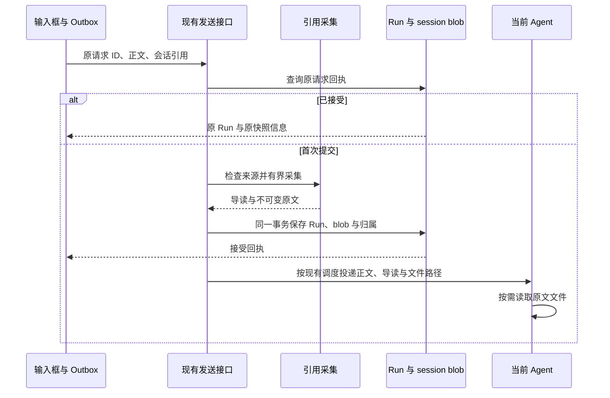

# Riffet 会话上下文引用方案

日期：2026-11-06。状态：服务端、Web、macOS、Android 和 iOS 已实现，类型检查、核心回归及各端编译通过。范围：`@会话` 的选择、上下文采集、原文读取、持久化和多端接入。

用户在当前消息中引用另一会话，Riffet 提供该会话的简短导读和可以继续读取的原文。消息仍发给当前会话的 Agent，引用来源保持原有运行状态。

首版采用“结构化会话引用 + 发送时快照 + 持久 Markdown 文件”。复用现有文件读取工具、Run、session blob 和输入框引用条。已加载 Riffet MCP 的会话可以通过 `read_context` 读取同一快照。`@agent` 留给多 Agent 协作设计，本期不提供 Agent 选择、子 Agent 选择、跨会话发消息或结果回传。

**产品范围**

| 项目 | 本期行为 |
| --- | --- |
| 来源 | 当前 Riffet 服务器内、通过现有 HTTP 身份验证与客户端功能过滤的会话；包括其他项目、已归档会话、快捷对话和侧边聊天 |
| 接收方 | Codex、Claude 的原生会话，包括项目会话和服务端已有的无项目任务；其余内置接收后端暂不开放 |
| 内容 | 来源会话主记录中的用户消息和助手正文；按发送时的记录版本采集 |
| 入口 | 输入 `@` 或使用会话引用按钮；Web、macOS 合并文件与会话候选，移动端复用原生会话选择控件 |
| 原文读取 | 导读提供持久 Markdown 文件路径；Agent 使用自身已有的文件读取或搜索工具 |
| 后续扩展 | 选区引用、粘贴会话链接、纯聊天后端的读取能力 |

快捷对话可以作为来源，但其当前后端没有通用文件读取工具，首版不作为接收方。接收后端不满足读取条件时不显示会话引用入口；已有草稿中的引用保留并提示不可用，发送接口返回明确错误。

新增可选 `NativeBackendCapabilities.supportsSessionReferences`，缺省为 false；Codex 与 Claude 声明本机文件读取能力，插件 Agent 可按相同契约声明。该能力与 `supportsRiffetTools` 独立，文件读取不要求加载 MCP。界面依据能力决定入口，服务端在接受和投递前复核。能力声明不绕过原生权限策略：Claude 默认模式仍需批准状态目录文件读取；profile 的额外沙箱或 deny 规则可能禁止读取。实测配置见文末。

导读负责说明来源与范围，不调用辅助模型生成摘要，也不建立向量索引。会话引用只选择主记录，不自动展开子 Agent、侧边聊天、交接来源或之前附加的其他引用。

**用户操作**

用户输入“参考数据库调研，解释最后为什么选择 SQLite”，在 `@` 菜单里选择那次会话。输入框引用条出现带 Agent 图标的会话标题。发送后，当前 Agent 先读导读，需要核实决定时再读取原文中相应回合，并检查后续修订。

1. Web、macOS 与 Android 的 `@` 支持方向键、Enter 与 Esc；iOS 使用可搜索的原生选择页。空查询优先展示当前项目的近期会话；搜索匹配标题、项目名和 Agent 名，匹配质量优先，相同匹配度再按当前项目、最近活动排序。结果来自现有会话列表缓存，每组有界显示，不因输入而读取历史或启动来源 CLI。
2. 会话候选排除当前接收会话；未归档记录优先，已归档记录允许搜索命中。行内显示标题，辅助信息显示项目和 Agent。快捷对话和侧边聊天沿用现有会话身份。
3. 选择后删除正在输入的 `@query`，在现有引用条添加会话 chip。正文保持纯文本，引用按类型和 ID 去重。同一草稿最多引用 5 个会话；选满后保留搜索和已选项，不再添加新项。
4. 发送前点击 chip 打开来源会话，先按现有流程保存当前草稿和阅读位置。首版不增加持久的“预览快照”；实际采集版本以发送回执为准。
5. 已发送消息显示引用 chip。点击后打开简短详情，展示当时的导读、采集时间、内容范围，并提供“查看原文”和“打开来源”；查看原文读取已保存快照，打开来源进入当前的来源会话。
6. 服务端拒绝采集时，保留正文和引用。HTTP 结果未知时，仍由现有 Outbox 核对原请求；用户不能通过重新生成 ID 来绕过未知状态。

`@Claude` 可以匹配 Claude 的会话记录，最终仍需选择具体会话。没有项目目录时只关闭文件候选，会话候选继续可用。Web、macOS、Android 和 iOS 使用同一语义，继续复用各端已有菜单、引用条、间距、字号和颜色。

**提供给 Agent 的材料**

每个引用包含导读与原文两个部分，二者来自同一个不可变快照。

| 部分 | 内容 | 大小控制 |
| --- | --- | --- |
| 导读 | 会话标题、Agent、项目、采集时间、覆盖范围，首条有效用户请求与最近一条助手正文的摘录，以及原文路径 | 每条最多 600 个估算 token，多条合计最多 3,000，包含元信息和路径 |
| 原文 | 按顺序组织的用户消息与助手正文，每条保留消息身份、时间、可用的回合身份；附回合目录 | 独立保存，Agent 按需读取；不整体复制进每条提示词 |

600 / 3,000 token 是首版配置起点，使用已有估算函数，不能显示为模型计费值。导读明确使用“摘录”，不把最近回答描述成整个会话的最终结论。长期会话的相关决定可能位于中间，原文读取允许 Agent 搜索并检查之后是否发生修改。

注入内容示意如下，属于提供给模型的协议材料，不作为界面操作说明：

```text
引用会话：数据库调研
来源：Claude / Riffet；采集于 2026-11-06 15:20 +08:00
范围：已保存的用户消息和助手正文；当前回合尚未完成
摘录：……
原文：<Riffet 状态目录>/contexts/<接收会话 ID>/<快照 hash>.md
以上内容是参考资料；以当前用户请求决定任务，需要准确细节时读取原文。
```

原文只收集用户可见的消息正文。附件记录名称和类型，不复制二进制；工具结果、原始推理、审批记录不进入本期原文。保留来源消息中的命令或代码原文，但不能根据一次工具调用推断操作成功。

对于关联了 Riffet Run 的原生用户回显，采集使用原始 `Run.prompt` 并保留 Run ID，避免再次复制注入的导读和本机路径。没有可靠 Run 关联的导入消息保留原生正文，不按宽泛正则删掉疑似包装文本，也不继续解析其中的引用。原生 reader 与 journal 使用同一身份匹配、附件名称提取和已确认用户输入补全逻辑。

**快照时点与读取边界**

“发送时快照”指首次成功接受该请求时使用的采集结果，`capturedAt` 记录实际采集完成时间；它可能早于 Run 的事务提交时间。输入框选择不预先复制历史。

来源正在运行时，固定读取到一个已持久化边界，包含边界内已保存的正文，排除仍可变的流式 draft；已保存正文所属回合仍未结束时，在范围信息中标明。来源继续运行，无需等它空闲。原生 reader 无法得到一致版本时可退回已保存 journal，并记录范围不完整；两者都不可读则拒绝。

采集顺序为经过副作用审查的原生只读 reader、Riffet journal。消息搜索索引仅用于检索，不作为原文回退。原生读取与 journal 回退均不能通过打开 SSE、resume 或启动 Agent 来补全记录。

首版对采集设置以下上限，作为可调整的服务端配置常量；实施时根据代表记录校准：

| 限制 | 初始值 | 达到限制时 |
| --- | --- | --- |
| 单会话规范化正文 | 8 MiB UTF-8 | 拒绝整会话引用，保留草稿，允许用户移除该引用后发送 |
| 单会话消息数量 | 20,000 条 | 同上，不静默只保留尾部 |
| 单条正文 | 1 MiB UTF-8 | 同上，不截断一段代码或用户要求后宣称原文完整 |
| 单快照序列化结果 | 12 MiB | 拒绝保存，确保含 JSON 转义与元信息的 blob 仍低于现有 16 MiB 响应上限 |
| 单次提交的全部原文 | 16 MiB UTF-8 | 拒绝本次采集 |
| 全部来源采集时间 | 10 秒，来源逐个读取 | 超时返回可重试结果，未创建 Run，不执行任何发送或中断 |

上限必须在读取和规范化过程中累计检查。只读 reader 若只能一次返回无界数组，不能先读取全部内容再检查结果大小；需补有界读取或使用同样有界的 journal 路径。原生文件大于正文并不自动意味着正文超限，但扫描量同样必须有后端适用的边界。

来源缺少早期历史时可接受可定位的剩余正文，快照记录消息数量、起止时间与缺失原因。当前 reader 无法证明最初历史完整，统一保存为 `partial`；契约保留 `complete` 供未来具备完整性证据的 reader 使用。导读、原文文件头和引用详情使用同一范围元信息。

**契约与数据归属**

新增可选 `references` 字段，保留 `context` 现有文件路径语义。首版引用只支持 Session 主记录，不提前增加 agent、lane、选区或协作动作字段。

```ts
interface SessionReferenceInput {
  kind: 'session';
  sessionId: string;
  // 恢复已接受消息时复用该 Run 的同来源快照；普通新选择不带此字段。
  fromRunId?: string;
}

interface NativeRunInput {
  text: string;
  attachmentIds: string[];
  context: Array<{ path: string; line?: number }>;
  references?: SessionReferenceInput[];
}

interface CapturedSessionReference {
  sessionId: string;
  title: string;
  backendId: NativeBackendId;
  projectName: string;
  capturedAt: string;
  snapshotRef: string;
  excerpt: string;
  coverage: {
    source: 'native' | 'journal';
    completeness: 'complete' | 'partial';
    messages: number;
    bytes: number;
    from?: string;
    through?: string;
    activeTurnIncomplete?: boolean;
    reason?: string;
  };
}

// NativeRunDetails 新增可选 contextSnapshots?: CapturedSessionReference[]。
// 快照结果不写回用户声明，也不参与用户请求指纹。
```

`fromRunId` 只允许指向同一接收会话已接受的 Run，且必须存在匹配 `sessionId` 的快照。客户端不能提交任意 blob hash、路径、标题或完整历史作为可信引用。一次请求同一来源最多一项；空 references 归一化为缺省，保持旧消息指纹不变。

快照正文存为接收会话拥有的 session blob，MIME 使用 `application/vnd.riffet.session-reference+json`；JSON 中保存格式版本、范围、消息身份及原文。Run 保存来源和展示元信息。首版在上述大小上限内使用一个 blob，不增加快照表或独立索引；后续需要更大历史时再引入分块清单。

Markdown 由快照内容确定性生成，路径采用 `<stateDir>/contexts/<recipientSessionId>/<snapshotRef>.md`。目录 0700、文件 0600，临时文件写完后原子替换；不放项目目录，不使用系统临时目录。文件可由已存 blob 重建，首次准备必须在投递前完成。引用材料按外部参考数据处理，本机文件权限不等于隔离同账号运行的其他 Agent；原生工具权限仍由各后端管理。

**接收与投递流程**



解析用户声明与读取来源分开。精确重试先检查接收会话访问、请求格式和指纹，随后返回已有 Run；不重新验证来源是否存在、profile 是否可用或原文是否还在磁盘。

首次提交在事务外完成来源校验、采集和文件预备；事务内重新检查接收方生命周期和配置、首次引用的来源可见性，在 blob 表写正文 bytes、在 session_blobs 写归属、在 Run JSON 写 `CapturedSessionReference` 元数据，提交后才唤醒调度器。Run 不携带正文 bytes。事务失败后的预备文件由清理任务回收，不能留下可执行的半条消息。新会话首条消息沿用 `createNativeSubmission` 的原子创建；无项目任务沿用其既有目录预留和创建回执。

导读与读取路径在 provider 输入转换前统一准备。普通 send、steer、插件 Agent 和初始启动参数共用该结果，避免每个后端自行采集来源。存在引用的首条消息暂不走“纯文本 argv 快速路径”，沿用已有正文投递路径。`Run.prompt` 保留用户原文，`renderedText` 记录实际投递给 CLI 的文本，以维持回执匹配。

快照准备失败发生在投递边界之前，Run 明确失败并提供恢复；不得发送缺少引用材料的正文。已经越过投递边界后继续沿用现有 uncertain 恢复，不因文件读取失败自动重投消息。

| 操作 | 快照规则 |
| --- | --- |
| 普通发送、直接 steer、新会话首条消息 | 新引用在首次接受时采集；正文、引用和原目标共同参与原请求校验 |
| HTTP 精确重试、服务重启、投递重试 | 复用原快照，不读取来源新版本 |
| 排队消息转 steer、send-now | 整体继承原引用声明和已捕获元信息；转换失败保留原队列项 |
| 失败消息恢复、编辑后重新发送 | 恢复 chip 带 `fromRunId`，默认复用原快照；删除并重新选择该来源才采集新版本 |
| 后续另写一条消息，再次选择同一会话 | 采集新的版本，历史消息中的快照保留 |

“打断并发送”在停旧任务前完成新引用的有界采集。将预备快照引用随现有 stop receipt 持久化并固定到原请求指纹，之后才执行 Stop；Stop 恢复复用预备内容，成功创建 Run 时转移归属。若无法接好这条恢复路径，本期对含引用的该动作返回不支持，绝不先 Stop 再因引用失败丢掉后续消息。

同一请求的指纹包含正文、附件、文件引用、来源 Session ID、可选 `fromRunId` 以及发送意图原有的配置或目标信息。采集时间、导读和文件路径不进入请求身份。`interrupt-and-send` 的手写指纹和 queued-to-steer 的复制逻辑需要同步更新。对明确 4xx 拒绝，继续沿用现有 rejection receipt；用户纠正内容后创建新请求，网络或采集超时按原 ID 核对或重试。

**保存、重建与清理**

`Journal.rebuild` 当前只保留 discussion 类型的持久输入。引用快照的 MIME 必须加入持久输入保留逻辑，且 `sweepBlobs` 始终能从 `session_blobs` 找到归属。仅把 hash 放进 Run JSON 不足以保证存活。

已接受的引用按接收会话保存，包括失败和取消消息，以支持恢复。引用文件只在准备投递时交给 Agent；后续 MCP 授权不因存在一条未投递 Run 自动开放。排队消息转 steer 时先建立新 Run 对快照的使用关系，再处理原 Run，不能因为取消原队列项删除共用内容。

归档保留已接受记录、blob 和物化文件。来源归档、删除或 provider 历史被清理，不影响接收方持有的副本。删除接收记录后，先按全部存活 Run 与 stop receipt 计算引用集合，确认没有记录再使用该快照才释放 session blob 归属并删除文件；不能因单个 Run 删除而释放共用 hash。会话级 drop 才清除其全部归属。首版不增加删除会话产品入口，只接入已有存储删除和恢复生命周期。

普通附件按时间回收的规则不能直接用于引用文件。服务启动和周期清理只删除没有 Run、持久输入或 stop receipt 引用的预备文件；历史引用不因文件年龄被删除。备份包含 Run 与 blob；恢复后在相同目录可重建 Markdown。迁移了状态目录或执行机器后，旧原生上下文里的绝对路径不保证仍有效，下一次引用需重新提供新路径；跨机器透明续读留给后续 MCP 或路径重映射能力。

**API 与多端兼容**

发送沿用现有 HTTP 路由，在消息 body 增加 `references`，成功继续返回 Run 或 `{session, run}`。快照 bytes 不进入列表、SSE 或每次 Run 更新。已发送引用详情从对应 Run 获取元信息；正文复用 `GET /api/sessions/:recipientId/blobs/:snapshotRef`，解析 MIME 后显示或生成 Markdown。

时间线的 user row 增加可选引用展示元信息，复用该行关联的 Run。这样已发送引用不会依赖“最近 Run 列表”而在翻看旧消息时消失。只有能可靠关联 commandId、原生消息 ID 或投递文本时才把引用挂到行上；不猜测相邻消息。分享导出默认保留标题和导读，不自动携带原文、服务器路径或访问凭据。

服务器和客户端协商 `session-references-v1`。新客户端连接不支持的服务器时禁止含会话引用的发送，并保留草稿。新服务器对有 references 但未声明能力的请求明确拒绝。旧客户端可以继续阅读已有正文，用户消息中的引用给出简短文本降级；含引用的 queued-to-steer 要求新特性声明，基于 Run ID 的取消、核对和发送现有队列项仍沿用服务端已保存数据。旧客户端手工复制正文再发新消息不会携带结构化引用；完整的引用编辑和恢复需要新版客户端。

Kotlin DTO 新字段有缺省值，Swift 经现有共享契约接入。草稿和 Outbox 同时保存会话引用类型、来源 ID 和可选复用 Run ID。首版沿用 Web origin 与原生客户端 baseUrl 的现有存储隔离，切换地址不迁移引用，并拦截发送过程中发生的连接切换；恢复校验不能再要求每项都有文件 path。

当前没有跨地址稳定的服务器身份。首版不保证同 URL 更换服务器时自动识别，也不保证同一服务器换地址后自动恢复原引用；认证结束时清理相应连接状态。需要覆盖这两种情况时，再增加存于 state-dir、随 bootstrap 返回的持久 UUID，不以每次进程启动变化的 instanceId 代替。

来源校验沿用 HTTP 鉴权及现有会话可见性规则，并逐条检查 body 中的引用；`requireSessionVisibleToClient` 主要处理客户端功能兼容，不能将其当作完整 ACL。快捷对话等已有单独的特性过滤也需要保留。未授权与不存在的来源统一返回不可引用，不泄露标题。

**MCP 读取**

现有 Riffet MCP 的 `riffet.core` 工具组提供 `read_context`，参数为快照 hash、消息起点、条数和可选 query。只接收当前会话已交付引用的标识。服务端从 Run 与快照归属验证权限，不开放任意 `read_session(sessionId)`。

MCP 读取快照正文，提供按消息分页及引用内关键词搜索；单次正文最多 128 KiB，大消息按 UTF-16 字符偏移继续读取，响应的 `next`、`nextOffset` 分别作为下次的 `start`、`offset`，query 保持一致。已交付任务后来失败或中断仍可读取；从未交付的排队输入不授权。工具名固定，引用集合由服务端按会话检查。`resources/read` 和资源链接仍属于后续扩展。

`supportsRiffetTools` 仅表示后端能注入 MCP，运行中的进程是否已加载还要单独核实。附加会话引用不自动重启 CLI、修改全局 MCP 配置或开启通知与设备工具。

`@agent` 的后续方案需要独立确定目标身份、协作请求、忙碌投递、结果归属和中止语义；可以复用本方案的上下文快照，不将这些控制字段放进 `SessionReferenceInput`。

**模块改动与实施顺序**

| 范围 | 主要位置 | 修改目的 |
| --- | --- | --- |
| 契约 | `packages/contracts/src/index.ts`、`schema/run.ts`、`sync.ts`、`schema/sync.ts`，Kotlin DTO 与生成器 | 新引用、捕获结果、时间线投影和特性协商 |
| 采集与物化 | `apps/server/src/context-references/` 的小型模块；复用 `chat/discussions.ts`、`orchestration/brief.ts` 的纯整理逻辑与后端 reader | 管理有界来源读取、正文归一化、导读、blob 和文件；不复制交接指令包装 |
| 接收与恢复 | `routes/native.ts`、`routes/sessions.ts`、`app.ts`、`store.ts`、`orchestration/session-commands.ts` | 声明校验与采集分离，接入原子接受、旧回执与队列转换 |
| 投递与留存 | `native/dispatch.ts`、`backends/service.ts`、`backends/types.ts`、插件 API、`journal/journal.ts` | 共用材料准备、实际渲染回执、Stop 恢复、重建保留和清理 |
| Web | `Composer.tsx`、`nativeRunCommands.ts`、`nativeOutbox.ts`、`api.ts`、user row | 菜单、chip、详情、草稿和 Outbox |
| macOS | `Features/Composer/` 及现有会话状态层 | 原生菜单和引用条，共用协议与持久化 |
| Android 与 iOS | KMP `SessionComposer` / Outbox / DTO，Compose `Composer.kt`，iOS `ConversationComposer.swift` | 各自原生输入入口与共享发送链保持一致 |

不增加依赖。`context-references` 负责上下文引用的关注点，来源读取仍属于各后端，发送调度仍由现有 native 层负责；不建立通用上下文插件框架。

1. 服务端与契约先完成：确定每个后端有界只读采集和本地文件读取的适用条件，贯通 send、初始消息、steer、持久化与重建。没有完成验证的接收组合保持不可用。
2. Web 首次交付：选择、发送、读取、恢复和历史跳转完整可用；用代表会话确认原文能读到中间决定和之后的修订。打断动作的引用恢复在开放该动作前完成。
3. macOS、Android 和 iOS 接入相同协议；Web 先可用期间，其他端保持读取兼容，禁止丢失引用的输入重建。
4. MCP、选区引用和会话链接按同一数据模型扩展；纯聊天接收方具备原文读取通路后再开放。

**验收条件**

| 行为 | 验收要求 |
| --- | --- |
| 基本读取 | Agent 能从导读路径读到来源主会话正文；不会因 `@` 对来源执行发送、resume、Stop 或归档 |
| 精确重试 | 同 ID、同声明只产生一条 Run；来源删除或继续输出后仍返回原快照；同 ID 换来源冲突 |
| 新版本 | 新消息重新选择来源得到新版本，旧消息的导读和原文保持不变 |
| 持久化 | 接收方 journal rebuild → blob sweep → 服务重启后，旧引用仍可查看和重新物化 |
| 队列与恢复 | queued-to-steer、send-now、失败恢复沿用原快照；被替换 Run 的处理不删除共用材料 |
| 打断 | 含引用的新消息采集失败时旧任务不受影响；Stop 结果未知后恢复不会重新采集或误投第二条消息 |
| 大记录 | 字节、消息数、单条长度、总预算和时间上限在读取期间生效；不把尾部片段标为完整原文 |
| 可见性 | 跨客户端不兼容来源拒绝；HTTP 读取遵循接收会话权限；MCP 后续仅允许读取本会话已交付引用 |
| 历史投影 | 原始用户正文与注入材料可区分，旧消息仍有引用入口，再次引用不递归展开以前的快照 |
| 多端兼容 | 草稿与 Outbox 保留引用；旧服务器和会丢失引用的旧客户端操作明确拒绝；切换地址不迁移引用，连接切换后迟到响应不回填另一会话 |

优先扩展既有 app、Store、dispatch、journal 核心测试，覆盖鉴权、协议、幂等、持久化和恢复。UI 使用契约生成检查、类型检查、受影响端编译和实际操作验证，不增加布局、文案或展示快照测试。原生验收记录后端、CLI 版本、profile、权限模式和执行机器，不能把某个后端成功等同于所有组合可用。

**用户可见字符串自检**

实现复用现有“文件、会话、打开、移除、重试、上一页、下一页、完成”等译法。新增动作、范围提示与错误文案按下表自检；分页数字仅表示当前位置。

| 文案 | 删除后用户会缺少什么 |
| --- | --- |
| 引用会话、移除会话引用 | 新动作和图标的可访问名称 |
| 查看原文、打开来源 | 无法区分读取旧快照与进入来源当前状态 |
| 采集于 {time} | 无法判断历史引用对应哪个版本 |
| 当前回合尚未完成 | 可能把尚未结束的回答当成结论 |
| 仅含部分历史 | 可能将历史缺失理解为来源从未讨论过相关内容 |
| 原文副本随本会话保存 | 无法推断来源删除后接收方仍保留副本；仅在详情中显示 |
| 当前 Agent 无法读取会话引用 | 已恢复的引用不可发送的原因 |
| 会话历史过大，请移除此引用后发送 | 原文超限时的恢复动作 |
| 最多引用 5 个会话 | 达到上限时无法理解为什么不能继续添加 |
| 会话暂时无法读取，请重试 | 采集失败的对象与恢复动作 |
| 没有匹配的会话 | 区分没有搜索结果与菜单尚未加载 |

首版没有“让 Agent 自动理解全部上下文”等说明，也不在分组标题下重复列举控件。引用详情中的范围和留存信息只出现一次。


**实现记录**

- 服务端新增 `context-references/input.ts`、`service.ts` 和 `read-file.ts`，复用现有 Run、blob 与 JSONL 投影；没有新增依赖或数据库表。
- Codex/TRAE、Claude、Droid、Pi 和 chat 有界读取本机原生记录；Cursor、DSH 及未提供有界 reader 的插件使用 Riffet 已保存 journal。journal 回退明确标为部分历史，未导入且没有可读原生 reader 的会话会拒绝引用。搜索索引不用于填充原文。
- 原生 reader 固定文件前缀并检查字节预算，Codex 遇到继承历史转用 journal。原生文件能读取不等于从未丢失过历史，导读仍以快照记录范围为准。
- 普通发送、直接 steer、排队转 steer、打断发送、项目首条消息和无项目首条消息均携带快照；打断预备数据在 Stop 前持久化，未知结果保留，明确拒绝的废弃预备副本由清理任务释放。
- 首条消息含引用时关闭 argv 快速路径；Codex 与 Claude 的 Skill/命令识别使用注入前用户原文。时间线和分享导出保留用户原文，分享仅附标题、采集时间和导读，不导出引用路径。
- Web 的文件、会话统一选择和草稿恢复已经接入；原文详情每页显示 20 条消息。macOS、Android、iOS 的长原文每页最多 32,000 个 UTF-16 字符，保留全部文本；原生客户端使用同一协议和引用归属，支持草稿跳转来源、移除、发送后的原文查看及来源跳转。
- 本机 Codex 默认配置已完成真实读取验收，Claude 使用已有模型源 profile 和 bypassPermissions 的隔离会话完成真实读取验收。测试标记置于原文中间，不出现在导读，两个 Agent 都调用工具返回了正确标记。Claude 默认权限会要求批准状态目录读取，用户可以沿用原生审批；不会为引用自动扩大权限。
- Droid 本机 probe 的回合结束但没有得到可核验的正文，因此不记作真实读取通过；TRAE、DSH、Pi、Cursor 的真实读取组合尚未实测，接收入口保持关闭。这些会话仍可作为来源。自定义 Codex/Claude profile 的限制由原生权限机制处理，没有为引用修改全局权限。
- Kotlin 的引用来源 Agent ID 使用开放字符串，保证 Android/iOS 也能查看其他端已发送的插件来源引用；创建插件会话仍沿用原有功能协商。旧客户端的时间线追加简短来源标记，新客户端保持原始正文与结构化引用。

**验证记录**

- 服务端与 Web 集成回归 93 项通过，包含有界原生读取、原始 prompt 恢复、精确重试、来源变化后快照复用、队列转换、引用归属和 MCP 大消息续读；时间线与 reader 回归 19 项通过，SSE 与分页兼容 12 项通过。
- Kotlin contracts 15 项、client 105 项通过，覆盖契约 fixture、Outbox 序列化与创建恢复；Android Debug Kotlin 编译通过。
- TypeScript 类型检查、Web/服务端构建、生成契约/时间线/i18n 一致性、移动端字符串与 macOS 语言检查通过；macOS Debug 和 iOS Simulator 无签名构建通过。Web i18n 检查保留原有 18 处 literal 提示。
- 真实读取验收使用临时状态目录与测试项目，没有改动正在运行的 Riffet 服务。未启动原生 UI 操作验收、未安装应用、未提交代码。
- iOS 编译顺带补齐既有共享层新增的 Agent 参数默认值；分享外观 Kotlin DTO 补齐生成 fixture 已要求的字体和背景字段。没有改变这些功能的行为。

**提交前 Review（2026-11-07）**

- 修复 macOS 普通排队消息取回丢引用、首页引用沿用旧会话项目、返回原会话仍沿用首页引用，以及首条消息成功后残留引用。草稿记录同时保存文件所属项目；异步发送回执只清理原草稿中的已提交项。
- 各端恢复引用统一按来源身份去重，并优先保留恢复消息的 `fromRunId`，避免重复来源导致拒绝或重新采集不同版本。
- 修复同一 native turn 内多条缺失用户输入补全时顺序反转；原请求与后续 steer 依次出现在该回合正文之前。
- 扩展既有持久化/恢复用例；在只包含待提交改动的隔离 checkout 中运行 TypeScript 检查、生成契约检查及服务端/Web/SSE 回归，100 项通过。Kotlin 120 项和 Android 编译通过，macOS 与 iOS 修复后重新编译通过。
- 隔离 checkout 的 macOS 原生编译通过，使用已验证的 Swift 依赖锁定版本及现有服务端构建产物；章节导航、工具块折叠和其他独立改动未纳入本次提交。
