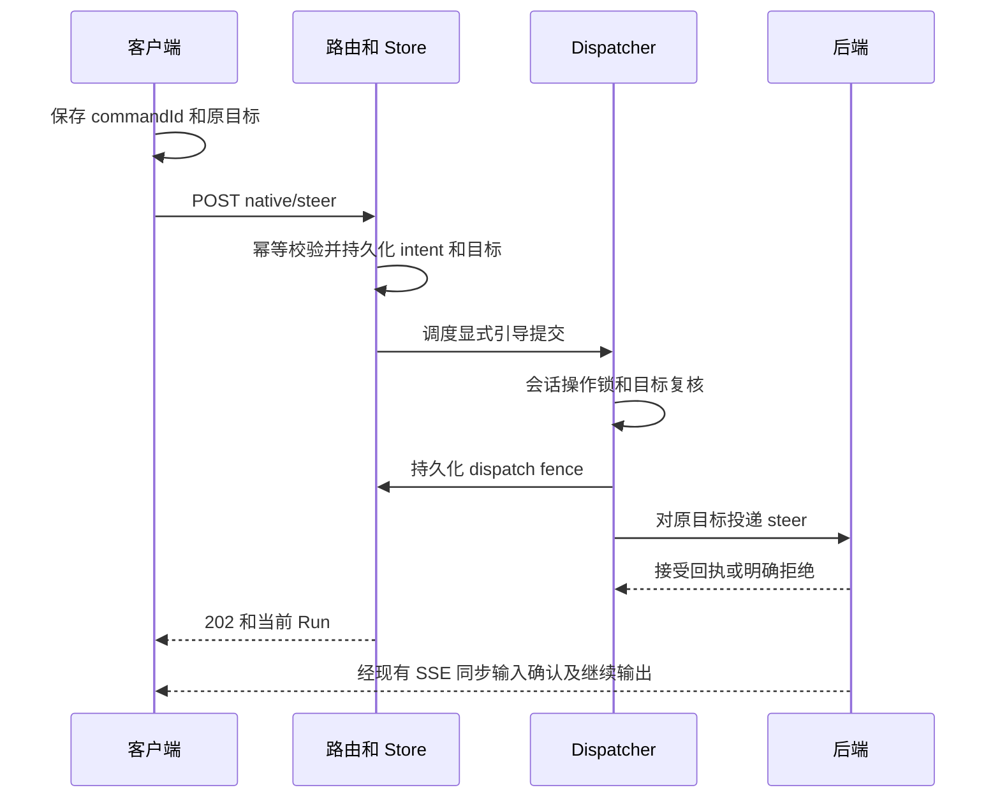

# Riffet 运行中会话引导设计与实现

日期：2026-10-16。状态：已实现服务端、Web、KMP 共享逻辑，以及 iPhone、Android、macOS 客户端接入。当前开放经过目标绑定的 Codex、Cursor 和 Claude Code；其他后端按原生协议的实际保证分别门控。

测试已按 [AGENTS.md](../AGENTS.md#测试与验证) 精简：非必要不增加测试，保留目标绑定、幂等投递、Outbox 精确重试、队列转换与故障恢复等核心行为；UI 展示、文案与重复分支测试不再维护。下文初次实现的验收数量是历史执行记录。

Riffet 将引导消息提交给指定的活动 turn，由后端在可接收输入的步骤边界继续处理当前任务。原来的工具执行、审批策略和任务目标继续保留，用户通过补充消息调整后续工作。引导不承诺修改已完成的操作，也不承诺改变正在进行的模型请求。

Codex 通过专用 `turn/steer` 路径完成投递与确认，最低开放版本为已实测的 0.160.0；版本未知或更旧时关闭能力。TRAE CLI 也支持原生 `turn/steer`，Riffet 从已实测的 0.210.1 开放，使用持久化输入元数据确认消息归属，并核对实际连接的 app-server 版本。Cursor 使用受控 plugin 的工具 hook，要求 CLI 日期版本不低于已实测的 2026.10.01 且支持 `--plugin-dir`。Claude Code 复用已有 hooks 和真实 `prompt_id`；生产全链路已在 2.1.252 验证。Cursor、Claude 都必须先收到当前进程的原生目标握手才提供入口，单凭存活终端或 busy 状态不开放。DSH 存在转入 next-turn 的边界，Droid 的过期输入会启动或留给下一轮，两者尚未开放。实现复用 Run、会话锁、附件处理、事件流和幂等机制，没有新增外部依赖。

**iPhone 基线提交后，沿既有共享层完成集成。** 本次以 `5bb8bef` 为基线，包含已提交的 iPhone App、配对与 Codex runtime 整合。iPhone 通过 RiffetKit 复用 KMP 的网络、会话状态、Outbox 和时间线；Swift 仅增加界面和命令转发。

| 范围 | 实际接入位置 | 集成方式 |
| --- | --- | --- |
| `apps/mobile/iosApp/Riffet/**` | `ConversationComposer.swift`、`App/Workbench.swift` | 原发送按钮按共享偏好路由，队列保留显式引导操作 |
| KMP `client` | `RiffetApi.kt`、`SessionComposer.kt`、`Outbox.kt`、`SessionStore.kt` | 共用投递、草稿修订检查和恢复流程 |
| KMP `contracts` 与 `core` | DTO、事件投影和 turn 分组 | 可选字段向后兼容，覆盖缺字段解码与同轮多输入 |
| 服务端路由与启动 | `routes/native.ts`、`app.ts` | 复用原有路由注册和输入校验，保留配对及 SSE 撤销逻辑 |
| Web | `api.ts`、`useNativeSession.ts`、Composer 和 timeline | 专用 API、版本化 Outbox、同轮显示 |
| 后端与调度 | `native/dispatch.ts`、`backends/types.ts`、Codex runtime | 专用 steer 操作，共用会话锁和写入边界 |
| 构建与运行 | KMP、Apple framework、Swift 源码、独立 Codex 会话 | 不安装 App，不重启已有验收服务；真实协议验证使用临时数据目录 |

共享契约和 KMP 状态逻辑由同一写入者集成，服务端、Web 与原生客户端按目录拆分。没有同时改写另一任务尚未提交的 iPhone 文件。

**三种发送动作分别保留各自的承诺。**

| 用户操作 | 执行方式 | 目标已结束时 |
| --- | --- | --- |
| 加入队列 | 留在 Riffet 队列，空闲后按当时配置开始新的 turn | 按现有队列规则发送 |
| 引导当前任务 | 绑定原生会话和活动 turn，调用原生 steer | 明确返回未发送；保留草稿，由用户选择后续动作 |
| 打断并发送 | 确认停止当前任务，再提交替代任务 | 保持现有打断接口定义 |

普通发送默认加入队列。“设置 → 交互与输入 → 任务输出时发送到”可选择排队或引导；选择引导后，首次提交按当前后端能力及活动目标决定是否走引导，当前没有运行任务时走普通发送；任务仍在运行但目标或能力暂时不可用时保留草稿，由用户明确选择加入队列。这项偏好不改变 Enter 键设置。已经按引导提交后，即使被拒绝或结果未知，服务端和客户端均不自动改为加入队列、打断发送或投向另一个 turn。用户主动切换动作后，生成新的 `commandId`。

**协议通过新增可选字段保持兼容。** 不扩展已有 `Run.state`、`NativeDeliveryState` 或 SSE 顶层消息类型的枚举；旧客户端可能无法解码新枚举值。新增字段在 TS 中可选，在 Kotlin 中提供缺省值。

以下代码表示新增的契约，现有字段省略：

```ts
export interface NativeTurnTarget {
  nativeSessionId: string;
  turnId: string;
}

export interface AppSettings {
  composerRunningBehavior?: 'queue' | 'steer'; // 缺失按 queue 处理
}

export interface NativeBackendCapabilities {
  supportsSteer?: boolean; // 缺失按 false 处理
}

export interface NativeStatus {
  activeTurn?: NativeTurnTarget & { ownerRunId?: string };
}

export interface NativeRunDetails {
  intent?: 'steer';        // 缺失表示现有的普通提交
  nativeTurnId?: string;  // 原生执行回合的身份
  ownerRunId?: string;    // 引导消息所关联的原始 Riffet Run；可缺失
  sourceRunId?: string;   // 从队列转引导时，已原子取消的原排队 Run
  expectsTurnOutcome?: boolean; // 已废弃并忽略：所有执行都只由回合结束事件结算（TURN-LIFECYCLE.md T4）
}

export type NativeWorkbenchEvent = WorkbenchEvent & {
  nativeId: string;
  nativeAliases?: string[];
  nativeTurnId?: string;
};

export interface NativeSteerInput {
  commandId: string;
  text: string;
  attachments?: Array<{ id: string }>;
  context?: Array<{ path: string; line?: number; text?: string }>;
  target: NativeTurnTarget;
}
```

`supportsSteer` 表示当前 profile、CLI 版本及接入方式经过验证，具有符合本文约束的机制。`activeTurn` 来自后端实际观察，不能根据最近一条 Run 或 `phase: busy` 猜测。客户端启用引导动作需同时满足能力可用、目标存在、连接可写，以及没有阻塞中的审批、停止或投递结果未知状态；最终判定始终在服务端执行。

`activeTurn` 在状态重建后必须反映当前后端，不得沿用断线前的缓存来启用按钮。服务端进程重启后可以只读重连并恢复活动 turn；无法准确恢复时，先不提供引导。目标始终包含会话和 turn 两层身份，避免恢复、换绑或读取旧缓存后误投。

引导复用现有文本、附件和文件引用的校验及渲染。V1 不经引导执行 `/model`、`/clear` 等 CLI 控制命令；对于命令或技能的识别，复用现有后端目录和分类，不把所有以 `/` 开头的文本都当成普通消息。后端不能支持的输入形态在写入前明确拒绝。

引导请求不携带模型、模式、权限或工作目录覆盖，也不以当前会话的 `expectedConfigRevision` 代表目标 turn 的配置。它继承目标实际生效的配置；挂起的下一轮配置继续按原规则处理。若配置正在使运行端点发生变化，返回明确的冲突。`resolvedConfig` 记录目标实际配置，不能把已保存、尚未生效的新配置写成实际执行值。

**HTTP 入口独立，仍返回已有 Run 结构。**

```http
POST /api/sessions/:id/native/steer
Content-Type: application/json

{
  "commandId": "client-command-uuid",
  "text": "先处理登录问题，管理后台这次先跳过",
  "target": {
    "nativeSessionId": "thread-123",
    "turnId": "turn-456"
  }
}
```

成功接受提交返回 `202 + Run`。HTTP 接受、后端接受输入、历史确认输入和任务完成是不同阶段，客户端按 Run 与事件流更新，不能收到 202 就标为“模型已采纳”。现有 `GET /api/sessions/:id/runs` 和 SSE `runs` 帧可用于回执核对；这些列表只含近期及未完成记录，缺少某个 ID 不能证明从未接受。最终可用同 ID、原输入、原目标精确重试取回已有 Run，首批不新增轮询接口。

已有排队消息通过 `POST /api/sessions/:id/native/runs/:sourceRunId/steer` 转为引导，body 只包含新的 `commandId` 和原目标 `target`。Store 在同一事务中复制原消息正文、附件和引用，创建新的 steer Run，并将原排队 Run 标为 `cancelled / steer_replaced`。原 commandId 和发送意图保留在原记录里。接受失败时队列不变；接受后发现目标结束则新引导明确失败，提供内容恢复，不重新入队。

这一路径的指纹额外包含 `sourceRunId`，不能与输入框直接引导或另一条队列消息共享 commandId。精确重试先查新 ID，验证原 source 和 target；即使原排队记录已删除、附件已清理或当前能力关闭，仍返回原回执。客户端在 Outbox v2 保存原内容快照供恢复，重试只发送原 source、ID 和 target。未知期间封锁原队列项的直接发送、编辑和删除，避免同时执行两种动作。

转换被拒绝时原排队消息仍在队列，恢复失败引导内容前必须先精确核实并成功取消 source，避免恢复后普通发送与原队列各执行一次。`GET /runs` 中缺席不足以证明 source 已删除；此时继续通过精确 source cancel 端点确认取消或 `404 RUN_NOT_FOUND`。source 已经执行、取消失败或原引导仍未知时不回填第二份可发送草稿，保留失败快照。Web 与 KMP 共用各自既有的附件读取、取回与草稿修订保护。

若 202 响应中的 Run 已是投递前 `failed`，客户端按明确拒绝处理并保留当前草稿。若先接受再异步失败，输入内容保留在提交记录中，提供“恢复到输入框”，不自动覆盖用户后来写的新草稿。

| 结果 | HTTP 或持久化结果 | 客户端处理 |
| --- | --- | --- |
| 后端不支持 | `409 STEER_UNSUPPORTED` | 保留草稿，更新能力显示 |
| 目标结束、换绑或不匹配 | `409 STEER_TARGET_CHANGED` | 保留草稿，同步当前状态 |
| 正在停止 | `409 NATIVE_INTERRUPT_IN_PROGRESS` | 保留草稿，等待当前操作完成 |
| 审批或配置切换阻塞 | 复用现有交互、配置冲突错误 | 展示对应状态，不把输入提交给审批框 |
| 输入不支持或无效 | 复用现有输入校验错误 | 保留草稿与附件 |
| 相同 commandId 的请求内容不同 | `409 COMMAND_ID_CONFLICT` | 阻止复用该 ID |
| 活动端点不可写 | `503` 及明确连接错误 | 保留草稿；若结果无法确定则进入未知状态 |
| 已持久化后才发现目标失效 | 返回已有 Run 的 `failed` 状态及具体原因 | 保留原提交内容，提供恢复到输入框的操作 |

精确重试先查询已持久化的 `commandId`，验证指纹后返回原 Run。即使目标已结束或能力暂不可用，也允许读取已接受的原回执；身份鉴权、会话访问和输入格式检查继续执行。已有回执的校验基于原请求身份和规范化输入，不重新读取已删除附件或文件后才决定是否返回。指纹包括规范化输入、`intent: steer` 和目标身份。普通提交保持原来的指纹规则，不重算旧记录；同一个 ID 跨普通、打断或引导入口不能触发第二次副作用。

**持久化沿用 Run，并区分消息记录与执行回合。** 一条原始消息和后续多条引导各有自己的 `commandId`、Run、输入内容、送达状态及原生消息 ID；这些记录可以属于同一个原生 turn。原始 Run 是已知情况下的执行归属，后续引导不会覆盖它。

接受引导时，在同一个事务里写入 `intent`、目标 `nativeSessionId/nativeTurnId` 和可用的 `ownerRunId`，再发布 `run_updated`。不能先创建普通 queued Run，再异步补 intent，否则 Dispatcher 可能在两次写入之间将它当成下一轮消息。投递前后的身份字段都需校验，不能在绑定阶段把旧目标悄悄改成当前目标。

| 既有投递状态 | 引导提交的含义 |
| --- | --- |
| `queued` | 刚持久化，等待这次短暂的会话操作锁；不进入下一轮任务队列 |
| `preparing` | 校验目标、输入和端点；工具 hooks 可在 `steer_waiting_boundary` 等待原任务下一个工具边界，不启动或重启 Agent |
| `dispatching` | 已持久记录可能产生外部副作用的边界，接下来只投递一次 |
| `input_sent` | 后端 RPC 已接受或 hook 上下文已交出，等待真实原生输入回执或历史确认 |
| `observed` | 原生输入或 hook context 已和 commandId/消息 ID 关联；目标 turn 可能继续运行 |
| `failed` | 明确没有投递成功，或目标任务明确失败 |
| `uncertain` | 无法确认是否投递或被消费，禁止自动重发 |
| `cancelled` | 写入前取消，或目标 turn 后续被明确停止；通过 stage 区分 |

引导 Run 在输入确认后进入 `running`，随目标 turn 的最终结果结算；UI 的“已送达”依据输入回执，不等同于该 Run 已完成。输入阶段的失败只结束这条引导提交，不停止或失败原始 Run。单条引导的移除只允许在写入前发生；送达后不提供承诺撤回模型输入的按钮。

后端确认目标 `completed / failed / interrupted` 后，向原始 owner 及属于该目标、已确认输入的引导传播同一个执行终态；明确未送达或仍无法确认的提交保留各自结果，不用目标终态覆盖。对具备可靠 turn 事件的引导路径，`phase: idle` 只更新会话显示，不能把尚未拿到终态的 owner 或引导结算为 completed。终态去重按原生 turn 身份执行；目标消失而结束原因未知时先核对历史，不用空闲状态把失败或取消改成成功。

Cursor、Claude 的原生历史即使带 turn ID，也不代表当前进程接通了 Riffet hooks。Dispatcher 不按 idle 结算任何执行（TURN-LIFECYCLE.md T4）：没有结束事件的执行在空闲满 `IDLE_RECONCILE_MS` 后记为结果未确认；只有状态点名过的回合，才会因状态点名另一个回合而被判为结果未确认。Stop 先于原始 user echo 时，未关联 commandId 的真实目标终态短暂按 session/turn 缓存，唯一原始消息认领后再结算，避免纯文本回复卡住。中断失败 hook 的 `is_interrupt:true` 拒绝未领取的输入并发布取消结果，子 agent metadata 不能领取或终止父 turn。

**Dispatcher 增加显式引导分支，继续使用现有会话锁。** 后端 driver 增加可选 `steer()`，与 `send()`、`interrupt()` 对齐；backend service 负责解析 profile、订阅和调用，不建立另一套会话生命周期。



实现顺序约束如下：

1. Route 复用鉴权和输入校验，在无外部副作用的阶段准备内容；对已有 command 返回原回执。
2. 创建带 steer intent 的耐久记录，调用 Dispatcher 的专用方法；普通 `kick()` 的候选选择明确排除 steer 记录。
3. 复用会话操作锁，锁只覆盖输入操作，不等待整个 turn 完成。与普通发送、配置、停止遵循现有一致的锁获取顺序，不能在不同路径反向获取两层锁。
4. 锁内读取最新会话、后端活动 turn、归档及停止状态；检查 backend/profile/会话/turn 与原目标一致。只能复用已运行端点或只读恢复其连接，不能通过 `ensure` 启动一个新任务来接收引导。
5. 内容准备和异步读取之后、写入之前再检查目标；写入前同步持久化 dispatch fence，并携带原目标调用 driver。
6. 明确的后端拒绝转为 `failed`；已接受则记录接受时间，等待输入回执。断线或超时且可能已经写入时转为 `uncertain`。
7. 完成、失败、取消事件按目标 turn 与关联 commands 结算。继续同步原始任务的输出和状态。

同一会话的两次引导通过短操作锁顺序提交，不会等待目标 turn 结束。不同 commandId 的重复文本仍是两条有效消息；相同 commandId 的并发请求只产生一次投递。锁前后需复查存储状态，防止多个 HTTP 请求各自投递同一记录。

引导不会调用现有 `interruptAndSend`、`sendQueuedNow` 或 Cursor 的 `deliverNow`。原任务及其工作目录占用保持有效，相关队列仍等待整个原生 turn 结束。未知的原始输入会继续阻止引导；未知的引导输入阻止继续发送新指令，并通过回执核对解决，避免顺序和送达对象失真。

停止与引导竞争时，已设置停止标记的会话拒绝新的引导。若引导已进入外部写入边界，停止随后作用于同一个目标 turn，引导记录保留真实送达结果和最终停止状态。归档路径沿用相同协调方式，不能在归档检查后、实际归档期间再插入一次不受控写入。

停止回执只能证明任务已停止，不能证明尚无输入回显的引导有没有送达。这类记录继续保留 `uncertain` 和原目标；迟到的精确输入回显可补齐送达结论，但不会把已停止任务重新显示为运行中。用户可以检查状态；只有服务端证明没有残留任务或输入时才允许继续对话，迟到证据仍可以修正历史。

**恢复路径必须保持原目标。**

| 恢复场景 | 规则 |
| --- | --- |
| HTTP 回执丢失，服务端已有 Run | 通过 runs/SSE 或同 ID 精确重试取回原回执，不再投递 |
| 客户端重连且服务端无此 ID | 用户可用原 ID、原输入、原目标重试；服务端仍检查目标是否活动 |
| 用户刷新后已有目标变更 | 引导草稿保留，要求明确选择新的发送动作；不自动改写 target |
| 服务端重启，记录尚未越过 fence | 首批将未完成准备的引导标记为明确未发送，不自动恢复成新任务；内容可恢复到草稿 |
| 服务端重启，记录已越过 fence | 标记不确定，通过原生输入/历史回执核对；不能因没找到一条历史记录就认定未发送 |
| Cursor / Claude 已确认输入，但停机期间丢失 Stop | 保留原回执，将等待 hook 终态的 owner 和引导转为 `uncertain / turn_outcome_unknown`，允许核对后结束跟踪；只有原 session 与 turn 的真实活动握手能恢复 running，idle 不伪造完成，迟到原生终态仍可结算 |
| 接受回执到达前 turn 已完成 | 暂存最终结果，输入确认及关联恢复后按同一目标结算 |
| 完成通知没有 user items | 从已持久化的目标关联及恢复的命令集合结算已知消息；未确认投递的记录继续核对，不能仅凭目标结束假定已收到 |

明确的原生拒绝与通用 RPC 异常要分别编码。不能把所有超时当失败后重试，也不能把所有已过 fence 的明确拒绝永久留在 uncertain。若后端只回报“已接受待处理”，但不能确认原 turn 消费，UI 维持“已提交，待确认”；原 turn 结束后仍无确认时保留未确认结果。

**Codex 复用原生协议，并与普通发送分开。** 既有 `runtime.send()` 在有 `activeTurnId` 时会调用 `turn/steer`，也可能在无活动 turn 时调用 `turn/start`。新增 driver `steer()` 只允许引导，把请求中的目标传到底层；目标失效不会改走 `turn/start`。冷连接恢复仅允许连接已有 socket，并只读恢复活动目标。

Codex 请求固定携带 `threadId`、`expectedTurnId`、`input` 和 `clientUserMessageId`，不携带 turn 级配置覆盖。RPC 回执只表示后端接受，输入事件回显的唯一消息标记继续承担认领。引导不使用文本近似匹配；同文本的外部 TUI 消息不能认领 Riffet 的提交。

TRAE 的 `turn/steer` 不接受 `userMessageId`，但原生通知、历史和 rollout 都保留 `UserInput.text_elements`。专用引导路径在原文上附加零长度 `byteRange: { start: 0, end: 0 }` 元素，其 placeholder 为唯一 `riffet-steer:<commandId>`。零长度元素不改变正文或原生 TUI 的编辑区域。只有同一 native session、同一 turn、同一 commandId、完全相同正文及元数据均匹配已持久化的 dispatch fence 时，才认领原生 user item；未越过 fence 或已明确拒绝、取消的提交不能被标记认领。此路径不进入旧普通发送的正文匹配队列。冷回放使用原 Run 及 fence 恢复关联，无须增加数据表或客户端字段。

Codex 与 TRAE 在真正写入之前都核对 `initialize.userAgent` 中实际 app-server 的版本，最低分别为 0.160.0、0.210.1。TRAE 的 `--version` 可能在版本之后输出 `installation: internal`，安装能力探测只取版本行。Codex 系列探测按安装文件的真实路径和文件身份缓存，同一路径更新 CLI 后重新探测；更新文件或 symlink 不代表活动进程已经升级，不能为满足版本条件重启用户当前任务。

`turnRuns` 保持稳定的原始 owner，另维护同一 turn 的 commands 集合。该集合由已持久化的 Run 目标关联及历史消息重建，不依赖完成事件是否带 items。原始输入、引导输入、助手和工具都带相同的 `nativeTurnId`；各输入自己的 commandId/nativeMessageId 不变。

Codex 官方定义 steer 会追加到活动 turn，不产生新的 `turn/started`，并拒绝不匹配的目标。2026-10-16 使用本机 0.160.0 完成 HTTP 到真实模型的验证：在 `sleep 15` 工具执行期间发送引导，原始 Run 与引导 Run 最终完成，原生 turn 只有一个，引导输入回执一次，最终回复包含引导指定的标记。能力门控复用已有只读 CLI 探测；低于 0.160.0 或版本未知时关闭，不能向用户活动任务试发探测消息。

2026-11-12 将 Codex 适配验证上限更新为 0.167.2，保留原 steer 最低版本。对比两个 CLI 实际生成的 0.166.0 / 0.167.2 协议定义，thread/turn 核心请求未变；隔离会话的三轮真实模型验证覆盖文本、shell 工具调用、最后回复交付及服务重启后的序号/增量恢复，9 项检查通过。子代理 schema 与独占 writer/只读历史恢复探针通过。

同日通过 Riffet HTTP 在 `sleep 15` 工具执行期间投递引导，8 项检查通过：原 turn 与 owner 保持不变，原始 Run 和引导 Run 均完成，输入回执一次，同 command 重试返回原 Run，已完成目标返回 409；原生 `thread/read` 确认最终回复采用引导指定的标记。实际连接握手为 `riffet/0.167.2`，未把磁盘 CLI 版本当作运行版本。

新增 `requiredHumanApproval` 仅由可处理人工交互的 Codex runtime 声明；`humanCommand` 只允许单次接受、拒绝或取消，即使服务端提供会话级或记住规则选项也不转发。审批限制由协议契约测试验证，组织托管规则的实际触发未作为本次真实模型验收项。

2026-10-16 对本机 TRAE CLI 0.210.1 的验证分三层，均使用独立项目和新会话：

| 验证范围 | 证据与边界 |
| --- | --- |
| 真实 CLI、可控工具及本地 Responses 模型桩 | 工具执行期间提交；原工具完成一次，后续模型请求含引导，只有一个 turn；错误及已结束目标拒绝；零长度元数据在通知、历史与 rollout 保留 |
| TRAE 网关、DeepSeek-V4-Flash 的内置 claudecode harness | 真实模型调用 `probe_wait` 时提交引导；工具正常完成，原任务的 `RED` 被后续引导改为 `BLUE`，只有一个原生 turn；该次使用全正文 span 验证元数据关联机制。零长度 span 的后续尝试有一次模型仍答 RED、一次网关等待工具超时，不将其记为真实模型验收通过 |
| Riffet HTTP、真实 CLI、原生 TUI、本地 Responses 模型桩 | 原始 Run 与引导 Run 同 turn、owner 稳定，唯一回执，精确重试返回同 Run，旧目标返回 409；工具 start/done 各一次；原生终端显示正文、不显示内部 marker。使用最终零长度元数据实现 |

最终零长度协议证据位于 `/var/folders/bw/nhmdp1ws5_g53s2p29950xb00000gn/T/riffet-traex-steer-hZ4d7N/`，真实网关成功记录位于 `riffet-traex-steer-e7MsVC/`，最终 HTTP/TUI 证据位于 `riffet-traex-http-steer-72NjTs/`（后两者与第一项同属该临时父目录）；各目录含 `result.json`、历史或请求记录。临时网关登录副本已删除，自己的 app-server 与 TUI 已关闭。核心回归复用已有后端测试，未新增 UI 测试；没有改动任何客户端的设置、默认排队行为或图标。

**DSH 保留关闭状态，后续适配复用现有 bridge。** 当前 `sendPrompt()` 使用 `agent.followup()`。原生包把 followup 放入 next-turn，把 steer 放入 next-step；当前工具结束后可在下一步消费。idle 时 steer 会启动新 turn，所以仅在 Web 侧判断 busy 不足以保证目标。

bridge 先完成内容 admission 等异步操作，再在同一同步处理分支里检查 agent 仍处于 running、实际 turn 身份匹配，随后调用 `agent.steer(message)`；中间不能有 await。还需验证原 turn 结束时，未消费输入不会自动进入下一轮；事后显示“未确认”不能阻止这类误投。当前版本若不能提供可核对的 turn 身份，或不能保证未消费输入只属于原 turn，则 `supportsSteer` 保持 false，先验证或补齐桥接，不以 running 状态替代目标身份。

已查到的 DSH agent-loop 在活动 phase 的 abort signal 已触发时，会把唤醒输入改投 next-turn，而 status 尚可保持 running。适配必须检查原生 admission 结果；若版本只提供 inbox 检查，则需证明 steer 调用和新 message 所在 boundary 的核对在同一同步栈内完成，发现进入 next-turn 时在任何消费或唤醒机会前移除该 message 并明确拒绝。若不能证明检查、移除和后续 turn 结束清理的完整时序，保留不可用状态，不启用补偿式试发。

实现阶段进一步核对了兼容目标 0.2.0-rc.2：其类型说明取消后的唤醒输入进入下一轮，agent-loop 也在 `phase.abort.signal.aborted` 时把目标改为 `next-turn`。因此当前版本不满足严格引导约束，不能仅凭方法存在或 `running` 状态开放。

**Cursor、Claude 和 Droid 分别设置开放条件。**

| 后端 | 已知约束 | 开放引导前的要求 |
| --- | --- | --- |
| Cursor TUI | Follow-up 的下一步可能是 steer、interrupt and send 或 send now；当前循环会继续升级动作 | 识别可靠的原 turn 身份与输入确认，只触发 steer；目标结束或状态不明时停止，不继续按 Enter。若不能避免 CLI 自动转为下一轮，则不提供严格引导 |
| Cursor SDK | 官方 `run.steer()` 有接受与退回 follow-up 两种结果；部分句柄不支持实际引导 | 先验证能否接入 Riffet 所用的同一执行会话；不能因 SDK 有此方法就替换现有 TUI 驱动。退回 follow-up 时告知未引导，不自动 send |
| Cursor 工具 hooks | CLI 2026.10.01-e373342 已实测原 generation 内注入、工具不中断、模型采用、唯一原生 marker 与旧目标不跨轮消费；`--plugin-dir` 可加载受控 hook | 已接入短登记、fence、结束拒绝、原生 marker 确认及历史恢复；只对当前进程握手后的目标开放 |
| Claude Code | CLI 2.1.252 已实测同 prompt 的 `PostToolUse.additionalContext`、原生 attachment 和最终模型采用；生产 HTTP 全链路通过 | 已复用既有 hook bridge 接入延后投递；Enter、Ctrl+Enter、SDK priority 不承担严格目标投递 |
| Factory Droid | 0.238.0 的 `end_of_turn` 已实测同轮消费、工具不取消、输入可唯一认领；过期或完成末尾仍会接受并启动新 turn，`skipAgentLoop` 会把过期输入保留到未来 | 原生接收端补齐活动目标条件写入及过期拒绝后再开放，不能以客户端 busy 检查或跨 RPC 删除代替 |

**Cursor 已找到保持现有 TUI 的可行路径。** 使用本机 CLI `2026.10.01-e373342`、`composer-2.5` 和 Riffet 已配置的 launch profile，在独立项目及专用 tmux socket 上完成以下实验：

| 场景 | 实测结果 |
| --- | --- |
| sleep45 期间只提升一次 TUI steer | 工具未取消或重跑，最终答 `CURSOR_SINGLE_STEER_B`；初始输入与引导各有唯一 blob ID，但属于同一个原生 `requestId` |
| `postToolUse.additional_context` | sleep12 完整结束；最终答 `CURSOR_HOOK_STEER_C`；原生 tool-result blob 保存完整唯一 command marker，所有 hook 的 `generation_id` 与原始输入 `requestId` 一致，没有第二个 user turn |
| Follow-up 留到原 turn 结束，另加 `beforeSubmitPrompt` guard | CLI 自动执行为下一 generation，最终答 `CURSOR_EXPIRED_D`；guard 只在首次提交时调用一次，自动转下一轮前没有重跑 |
| 通过独立 `--plugin-dir` 加载 hook | 项目没有 `.cursor/hooks.json`，原 generation 内仍成功采用 `CURSOR_PLUGIN_STEER_E`；工具正常完成 |
| 保留旧 generation 的 inbox，再主动开启普通新任务 | 新任务的工具 hook 不领取旧输入，历史没有过期 marker；新任务正常答 `CURSOR_NEW_TURN_E` |

当前 CLI 的 promotion 源码实际发送带 `expectedRunId` 的 context injection，但遇到 `revert_to_followup` 时 TUI 会将其交回普通队列。只减少 Enter 次数或加 `beforeSubmitPrompt` 检查不能封住这个回退。优先方案是通过服务端拥有的 plugin 目录加载工具 hook，绑定原生 `conversation_id + generation_id`，在真实工具边界领取原目标输入；不修改用户项目或全局 hooks，也不通过启动新宿主接收引导。

官方 [工具 hooks](https://cursor.com/docs/hooks#posttooluse) 定义了工具结果后的 `additional_context`。本机实验已确认它会进入原生工具结果 `<system_reminder>`，从而可将唯一 command marker 关联到真实 blob ID。hook 自己写出的本地 receipt 仅证明返回了输出，不能代替原生记录确认。另只读检查了官方 SDK 1.0.37：活动 inline Run 有目标绑定和消费回执，detached local/cloud 句柄退回 follow-up，checkpoint store 也独立于 CLI chat-store；本轮没有用 SDK 发起模型请求。[SDK 官方说明](https://cursor.com/docs/sdk/typescript#steering-a-run-in-flight)

完整证据保存在本机临时目录。其中 `probe-c-hooks/evidence/` 保存原生 marker，`probe-d-expiry/evidence/` 保存 TUI 自动转轮，`probe-e-plugin/evidence/` 保存插件加载和旧目标隔离；`REPORT.md`、<!-- doc-paths:off -->`evidence/summary.json`<!-- doc-paths:on --> 汇总结果。`reproduce.py` 可在新临时目录复验插件方案，已做语法检查，没有为此重复模型调用。专用 tmux server 已清理。

生产 adapter 的完整 HTTP 验证也已通过：CLI `2026.10.01-e373342` / `composer-2.5` 在独立临时服务和 PTY 中完成原工具，start/done 各一次，原始 Run 与引导 Run 同一 nativeTurnId、稳定 owner、均 completed，引导 delivery 为 observed；最终答 `CURSOR_HTTP_STEER`。真实回执唯一，工具更新、引导输入、助手输出的次序正确，carrier 隐藏，旧目标的新提交返回 409。关闭自己的 PTY 后重启同一临时服务，只读冷回放仍得到相同 receipt ID、顺序和隐藏结果，没有新模型请求。脚本与结果位于 `/var/folders/bw/nhmdp1ws5_g53s2p29950xb00000gn/T/riffet-cursor-http-final-b75o56jk/{e2e.ts,result.json,trace.json,cold-replay.json}`。

**Claude 已验证 hook 注入、持久化及模型闭环。** 对本机 CLI 2.1.252、官方 SDK 0.3.301 类型及官方交互、hooks 文档进行核对。SDK 用户消息提供 UUID、输入优先级和是否查询的选项，没有找到原 turn 条件写入字段；实验也确认，原任务完成后继续向同一流写输入，会产生新的 `UserPromptSubmit` 和新的 `prompt_id`，不能作为严格引导的过期拒绝路径。

| 场景 | 实测结果与边界 |
| --- | --- |
| sleep12 期间通过 PostToolUse 注入 | 工具完整结束；UserPromptSubmit、PreToolUse、PostToolUse 使用同一 `prompt_id`；原生 JSONL 保存唯一 `hook_additional_context` attachment，带真实 UUID、原工具 ID 和 parent 链 |
| 完全不注入的工具对照 | 工具完整结束后仍遇网关 502；不能把该故障归因于引导或 hook |
| 纯文本开始输出后登记输入，没有后续工具 | Stop 拒绝未消费记录；原任务正常答 `ORIGINAL_DONE`，`num_turns = 1`，没有为消费输入而续跑 |
| 原任务完成后继续向原生流发送 | 产生新的 prompt，说明输入流本身不提供目标过期保护 |
| 主动 interrupt | 工具被停止，没有上下文回执；还需独立处理中断失效，不能只依赖 Stop hook |
| 交互 TUI 工具边界验证 | 早期请求受网关 502 阻塞；随后一次独立重试成功，工具完成、单 prompt、原生 attachment 与最终引导标记均取得 |
| Riffet 生产 HTTP 全链路 | 原始 Run 与引导 Run 同一 prompt、稳定 owner、工具启动与完成各一次、唯一原生回执；两次 snapshot 身份稳定，最终答 `CLAUDE_HTTP_STEER`；任务结束后旧 target 的新提交返回 409 |

生产实现复用 Riffet 现有 TUI 和 loopback hook bridge，以 `nativeSessionId + prompt_id` 为原目标，并核验主线程及真实工具 ID。`claude/row-mapper.ts` 从原生 `hook_additional_context` attachment 生成 `native_input_receipt`，不伪造普通 user echo。失联或冷恢复后，存活的旧 TUI 可能仍指向旧 hook URL/token，不能仅凭终端存在就开放引导，也不能在引导路径重启它。官方 [交互说明](https://code.claude.com/docs/en/interactive-mode#queue-messages-while-claude-works) 和 [hook 上下文说明](https://code.claude.com/docs/en/hooks#add-context-for-claude) 分别支持输入边界与持久化机制。

报告及全部实验保存在本机临时目录。`report.json` 区分确认项与未确认项；<!-- doc-paths:off -->`hook-923babeb/native-receipts.json` 保存原生注入记录，`control-4e1984c6/summary.json`<!-- doc-paths:on --> 保存无注入对照，`tail-af7ebe32/` 保存原任务单轮结束及 pending 拒绝。`run_probe.py` 与 `run_tui_probe.py` 为复验入口，各实验 `command.json` 保存实际 CLI 参数。自己的 CLI 进程均已退出，没有升级全局 CLI。

成功 TUI 重试位于 `tui-66718fbc/`；生产全链路脚本、结果和事件流同样只在本机临时目录。生产实验使用独立临时项目和新会话，复用本机 CLI 登录配置；CLI 实际将 transcript 保存到自身默认历史目录，未将其描述为完全隔离的配置环境。实验结束后只关闭自己的 terminal 和 App 实例。

**Droid 0.238.0 的真实验证已覆盖成功路径与完成竞争。** 通过当前 Riffet 同形的 `droid exec --input-format stream-jsonrpc --output-format stream-jsonrpc` 启动独立进程，核对官方 SDK 0.9.1 发布包的参数类型，并执行以下实验：

| 场景 | 实测结果 |
| --- | --- |
| 工具运行中提交 `queuePlacement: end_of_turn` | 原 sleep 在同 PID 完整运行 8 秒；模型随后执行引导新增的小工具并答 `GUIDANCE_READ_CONFIRMED`；唯一完成事件仍指向原 turn |
| 工具运行中加 `skipAgentLoop: true` | 同轮读取成功，工具正常结束 |
| 目标结束后提交 `end_of_turn`，附错误 `expectedTurnId` | 返回 `{}` 并启动新 turn；额外 guard 字段被忽略 |
| 目标结束后提交 `end_of_turn + skipAgentLoop: true` | 不立即启动，但输入被保留；随后独立任务实际读到该内容 |
| 客户端已收到最终回答、尚未收到原 turn 完成时提交 | 请求在 00:47:43.300Z 发出，00:47:43.321Z 被接受；00:47:43.328Z 才收到原完成事件，随后出现另一个完成的 turn |
| 入 `end_of_loop` 后调用 queued-message delete | 可删除未消费输入；两个 RPC 之间没有原子保证 |

这组结果证明 Droid 具有原生引导行为，也证明当前接入不能承诺原目标过期时拒绝。`skipAgentLoop` 只控制是否启动 loop，不提供目标条件。所需原生改动是在接收端同一临界区检查 `expectedTurnId + onlyIfActive`，过期时不写入、不启动、不留给后续任务，并返回明确的目标接受或拒绝结果。

后续 Riffet 接入可复用现有 RPC 和 `requestId` 回显，但须保留稳定执行 owner；当前 runtime 对每条 user message 都更新 `activeTurn` 的逻辑不能直接用于引导，因为原生完成事件仍指向原始输入。官方依据为 [Droid Exec](https://docs.factory.com/droid-exec/overview) 和 [SDK reference](https://github.com/Factory-AI/droid-sdk-typescript/blob/main/docs/typescript-sdk-reference.md)。本机完整报告、脚本与原始 trace 保留在 `/tmp/riffet-droid-probe-20261016/`，其中 `trace-follow.jsonl:48/62/64` 记录新增工具、最终标记和原 turn 完成，`trace-matrix.jsonl:92/93/95/106` 记录完成末尾竞争。三个实验进程均已正常关闭。

**工具 hook 已接入延后写入的生命周期。** Cursor、Claude 共同复用 `shared/deferred-steer.ts`、`shared/hook-server.ts` 和 `shared/hook-cli.mjs`，继续使用 Run、原目标、现有 hook bridge 和投递状态，没有独立消息服务。

1. driver 返回 `{deferred:true}` 表示等待工具边界，Dispatcher 立即释放短锁，保留 `preparing / steer_waiting_boundary`，不填写 `providerAcceptedAt/inputSentAt`。它不进入普通发送队列，停止、配置及原生 hook 可以继续获得会话锁。
2. 登记时完成输入校验和附件物化，固定原生 session、prompt/generation、commandId 和 renderedText。hook 到来时只短暂获取会话锁，核对原目标、真实工具调用归属、Run 状态、停止与归档标记，再通过同一个 CAS fence 返回此次上下文。并行或重复 hook 只能领取一次，子 agent 的工具不能误领父会话引导。
3. 到达 fence 前，Stop、目标更换、SessionEnd、取消或服务恢复均可明确拒绝未消费输入。`native_input_rejected` 带 `beforeWrite:true`，只允许 queued/preparing CAS 转为下一条消息（同一行去掉引导身份，`queued / steer_fallback`；`timings.fallbackAt` 让它排在停止后的补发之后、其余排队消息之前，`Store.requeueSteer`）；已越过 fence 的记录不能被这条通知伪判未发送。纯文本尾部没有后续工具时按目标结束拒绝，不通过 Stop hook 强制续跑，这条引导随后作为下一条消息发送。目标已结束而 provider 没有回报的 queued/preparing 引导，由 Dispatcher 在会话空闲时同样转为下一条消息。转出后 steer 的 fence 拒绝再写入，迟到的 hook 领取不会重复投递。用户主动取消的不转。
4. `native_input_submitted` 只表示 fence 后准备交出 hook 输出，记录 input_sent，不伪报原生接受。确认依据是原生 transcript 中携带完整唯一 carrier 的真实记录：Cursor 是工具结果 blob，Claude 是 `hook_additional_context` attachment。`native_input_receipt` 保留真实来源 ID、目标（`data.targetTurnId`）和 commandId；transcript 可能把这一行归到另一个 turn key（Claude 回答提问后的 `claude-turn:<uuid>`），Dispatcher 按 `targetTurnId` 比对目标，不按行所在的 turn；解析结果必须与 Store 中 fence 保存的完整 carrier 一致。UI 只显示用户内容，不显示内部 carrier。越过 fence 后回执缺失仍为未知，不自动重投。
5. 初版只开放经过验证的输入形态。Cursor 支持文本和文件引用，暂不通过引导传附件；Claude 可物化普通文件附件与引用，拒绝图片。两个 hook 后端均拒绝命令/技能调用，渲染输入最多 6,000 字符，完整 carrier 及同次 hook 的所有引导合计最多 8,000 字符。超出同次额度的输入留待原目标下一个工具边界，原目标结束即拒绝。Claude 文档对超过 10,000 字符的上下文使用文件加预览，因此不能把超长输出当成全部正文已进入模型请求。

投递前重启转为下一条消息；投递后重启保持未知并从原生记录认领。未确认的引导只在它的目标 turn 仍在运行时阻塞后续消息：CLI 回到提示符或进入同一 chat 的另一个 turn 后，它无法再进入任何 turn，后续消息照常发送，它自己保留未确认结果供核对（`native/lane.ts`）。测试覆盖短锁、Stop 竞争、重复 hook、子 agent、迟到 marker、无后续工具及旧目标不跨轮领取。终态先于 receipt 时按目标暂存，冷重放时只读取有真实输入身份且已明确结算的原始 owner；`interrupted + uncertain` 不能证明目标结束。Cursor 原生 user echo 同时补齐 owner 的 nativeTurnId，迟到关联可在精确引导 receipt 时补齐 ownerRunId。Codex 的立即投递路径继续保留。

**时间线按原生 turn 分组，输入消息各自保留身份。** Web 与 KMP core 共同使用新的 turn 关联规则：存在原生 turn 及已知 owner 时归到原始 Run；无 Riffet owner 的外部 TUI 任务，以后端、原生会话、原生 turn 组成稳定分组身份，不为显示捏造一条原始 Run。旧事件没有新增字段时继续使用已有分组逻辑。

引导消息插在实际事件顺序中，显示“引导”及投递状态。它不会把前面的过程标为完成，也不会新建一段重复的 Working 计时。历史恢复、分页、增量 snapshot 和流式 draft 都必须保留新增身份字段；同一内容通过乐观展示、HTTP 回执和历史回显三次到达时，只合并成一个用户消息。

已有完整回复、工具进度与引导消息可以交错，不能把所有引导移到 turn 开头。补充消息送达后，原任务继续输出；用户回看历史时保留阅读锚点。主动提交引导按现有主动发送规则显示自己的新消息。

统计按实际 turn 和模型 step 去重。原始 Run 继续承载该 turn 的耗时、TTFT、速度和执行结果；引导记录不增加执行次数，不承接下一段输出的独立 token 总量，也不重置原 turn 起点。`stats/ledger.ts` 等运行统计入口必须识别 steer 提交，避免把它当成新执行入账；原生 usage 仍按已有 provider step 身份去重。无 Riffet owner 的原生 turn 沿用原生用量记录机制，不用某条引导伪造原始执行归属。

具体修改包括：`StatsLedger.writeRunFacts()` 对 `native.intent === 'steer'` 不生成 `run_facts`；迁移、backfill 和 refresh 经过同一判断，清理历史试验留下的 steer facts。`resolveRun()` 的候选排除 steer Run；`recordUsage`、`observeEvents`、metrics meter 的输入归属使用稳定的 ownerRunId。用户输入回执仍使用自己的 Run，assistant/tool/usage 不随新引导改归属。这样 totals、heatmap 和 run 列表继续从原有 facts 查询，不为每条引导重复计数。无 owner 时保留原生 step/turn 身份和空的 Riffet owner，不按最近的引导消息猜测归属。

旧客户端可忽略新字段并继续读取内容，但可能把多条用户消息显示为多个视觉段落。验收需分别说明“协议可读”和“完整同轮展示”；不能把 JSON 解码成功等同于所有旧版显示完全一致。

**Outbox 保留原意图和原目标。** Web 和 KMP 继续使用现有持久化 Outbox，不为 steer 新建存储系统。必须在 POST 前保存 commandId、输入和目标；当客户端读到服务端已有同 commandId 的 Run 时，移除本地待回执条目并跟随服务端状态，而不是假定模型已处理。

KMP 的现有 `interrupt: Boolean = false` 字段保留，新增可选 `steerTarget`；Web 在现有 entry 中新增同义字段。`steerTarget != null` 表示引导，`interrupt == true` 表示打断，两者同时出现的条目拒绝发送。解码旧条目时 `steerTarget` 默认为 null，继续沿用原来的排队或打断行为。共享发送函数在普通消息首次提交时读取 `composerRunningBehavior` 并确定意图，再保存 Outbox；显式打断及已有 Outbox 不重新读取这个偏好。独立 `steer(..., target)` 继续供队列等显式操作调用。

Outbox 的 `body` 可继续复用 `NativeMessageInput` 容器，但引导条目创建时其 `expectedConfigRevision` 固定为 null/缺失。网络层通过专用 mapper 构造 `NativeSteerInput`，只选择 commandId、text、attachments、context 并附加持久化的 target；不把普通 body 原样 POST 到 steer 入口。首次请求和重试使用同一 mapper，不能在重试时读取当前配置补充字段。已保存的引导条目若含配置 revision 或缺少 target，按格式不合法提供内容恢复，不自行改写后发送。

未知结果重试只能重放原 API、原 ID 和原 target。禁止把丢失响应的 steer entry 传给普通 `nativeSend`，也禁止把当前 `activeTurn` 回填到旧 entry。跨设备各自创建不同 commandId，服务端负责同目标内的顺序。用户取消网络等待或 App 进入后台时保留未确认 entry；恢复后先同步回执，再允许人工重试。

旧客户端读取新服务器字段可依赖现有 `ignoreUnknownKeys`，但旧客户端读取新 Outbox 字段后可能仍将其误认为普通发送。引导 entry 增加存储格式版本 2，并写入旧版本扫描范围以外的键或目录；普通及打断 entry 继续使用原格式和原位置。新客户端通过同一个 OutboxStore 合并读取两种记录，缺少支持的格式或身份字段时只提供内容恢复，不投递。仅增加 JSON 版本字段不能保护会忽略未知字段的旧二进制。

| 平台 | 普通及打断的旧扫描范围 | 引导记录的隔离位置 |
| --- | --- | --- |
| Web | `riffet.native-send.<session>.<command>` | `riffet.native-steer.v2.<session>.<command>`；沿用 sessionStorage 的 origin 隔离 |
| Android | `riffet.sends` preferences 中的 `send.<session>.` 前缀 | 同一 preferences 内的 `steer.v2.<serverScope>.<session>.<command>` 键，旧前缀不会命中 |
| iOS | `outbox` 目录下现有 server scope 内，以 `<safeSession>.` 开头的文件 | 独立 `outbox-steer-v2/<serverScope>/` 目录，继续复用原子文件读写 |
| macOS | `Riffet/outbox` 下以 `<safeSession>.` 开头的文件 | 独立 `Riffet/outbox-steer-v2/<serverScope>/` 目录，继续复用原子文件读写 |

`serverScope` 使用当前选定服务端的稳定 origin，沿用项目已有的安全路径编码，不包含令牌。新格式记录与该 origin 绑定，切换服务器后不跨 origin 重放。KMP 的 list/save/remove 和 Web 对应函数都同时识别各自支持的位置；同 ID 的冲突内容隔离并报错，不任选一条发送。旧位置不写入 steer 字段，也不把新记录复制回旧位置；原有普通条目通过现有流程读取，在确定回执后才删除。这里复用现有 Outbox 接口及存储实现，不建立第二套消息恢复状态机。

**各端逐步接入，iPhone 保持共享逻辑边界。**

| 客户端 | 引导入口 | 业务逻辑位置 |
| --- | --- | --- |
| Web | 原发送按钮和快捷键按偏好选择意图；队列行使用 Lucide `CornerUpRight` | `api.ts`、`useNativeSession.ts`、Composer、timeline |
| iPhone | 原发送按钮保留 44 点触控区，队列使用 SF Symbol `arrow.turn.up.right`；长按菜单继续提供打断 | Swift 负责控件；通过 Workbench/IOSHost 调用共享 SessionStore，不另写 HTTP 或 Outbox |
| Android | 原发送按钮走共享偏好；队列、消息 badge 使用同形转向箭头 | 共享 SessionStore、SessionComposer 和 NativeSendOutbox |
| macOS | 原发送按钮和键盘提交走共享偏好，队列使用 `arrow.turn.up.right` | 共享 RiffetKit；Swift 只作命令和展示适配 |

各端“交互与输入”设置增加“任务输出时发送到：排队 / 引导”，服务端保存 `composerRunningBehavior`，缺失默认为排队，旧设置不主动迁移。输入区去掉独立引导按钮，主按钮保留原图标及布局，仅提示和无障碍标签反映实际动作。选择引导后，还需满足能力、活动目标、可写连接、运行状态以及无审批和未知提交等条件，才通过同一个发送入口提交 steer；否则沿原普通发送路径排队。

排队行操作统一为“补充到当前任务”“停止并发送”“编辑”和“取消排队”；可用性取决于具体任务、后端能力和服务端校验。补充消息显示“补充消息”，正常接收后隐藏成功标签。发送未知时在对应消息旁显示“检查状态”，可安全精确重试时显示“重试发送”，不展示“原请求”“已核对”或“结束跟踪”。

队列的补充入口仅在目标存在且后端支持时显示；短暂断线或操作冲突时保留消息并给出具体原因，不改变原发送意图。输入确认只证明已收到，不宣称模型一定遵循。

草稿在完整提交可靠保存到持久 Outbox 后即可清理，清理遵守修订号，不能覆盖等待期间新编辑的内容。明确拒绝保留或恢复正文、附件和引用；响应未知由单条提交记录承载，不再同时作为可重复发送的新草稿。Web 使用独立持久存储，迁移和重新打开页面只查询，不自动提交。

iPhone 继续遵循其当前 44 点主触控区与原生无障碍规则：引导必须有独立语义标签，不复用停止标签或只靠颜色区分。它可以在当前 App 版本完全不接入本功能；服务端先上线不要求手机同步发版。

**旧客户端的队列操作由服务端限制。** 旧端会忽略 intent，并按 delivery 为 queued 将短暂待投递的引导展示为队列消息，因此字段兼容本身不足以保护操作。新服务器必须在路由和 Dispatcher 两层检查记录意图：

- `native/runs/:runId/send-now` 和 `dispatch.sendQueuedNow()` 对 steer 返回 `409 STEER_ACTION_UNSUPPORTED`，不能打断、提升优先级或改写目标；普通 execute/sendRun 路径也拒绝消费 steer 记录。
- `native/runs/:runId/cancel` 及 `DELETE /runs/:runId` 仅允许按原有条件更新在 fence 前取消该引导记录。取消与投递使用同一 CAS 边界，不停止 owner；越过 fence 后明确拒绝取消输入。
- 旧端“移回输入框”通过先成功取消、再恢复内容实现，遵守上一条规则。恢复内容本身不投递；用户再次选择普通发送时生成新 commandId。新端同时保留原 intent/target 供用户明确选择，不能静默改成普通发送。
- `native/runs/:runId/resolve` 仅接受显式继续操作及用户确认的队列 ID 集合。服务端验证原会话安全空闲且没有残留输入，再以 `queueReleasedAt` 解除旧未知状态的阻塞；原消息不改成已取消，迟到记录仍可纠正。旧 `discard` 请求拒绝。停止操作使用精确原生目标和持久 requestId，旧端不能绕过这些约束。

兼容测试必须用旧客户端形态的请求操作新 steer 记录，覆盖短暂 queued、preparing、input_sent 和 uncertain 状态，确认它们不能绕过目标绑定或触发替换任务。旧端仍可能显示含义不完整的临时队列项，但误操作不会改变服务端记录的发送意图。

**版本兼容按以下矩阵验收。**

| 客户端 | 服务端 | 结果 |
| --- | --- | --- |
| 旧 | 旧 | 原行为 |
| 旧 | 新 | 原发送端点和枚举不变；可读新增事件字段，普通发送继续排队；对 steer 的旧队列动作由新服务端拒绝或按 fence 前取消处理；同轮展示能力按旧版实际表现记录 |
| 新 | 旧 | 缺少 supportsSteer 视为 false，不调用新端点；原有 Outbox 和发送正常 |
| 新 | 新、后端不支持 | 不提供引导；保留其他已支持动作 |
| 新 | 新、后端支持 | 首次提交按偏好选择；引导走专用入口与目标绑定 |
| 新客户端已有 steer Outbox，后端能力失效 | 任意 | 先查原回执；没有回执则保留内容，不降级投递 |

`supportsSteer` 首批保持可选且默认 false。JSON 旧缓存中缺字段与服务器确实不支持的结果一致。删除或关闭某个 profile 的引导能力时，已接受记录仍能查询；不抹掉用户消息及历史身份。

**实现范围与验收边界如下。**

| 范围 | 实现 | 验证方式 | 边界 |
| --- | --- | --- | --- |
| 契约 | TS/Kotlin 可选字段、专用请求、错误码、Outbox v2 | 缺字段解码与契约测试 | 老客户端原有发送语义继续保留 |
| 服务端 | Store、Dispatcher、队列原子转引导、Codex strict steer、Cursor/Claude hooks、稳定 owner、统计排除 | 集成测试及三个后端的真实 HTTP 验证 | 过期明确拒绝，写后未知不重投 |
| Web | 发送偏好、队列操作、Outbox、精确重试、恢复、时间线 | Web 测试与生产构建 | 未执行浏览器交互验收 |
| KMP | 状态、网络、Outbox、草稿保护、事件与分组 | contracts/core/client 测试 | 平台网络恢复仍需真机验收 |
| 原生 UI | iPhone、Android、macOS 输入区、队列行与 badge | Android APK、Apple framework 和 Swift App 实际构建 | 未安装 App 或操作真机/模拟器 |
| Droid、DSH、TRAE | 能力保持关闭 | Droid 真实原生调用、其余协议与当前版本源码核对 | 满足目标绑定和唯一确认后再开放 |

共享与界面代码已经接通；编译、单元测试和真实 Codex、Cursor、Claude 协议验证分别提供证据。手机后台恢复、跨设备同时操作与辅助功能的真实界面验收仍需设备环境，不能用框架构建替代。

**验证围绕外部行为和故障恢复，不以方法被调用替代完整结果。**

| 层次 | 必须覆盖的场景 | 判定依据 |
| --- | --- | --- |
| Store | 同 ID 同输入重试；同 ID 改目标/意图；持久化 intent 与事件原子性 | 仅一条提交记录、一次副作用，冲突明确 |
| Dispatcher | 原始 Run 正在运行时引导；同轮连续两条；旧排队消息存在；与 stop/archive/configure 竞争 | 引导可直接投递；原始队列不提前执行；无端点重启和死锁 |
| 原生协议 | 目标已结束、目标换绑；当前工具执行中；消息认领歧义；后端明确拒绝 | 原目标受保护；不产生 turn/start 或 interrupt；工具不中断 |
| 事件时序 | 完成早于发送回执；空 items 的完成事件；输入 echo 迟到；重复通知 | 每条已确认提交只结算一次；未确认消息不伪造回执 |
| 重启恢复 | fence 前与 fence 后分别终止服务；原 turn 已继续或结束 | 前者明确未发送，后者核对原目标，不自动重投 |
| Web/KMP | HTTP 超时、App 后台取消、刷新、丢 SSE、网络切换、未知 Outbox 版本 | 原 ID、原 API、原目标不变，草稿及附件可恢复 |
| Timeline | 多条引导、同文本、draft/历史合并、分页、snapshot 重置 | 单个原生 turn、独立用户消息、稳定 key、无重复 |
| Stats | 单 turn 多引导；模型多 step；完成和中断 | 一轮执行，usage 无重复，计时不重置 |
| 兼容 | 旧 iPhone 连新服务、新端连旧服务、旧缓存、旧 Outbox 导入 | 解码与原有发送可用，缺能力不显示引导 |

测试在独立测试端口、数据目录和构建输出中执行；iPhone 开发使用的真机/模拟器、运行服务和 framework 产物不作为本功能的试验环境。使用小型工具运行任务验证“工具继续执行、引导在同 turn 生效”，记录原 turnId、输入回执及最终结果；真实调用使用独立测试会话。

代码验证按受影响范围选择 TS typecheck、现有核心测试或必要的 framework 编译，不要求每次改动重复全部平台构建。具体 Gradle task 以当时项目定义为准，不把 JVM 测试通过当作 Apple 导出成功。整体测试基线若已有无关失败，分别记录，不覆盖其他任务的结果。

2026-10-16 初次实现验收记录（测试精简前）：

| 检查 | 结果 |
| --- | --- |
| `npm test` | 171 个文件、1731 条测试通过；含默认发送偏好、设置持久化、队列转引导、原生 hooks 与严格引导故障回归 |
| `npm run typecheck` | 通过 |
| `npm run build` | Web 与服务端生产构建通过 |
| `npm run gen:fixtures:check` | 共享时间线 fixtures 与生成源一致 |
| KMP `:contracts:jvmTest :client:jvmTest :shared:jvmTest` | 32 + 277 + 113 = 422 条测试通过；覆盖默认排队、能力选择、provider 连接、首次发送互斥及原目标重试 |
| KMP `:core:jvmTest` | 98 条时间线与核心测试通过 |
| KMP `:androidApp:assembleDebug` | Android APK 实际构建通过 |
| KMP `:client:linkDebugFrameworkIosSimulatorArm64 :client:linkReleaseFrameworkMacosArm64` | iOS Simulator Debug、macOS Release framework 链接通过；Compose JVM 编译通过 |
| iPhone 与 macOS Swift App | 使用本次 RiffetKit 及独立输出目录，两个 Debug `xcodebuild` 均通过 |
| macOS 原生 Outbox 测试 | 实际执行 1 条通过，覆盖重建恢复、不同 origin 隔离及旧扫描范围隔离 |
| 真实 Codex 0.160.0 | HTTP → Store → Dispatcher → App Server → 模型全链路通过；同一 turn、稳定 owner、输入回执一次、最终响应采用引导标记 |
| 真实 Cursor 2026.10.01-e373342 | HTTP → Store → Dispatcher → 原 TUI plugin hook → 原生工具结果 → 模型全链路通过；同 turn、稳定 owner、工具完整执行一次、唯一 receipt、正确交错顺序；重启后的只读冷回放通过 |
| 真实 Claude Code 2.1.252 | HTTP → Store → Dispatcher → 原 TUI PostToolUse → 原生 attachment → 模型全链路通过；同 prompt、稳定 owner、工具完整执行一次、唯一 receipt、过期 409 |

真实模型验证在独立临时项目与会话中执行，结束后释放自己的后端与临时目录。没有操作浏览器、安装或启动 App，也没有执行手机真机、跨设备和无障碍交互验收。

**发布与回退依靠能力开关及可选字段。** 先上线可读取新字段的服务端与完整验证过的后端，再发布 Web 和共享客户端。关闭 `supportsSteer` 后立即停止新提交，已发送记录继续按原目标核对并展示；不删除 intent 或转成普通 queued Run。历史记录没有新增字段时继续按旧逻辑处理。

服务端数据一旦包含 steer 记录，未经适配的旧二进制可能把它们当普通 queued Run 发送。因此不能把“旧客户端兼容”推定为“任意旧服务端可安全读新数据库”。回退只使用认识 steer 记录但关闭能力的版本；若必须回到更旧版本，先备份，并由迁移工具将未投递记录转为明确未发送、隔离未知记录且清理所有可被旧调度器重投的候选，再启动旧版本。

方案验收以同一原生 turn 持续工作、输入可追踪、重复及恢复不误投、跨端展示和统计一致为准。当前 Codex、Cursor、Claude 的端到端验证通过；Droid、DSH、TRAE 保持关闭，界面只显示各后端已支持的动作。

**可核对的实现和协议依据如下。**

- [现有 Dispatcher](../apps/server/src/native/dispatch.ts) 在活动 Run 存在时阻止普通队列投递；[Store](../apps/server/src/store.ts) 提供 commandId 幂等、状态条件更新和持久化。
- [后端接口](../apps/server/src/backends/types.ts) 与 [后端服务](../apps/server/src/backends/service.ts) 提供发送、停止和 dispatch fence；[Codex runtime](../apps/server/src/backends/codex/runtime.ts) 已含 turn/steer 路径。
- [Codex App Server 官方文档](https://learn.chatgpt.com/docs/app-server#steer-an-active-turn) 定义 expectedTurnId、活动 turn 追加和配置覆盖限制。
- [Cursor SDK 官方文档](https://cursor.com/docs/sdk/typescript#steering-a-run-in-flight) 定义 steer 接受结果和可用句柄；[Claude 官方交互文档](https://code.claude.com/docs/en/interactive-mode#queue-messages-while-claude-works) 区分工具边界消费、下一轮发送与强制发送的行为。
- [DSH bridge](../apps/server/src/backends/dsh/bridge-runtime/index.mjs) 当前调用 followup；本机兼容目标包位于 `~/.dsh/profiles/node_modules/@deepseek-ai/`，`dsh-agent` 版本 0.2.0-rc.2。约束见 `dsh-agent/lib/types/runtime-types.d.ts` 的 send/steer 说明，以及 `dsh-agent-loop/lib/index.js` 的 `wakingAfterAbort` 分支。
- [KMP JSON 契约](../apps/mobile/contracts/src/commonMain/kotlin/riffet/contracts/Json.kt)、[Outbox](../apps/mobile/client/src/commonMain/kotlin/riffet/ui/composer/Outbox.kt)、[SessionComposer](../apps/mobile/client/src/commonMain/kotlin/riffet/ui/state/SessionComposer.kt) 是共享兼容与恢复的主要位置。
- [Web 时间线](../apps/web/src/app/session/buildTimeline.ts)与[回合分组](../apps/web/src/app/session/timelineTurns.ts)、[KMP 时间线](../apps/mobile/client/src/commonMain/kotlin/riffet/ui/timeline/)、[iPhone 方案](IOS.md) 和 [移动端架构](MOBILE.md) 约束跨端接入边界。
