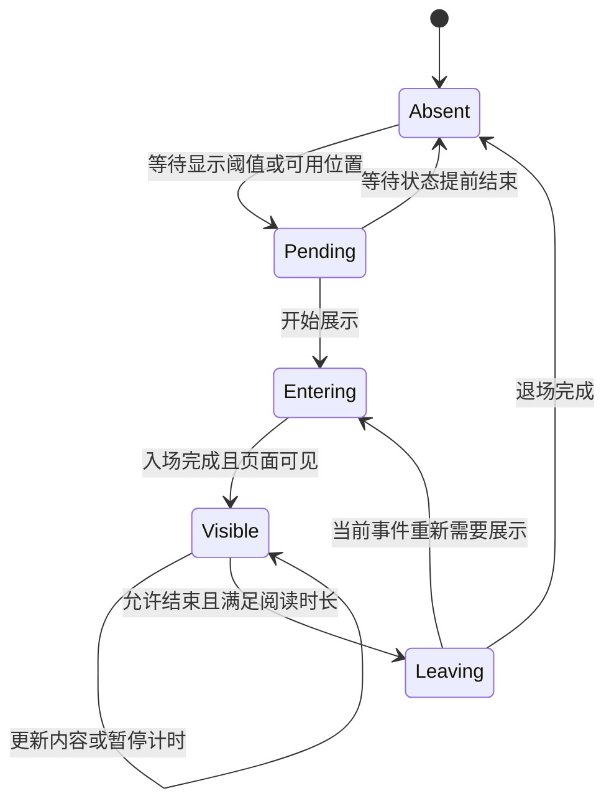

# 应用内提示的展示时序与布局方案

Riffet 应用内需要阅读的自动提示一旦出现，至少完整可见 1500ms。已有的更长时长继续保留，仍然存在的问题持续显示。短暂通知采用浮层，避免改变消息列表和输入框的布局；需要持续处理的问题留在其所属区域。

最短时长只约束展示。业务完成、连接恢复、输入可用性和权限变化立即生效。用户主动关闭、执行提示中的操作或离开页面时立即响应。

## 适用范围

规则覆盖 macOS、Web、iOS 和 Android 的应用内横幅、Toast、Snackbar、操作结果和复制反馈。正常操作不因此增加成功通知。

Tooltip、菜单、弹窗、按压与焦点反馈继续由用户交互控制。任务进度、用量数值和会话状态徽标保持实时，不为每次数值变化停留 1500ms。系统通知和 Android 系统 Toast 沿用操作系统行为，应用内规则不承诺其显示时长。

正常会话启动、打开已有会话时的恢复和自动重连不产生独立 notice。各端复用已有会话状态展示，有标题或标签 loading 的入口继续使用，未提供额外状态的入口保持静默。已有 loading 沿用自身的延迟出现机制，完成后立即结束，不保留“刚才”或追加“已恢复”。后端通过已有 phase、connection 发布这些状态，不重复发送进度 notice；各端不按文案过滤，也不屏蔽所有 info。明确失败、连接冲突、历史读取失败及需要用户处理的问题仍由其所属区域显示，错误优先于启动 loading。

进度和等待不是提示。加载模型列表、创建会话、上传附件、保存设置、同步交互、排队、重试、切换模型这类状态，只由正在等待的控件自己表达：模型选择器、发送按钮、标题旁的状态、附件标签、设置行。它们不进入横幅、Toast、浮层或输入框内的提示行，结束后也不留下“已完成”或“刚才”。后端 `noticeLevel: 'info'` 表示进度或事实，各端放在标题旁的信息入口（macOS 信息按钮、Web 标题信息面板），不做横幅；`warning`、`error` 才是需要处理的问题。

1500ms 是最低阅读时间，不是自动消失的统一时间，也不作为新增设置开放。

## 当前接入位置

| 位置 | 当前机制 | 需要处理的问题 |
| --- | --- | --- |
| macOS `ConversationView.swift` 的 `persistentNoticeBars` | 历史警告、后端 notice 条件渲染，占用消息区高度 | 状态清空就移除，缺少最短停留 |
| macOS `ConversationComponents.swift` 的 `CopyButton` | 1200ms 后复原图标 | 不足 1500ms，重复操作的旧任务会提前复原新反馈 |
| Web `Composer.tsx` 的 `feedback` | `useHeld` 保留退场内容，`Collapse` 与 `followContentHeight` 平滑高度 | 动画不提供最短阅读时间，调用方撤掉内容就开始收起 |
| Web `lib/toast.ts` | 成功 2800ms、信息 3500ms、错误 6500ms；带操作默认至少 6000ms | 自定义 duration 无下限；第五条直接挤走最早一条；重复通知重新挂载 |
| Web `Markdown.tsx`、`SessionInfo.tsx` 的复制反馈 | 1400ms 后复原 | 不足 1500ms，重复操作存在旧定时器竞态 |
| Android `SessionScreen.kt` 的 `SessionBanners` | 由实时 status 生成，经 `Reveal` 展开收起 | `Reveal` 只保留退场值，没有最短停留 |
| Android `RiffetSnackbar.kt` | 应用外壳持有队列，Material 管理时长和无障碍行为 | 复用队列，接入前核对当前依赖的时长及取消行为 |
| iOS `ConversationView.swift` 的 `connectionNotice` | 条件插入 `meta.connection` 行，内容直接读取实时 status | 状态消失即移除行，缺少独立展示状态 |

这些入口的源状态继续实时更新。最短停留接在持续挂载的提示所有者上；仅在 `Notice`、`NoticeBar` 内增加定时器无法阻止父视图提前卸载。

## 时长规则

| 提示类型 | 出现 | 自动消失 |
| --- | --- | --- |
| 成功与一般操作结果 | 操作有结果时出现 | 按现有默认时长，最低 1500ms |
| 警告与错误 | 明确异常立即出现 | 异常仍存在则持续显示；结束后满足最低时长再退场 |
| 会话启动、自动重连状态 | 复用各端已有状态展示及其延迟出现机制 | 状态结束即停止，不适用最低阅读时间 |
| 加载、创建、上传、保存等等待 | 不作为提示，由等待中的控件显示 loading | 完成即结束，不保留 |
| 复制等控件内反馈 | 操作成功后立即出现 | 最后一次成功操作之后至少 1500ms |
| 带操作的通知 | 沿用现有入口 | 维持现有较长默认值；自定义时长不能低于现有操作时长下限 |

以提示的入场完成、所属页面在前台且未被应用内覆盖为开始计时的条件。入队、请求发出、组件首次挂载和数据到达都不算开始阅读。退场动画在满足时长之后开始，动画长度沿用各端已有参数。

页面留在后台或被应用内全屏内容覆盖时暂停阅读计时，返回后继续剩余时间。Web Toast 现有的悬停、键盘焦点和详情阅读暂停行为保留。计时使用平台单调时间，避免系统时间调整影响截止判断。

当无障碍偏好要求延长时长时，采用更长的时长；减少动画不会缩短阅读时间。

## 提示身份和内容更新

一次提示对应一个事件，例如某次连接中断、某次复制成功、某次保存失败。其身份包含所属服务端、项目或会话，以及事件标识，不能只按文案区分。

已有事件 ID 直接复用。没有 ID 的条件提示，由所有者按来源位置和本地发生次数生成身份；完全退场后再次出现才增加次数。同类问题在保留或退场期间复发，沿用当前事件，立即恢复为异常状态，并从复发时重新确保至少 1500ms 的可见时间。后端无 ID 的 notice 正文发生变化时视为新事件，同文案快照不产生新身份。已有明确关联信息的恢复与进度更新仍归原事件，不根据文字猜测关联。

同一事件的恢复和进度更新在原位置完成，不重播入场动画。1500ms 约束事件的可见时间，不要求每个进度数字和每一版措辞各占 1500ms。独立的新错误有独立身份，不能用替换正文的方式清掉尚未读完的旧事件。

不同来源沿用现有分组并列显示。单个来源出现独立新问题时，旧内容在原区域停留到满足最低时长，新问题立即并列呈现；普通操作结果则进入现有通知队列。提示所有者按当前可见事件分别保存时序，旧事件退场后释放，不形成可回看的历史列表。

重复的状态快照不续期。用户再次完成复制、再次触发同一种操作结果时，才按新一次事件续期。现有无操作 Toast 可以合并相同来源、相同正文和详情的重复事件，并保留原 id；带撤销等操作的通知继续独立，避免把不同操作合并。

提示的文字保留和操作可用性分别计算。保留内容只保存展示数据，不把旧 ReactNode 或带回调的视图整体冻结。任何动作都在执行时校验最新所属对象和业务状态，不能执行保留内容中的旧回调。

| 源状态变化 | 保留期间的显示 | 操作 |
| --- | --- | --- |
| 有明确连接恢复证据 | 原事件转成过去发生的事实，并标记“已恢复” | 立即移除重试操作 |
| 创建、加载明确成功 | 同一位置改为对应的完成结果，停止转圈 | 立即解除真实业务限制 |
| 后端 notice 消失，但没有恢复证据 | 保留原内容到满足最低时长，不推断成功 | 移除已失效的操作 |
| 问题持续存在 | 继续显示当前问题 | 按最新状态决定可用操作 |
| 提示尚未退出时同类问题复发 | 沿用当前事件，立即显示当前异常 | 从复发重新确保最低阅读时间 |
| 提示已完全退出后同类问题再发生 | 开始新的事件 | 重新计算最低阅读时间 |

恢复不会附加第二条成功 Toast。用户无需关闭一条已经恢复的告警才能继续操作。

## 展示状态和计时

提示所有者按事件保存当前作用域、事件身份、保留内容、累计可见时间和自动化代次。已有的正文、严重程度和操作模型继续复用，不增加持久化提示记录或服务端协议字段。

`Pending` 中提前结束可以直接取消的只有可省略的等待状态。已经入队的独立操作结果仍等待展示，不能因业务状态随后变化而静默丢弃。

自动退场需要同时满足：提示已不需要持续显示，以及累计可见时间达到适用时长。短暂通知到达自身展示时长后即可结束；条件告警必须另有源条件结束或由用户关闭。作用域切换、手动关闭和用户执行操作走立即结束路径。

每次安排任务都捕获作用域、事件身份和任务代次。唤醒时重新读取当前状态，三者匹配才更新展示；定时器只负责唤醒，不能直接把提示设为空。相同事件续期或退场取消时，旧任务失效。

例如：警告完成入场后 100ms 恢复，则立即撤掉重试按钮、显示恢复状态，再保留至少 1400ms 后开始退场。警告持续 5 秒才恢复，则恢复后可以直接开始退场。后台暂停 10 秒不会消耗剩余阅读时间。

## 布局与消息位置

短暂通知复用现有浮层的样式和布局方式。macOS 已有浮在消息上方的书签提示，Web 已有固定定位 Toaster，Android 已有外壳 Snackbar。临时会话 notice 可以复用这些布局方式，不为它预留永久空白行，也不另设一套颜色、字号和圆角。

各提示入口预先确定展示位置，不因“存在超过几秒”从浮层搬进消息流。这样同一事件只进入、退出各一次，不因时长触发第二次布局变化。

历史读取失败、会话连接冲突、权限或配置导致的持续阻断，继续在对应区域显示。展开、收起和内容换行复用现有尺寸过渡；阅读时保持当前消息及其相对位置，跟随最新消息时保持底部跟随。提示本身不抢焦点、不滚动到末尾。

浮层仅自身区域响应指针，不铺设拦截整个消息区的背景。正文不以全局固定高度截断，长详情复用已有详情入口；小窗口下复用各端现有宽度限制和安全区。

一次问题只保留一个完整说明及操作，沿用现有连接、历史和 notice 的去重逻辑。消息发送与任务恢复问题继续遵循持久 Outbox 的恢复方案，不搬到全局浮层。

## Toast 和 Snackbar 队列

Web 最多四条同时可见，并受可用视口空间限制；放不下的继续等待。入场前按现有宽度与字体测量所需空间，摘要和操作区域完整落在视口内才计阅读时间，长正文沿用已有预览与详情入口。等待项不计阅读时间。取消直接 `.slice(-3)` 删除早到项的做法，前一项正常退出或用户主动结束后再展示等待项。新的普通提示不能缩短已展示项的时长。

阻断性故障在其所属页立即呈现，不等待普通 Toast 队列；同一故障不再重复排一条 Toast。普通结果按入队顺序展示，同类重复按前述身份规则合并。

Android 继续使用 Material 的 `SnackbarHostState` 队列，不在其外部叠加第二套排队。实施时先查当前版本的源码与类型定义，核对默认时长、无障碍延长、任务取消和宿主可见性，再决定需要补充的最小适配。

队列属于展示宿主的生命周期。会话或页面绑定的提示随其作用域离开而取消；已有全局通知和撤销操作按原有归属保留。仅临时遮挡或进入后台时暂停，不作为作用域销毁。提示不新增历史列表、磁盘持久化或跨设备同步。

## 新建 Codex 会话的告警判断

macOS 当前存在 `transcript == unavailable`、已有 nativeSessionId 且时间线为空时显示找不到记录文件的分支。仅凭这些条件无法区分新建会话尚未产生记录和旧会话记录确实丢失。闪过的黄色条是否来自这里，需要在创建路径复现时确认。

历史状态为 loading 或 ready 时，不能用上述兜底判断覆盖成错误。新建会话尚未产生历史是正常空状态。只有显式 history error，或对预期存在历史的旧会话完成读取并明确失败时，才出现历史告警。优先复用已有会话、历史与运行状态，不新增“为了提示计时”的后端标志。

正常启动和自动恢复采用现有中性进度样式，黄色用于需要用户注意的问题。真正的故障立即呈现，并遵循最低阅读时间；不能把所有黄色提示统一延迟来掩盖误报。

## 跨端实现边界

原生三端复用 `apps/mobile/client` 中纯展示规则的既有组织方式。增加小型时序规则，输入当前事件、可见性、单调时间和用户动作，输出展示阶段与下一次唤醒时间；Swift 和 Compose 各自持有展示状态与自动化。共享层不引用 SwiftUI、Compose、网络或磁盘。

Web 在现有提示所有者旁使用等价的 TypeScript 规则和计时适配。保持两种语言的事件语义与常量一致，不为同步一个常量引入跨语言代码生成流程。

| 端 | 接入位置 | 保留的现有职责 |
| --- | --- | --- |
| macOS | `ConversationView` 的阅读提示和横幅所有者；`CopyButton` 的局部反馈 | `NoticeBar` 负责外观，`ChatMotion` 与消息列表负责布局过渡和锚点 |
| Web | `NativeSession` 的提示投影、`Composer.feedback`、创建等待区域、Toast store 和复制反馈 | `useHeld` 负责退场内容，`Collapse` 负责尺寸动画，Toaster 负责浮层 |
| Android | `SessionBanners`、页面与 Picker 的提示所有者、`RiffetSnackbar`、复制反馈 | `Reveal` 保留退场内容并禁用过期交互，Material 管理 Snackbar |
| iOS | `connectionNotice` 对应的展示投影与行生命周期、页面操作反馈 | Swift 列表负责消息锚点，动作读取最新 Workbench 状态 |

不改变 `SessionStore.status`、`ConversationStatus` 和后端状态发布时间。通用 `Collapse`、`Reveal`、`useLingering` 保留原语义，终端抽屉、附件和菜单不受提示时长规则影响。

## 文案和无障碍

新增通用用户可见字符串限于下表；其余复用对应功能已有的正文、结果和操作文案。

| 字符串 | 缺少它会造成的误解 |
| --- | --- |
| 已恢复 | 用户会把保留中的旧告警理解成当前仍然异常；仅用于有明确恢复证据的事件 |

已恢复或仅为历史保留的提示不再维持警告色和失效操作。读屏对新事件和实质恢复各播报一次，不因轮询、重新计时和相同快照重复播报。退场内容沿用现有禁用交互与无障碍处理；手动关闭不移动焦点到无关位置。

## 实施顺序和验收

先完成 macOS 创建 Codex 会话的复现与告警来源确认，修正初始化误报，接入最短停留和临时提示浮层。随后接入 Web 提示区域、Toast 与复制反馈，再通过原生共享规则接入 iOS、Android 及其余页面提示。每端交付前搜索条件渲染、自动清空与局部定时器，核对没有绕过规则的应用内自动反馈。

| 手动验收场景 | 预期结果 |
| --- | --- |
| 快速新建 Codex 会话，历史尚未产生 | 不出现历史缺失误报；消息列表和输入框不被临时通知推动 |
| 等待状态在延迟出现阈值前完成 | 不出现额外提示 |
| 提示完成入场后 100ms 条件结束 | 事件仍可见至累计 1500ms；状态与操作立即更新 |
| 异常持续超过 1500ms | 持续展示，不因达到下限自动关闭 |
| 提示入场期间条件结束 | 展示结果或历史事件，并在入场完成后计足阅读时间 |
| 连续两次复制，相隔 1000ms | 从第二次成功起至少再显示 1500ms，旧任务不提前复原 |
| 连续产生五条不同 Web Toast | 每条获得自身完整展示时间，前四条不被直接挤掉 |
| 普通通知排队时发生阻断故障 | 故障在所属区域立即可见，不等待队列 |
| 同一告警频繁收到相同状态快照 | 不重新入场，不无限续期，不重复读屏播报 |
| 断开、恢复、再次断开均发生在同一提示退出前 | 原位反映当前异常，并从复发起确保 1500ms，不排队等待旧状态 |
| 连接恢复后用户点击原操作位置 | 已失效操作不能触发，输入可用性反映最新状态 |
| 展示中切换会话、服务端或页面 | 旧作用域的提示和任务清理，不污染新页面 |
| 展示 500ms 后进入后台，再返回 | 至少保留尚未读完的 1000ms |
| 用户主动关闭、操作或离开 | 立即响应，不受 1500ms 限制 |
| 长正文、窄窗口、减少动画与读屏 | 内容可访问，消息位置稳定，阅读时间不缩短 |
| 窄窗口和较大字体下连续产生四条长 Toast | 只有能完整显示预览和操作的项进入展示，其余排队且不计时 |

验证复用类型检查、受影响端编译和上述实际界面场景，不新增 UI 展示、文案、颜色、动画或快照测试。实现时按实际改动运行必要检查，不重复整套平台构建。
